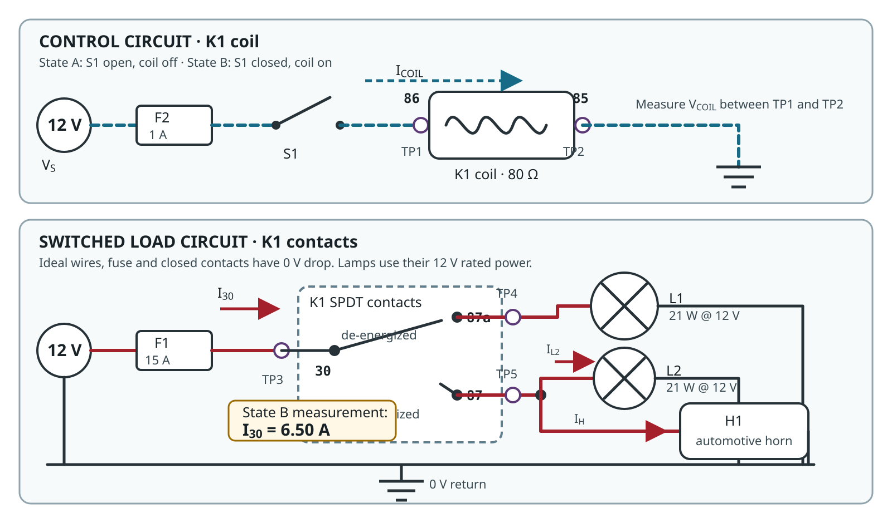
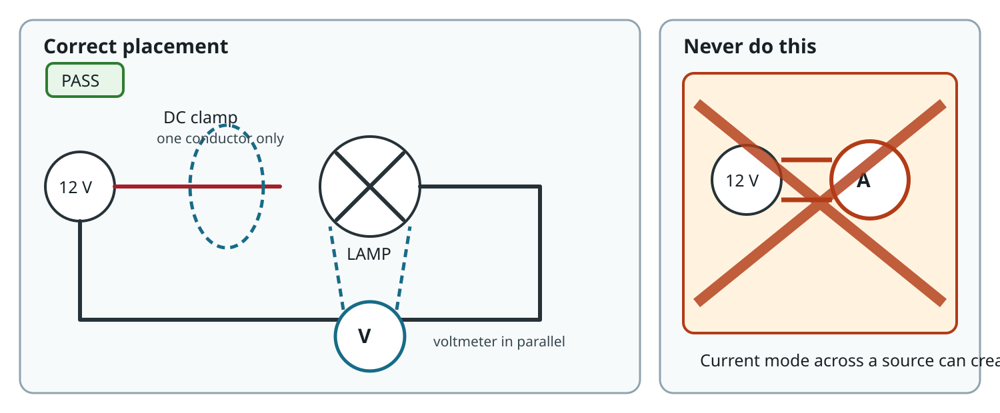
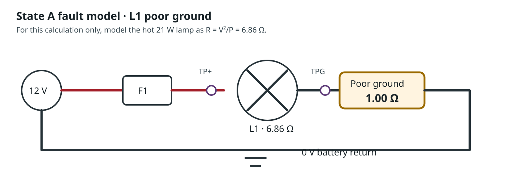

::: {.student-fields}

Name

Date

Group

:::

## Purpose

Use a five-pin automotive relay to analyse two separate circuits: the coil
control circuit and the switched load circuit. Apply Kirchhoff's voltage law
(KVL), Kirchhoff's current law (KCL), power relationships, and a voltage-drop
test.

::: {.safety-box}
**Analysis first.** Complete the investigation from the diagram. A physical
trainer uses a teacher-approved, current-limited or fused 12 V source. Never
connect a relay coil, lamp, or horn directly to a BeagleBone GPIO. Do not use
resistance or continuity mode on an energized circuit.
:::

## Circuit information

- Both 12 V source symbols represent fused branches of the same nominal 12.0 V
  system and are repeated only to keep the two circuits visually separate.
- Relay `K1`: terminals `85` and `86` are the 80.0 Ω coil; `30` is common;
  `87a` is normally closed; `87` is normally open.
- `L1` and `L2`: each rated 21.0 W at 12.0 V.
- In **State B**, the measured current through terminal 30 is 6.50 A.
- Treat wires, intact fuses, and closed contacts as ideal unless a fault is
  stated. Treat the horn as a steady 12 V load for the calculation.

## Part 1 — Read the relay states

Complete the table before calculating.

| Condition | Coil energized? | Connected contact | Loads that operate |
|---|---|---|---|
| State A: S1 open |  |  |  |
| State B: S1 closed |  |  |  |

::: {.question}
**1.** Trace the complete conventional-current path in State A. Start at the
positive source and name every numbered relay terminal used.

:::

::: {.question}
**2.** Trace the coil-current path in State B, then trace both load-current
branches. Keep the coil and contact circuits separate.

:::

## Part 2 — Coil circuit: KVL and power

::: {.equation-box}
Use $V=IR$, $P=VI$, and KVL: the algebraic sum of voltage changes around a
complete loop is zero.
:::

::: {.question}
**3.** Calculate coil current and coil power in State B. Show units.

:::

::: {.question}
**4.** Write a KVL equation for the energized coil loop. State the expected
voltage from TP1 to TP2 and the expected voltage across each ideal closed switch
or fuse.

:::

## Part 3 — Load circuit: KCL and power

::: {.question}
**5.** Calculate the rated current of each 21.0 W lamp at 12.0 V.

:::

::: {.question}
**6.** In State A, calculate the terminal-30 current. Write a KVL equation for
the loop through F1, terminal 30, terminal 87a, and L1.

:::

::: {.question}
**7.** In State B, use KCL at the branch after terminal 87 to calculate horn
current. Then calculate the horn's operating power at 12.0 V.

:::

::: {.question}
**8.** If the control and load branches share the same battery, calculate total
battery current and power in State B. Include the coil.

:::

## Part 4 — Place the meters safely

::: {.question}
**9.** Write where you would place the red and black voltage probes to test
voltage across L2 in State B. Then state which single conductor a DC clamp would
surround to measure horn current.

:::

## Part 5 — Poor-ground fault

For this calculation only, model the hot resistance of L1 from its rating:
$R_{L1}=V^2/P$. A 1.00 Ω unwanted ground resistance is then added in series.
Real incandescent resistance changes strongly with temperature, so this is a
simplified steady-state model.

::: {.question}
**10.** Calculate the modelled hot resistance of L1, the new circuit current,
the voltage across L1, and the unwanted voltage drop from TPG to battery return.

:::

::: {.question}
**11.** Calculate lamp power with the fault. Compare it with 21.0 W and predict
the visible effect.

:::

::: {.question}
**12.** A technician measures 12.0 V at terminal 30, nearly 12.0 V at terminal
87a, but 1.53 V between the lamp ground and battery negative while L1 is on.
Identify the most supported fault location and the next power-off inspection.

:::

## Final check

- [ ] I kept the coil and contact circuits separate.
- [ ] Every KVL equation describes a complete loop.
- [ ] Every KCL equation describes a named node.
- [ ] Every number includes a unit.
- [ ] I did not propose current mode across a voltage source.

::: {.source-note}
**Reference note.** Original classroom circuit and questions, informed by
Schultz, *Grob's Basic Electronics*, 12th ed., Ch. 9; TE Connectivity's
[Micro Relay A/VFMA data sheet](https://www.te.com/content/dam/te-com/documents/automotive/global/ENG_DS_V23074-X0000-A001_0615.pdf);
and TI's [inductive-load driver guidance](https://www.ti.com/lit/an/slvae59a/slvae59a.pdf).
Verify the markings and data sheet for the actual relay before wiring.
:::
