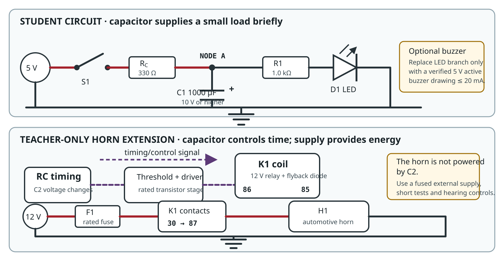

::: {.student-fields}

Name

Date

Group

:::

## Investigation question

Can an ordinary classroom capacitor supply enough energy to operate an
automotive horn? How can a small capacitor still control when a horn operates?

::: {.safety-box}
Students build only the protected **5.0 V LED circuit** or a teacher-verified
low-current active buzzer version. Observe capacitor polarity and use a capacitor
rated at 10 V or higher. Discharge through a suitable load before handling. Do
not short a charged capacitor. The 12 V automotive horn is a fused,
teacher-operated extension only.
:::

## Two different jobs for a capacitor

1. **Energy job:** the capacitor supplies a small load briefly while its voltage
   falls.
2. **Timing job:** the capacitor voltage changes with time and a driver uses that
   signal to control a separately powered load.

## Part 1  -  Build and measure the 5 V circuit

### Parts

| Item | Starting value or requirement |
|---|---|
| Protected source | 5.0 V, current limited |
| Charging resistor $R_C$ | 330 Ω |
| LED resistor R1 | 1.0 kΩ |
| C1 | 1000 µF, polarized, rated 10 V or higher |
| D1 | Red LED, polarity checked |
| Optional substitute | Verified 5 V active buzzer drawing no more than 20 mA |

### Safe sequence

1. Build with power off. Keep the LED branch for the core investigation.
2. Ask for a polarity and node check before connecting 5 V.
3. Put the multimeter leads in `COM` and `V/Ω`. Select DC voltage.
4. Measure C1 voltage from Node A to 0 V. Do not use physical current mode.
5. Close S1 until C1 is near 5.0 V. Release S1 and record C1 voltage as it
   discharges through the load branch.
6. Calculate LED current from the voltage across R1: $I_{LED}=V_{R1}/R_1$.
7. Stop for heat, smell, a bulging capacitor, unexpected polarity, or supply
   current limiting.

### Discharge observations

| Time after release (s) | $V_C$ (V) | $V_{R1}$ (V) | calculated $I_{LED}$ (mA) | LED or buzzer observation |
|---:|---:|---:|---:|---|
| 0 |  |  |  |  |
| 1 |  |  |  |  |
| 2 |  |  |  |  |
| 3 |  |  |  |  |
| 5 |  |  |  |  |
| 10 |  |  |  |  |

## Part 2  -  KVL, KCL, and capacitor relationships

::: {.equation-box}
$$E_C=\frac{1}{2}CV^2 \qquad i_C=C\frac{dv_C}{dt}
$$

For an approximately constant load current over a limited voltage change:

$$C\approx\frac{I\Delta t}{\Delta V}
$$
:::

::: {.question}
**1.** While C1 discharges through the LED branch, write a KVL equation using
$V_C$, $V_{R1}$, and $V_{LED}$.

:::

::: {.question}
**2.** While S1 is closed and C1 is charging, write a KCL equation at Node A
using charging-resistor current, capacitor current, and LED-branch current.

:::

::: {.question}
**3.** Calculate the maximum ideal energy stored in 1000 µF at 5.0 V.

:::

::: {.question}
**4.** A verified active buzzer draws approximately 12 mA and operates from
5.0 V down to 3.0 V. Estimate how long an ideal 1000 µF capacitor could support
that current over the 2.0 V drop. State why the real sound may differ.

:::

::: {.question}
**5.** Use one row of your measurement table to check
$V_C\approx V_{R1}+V_{LED}$. Show the measured difference.

:::

## Part 3  -  Automotive horn estimate

For an engineering estimate, assume an automotive horn draws a constant 5.0 A.
Suppose it must remain useful for 0.250 s while supply voltage falls no more than
4.0 V.

::: {.question}
**6.** Estimate the required capacitance using
$C\approx I\Delta t/\Delta V$. Convert the answer to microfarads.

:::

::: {.question}
**7.** Calculate the ideal energy stored by that capacitor at 12.0 V. Compare its
capacitance with the 1000 µF student capacitor.

:::

::: {.question}
**8.** Explain why the lower diagram uses the capacitor as a timing signal while
the fused 12 V supply powers the horn. Identify the parts that keep high load
current out of the timing circuit.

:::

## Final evidence

- [ ] Circuit polarity was checked before power.
- [ ] All measurements were made in DC voltage mode.
- [ ] KVL was checked with measured voltage values.
- [ ] KCL names the charging, capacitor, and load currents at Node A.
- [ ] The automotive answer is labelled as an estimate based on assumed current.
- [ ] The capacitor controls timing; it is not presented as the horn's practical
      energy source.
