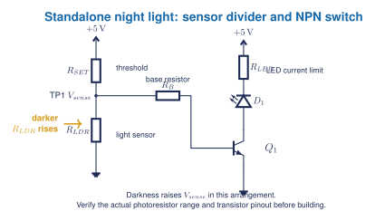

## Challenge

Make a protected low-voltage light turn on in darkness and off in light. Prove the threshold, electrical safety, and repeatability with calculations and measurements.

{fig-alt="A photoresistor divider drives an NPN transistor and resistor-limited LED." width="100%"}

| Minimum | Proficient | Extension |
|---|---|---|
| Standalone photoresistor/transistor LED circuit | BeagleBone reads an approved sensor and applies threshold plus hysteresis | Adjustable threshold and timestamped logging/graphing |

## Parts to confirm

- exact light sensor or module;
- LED, series resistor, and protected supply;
- transistor/MOSFET/comparator and its pinout;
- BeagleBone model and verified pins, if used;
- multimeter and breadboard.

::: {.callout-warning title="Electrical limit"}
BeagleBone Black GPIO is 3.3 V and its analogue inputs are 1.8 V maximum. A 5 V sensor signal or pull-up must not reach either input. Prefer a verified 3.3 V digital sensor or comparator output. Direct ADC use requires a calculated, measured, teacher-approved divider.
:::

## Required tests

1. Measure sensor supply and worst-case output before board connection.
2. Repeat three bright-to-dark and three dark-to-bright trials.
3. Hold the light close to the threshold and check for chatter.
4. Disconnect the sensor and observe the planned safe response.
5. Measure LED-resistor voltage and calculate current.

## Hand in

Schematic, part documentation, calculations, voltage table, repeated trials, one diagnosed fault, relevant code/log evidence, conclusion, and portfolio reflection.

[Open the complete project pathway](../../../tej3-4/capstone/projects/automatic-night-light.qmd).
