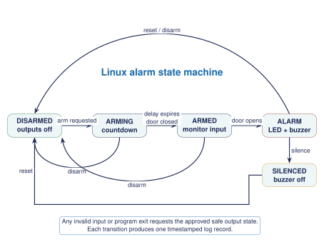

## Challenge

Use Linux and Python to read a protected door/pushbutton input and control status outputs through a clear, testable state machine.

{fig-alt="The alarm moves through DISARMED, ARMING, ARMED, ALARM, and SILENCED states with reset and safe-state paths." width="100%"}

| Minimum | Proficient | Extension |
|---|---|---|
| Switch input changes a resistor-limited status LED | DISARMED, ARMING, ARMED, ALARM, and SILENCED states; buzzer and event log | Relay-controlled lamp, second sensor, or shared supervised horn demonstration |

## Core evidence

- completed I/O table and state-transition table;
- switch open/closed voltage measurements;
- LED resistor and driver calculations;
- three state-machine trials;
- timestamped event-log excerpt;
- safe shutdown test;
- one diagnosed fault and retest.

::: {.callout-warning title="Load boundary"}
GPIO never directly powers a buzzer, relay, lamp, or horn. Use a rated driver. Inductive relay coils require flyback protection. The real horn uses a separate fused supply at the shared teacher station.
:::

## Build gates

1. Test the state machine with simulated input.
2. Read and print the switch with outputs disconnected.
3. Test the LED, buzzer driver, and relay/lamp separately.
4. Integrate only after a power-off inspection.
5. Confirm outputs switch off on normal exit, `Ctrl+C`, and a prepared error.

[Open the complete project pathway](../../../tej3-4/capstone/projects/linux-alarm.qmd).
