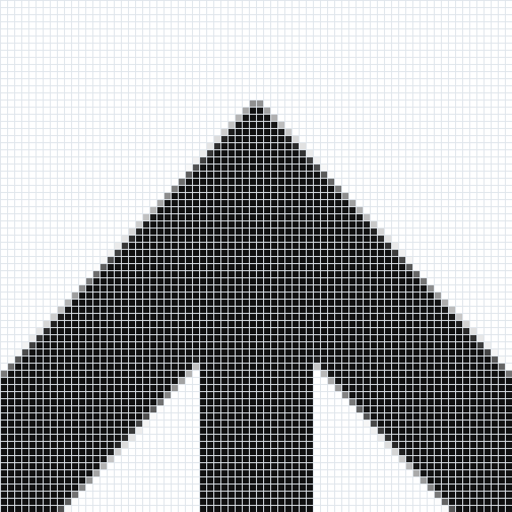
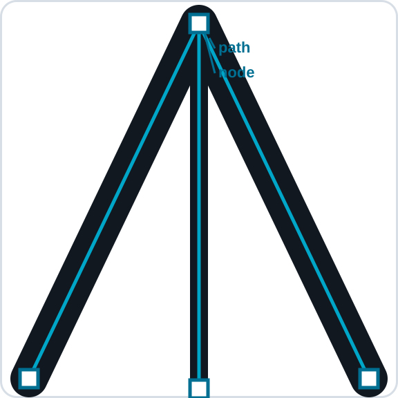

## Learning goals

By the end of this lesson:

- I can tell the difference between a raster image and a vector image.
- I can zoom in and find pixels in a PNG and paths in an SVG.
- I can choose a useful file type for a job.
- I can explain how a machine can follow an SVG path.

## Why this is useful

The wrong file can look blurry or behave badly in another program. Knowing how the file works helps you choose the right image for a screen, an engraving, or a cut line. It also helps you send clear instructions to tools such as a laser cutter, vinyl cutter, embroidery machine, or CNC router.

## Two ways to describe an image

A **raster** image is made from a grid of tiny squares called pixels. Raster images work well for photos, painted textures, and shading. A raster image can look blocky when it is made too large.

Each pixel stores one small piece of the image.

A **vector** image is made from shapes and paths. Its points, curves, fills, and lines can be edited. It stays sharp when it is made larger or smaller. Vector files are useful for logos, diagrams, score lines, and cut lines.

## Same logo, two different files

At normal size, the PNG and SVG versions of this logo look almost the same. The difference becomes clear when you zoom in.

::: {.columns}
::: {.column width="50%"}
### PNG: a grid of pixels

The PNG stores the logo as a grid of coloured squares. Those squares are called **pixels**.

{fig-alt="A close view of the PNG logo showing large square pixels along a diagonal edge"}
:::

::: {.column width="50%"}
### SVG: shapes and paths

The SVG stores the logo as shapes and paths. The small points on a path are called **nodes**. Move a node to change the shape.

{fig-alt="A close view of a smooth SVG edge with a blue vector path and editable square nodes"}
:::
:::

::: {.callout-tip title="Try it"}
Open the PNG and SVG in your design program. Zoom in as far as you can. Look for square pixels in the PNG. Select the SVG with a path-selection tool and look for nodes.
:::

## What a machine sees

A **machine path** is the route that a tool follows. A laser, blade, pen, needle, or router can use vector geometry to plan that route.

| File | What it stores | A good use |
|---|---|---|
| PNG | A grid of pixels | Photos, shading, websites, and laser engraving |
| SVG | Shapes, paths, and nodes | Laser cutting or scoring, vinyl cutting, pen plotting, and CNC paths |

An embroidery design can begin with an SVG because its clean shapes are easy to trace and size. Embroidery software must then turn those shapes into stitches and save a machine file such as DST or PES. The embroidery machine follows the stitch file, not usually the SVG itself.

## Why SVG matters

SVG is a common vector file type. It can store the page size, paths, groups, fills, and lines. It can move between many programs and gives fabrication software geometry it can turn into machine paths. Always check:

- document units are millimetres when physical size matters;
- a known rectangle measures correctly after export and import;
- text is available in the destination environment or converted to paths in a copy;
- the software distinguishes filled artwork from vector paths;
- repeated or overlapping cut lines have been removed.

## Sort by intended operation

- **Raster image:** use when engraved tone or photographic detail is intentional.
- **Filled vector shape:** useful for clean engraved artwork.
- **Open or closed vector path:** useful for scoring or cutting when the machine workflow recognizes it.

Make the same symbol in three forms: a low-quality raster image, a filled vector shape, and an outline path. Make each one larger. Check the edges. Decide how a laser program may read each one.

::: {.ter-curriculum-relevance}
**Design curriculum:** Complete this lesson after [Photopea Lesson 3 — Combine the Logo and Nameplate](../logo-design/03-combine-logo-nameplate.qmd). It supports **TGJ2O**, **TDJ2O**, and **TIJ1O** work with images, file types, design communication, and digital making.
:::

## Summary

PNG images are made from pixels. They work well for photos, shading, and screens, but their edges can become blocky when enlarged. SVG images are made from editable shapes and paths, so they stay sharp. Fabrication software can turn those paths into routes for cutting, scoring, plotting, routing, or creating embroidery stitches.

Next: use your design in a short [2D Animation with Pencil2D](05-animation-ui-ux.qmd).
