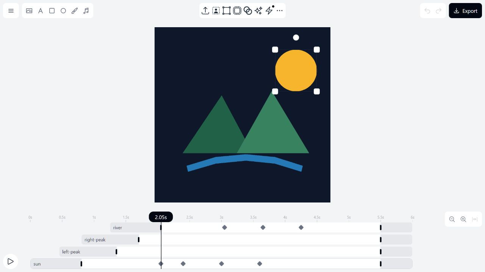
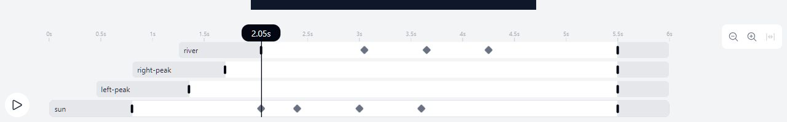
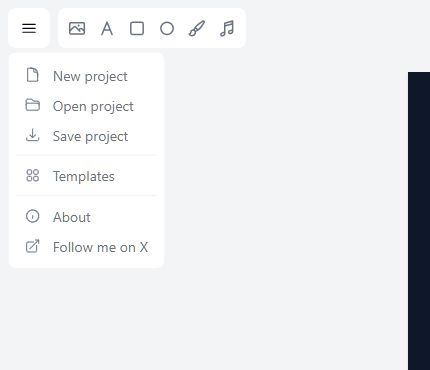
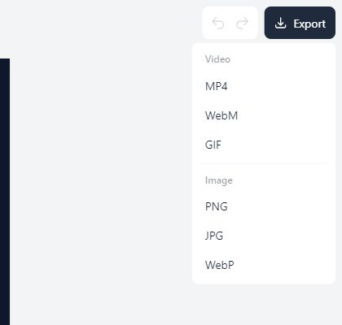
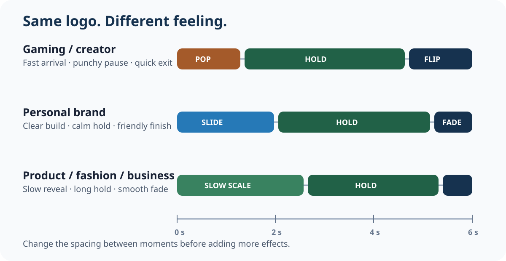

You already designed a logo. **Do not make another logo.** Your job is to make the existing logo move in a way that fits the brand.

::: {.callout-important title="Four class periods"}
Your final animation is due **at the end of Day 4**. Most of your time should be spent making, testing, and improving.
:::

## Class materials

[Open the project-launch slides](https://docs.google.com/presentation/d/1o2W4UskTUljoCi4y4d5t0GpXlWVc1w9QJXwY6u-ck3M/edit?usp=drivesdk){.btn .btn-outline-primary}
[Make a copy of the Google Docs workspace](https://docs.google.com/document/d/10w0DbQ5fCOVRLjd0jbYHOhSq1swqOBaIixB52jIvPCo/copy){.btn .btn-primary}
[Watch the animated example](#see-a-complete-example){.btn .btn-outline-primary}
[Download the printable handout](../../assets/animate-your-logo/animate-your-logo-handout.pdf){.btn .btn-outline-secondary}

If the Google Docs link asks for access, use the printable handout and tell your teacher. The teacher must finish the school-account sharing setup before assigning the Drive copy.

## Learning goals

- I can make intentional motion choices for an audience and emotion.
- I can use a timeline, presets, and keyframes to control timing.
- I can test an animation and make one visible improvement.
- I can save an editable project and export a final file that reopens correctly.

## Why this is useful

Animated logos appear in game intros, creator channels, product launches, fashion promos, business videos, and portfolio reels. Motion can make the same logo feel energetic, calm, playful, precise, or premium.

## Part 1: Beginner software warm-up

Complete this short practice before starting the full logo animation. The goal is to learn the controls, not make a masterpiece.

### Make a four-second practice animation

The pictures below are real screenshots from smooth.video. The editor may look slightly different on a Chromebook or a smaller screen, but the icons and diamonds are the same.

### Watch the real browser walkthrough

This 27-second screencast was recorded while completing the warm-up in the actual smooth.video editor. Pause it whenever you need to compare your screen with the example.

{fig-alt="Animated browser recording of the actual smooth.video editor. Eight captioned steps demonstrate selecting an object, opening Transform, adding a diamond keyframe, using Animate and Smooth easing, testing the timeline, saving the project, and choosing MP4 or GIF from Export."}

[Open the screencast at full size](../../assets/animate-your-logo/smooth-video-beginner-screencast.webp){.btn .btn-primary}

1. Open [smooth.video](https://smooth.video/).
2. Select the **picture icon** at the top left. This is **Add media**. Import one PNG: your logo, your initials, or one simple shape.
3. Click the object once on the canvas. Look for **white handles** around it and a highlighted row on the timeline.

{fig-alt="Screenshot of the real smooth.video editor with a mountain scene on the canvas. The sun is selected with white handles, and the sun row is highlighted on the timeline."}

4. Drag the **playhead** to `0:00`. Make the object small and place it near the left side of the canvas. This is the starting state.
5. Drag the playhead to `1:00`, then move the object into the centre. A **diamond** appears on its timeline row. That diamond is a keyframe.
6. Drag the playhead to `2:00`. Use the corner handles or **Transform** controls to make the object larger and rotate it slightly. A second diamond appears.
7. Drag the playhead to `3:00`. Change the object's position, opacity, or colour to create another keyframe.
8. Drag the playhead to `4:00` and create a clean final position.
9. Open the keyframe's easing control and choose **Smooth** for at least one movement.

{fig-alt="Close-up screenshot of the real smooth.video timeline. The playhead is at 2.05 seconds, and several diamond keyframes appear on the river and sun rows."}

10. Press the **space bar** or select **Play**. Watch the entire four seconds and fix any jumpy motion.
11. Select **Menu > Save project** and save the editable `.smooth` file.
12. Select **Export**, choose **MP4** or **GIF**, and reopen the downloaded file to confirm that it plays.

::: {.columns}
::: {.column width="50%"}
{fig-alt="Screenshot of the real smooth.video Menu with New project, Open project, and Save project options."}
:::

::: {.column width="50%"}
{fig-alt="Screenshot of the real smooth.video Export menu showing MP4, WebM, GIF, PNG, JPG, and WebP options."}
:::
:::

::: {.callout-tip title="How do I add a keyframe?"}
**Move the playhead first. Change the selected object second.** The change becomes a diamond-shaped keyframe automatically. If you want a keyframe without changing anything yet, click the **small hollow diamond** on the selected object's timeline row.
:::

| Time | What you do | What smooth.video records |
|---|---|---|
| `0:00` | Small object on the left | Starting state |
| `1:00` | Move it to the centre | First keyframe |
| `2:00` | Enlarge and rotate it | Second keyframe |
| `3:00` | Change position, opacity, or colour | Third keyframe |
| `4:00` | Create a clean final position | Final keyframe |

::: {.callout-warning title="No diamond appeared?"}
Confirm that the object is selected, move the playhead away from `0:00`, and then change its position, size, rotation, opacity, or colour. Changing the object only at `0:00` edits its starting state instead of adding a later keyframe.
:::

### Part 1 submission

Submit these items in the **Animation Software Warm-Up** assignment:

- the exported MP4 or GIF;
- the editable `.smooth` project file; and
- a private Classroom comment naming the easiest control and the hardest control.

Before submitting, confirm that the animation has at least four keyframes, at least two kinds of change, smooth playback, and an exported file that opens correctly.

## Part 2: Full logo animation

Make a **5–8 second animated intro** from the logo you already designed.

Choose one direction:

| Direction | Possible feeling | Good starting motions |
|---|---|---|
| Gaming / creator | energetic, bold, punchy | pop, bounce, quick slide, snap |
| Personal brand | confident, clear, authentic | smooth slide, scale, reveal, fade |
| Product / fashion / business | polished, deliberate, professional | slow scale, clean reveal, long hold, soft fade |

Your animation must have:

- at least **two intentional changes** across the logo or its parts, such as move, scale, rotate, fade, or reveal;
- timing that changes on purpose instead of making every moment the same speed;
- a complete **beginning, middle, and ending**;
- one visible improvement after testing or feedback; and
- motion that supports your chosen brand feeling.

{fig-alt="Three six-second timing plans compare punchy gaming or creator motion, clear personal-brand motion, and polished business motion."}

## Part 2 examples and guidance {#see-a-complete-example}

This six-second example reuses the four-part AA mountain logo from the earlier Photopea lesson. The sun rotates into place, the peaks arrive from opposite sides, the river slides in, the complete mark holds, and everything fades out.

<div class="ter-motion-example">
  
  
</div>

The first complete frame is not the end of the design. The hold gives people time to recognize the logo, and the fade creates a finished ending.

{fig-alt="Before-and-after comparison of the AA mountain animation. The left side shows parts entering; the right side shows the complete sun, peaks, and river."}

### Advanced example: grow a complete emblem from one mark

The Technology Commons example begins with the curved-arrow AA mark. The lighthouse rises from its centre stem, the arrow separates into the two lighthouse supports, the beams open, the roots grow, the leaves and waves expand, and the four hands grow outward with a slight rotation.

<div class="ter-motion-example ter-motion-example--commons">
  
  
</div>

::: {.callout-tip title="Could you build something similar in smooth.video?"}
**Yes.** The exact emblem is an advanced example, but it uses the same tools required for this assignment. smooth.video can import a layered PSD with each layer as its own timeline element, and it animates changes in position, scale, rotation, opacity, and timing.

Prepare the moving pieces first in Photopea or another vector editor. A flattened PNG cannot automatically split itself into two supports.

| Prepared element | Motion to build in smooth.video |
|---|---|
| Curved arrow: left and right halves | Begin aligned as one mark; move and rotate the halves into the support positions. |
| Lighthouse tower | Reveal or scale upward from the arrow's centre stem. |
| Light beams | Scale outward from the centre, then hold. |
| Roots | Reveal or scale downward without changing their horizontal centre. |
| Leaves and waves | Scale outward with slightly staggered timing. |
| Four hands | Use separate transparent layers; scale from the centre and add a small rotation. |

You do **not** need this many parts for full marks. A strong student version could use three to five prepared pieces and the same idea: one mark transforms, the secondary parts arrive in order, and the complete logo holds long enough to read. See the official [smooth.video logo-animation guide](https://smooth.video/logo-animation/) for its layered-PSD workflow.
:::

### Build this type of transformation in smooth.video

This walkthrough recreates the **idea** of the Technology Commons animation. Use your own logo parts and adjust the movement to fit your design.

::: {.callout-important title="Prepare the pieces before you animate"}
Open your logo in Photopea first. Put every part that needs different motion on its own named layer. For the split-arrow idea, make **arrow-left** and **arrow-right** separate layers but position them together so they look like one normal arrow at the beginning.

Save a layered PSD. When you open the PSD in smooth.video, each Photoshop layer becomes its own timeline element. A single flattened PNG cannot split into separate supports later.
:::

#### Suggested layers

Use only the parts your design needs. The full emblem could use:

- `arrow-left` and `arrow-right`;
- `lighthouse-tower`;
- `beam-left` and `beam-right`;
- `roots`;
- `leaves-left` and `leaves-right`;
- `waves-left` and `waves-right`; and
- one layer for each hand.

#### Step by step

1. **Open the project.** Open [smooth.video](https://smooth.video/), select **Menu > Open project** for an existing `.smooth` file, or use **Add media** to open your layered PSD.
2. **Set the scene.** Use **Scene settings** to choose the canvas size and background colour. A square canvas such as `1000 × 1000` is easy to preview and export.
3. **Check the timeline.** Confirm that every prepared layer has its own named row. Reopen the PSD in Photopea if two pieces that need different motion arrived as one element.
4. **Build the normal starting mark.** At `0.0 s`, place `arrow-left` and `arrow-right` together so the curved arrow looks complete. Keep both halves still until about `0.9 s`.
5. **Raise the lighthouse.** Select `lighthouse-tower`. Put the playhead near `0.9 s`, make the tower short and aligned with the arrow's centre stem, then move the playhead near `1.7 s` and set the tower to its finished height. smooth.video animates between the two states. A simple **Animate > In > Scale** entrance is an easier alternative.
6. **Split the arrow into supports.** Keep both arrow halves aligned until the tower is complete. At about `1.7 s`, set their starting positions. Move the playhead to about `2.5 s`, move the left half toward the left support and the right half toward the right support, then add a small opposite rotation to each half. Use **Transform** for exact position, scale, and rotation values.
7. **Open the beams.** Select each beam and use **Animate > In > Scale**. Stagger the left and right animation points slightly between `2.4 s` and `3.0 s` so the light spreads from the centre.
8. **Grow the roots straight down.** Keep the roots' horizontal position unchanged. Set a short or hidden state near `2.9 s`, then a full-height state near `3.5 s`. Check that the top of the roots remains centred under the lighthouse.
9. **Add leaves and waves.** Use **Scale**, **Slide**, or two custom transform points between `3.3 s` and `4.0 s`. Let the left and right pieces arrive a fraction of a second apart.
10. **Grow the hands from the centre.** Start each hand small and near the centre. Move the playhead forward, place it at its finished outer position, restore its full size, and add a small rotation. Stagger the four hands from about `3.9 s` to `5.9 s`.
11. **Hold the completed logo.** Leave the final emblem unchanged for at least `0.7 s`. The audience needs time to recognize it.
12. **Save and export.** Use **Menu > Save project** to keep the editable `.smooth` file. Use **Export** and choose MP4 or GIF, then reopen the exported file and watch the entire loop.

#### Suggested timing map

| Time | What happens |
|---|---|
| `0.0–0.9 s` | The complete curved-arrow mark holds. |
| `0.9–1.7 s` | The lighthouse grows from the arrow's centre stem. |
| `1.7–2.5 s` | The arrow halves separate and align with the two supports. |
| `2.4–3.5 s` | Beams open, then the centred roots grow downward. |
| `3.3–4.0 s` | Leaves and waves expand into place. |
| `3.9–5.9 s` | The hands grow from the centre and rotate into the outer ring. |
| `5.9–7.3 s` | The completed logo holds before the loop restarts. |

::: {.callout-note title="Keep the student version manageable"}
The full Technology Commons emblem uses many prepared parts. For this assignment, choose **three to five** meaningful pieces and reproduce the same planning pattern: starting mark, transformation, supporting pieces, final hold.
:::

### How the advanced example was actually made with Python

The Technology Commons GIF above was generated frame by frame with Python. It is a teacher demonstration and coding extension, not the required student workflow. The script uses:

- **Pillow** to load the artwork, transform layers, draw each frame, and save the GIF;
- **NumPy** to inspect image colours and alpha transparency;
- **SciPy** connected-component tools to separate the lighthouse, beams, roots, waves, and hands from the source artwork; and
- a timed frame loop to reveal, split, scale, rotate, fade, and composite the parts.

[View the complete Python asset builder](https://github.com/mrandrewandrade/tech-edu-resources/blob/master/scripts/build_animate_your_logo_assets.py){.btn .btn-outline-primary}
[Download the raw Python source](https://raw.githubusercontent.com/mrandrewandrade/tech-edu-resources/master/scripts/build_animate_your_logo_assets.py){.btn .btn-outline-secondary}

The important animation idea is the same as the smooth.video workflow: calculate a progress value for the current time, transform each prepared layer, and composite the layers in order.

```{.python filename="Python timing pattern from the advanced example"}
frame_count = 60

for index in range(frame_count):
    time = index / (frame_count - 1) * 6.2
    frame = Image.new("RGBA", (720, 720), (23, 23, 23, 255))

    # Keep the arrow normal, raise the lighthouse, then split the arrow.
    lighthouse_progress = ease_out_cubic(clamp((time - 0.88) / 0.82))
    split_progress = clamp((time - 1.72) / 0.82)
    frame.alpha_composite(vertical_reveal(tower, lighthouse_progress, "up"))
    frame.alpha_composite(split_arrow(arrow, split_progress))

    # Preserve the root centreline while revealing downward.
    root_progress = ease_out_cubic(clamp((time - 2.86) / 0.66))
    frame.alpha_composite(vertical_reveal(roots, root_progress, "down"))

    # Grow each hand from the centre with a small rotation.
    for hand, start in hand_timing:
        progress = clamp((time - start) / 0.85)
        frame.alpha_composite(grow_hand(hand, angle=-8, progress=progress))

    frames.append(frame)

frames[0].save(
    "technology-commons-emblem-motion.gif",
    save_all=True,
    append_images=frames[1:],
    duration=[103] * (len(frames) - 1) + [1200],
    loop=0,
)
```

::: {.callout-note title="Run the real generator"}
Clone or download the repository, install the three image-processing packages, and run the asset builder from the repository root:

```bash
python -m pip install pillow numpy scipy
python scripts/build_animate_your_logo_assets.py
```

The complete source contains the real masks, layer extraction, easing, arrow split, centred root reveal, hand growth, still-frame generation, and optimized GIF export. The shorter excerpt above shows the structure without repeating the full file.
:::

### Optional starter and reference files

- [Open the editable smooth.video starter](../../assets/animate-your-logo/aa-logo-motion-starter.smooth) and replace the teacher example with your own logo.
- [Download the original four-part SVG](../../assets/personal-logo-photopea/aa-mountain-animation-ready.svg) used to build the example.
- [Download the printable two-page handout](../../assets/animate-your-logo/animate-your-logo-handout.pdf).

The starter is an example, not a template to copy exactly. Your motion should fit **your** logo and brand.

## Before you start

- Find the logo you already made. A layered PSD is best; a large clean PNG also works.
- Open [smooth.video](https://smooth.video/) in a current version of Chrome or Edge.
- Keep this lesson open beside the editor.
- Make one local folder for your project file, draft exports, and final export.
- Use the filename pattern `studentnumber-lastname-project.filetype`.

Example: `123456789-Smith-logo-animation.mp4`

::: {.callout-note title="Tool access check"}
smooth.video runs in the browser, needs WebGL, and does not require an account. Its official documentation says the editor and exports run locally in the browser. If it does not open on the school device or network, use the [Photopea fallback](#photopea-fallback) and tell your teacher.
:::

## Your four days

| Day | Main work | End-of-day checkpoint |
|---|---|---|
| **1: Learn and choose** | Open the editor, try three entrance effects, and choose the emotion and motion direction. | A rough motion test plays from beginning to end. |
| **2: Complete draft** | Build a 5–8 second version with a beginning, middle, and ending. | Export and keep **version 1**. |
| **3: Improve** | Test timing and legibility. Use feedback to fix at least one weak moment. | Export **version 2** and explain what improved. |
| **4: Finish and submit** | Peer test, make final fixes, export, reopen the result, and submit manually in Google Classroom. | All files and the design sentence are submitted. |

## Part 2: Build the full logo animation

### Start with a simple complete draft

Use this version first. It moves one PNG, takes about ten minutes, and gives you a working beginning, middle, and ending. You can add separate parts after it works.

1. Open [smooth.video](https://smooth.video/).
2. Select **Add media** at the top left.
3. Choose the PNG of the logo you already made.
4. Click the logo once on the canvas. A box should appear around it.
5. On the right, select **Animate**.
6. Select **In**, then choose **Scale**. If Scale does not suit your logo, choose **Fade** or **Slide**.
7. At the bottom, drag the **In animation point** so the entrance finishes near `1.5 s`.
8. Select **Out**, then choose **Fade**.
9. Drag the **Out animation point** so the fade begins near `5.3 s` and ends near `6.0 s`.
10. Select **Play** or press the space bar. Watch the whole six seconds.
11. If the logo is hard to read, make the entrance slower or leave a longer still section in the middle.
12. Select **Menu > Save project** and save the editable `.smooth` file.
13. Select **Export**, choose **MP4** or **GIF**, and wait for the download.
14. Open the downloaded file. If it plays correctly from beginning to end, you have a complete first draft.

::: {.callout-tip title="What should you see?"}
The logo grows onto the canvas, stays still long enough to read, and fades away. That is already two intentional changes: **Scale In** and **Fade Out**.
:::

::: {.callout-note title="Want separate moving parts?"}
Return to Photopea, put each moving part on its own named layer, save a layered PSD, and import that PSD with **Add media**. Each layer should appear on its own timeline row. Apply the same four actions to one layer at a time: **select the part, choose Animate, choose an effect, then move its animation point on the timeline**.
:::

### 1. Decide what the audience should feel

Write one feeling at the top of your notes: for example, **energetic**, **confident**, **playful**, **precise**, or **premium**.

Choose only two or three motion ideas that support that feeling. More effects do not automatically make stronger motion.

### 2. Open the editor and import your existing logo

1. Open [smooth.video](https://smooth.video/).
2. Select **Add media**.
3. Import the logo you already made.
4. Use a layered PSD if you want separate logo parts. Use a large PNG if you want to move the whole logo as one object.
5. Resize the logo so it stays fully inside the canvas.

{fig-alt="Screenshot of the real smooth.video editor. The canvas is centred, the tools are across the top, Play is at the lower left, and object rows with keyframes appear along the bottom."}

### 3. Try three entrance effects

1. Select the logo or one part of it.
2. Open **Animate** and then the **In** effect.
3. Try three choices such as **Fade**, **Slide**, **Scale**, **Pop**, **Bounce**, **Elastic**, **Blur**, **Rotate**, or **Flip**.
4. Select **Play** or press the space bar after each test.
5. Keep the effect that best matches the feeling you chose.

Do not stop at the first effect that works. Comparison is part of design.

### 4. Build a beginning, middle, and ending

- **Beginning:** Start empty or with only one small part. Bring the logo in clearly.
- **Middle:** Assemble, move, rotate, or scale at least two parts. Change the timing on purpose.
- **Ending:** Hold the complete logo long enough to read it, then fade or move it out.

Use the timeline to stagger the parts. Drag an animation point to change how long that effect takes. Add or move keyframes when you need custom motion.

::: {.callout-tip title="A simple six-second plan"}
- 0–2 seconds: reveal or assemble;
- 2–5 seconds: complete the movement and hold the readable logo;
- 5–6 seconds: finish with a short fade or exit.
:::

### 5. Save the editable project before exporting

1. Select **Menu**.
2. Select **Save project**.
3. Save the `.smooth` file in your project folder.
4. Save again after any important change.

The current project may remain in that browser, but the `.smooth` file is the reliable way to reopen it on another device.

### 6. Test and improve

Ask a classmate to watch once without explanation. Ask:

- What feeling did the motion create?
- When was the logo easiest to read?
- Which moment felt too fast, too slow, or confusing?

Make at least one visible improvement. Keep version 1 so the improvement is easy to compare.

### 7. Export and reopen the result

1. Select **Export**.
2. Choose **MP4** for a video or **GIF** for a looping image.
3. Wait for the browser to finish the export.
4. Open the downloaded file and watch the whole animation.
5. Check that the beginning, middle, ending, colour, and motion all survived the export.

::: {.callout-warning title="GIF transparency"}
smooth.video does not export transparent GIF backgrounds. Use a planned background colour, or ask before using another format. A GIF is still acceptable for this assignment.
:::

## Short, verified resources

### Primary live demonstration

Open the official [smooth.video logo reveal example](https://smooth.video/templates/logo-reveal/) and study the order of events. Select **Use this template** only if you want to inspect its timeline; do not replace your own logo design with the sample.

### Two-minute inspiration

Watch for pacing and style ideas, not software steps. This reel shows many animation styles and was checked when this lesson was prepared. It was not made in smooth.video.



After watching, name one timing idea you could reproduce with **Slide**, **Scale**, **Rotate**, **Fade**, or a keyframe.

## Photopea fallback

Use this only when smooth.video does not work on your device or network. You will make a frame-by-frame GIF from the same existing logo. You will not lose marks for using the fallback.

1. Open [Photopea](https://www.photopea.com/) and open your existing PSD or PNG.
2. Duplicate the logo layer for each important frame.
3. Rename every frame layer with `_a_` at the start. Add a delay after a comma, such as `_a_start,700` or `_a_hold,1200`.
4. Move, scale, rotate, or fade the logo a little differently on each frame layer.
5. Use **File > Export As > GIF**.
6. Save the PSD as the editable project and reopen the GIF to test it.

This verified walkthrough shows the same Photopea frame-layer workflow:



The assignment requirements stay the same: 5–8 seconds, two intentional changes, planned timing, beginning-middle-end, testing, and one visible improvement.

## Check your work

- [ ] My animation is 5–8 seconds long.
- [ ] It uses my existing logo, not a new logo.
- [ ] It includes at least two intentional changes.
- [ ] The timing changes on purpose.
- [ ] It has a complete beginning, middle, and ending.
- [ ] The motion matches the brand feeling I chose.
- [ ] Feedback led to one visible improvement.
- [ ] I saved the editable project when the tool supported it.
- [ ] I reopened the final MP4 or GIF and checked it.

## Troubleshooting challenges

Open the first hint only. Test it before opening the next one.

### My logo looks blurry

::: {.callout-tip collapse="true" title="Hint 1"}
Zoom out to 100%. A preview can look soft while you are zoomed in.
:::

::: {.callout-tip collapse="true" title="Hint 2"}
Replace the image with the largest clean PNG, SVG, or layered PSD you have.
:::

::: {.callout-tip collapse="true" title="Hint 3"}
Do not enlarge a small raster logo far beyond its original size. Re-export it from the editable source at a larger size.
:::

### Part of the logo disappears off-screen

::: {.callout-tip collapse="true" title="Hint 1"}
Pause near the problem and select the missing part in the timeline.
:::

::: {.callout-tip collapse="true" title="Hint 2"}
Check the starting and ending positions. The object may be travelling farther than expected.
:::

::: {.callout-tip collapse="true" title="Hint 3"}
Reduce the slide distance or scale, then preview the first and last frames side by side.
:::

### The whole animation feels too fast

::: {.callout-tip collapse="true" title="Hint 1"}
Find the one moment that needs more time. Do not slow every moment equally.
:::

::: {.callout-tip collapse="true" title="Hint 2"}
Drag entrance points or keyframes farther apart.
:::

::: {.callout-tip collapse="true" title="Hint 3"}
Add a one- or two-second hold after the complete logo appears.
:::

### The animation feels boring

::: {.callout-tip collapse="true" title="Hint 1"}
Change the timing before adding more effects. Make one arrival quick and another deliberate.
:::

::: {.callout-tip collapse="true" title="Hint 2"}
Separate the logo into parts or add the brand name as a second element.
:::

::: {.callout-tip collapse="true" title="Hint 3"}
Create one contrast: small to large, hidden to revealed, scattered to assembled, or fast to still.
:::

### The export is a still image or does not play

::: {.callout-tip collapse="true" title="Hint 1"}
Confirm that the animation plays in the editor from the start.
:::

::: {.callout-tip collapse="true" title="Hint 2"}
Use **Export > MP4** or **Export > GIF**, not PNG, JPG, or WebP.
:::

::: {.callout-tip collapse="true" title="Hint 3"}
Export again, wait until the browser finishes, and test the new file in a different viewer.
:::

### The motion does not match the brand feeling

::: {.callout-tip collapse="true" title="Hint 1"}
Say the intended feeling out loud, then describe the motion with one word.
:::

::: {.callout-tip collapse="true" title="Hint 2"}
If those words conflict, change speed and easing first: punchy motion is usually faster; polished motion usually has a slower reveal and longer hold.
:::

::: {.callout-tip collapse="true" title="Hint 3"}
Remove the effect that attracts attention to itself instead of the logo.
:::

## Save, export, and submit

Submit manually through Google Classroom:

1. `studentnumber-lastname-logo-animation.mp4` **or** `.gif`
2. `studentnumber-lastname-logo-animation.smooth` or `.psd` when the tool supports an editable project
3. One sentence in the Classroom comment: **My most important design choice was ___ because ___.**



## Rubric

::: {.table-responsive}
| Criterion | Beginning | Meeting | Stronger work | Weight |
|---|---|---|---|---:|
| **Movement and timing are intentional** | Motion is missing, random, or rushed. | Two or more controlled changes create a clear 5–8 second beginning, middle, and ending. | Varied timing creates emphasis, a readable hold, and a confident rhythm. | **30%** |
| **Animation communicates the brand or emotion** | The logo is difficult to read or the motion does not fit the chosen feeling. | The logo stays readable and the motion supports the named brand emotion. | Restraint, hierarchy, and polish strengthen the brand message. | **30%** |
| **Testing, feedback, and improvement** | Feedback or a visible improvement is missing. | A peer test leads to one meaningful change. | The improvement clearly solves a named communication or timing problem. | **25%** |
| **Finished and submitted correctly** | Required files, reopen check, or design sentence are missing. | The final animation plays, the accepted files are named correctly, and the design sentence is included. | The final package is complete, organized, and easy to verify. | **15%** |
:::

::: {.callout-note collapse="true" title="Curriculum connection"}
This assignment asks you to apply design-process skills, communicate an idea through a digital product, use an appropriate browser-based tool, test the result, and explain a design decision. Those practices connect to Grade 10 Technological Education learning about design, communication, digital tools, and evaluation.
:::

## Summary

You animated the logo you already designed, used timing to communicate a brand feeling, tested the result, improved it, and exported a file that other people can watch.

**Next:** use the final animation as an intro for a portfolio, product demo, presentation, or creator video.


