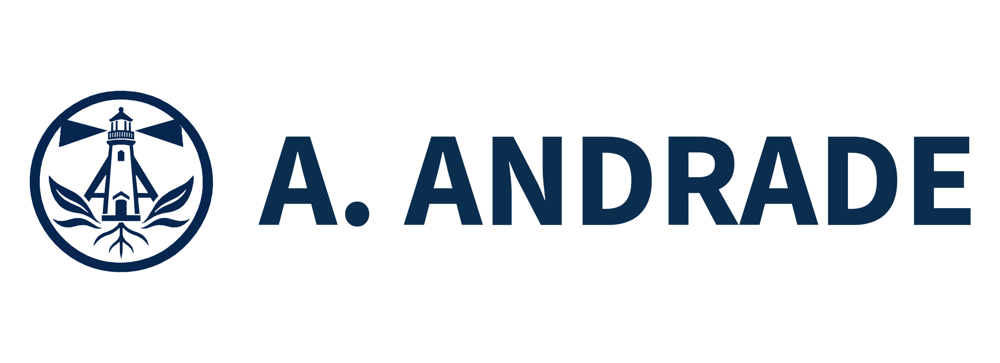
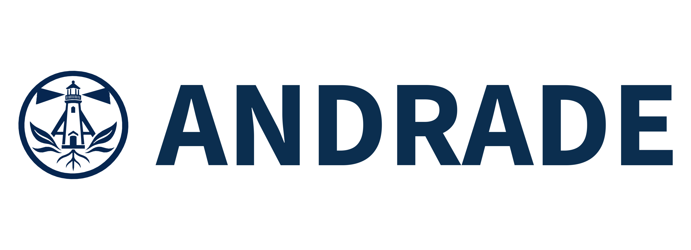
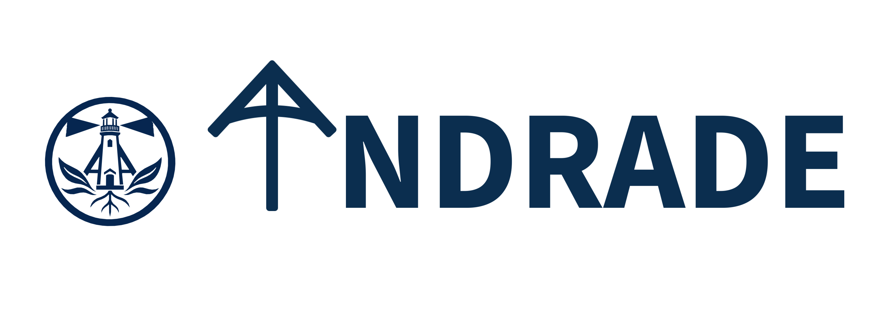
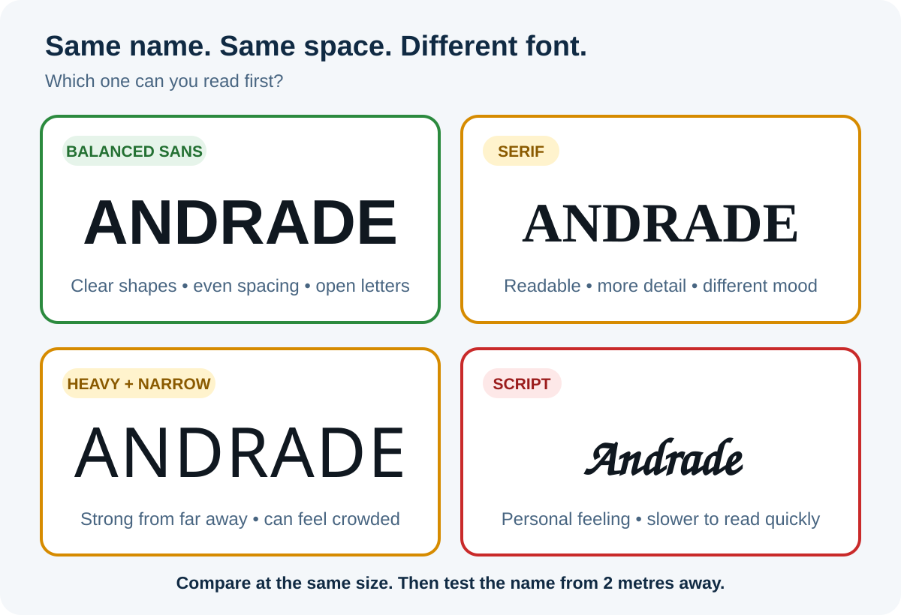
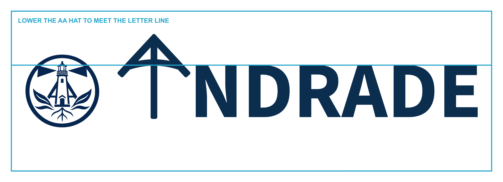

## Learning goals

By the end of this project:

- I can use a tutorial as a starting point without copying its final design.
- I can try several layouts and fonts before choosing one.
- I can make my own name and logo look balanced and easy to read.
- I can prepare PSD, PNG, and SVG files for feedback and fabrication.

## Why this is useful

The tutorial showed you where the tools are and how they work. A designer must also make choices. This project asks you to use the same basic steps with **your own name, your own logo, and your own layout**.

You are designing for a real object. Good spacing, readable letters, and clean files make the name tag easier to understand and easier to manufacture.

::: {.callout-important title="This is the task after the Andrade tutorial"}
Finish [Photopea Lesson 3 and its video](../logo-design/03-combine-logo-nameplate.qmd) first. The ANDRADE file is a worked example, not your submission. Save a new copy and replace the example with your own design.
:::

::: {.ter-project-brief}
## Design brief

Create an original name tag for a teacher-approved **11 × 4 inch blank**. Put a personal logo in the left area and your name in the remaining space. The name must be readable from about 2 metres away. Keep everything away from the edges and prepare clean files for teacher approval.
:::

## What you will submit

Submit these three versions of the same design:

1. **PSD:** the editable master with clearly named layers.
2. **PNG:** a transparent preview or engraving image at 3300 × 1200 pixels.
3. **SVG:** the vector version with the logo and name visible.

Use clear filenames:

- `lastname-name-tag-master.psd`
- `lastname-name-tag.png`
- `lastname-name-tag.svg`

Your teacher will tell you which file the machine workflow needs. A PNG can be used for raster engraving. An SVG can carry paths for scoring, cutting, plotting, or another fabrication process.

## 1. Plan before opening Photopea

Write down the name you want people to read. Then make **three small paper sketches**. Change at least one important idea in each sketch:

- the size of the logo;
- the size or position of the name;
- the font;
- the amount of empty space; or
- the relationship between the logo and the first letter.

[Download the full-size 11 × 4 inch paper prototype sheet](../../assets/name-tag-photopea/name-tag-paper-prototype.pdf){.btn .btn-primary}

Print at **Actual size / 100%**. Do not choose Fit. Hold each idea about 2 metres away and circle the one that communicates your name fastest.

## 2. Study the example; do not copy it

The three ANDRADE versions below solve the same problem in different ways.

::: {.columns}
::: {.column width="33%"}
### Clear baseline

{fig-alt="An 11 by 4 inch name tag with the Technology Commons emblem and large A. ANDRADE text."}

One logo, large type, and a simple centreline.
:::

::: {.column width="33%"}
### Maximum readability

{fig-alt="An 11 by 4 inch name tag with a smaller Technology Commons emblem and extra-large ANDRADE text."}

The name gets most of the space and reads well from far away.
:::

::: {.column width="33%"}
### Personal lettermark

{fig-alt="An 11 by 4 inch name tag with the Technology Commons emblem, a thick AA lettermark, and NDRADE text that reads together as ANDRADE."}

The AA logo becomes part of the word, so its weight and spacing must match the letters.
:::
:::

Ask these questions:

- Which version can you read fastest?
- What do you notice first: the name or the logo?
- Where is the empty space?
- Why does the logo feel connected to the name?

::: {.callout-note title="Your design must be different"}
Use the examples to understand size, spacing, and balance. Do not submit ANDRADE, the AA logo, or an unchanged example file. Replace them with your own name and your own approved symbol or lettermark.
:::

## 3. Make a new working copy

1. Open your completed file from Photopea Lesson 3.
2. Choose **File > Save as PSD** immediately.
3. Give the copy your own filename.
4. Keep the canvas at **11 × 4 inches** and **300 pixels per inch**.
5. Keep the background transparent.
6. Add a **0.25 inch safe margin** on every side.

At 300 pixels per inch, the document is **3300 × 1200 pixels** and the 0.25 inch margin is **75 pixels**.

Need help with a tool? Return to the matching walkthrough:

- [Lesson 1: Build and format the name](../logo-design/01-nameplate-text-photopea.qmd)
- [Lesson 2: Trace a rough logo](../logo-design/rough-sketch-to-svg-photopea.qmd)
- [Lesson 3: Combine the logo and name](../logo-design/03-combine-logo-nameplate.qmd)

## 4. Try fonts before choosing

Type your own name in at least **three fonts**. Keep the examples at the same size so you can compare them fairly.

{fig-alt="Four cards show the name Andrade in a balanced sans serif, a serif, a heavy narrow font, and a script font. Short labels compare readability, spacing, and mood."}

Choose the version that is easy to read in two seconds, has open letter shapes, and is thick enough to engrave. Do not stretch the letters to make them fit.

::: {.callout-tip title="Quick test"}
Show the three versions to another person for two seconds. Use the one they can read first, unless another choice has a strong reason.
:::

## 5. Replace the example logo

Use the logo you traced in Lesson 2 or another teacher-approved personal mark.

1. Place the SVG or transparent PNG on its own layer.
2. Keep the width-and-height link turned on.
3. Resize from a corner so the logo does not stretch.
4. Keep the logo inside the left 4 × 4 inch area.
5. Leave visible space around the logo.

If your logo replaces the first letter of your name, check that the complete word is still obvious. Match the logo’s thickness and baseline to the letters.

## 6. Make the layout look intentional

Check the complete design, not one layer at a time:

- **Safe margin:** nothing crosses the 0.25 inch guide.
- **Logo area:** the logo stays in the left 4 × 4 inch space.
- **Alignment:** the logo and name feel centred from top to bottom.
- **Gap:** the logo and name are connected but do not collide.
- **Hierarchy:** your name is the first or equal reading target.
- **Balance:** the empty space on one side does not make the design feel as if it is falling over.
- **Distance:** the name is readable from about 2 metres away.

{fig-alt="An alignment example showing the AA logo lowered so its curved hat visually meets the top line of NDRADE."}

Hide the guides and ask another person what they notice first. If they cannot read the name in two seconds, revise the size, font, spacing, or logo.

## 7. Export and check every file

### PSD

- Keep the text and logo editable.
- Name important layers.
- Save the full 11 × 4 inch document.

### PNG

- Hide the background and guides.
- Export at **3300 × 1200 pixels**.
- Reopen the file and check its transparency, spelling, and crop.

### SVG

- Make sure the logo and text are vectors, not missing smart objects.
- Export with raster graphics turned off.
- Reopen the SVG and check that the complete design appears.

::: {.callout-warning title="Check the SVG before submitting"}
Photopea may leave a placed SVG smart object out of an SVG export. If the logo disappears, open the logo SVG, copy its vector layers, paste those layers into the name-tag file, hide the smart-object copy, and export again.
:::

### Example files for checking, not submitting

- [Complete example pack](../../assets/name-tag-photopea/downloads/name-tag-design-pack.zip)
- [ANDRADE tutorial PSD](../../assets/name-tag-photopea/downloads/tutorial-andrade/Andrade-nameplate-complete.psd)
- [ANDRADE tutorial PNG](../../assets/name-tag-photopea/downloads/tutorial-andrade/Andrade-nameplate-complete.png)
- [ANDRADE tutorial SVG](../../assets/name-tag-photopea/downloads/tutorial-andrade/Andrade-nameplate-complete.svg)

## Final checklist

- [ ] The design uses my own name and approved logo.
- [ ] I sketched three layouts before choosing one.
- [ ] I compared at least three fonts.
- [ ] The canvas is 11 × 4 inches at 300 pixels per inch.
- [ ] The background is transparent.
- [ ] The logo is not stretched.
- [ ] Everything stays inside the 0.25 inch safe margin.
- [ ] The logo and name look balanced together.
- [ ] My name can be read from about 2 metres away.
- [ ] I checked the spelling.
- [ ] I reopened and checked the PSD, PNG, and SVG.
- [ ] My teacher approved the file before fabrication.

## Short reflection

1. Which font did you choose, and why is it easier to read than the other two?
2. What changed between your first sketch and final layout?
3. What does the viewer notice first?
4. What would you improve after seeing the finished physical name tag?

## Before fabrication

Follow your teacher’s material, ventilation, fire-safety, and machine instructions. Do not press Start until the teacher has checked the file and confirmed whether each part should engrave, score, or cut.

::: {.ter-curriculum-relevance}
**Design curriculum:** Complete this project after the three Photopea walkthroughs. It asks students to move from following an example to making and defending their own design decisions. It supports **TIJ1O** and **TDJ2O** work with images, typography, layout, file preparation, fabrication, testing, and revision.
:::

## Summary

The ANDRADE tutorial taught the basic Photopea steps. In this project, you used those skills to plan, compare, and build an original name tag. You tested its readability, checked its spacing, and exported editable, raster, and vector files.

Next: learn why the PNG and SVG versions behave differently in [Raster, Vector, and SVG](../02-digital-design/01-raster-vector-svg.qmd).
