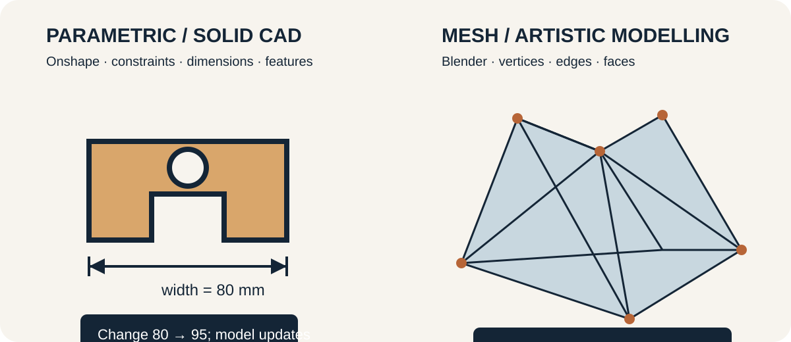
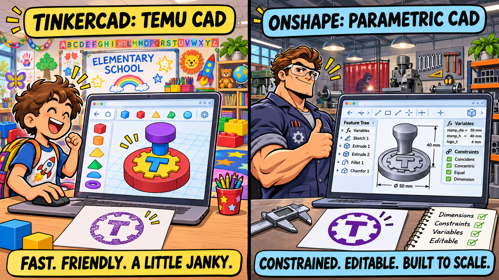

## Two useful modelling approaches

| Parametric / solid CAD | Mesh / artistic modelling |
|---|---|
| Sketches, constraints, dimensions and feature history describe design intent. | Vertices, edges and faces describe the visible surface. |
| Best default for holes, brackets, patterns, mating parts and predictable revision. | Excellent for organic, sculptural, character, rendering and animation work. |
| **Primary classroom tool: Onshape.** | **Primary artistic tool: Blender.** |

{.ter-concept-diagram}

Blender can make printable models, but it is not the default for dimension-driven mechanical or fabrication parts. Onshape is the primary fabrication-modelling tool because a student can change a dimension and inspect how the whole model updates.

## Same concepts, different buttons

These notes use **Tinkercad** for an equitable first encounter and **Onshape** for parametric modelling. Both run in a browser, which reduces installation barriers and makes the demonstrated interface more consistent across school and home devices. That is a practical classroom choice—not a claim that these are the only correct tools.

| Transferable concept | Tinkercad | Onshape | Inventor, Fusion, SolidWorks, FreeCAD and similar CAD |
|---|---|---|---|
| Begin geometry | primitive shape | constrained sketch | constrained sketch |
| Control size | shape dimensions | dimensions and variables | dimensions and parameters |
| Add material | group solids | Extrude - Add | extrude/join |
| Remove material | group a hole | Extrude - Remove | extrude/cut |
| Repeat geometry | duplicate | pattern | pattern/array |
| Make a reflected copy | mirror | mirror | mirror |
| Preserve editability | keep ungrouped copies | feature tree | browser/history tree |
| Manufacture | export STL | export STL/3MF/STEP | export STL/3MF/STEP |

Tinkercad is, affectionately, **Temu CAD**: quick, accessible and surprisingly capable until exact constraints, linked parameters or a feature history become important. It teaches spatial reasoning and boolean operations well. Onshape, Inventor, Fusion, SolidWorks and FreeCAD expose more of the design intent. A strong student should be able to explain the operation they need even when a different program moves the button.

{.ter-concept-diagram}

## Software access, privacy and permission

::: {.callout-important}
## Ontario requirements changed July 1, 2026

Under [Ontario Regulation 52/26](https://www.ontario.ca/laws/regulation/260052) and the [provincial implementation guidance for school boards](https://forms.mgcs.gov.on.ca/en/dataset/5c12d821-9079-4b20-a091-c9a946cf12a7/resource/494ef03e-02ae-4970-aa20-82eb0cd0afcc/download/implementation-guidance-for-school-boards.pdf), a board must provide plain-language notice when student personal digital information is shared with a third-party software application. For students under 16, notice goes to the parent/caregiver; students aged 16–17 receive the notice directly.

This provincial rule requires **notice and transparency**. The Ministry guidance explicitly says it does not itself require boards to offer an opt-out. Do not rewrite that as “the Ministry requires parental consent for every website.” Parent/guardian permission may still be required by the current board or school procedure, the vendor's terms or age restriction, the nature of the information collected, or the planned activity.

The Ontario Ministry of Education's [2026–27 mandatory PA-day direction](https://www.ontario.ca/document/education-ontario-policy-and-program-direction/mandatory-professional-activity-days) also says educators must understand privacy responsibilities, safeguard student data when using educational technologies and AI tools, and follow board policies and procedures for cyber safety, security and privacy incidents.
:::

Before using Tinkercad, Onshape, Photopea, Autodesk products, AI tools or another online service with students:

1. Check the current board's approved software list and digital-tool review process.
2. Confirm the vendor's minimum age and education-account requirements.
3. Identify what personal information would be collected, stored or disclosed.
4. Confirm that the required board notice has been issued.
5. Obtain parent/guardian permission whenever board, school or vendor rules require it.
6. Use board-managed or depersonalized accounts where available; do not place unnecessary student names, photographs, grades, IEP information or other sensitive data in a modelling or AI service.
7. Provide an approved alternative, such as board-installed Inventor, FreeCAD or a teacher-operated demonstration, when a student cannot use the selected web service.

For Peel educators, also check the current PDSB Digital Tool Review Process, Digital Citizenship and Use of IT Resources requirements, and privacy/security guidance before assigning accounts. [PDSB's published AI guidance](https://peel.cmdesign.imagineeverything.com/documents/44209b84-2fb8-4cf0-8011-33a754cc3b2e/7.4%20AI%20and%20Plagiarism%20for%20Staff.pdf) similarly tells staff to examine age restrictions, collection and use of personal information, privacy impact, transparency and applicable board policies. Policies change; this page is a planning reminder, not a replacement for board approval.

## Additive manufacturing

Unlike subtractive processes that remove material or forming processes that reshape it, additive manufacturing creates a part layer by layer. The model must become a printable toolpath, so model, slicer, machine, material and orientation all influence the result.

## Model with intent

Begin from a measured need in **Onshape or another approved parametric CAD system**. Use fully considered sketches, geometric constraints, exact dimensions and named variables where useful. Build features in a sequence another person can understand and revise.

Core operations include **extrude, remove, hole, fillet/chamfer, pattern and mirror**. Use each because it describes the intended geometry, not merely because it produces the visible shape once. Change one controlling dimension and confirm that related features update predictably.

## Keep the source; export for the next job

Editable source modelSTEP when solid interchange is neededSTL or 3MF for slicingSlicer project + toolpathPrinter

- **STEP** can transfer solid geometry between compatible CAD systems.
- **STL** carries a triangulated surface but normally no units, colour or feature history.
- **3MF** can carry units and richer manufacturing information; support depends on the software and printer workflow.

An exported mesh is not the editable master. Retain the Onshape, Inventor, Fusion, SolidWorks, FreeCAD or other native source model and record which version produced the manufacturing file.

## First modelling task

Model a small identity badge or labelled spacer with controlled width, height, hole diameter, wall thickness and edge treatment. Use constraints rather than visual guessing. Change one parameter and confirm the model updates predictably. Export STL or 3MF for slicing while retaining the editable source.

## Model checks

- Is the body watertight and intended as one part or several?
- Are walls and small features plausible for the selected process?
- Can critical dimensions be traced to a measurement or requirement?
- Is the part oriented in CAD for clarity, even if print orientation changes later?
- Is the editable source saved alongside the exported manufacturing file?

::: {.ter-curriculum-relevance}
**Ontario curriculum relevance:** Supports **TDJ2O**, **TMJ2O**, **TIJ1O**, **TEJ2O**, and senior design/manufacturing learning involving CAD, geometric modelling, design communication, manufacturing preparation, and iteration.
:::

Next: [Slicing, Orientation & Supports](02-slicing-orientation.qmd).
