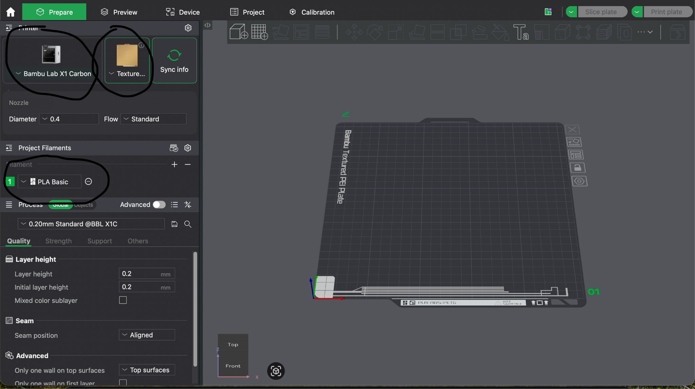

Your `.stl` file describes the **shape** of the model. It does not contain the complete printer, nozzle, plate, material or toolpath instructions. Bambu Studio is a slicer: it combines the model with those choices and produces a file the selected printer can use.

::: {.callout-tip}
## Student-created starting point

A student created the original illustrated classroom guide and captured the four Bambu Studio screenshots used on this page. This web version keeps the clear workflow and adds scale checks, profile verification, preview criteria, safety, troubleshooting and teacher approval.

[Learn how to improve this website](../../contribute.qmd){.btn .btn-primary} [View this page's `.qmd` source](https://github.com/mrandrewandrade/tech-edu-resources/blob/master/site/design-fabrication/04-3d-printing/02-slicing-orientation.qmd){.btn .btn-outline-primary}
:::

::: {.callout-important}
## Teacher approval is required

Do not send a print, start a printer, remove a build plate or reach inside a machine until your teacher authorizes that step. The nozzle and build plate can cause burns, and the printer can move without warning. School machine procedures override any general website instruction.
:::

## Before opening Bambu Studio

Confirm all of these:

- the filename identifies you and the project;
- the model is complete, watertight and exported as an STL;
- you know its intended overall dimensions;
- the flat build surface and intended print orientation are clear; and
- your teacher has identified the printer, nozzle, plate and filament you will use.

If Bambu Studio is not installed, use the [official Bambu Studio download](https://bambulab.com/download/studio). Do not download an installer from an advertisement or an unofficial mirror. A school-managed account or computer may block installation; use the teacher-approved classroom device or process instead.

The screenshots show the Bambu Studio interface used when the student guide was created. Labels can move between software versions, but the verification process remains the same.

## Step 1: Create a project and import the STL

1. Open Bambu Studio and create a new project.
2. Select **Add** or drag the `.stl` file onto the build plate.
3. If an import message asks about units, choose the units used when the STL was exported.
4. Select the model and read its displayed size. Compare it with the dimensions recorded in CAD.
5. Save the working project as `lastname-project-name.3mf`. A 3MF project preserves the plate layout and slicing choices; the original STL remains your geometry file.

::: {.callout-warning}
## Stop if the size is wrong

A model that is about **25.4 times too large or too small** probably has an inch-to-millimetre mismatch. Do not guess by dragging a scale handle. Check the CAD export units or ask your teacher before scaling.
:::

## Step 2: Match the physical printer setup

Select the exact classroom setup assigned by your teacher:

1. **Printer:** choose the actual machine model, such as the classroom X1 Carbon or P1S.
2. **Nozzle:** confirm the installed nozzle diameter, commonly `0.4 mm` in this classroom.
3. **Plate:** select **Textured PEI Plate** only when that is the plate physically installed.
4. **Filament:** choose the profile that matches the loaded material, not merely a similar colour. For example, Bambu PLA Basic and Generic PLA are different profiles.
5. **Process:** begin with the teacher-approved preset. `0.20 mm Standard` is a common first-pass profile for a 0.4 mm nozzle, but it is not a universal requirement.

{.ter-concept-diagram}

Never assume the software profile matches the machine because the screen looks familiar. Verify all four items every time.

## Step 3: Orient and place the model

1. Use **Rotate** and **Lay on Face** so the intended base sits flat on the plate.
2. Confirm that no part is below the plate, floating above it or outside the printable boundary.
3. Keep separate objects spaced apart. Use **Arrange** when the teacher permits multiple parts on one plate.
4. Recheck the displayed size after rotating or scaling.

For the stamp project, place the **flat back on the build plate** with the raised logo facing upward. This orientation normally needs no support material.

{.ter-concept-diagram}

## Step 4: Understand the main settings

Leave the teacher-approved preset unchanged unless the project requires a deliberate change. Record any setting you change and why.

| Setting | What it controls | Sensible starting point |
|---|---|---|
| Layer height | Vertical detail, surface texture and print time | `0.20 mm` is a common general-purpose choice with a 0.4 mm nozzle |
| Wall loops | Solid outer shells and much of the part's strength | The selected preset often uses 2 or 3; functional parts may need more |
| Sparse infill | Internal structure supporting upper surfaces | Decorative parts often need modest infill; more is not automatically better |
| Top and bottom shells | Solid closure above and below infill | Keep the approved profile unless thin surfaces appear in preview |
| Supports | Temporary material beneath otherwise unsupported regions | Off for the flat-backed stamp; enable only when preview and teacher direction show a need |
| Brim | A removable collar that increases plate contact | Auto or off for stable parts; consider it for tall, narrow or small-footprint parts |

For a functional bracket or handle, orientation and additional walls can matter more than raising infill from 15% to 50%. Use test evidence instead of treating one percentage as a strength guarantee.

## Step 5: Slice and inspect every layer

1. Select **Slice plate**.
2. Open **Preview**.
3. Drag the vertical layer slider from the first layer to the final layer.
4. Inspect the model against the checklist below.

{.ter-concept-diagram}

### Preview checklist

- The first layer is continuous and matches the intended footprint.
- No toolpath begins in mid-air.
- Holes and required gaps remain open.
- Thin walls, letters and logo details have not disappeared.
- Supports appear only where expected.
- Every toolpath remains inside the build area.
- The final layers close correctly.
- Estimated time and filament use are plausible for the model's size.
- The preview still matches the shape and orientation approved in CAD.

If any item fails, return to **Prepare** or to the CAD source. Slicing cannot repair missing geometry or an unsuitable design.

## Step 6: Save the correct file

Keep two different files when possible:

- **Project file (`.3mf`):** preserves the model, plate layout and profiles so the setup can be reviewed or revised.
- **Sliced printer file:** contains toolpaths for the selected printer setup. Depending on the machine and workflow, Bambu Studio may package this as a `.gcode.3mf` or another printer-specific output.

For a teacher-directed SD card or USB workflow:

1. Open the menu beside **Print plate**.
2. Select **Export plate sliced file**.
3. Save it in the location specified by your teacher.
4. Do not change the generated file extension.
5. Never reuse a sliced file on a different printer model, nozzle, plate or material setup.

{.ter-concept-diagram}

If the classroom uses network printing, stop after preview and request teacher approval. Do not select **Print plate**, **Send** or **Send all** independently.

## Step 7: Teacher check before printing

Show the teacher:

1. the project name and original STL;
2. the model dimensions and orientation;
3. the selected printer, nozzle, plate and filament profiles;
4. the first, middle and final preview layers;
5. the estimated time and material; and
6. any supports, brim or non-default settings.

The teacher confirms that the physical printer is ready, the correct plate and filament are installed, the build area is clear and the job fits the class schedule.

## Step 8: Print and remove the part safely

- Keep hands, hair, clothing and tools away from the moving printer.
- Do not touch the nozzle or build plate during or immediately after printing.
- Watch the first layer only from the approved viewing position. Tell the teacher if it lifts, curls, strings badly or prints in the wrong location.
- Let the printer finish and the plate cool before removal.
- Remove the plate or part only with the method demonstrated by the teacher.
- Wear required eye protection when clipping supports or brims.

## Step 9: Evaluate the result

Check the physical print against the CAD model and preview:

- Did the first layer adhere evenly?
- Are the overall dimensions reasonable?
- Are holes, gaps, text and raised details complete?
- Is the part warped, cracked, stringy or weak?
- Did support or brim cleanup damage a required surface?
- For a stamp, is the backing flat and does the impression read correctly?

Record one successful choice, one problem and one evidence-based change for the next version.

## Troubleshooting

| Symptom | Likely cause | Next action |
|---|---|---|
| Model is extremely large or small | STL unit mismatch | Return to CAD export settings or ask before applying an exact scale factor |
| Model floats above the plate | Incorrect orientation or Z position | Use Lay on Face and confirm the base touches the plate |
| Thin details disappear in Preview | Feature is smaller than the printable toolpath | Thicken or simplify it in CAD, then export a new STL |
| Holes are filled | Geometry is closed incorrectly or the gap is too small | Repair the source model and preview again |
| Print time or material seems unreasonable | Wrong scale, duplicate models or unsuitable settings | Check dimensions, object count and the selected process profile |
| File will not run on the printer | Wrong printer profile or unsliced STL was copied | Reopen the project and export for the exact assigned printer |
| First layer lifts or curls | Plate, cleanliness, profile, contact area or temperature issue | Stop and ask the teacher to inspect the setup; do not adjust the machine alone |

::: {.ter-curriculum-relevance}
**Ontario curriculum relevance:** Strongly relevant to **TMJ2O** and senior Manufacturing Technology, and useful in **TDJ2O**, **TIJ1O**, and **TEJ2O** projects involving CAM, process planning, material efficiency, quality, safety and evaluation.
:::

Next: [Tolerances & Functional Parts](03-tolerances-functional-parts.qmd).
