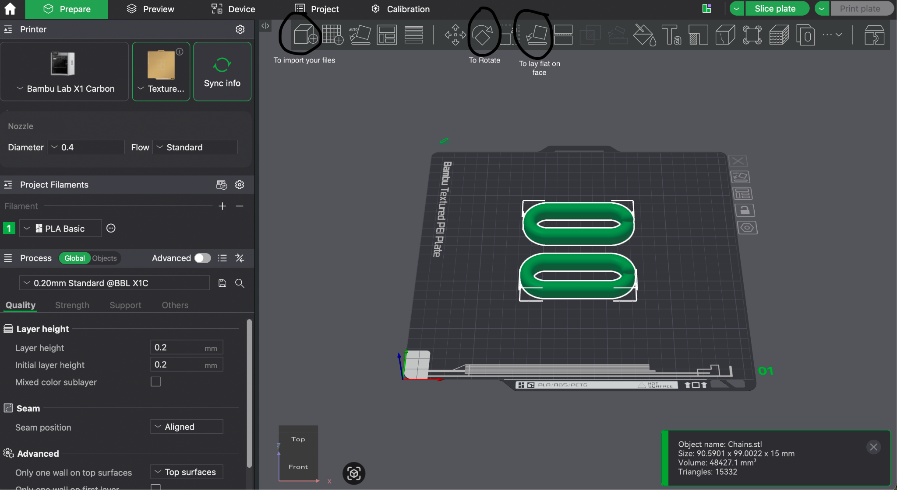
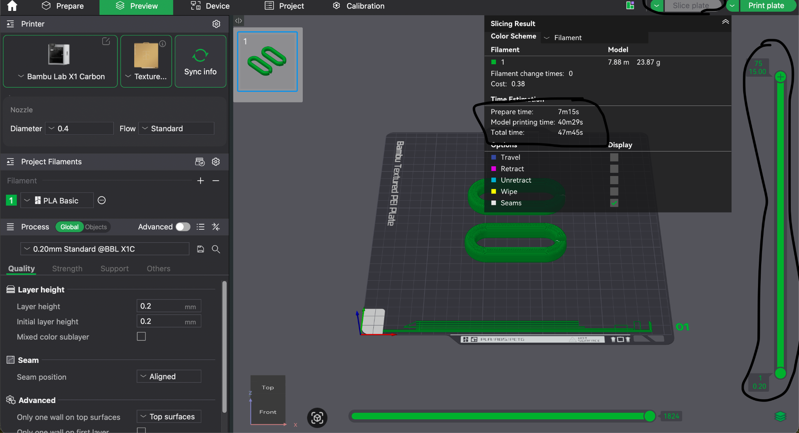
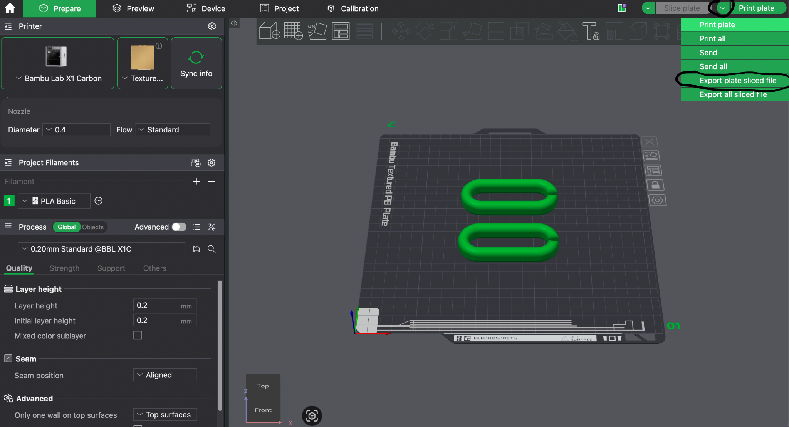

Your `.stl` file describes the **shape** of the model. It does not contain the complete printer, nozzle, plate, material or toolpath instructions. Bambu Studio is a slicer: it combines the model with those choices and produces a file the selected printer can use.

::: {.callout-tip}
## Student-created starting point

A student created the original illustrated classroom guide and captured the four Bambu Studio screenshots used on this page. This web version keeps the clear workflow and adds scale checks, profile verification, preview criteria, safety, troubleshooting and teacher approval.

[Learn how to improve this website](../../contribute.qmd){.btn .btn-primary} [View this page's `.qmd` source](https://github.com/mrandrewandrade/tech-edu-resources/blob/master/site/design-fabrication/04-3d-printing/02-slicing-orientation.qmd){.btn .btn-outline-primary}
:::

::: {.callout-important}
## Teacher approval is required

Do not send a print, start a printer, remove a build plate or reach inside a machine until your teacher authorizes that step. The nozzle and build plate can cause burns, and the printer can move without warning. School machine procedures override any general website instruction.
:::

## Before opening Bambu Studio

Confirm all of these:

- the filename identifies you and the project;
- the model is complete, watertight and exported in a supported format (`.stl`, `.3mf`, `.step` / `.stp`, `.obj` or `.amf`);
- you know its intended overall dimensions in millimetres (`mm`);
- the flat build surface and intended print orientation are clear; and
- your teacher has identified the printer (`X1 Carbon` or `P1S`), `0.4 mm` nozzle, `Textured PEI Plate` and filament (`PLA`) you will use.

If Bambu Studio is not installed, use the [official Bambu Studio download](https://bambulab.com/download/studio). Do not download an installer from an advertisement or an unofficial mirror. School accounts block software downloads, so use a personal device or an approved classroom workstation with Bambu Studio already installed.

The screenshots show the Bambu Studio interface used when the student guide was created, with numbered callouts and no personal or account details shown. Labels can move between software versions, but the verification process remains the same.

## Step 1: Create a project and import the model

1. Open Bambu Studio and select **New Project**.
2. Select **Add** (**1**—the cube icon with a `+` sign) or drag your model file onto the build plate.
3. If an import message asks about units, choose the units used when the model was exported.
4. Select the model and read its displayed size (`X × Y × Z` in `mm`) in the bottom-right **Object size** box (**2**). Compare it with the dimensions recorded in CAD.
5. Save the working project as `lastname-project-name.3mf`. A 3MF project preserves the plate layout and slicing choices; the original model file remains your geometry source.

::: {.callout-warning}
## Stop if the size is wrong

A model that is about **25.4 times too large or too small** probably has an inch-to-millimetre mismatch, or may be accidentally microscopic or larger than the build plate. Check the bottom-right size readout and edge/error status before scaling—do not guess by dragging a scale handle. Check the CAD export units or ask your teacher before scaling.
:::

## Step 2: Match the physical printer setup

Select the exact classroom setup assigned by your teacher:

1. **Printer (**`1`**):** choose the actual machine model, such as the classroom **Bambu Lab X1 Carbon** or **Bambu Lab P1S**.
2. **Plate (**`2`**):** select **Textured PEI Plate**, which is used on both classroom printers when that plate is physically installed.
3. **Nozzle (**`3`**):** confirm the installed nozzle diameter is **`0.4`**.
4. **Filament (**`4`**):** choose the profile that matches the loaded material (such as **PLA Basic**), not merely a similar colour.
5. **Process:** begin with the teacher-approved preset (`0.20mm Standard` is a common first-pass profile for a `0.4 mm` nozzle).

{.ter-concept-diagram}

Never assume the software profile matches the machine because the screen looks familiar. Verify all four items every time so the print does not fail or damage the bed.

## Step 3: Orient and place the model

1. Select your model and use **Rotate (`R`)** (**1**) or **Lay on Face (`F`)** (**2**) in the top toolbar so the largest, flattest base sits flat against the build plate (**3**).
2. Rotate your camera view underneath and around the build plate to confirm no part is below the plate, floating above it with gaps, or outside the printable boundary (no red out-of-bounds highlights).
3. Keep separate objects spaced apart. Use **Arrange** when the teacher permits multiple parts on one plate.
4. Recheck the displayed size after rotating or scaling.

For the stamp project, place the **flat back on the build plate** with the raised logo facing upward. This orientation normally needs no support material.

{.ter-concept-diagram}

## Step 4: Understand the main settings

Leave the teacher-approved preset (`0.20mm Standard`) unchanged unless the project requires a deliberate change. Record any setting you change and why.

| Setting | What it does | Default / starting point |
|---|---|---|
| Layer height (under Quality) | Thickness of each horizontal layer of melted plastic; affects vertical detail, surface smoothness and print time | `0.20 mm` (good balance of speed and quality with a `0.4 mm` nozzle) |
| Wall loops (under Strength) | Number of solid outer perimeter lines forming the outer shell of your object | `2` to `3` walls (more walls add perimeter strength) |
| Sparse infill density (under Strength) | Percentage of internal crisscross grid printed inside the object to support upper surfaces and add strength without wasting plastic | `15%` |
| Top and bottom shells | Solid closure above and below infill | Keep the approved profile unless thin surfaces appear in preview |
| Supports (under Support) | Temporary plastic scaffolding printed underneath steep overhangs or parts starting in mid-air (snapped off after printing) | `Off` for flat-backed parts; enable only when preview and teacher direction show a need |
| Brim (under Others) | Thin, flat collar printed around the bottom edge to help small or tall parts grip the build plate | `Auto` or `Off` for stable parts; consider for tall, narrow or small-footprint parts |

For a functional bracket or handle, orientation and additional walls can matter more than raising infill from 15% to 50%. Use test evidence instead of treating one percentage as a strength guarantee.

## Step 5: Slice and inspect every layer

1. Select **Slice plate** (**1**) in the top-right corner to generate the toolpath and open **Preview**.
2. Check the **Slicing Result** box (**2**) to review the **Total time** and filament weight (`g`).
3. Grab the **vertical layer slider** (**3**) on the right edge, drag it all the way down to **Layer 1**, and slowly scrub upward to the final layer.
4. Inspect the model against the checklist below.

{.ter-concept-diagram}

### Preview checklist

- The first layer is continuous, flat, cleanly attached and matches the intended footprint.
- No toolpath starts in mid-air without material or supports underneath it.
- Holes and required gaps remain open.
- Thin walls, letters and logo details have not disappeared.
- Supports appear only where expected.
- Every toolpath remains inside the build area.
- The final layers close correctly.
- Estimated time and filament use are plausible for the model's size and fit within class time limits.
- The preview still matches the shape and orientation approved in CAD.

If any item fails, return to **Prepare** or to the CAD source. Slicing cannot repair missing geometry or an unsuitable design.

## Step 6: Save and export the correct file

Keep two different files when possible:

- **Project file (`.3mf`):** preserves the model, plate layout and profiles so the setup can be reviewed or revised.
- **Sliced printer file:** contains toolpaths for the selected printer setup. Depending on the machine and workflow, Bambu Studio may package this as a `.gcode.3mf` or another printer-specific output.

For a teacher-directed SD card or USB workflow:

1. Open the dropdown arrow (**1**) beside **Slice plate** / **Print plate** in the top-right corner.
2. Select **Export plate sliced file** (**2**).
3. Save it with a clear name (such as `FirstName_PartName.gcode.3mf`) in the location specified by your teacher (class folder, USB drive or SD card).
4. Confirm the saved file ends in `.gcode.3mf` (not just `.3mf` or `.stl`) and do not change the generated file extension.
5. Safely eject your SD card or USB drive before removing it, and never reuse a sliced file on a different printer model, nozzle, plate or material setup.

{.ter-concept-diagram}

If the classroom uses network printing, stop after preview and request teacher approval. Do not select **Print plate**, **Send** or **Send all** independently.

## Step 7: Teacher check before printing

Show the teacher:

1. the project name and original STL;
2. the model dimensions and orientation;
3. the selected printer, nozzle, plate and filament profiles;
4. the first, middle and final preview layers;
5. the estimated time and material; and
6. any supports, brim or non-default settings.

Make sure that the teacher confirms that the physical printer is ready, the correct plate and filament are installed, the build area is clear and the job fits the class schedule.

## Step 8: Print and remove the part safely

- Keep hands, hair, clothing and tools away from the moving printer.
- Do not touch the nozzle or build plate during or immediately after printing.
- Watch the first layer only from the approved viewing position. Tell the teacher if it lifts, curls, strings badly or prints in the wrong location.
- Let the printer finish and the plate cool before removal.
- Remove the plate or part only with the method demonstrated by the teacher.
- Wear required eye protection when clipping supports or brims.

## Step 9: Evaluate the result

Check the physical print against the CAD model and preview:

- Did the first layer adhere evenly?
- Are the overall dimensions reasonable?
- Are holes, gaps, text and raised details complete?
- Is the part warped, cracked, stringy or weak?
- Did support or brim cleanup damage a required surface?
- For a stamp, is the backing flat and does the impression read correctly?

Record one successful choice, one problem and one evidence-based change for the next version.

## Troubleshooting

| Symptom | Likely cause | Next action |
|---|---|---|
| Model is extremely large or small | STL unit mismatch | Return to CAD export settings or ask before applying an exact scale factor |
| Model floats above the plate | Incorrect orientation or Z position | Use Lay on Face and confirm the base touches the plate |
| Thin details disappear in Preview | Feature is smaller than the printable toolpath | Thicken or simplify it in CAD, then export a new STL |
| Holes are filled | Geometry is closed incorrectly or the gap is too small | Repair the source model and preview again |
| Print time or material seems unreasonable | Wrong scale, duplicate models or unsuitable settings | Check dimensions, object count and the selected process profile |
| File will not run on the printer | Wrong printer profile or unsliced STL was copied | Reopen the project and export for the exact assigned printer |
| First layer lifts or curls | Plate, cleanliness, profile, contact area or temperature issue | Stop and ask the teacher to inspect the setup; do not adjust the machine alone |

::: {.ter-curriculum-relevance}
**Ontario curriculum relevance:** Strongly relevant to **TMJ2O** and senior Manufacturing Technology, and useful in **TDJ2O**, **TIJ1O**, and **TEJ2O** projects involving CAM, process planning, material efficiency, quality, safety and evaluation.
:::

Next: [Tolerances & Functional Parts](03-tolerances-functional-parts.qmd).
