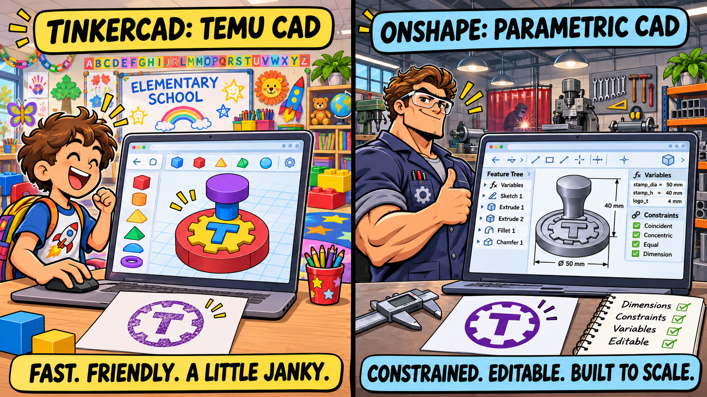

Additive manufacturing builds geometry layer by layer. Orientation changes strength and finish, supports leave evidence, holes may print undersize, thin details can disappear, and matching parts need tested clearance. Students keep the editable source model so evidence can drive a real revision.

The concepts in this unit are **software-independent**. Sketch, constrain, dimension, extrude, mirror, pattern, combine, inspect and export are transferable habits whether the buttons belong to Tinkercad, Onshape, Autodesk Inventor, Fusion, SolidWorks, Creo, FreeCAD, OpenSCAD, Blender or another approved tool. These notes demonstrate Tinkercad and Onshape because they are familiar, browser-based and easier to provide consistently across different student devices.

{.ter-concept-diagram}

::: {.callout-tip}
## The official running joke

Tinkercad is **Temu CAD** - affectionately. It is fast, friendly and a little janky, but it gets a beginner from an idea to a printable prototype. Onshape is where the same idea graduates into constraints, variables and a feature history. The joke is about software limitations, never about the student using it.
:::

::: {.callout-important}
## Before students sign in to a web tool

Ontario's new third-party software rule is a **notice and transparency requirement**, not a blanket provincial consent rule. Effective **July 1, 2026**, Ontario Regulation 52/26 requires school boards to give plain-language notice when a student's personal digital information is disclosed to third-party software. Ministry guidance says the notice goes to the parent/caregiver for students under 16 and directly to students aged 16–17; it also says the regulation itself does not create a required opt-out.

Before assigning Tinkercad, Onshape, Photopea, an AI tool or any other online service, educators must still check the current **board-approved-tool process, privacy/security guidance, vendor age requirement and local parent/guardian permission procedure**. Obtain permission whenever the board, school or vendor requires it, minimize personal information, and provide an approved alternative when access is unavailable.

Read the detailed [software access, privacy and permission note](01-additive-cad.qmd#software-access-privacy-and-permission), [Ontario Regulation 52/26](https://www.ontario.ca/laws/regulation/260052), and the [Ontario implementation guidance for school boards](https://forms.mgcs.gov.on.ca/en/dataset/5c12d821-9079-4b20-a091-c9a946cf12a7/resource/494ef03e-02ae-4970-aa20-82eb0cd0afcc/download/implementation-guidance-for-school-boards.pdf).
:::

::: {.ter-project-brief}
## Current TAS project

### Mission 2: AA Arrow Stamp → Your Own Stamp

First build the supplied **AA arrow** as a 1.50 in mirrored relief stamp. Then repeat the proven workflow with an **original logo**, test both impressions and revise the editable source. Keep the back flat for a later teacher-added lighthouse handle.

[Open the Logo Stamp mission →](logo-stamp-mission.qmd)
:::

## Classroom mission sequence

1. **Basic keychain:** learn the workplane, primitive shapes, alignment, grouping and export.
2. **Guided AA arrow stamp:** learn mirroring, controlled relief and impression testing with common artwork.
3. **Original-logo stamp:** transfer the process to an original design and revise it from physical evidence.
4. **Optional bonuses:** attempt the complex PCSS stamp, faux-enamel finishing or a parametric Onshape extension only after the required stamp is complete.

## Learning sequence

<ol class="ter-lesson-sequence">
  <li><a href="01-additive-cad.qmd">3D Modelling Foundations: Onshape CAD vs Blender Mesh</a>: choose the model type, use constraints and dimensions, and preserve design intent.</li>
  <li><a href="02-slicing-orientation.qmd">Slicing, Orientation &amp; Supports</a>: connect layer height, walls, infill, toolpaths, strength, time, and surface quality.</li>
  <li><a href="03-tolerances-functional-parts.qmd">Tolerances &amp; Functional Parts</a>: test holes, clearance, press fits, fasteners, assemblies, brackets, adapters, and repair parts.</li>
  <li><a href="logo-stamp-mission.qmd">Mission 2: AA Arrow Stamp → Your Own Stamp</a>: guided checkpoint, original transfer task, impression tests and submission.</li>
  <li><a href="tinkercad-logo-stamp.qmd">Tinkercad Stamp Pathway</a>: build the AA arrow first, then repeat it with an original logo.</li>
  <li><a href="onshape-logo-stamp.qmd">Onshape Stamp Pathway</a>: build the same required sequence with variables, constrained sketches and named features.</li>
  <li><a href="logo-stamp-mission.qmd#bonus-1--pcss-stamp-challenge">Bonus: PCSS Stamp Challenge</a>: simplify the more complex school crest after both required stamps pass.</li>
  <li><a href="tinkercad-faux-enamel-logo.qmd">Bonus: Tinkercad Faux-Enamel Badge</a>: optional post-stamp reuse of the successful original logo.</li>
  <li><a href="faux-enamel-pin-jewellery.qmd">Bonus: Parametric Faux-Enamel Jewellery</a>: a further optional Onshape extension.</li>
  <li><a href="04-design-challenge.qmd">Functional-Part Design Challenge</a>: a general/advanced project for a measured need.</li>
</ol>

## What this unit does not assume

Machine-specific safety instruction, operating procedures, assessments, and authorization are kept outside this website. Follow your school board's safety guidelines and the course-specific instruction provided by your teacher. Students in Mr. Andrade's classes can find that information in Google Classroom. Profiles and tolerances are printer-, material-, and process-dependent; measure and test rather than copy a universal number.

::: {.ter-curriculum-relevance}
**Ontario curriculum relevance:** Useful for **TIJ1O**, **TDJ2O**, **TMJ2O**, and **TEJ2O**, with strong transfer to senior Technological Design and Manufacturing Technology courses involving CAD/CAM, additive manufacturing, functional parts, prototyping, assemblies, and quality control.

Relevant senior contexts can include **TDJ3M/TDJ4M**, **TDJ3O/TDJ4O**, and appropriate **TMJ3M/TMJ4M**, **TMJ3C/TMJ4C**, or **TMJ3E/TMJ4E** projects. Apply those aliases only where the actual assignment matches the course focus.
:::

## Free CAD, model, and slicing resources

Model with a board-approved option. Possibilities include education access to [Onshape](https://www.onshape.com/en/education/plans), [Autodesk Inventor](https://www.autodesk.com/education/edu-software/overview), [Autodesk Fusion](https://www.autodesk.com/education/edu-software/overview) or SolidWorks, plus open-source [FreeCAD](https://www.freecad.org/) and [OpenSCAD](https://openscad.org/). Compare downloadable work on [Printables](https://www.printables.com/), [Thingiverse](https://www.thingiverse.com/), [NASA 3D Resources](https://science.nasa.gov/3d-resources/), and [Smithsonian Open Access](https://www.si.edu/OpenAccess), then slice with [PrusaSlicer](https://www.prusa3d.com/page/prusaslicer_424/), [UltiMaker Cura](https://ultimaker.com/software/ultimaker-cura/), or the [official OrcaSlicer repository](https://github.com/OrcaSlicer/OrcaSlicer). Check each model's licence, scale, geometry, and suitability. More provisional options are in the [full free-resource directory · Work in Progress](../resources/work-in-progress/index.qmd).

Start with the [AA Arrow Stamp → Your Own Stamp mission](logo-stamp-mission.qmd). Use the optional PCSS or faux-enamel extensions only after the required stamp work passes its impression tests.
