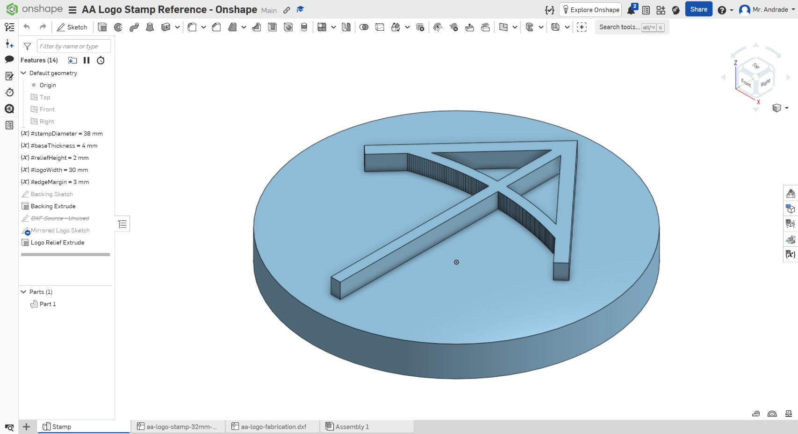

::: {.ter-project-brief}
## The required stamp mission

Complete the stamp project in this order:

1. **V1 - guided AA arrow stamp:** build the supplied AA arrow as a mirrored circular relief stamp. This is the technique checkpoint.
2. **V2 - your own stamp:** repeat the same workflow with a simple original logo. This is the assessed transfer task.

Do not begin the PCSS or faux-enamel bonuses until V1 and V2 have passed their impression tests.
:::

The introductory keychain taught placement, alignment and grouping. The stamp adds **relief, mirroring, minimum feature size and physical testing**. Starting with the AA arrow keeps the first stamp readable and lets everyone practise the same process before making original design decisions.

::: {.callout-important}
## Start here: download the AA logo

[Download the editable AA arrow SVG](../../assets/branding/logo/aa-logo.svg){.btn .btn-primary download="aa-arrow.svg"}

Use this SVG for the guided Tinkercad workflow and as the editable V1 logo source. Do not substitute a screenshot.
:::

## Other V1 files

- [AA arrow PNG reference](../../assets/branding/logo/aa-logo-transparent.png){download="aa-arrow-reference.png"}
- [Centred and mirrored AA DXF for Onshape](../../assets/branding/logo/aa-logo-stamp-32mm-mirrored.dxf){download="aa-arrow-stamp-mirrored.dxf"}

Use the supplied geometry to learn the fabrication process. You are not being assessed on inventing the AA mark.

## Standard stamp size

Use a **1.50 in diameter stamp**. The backing and relief dimensions below are used for both V1 and V2.

| Feature | Required dimension |
|---|---:|
| Stamp diameter | 1.50 in |
| Flat backing thickness | 0.16 in |
| Raised logo relief | 0.08 in |
| Minimum logo stroke | 0.05 in |
| Minimum gap between details | 0.05 in |
| Clear edge margin | at least 0.12 in |
| Maximum logo width | about 1.25 in |

{.ter-concept-diagram}

Technical views for this project must come directly from a CAD model in Onshape, OpenSCAD or another capable modelling package. Do not redraw an orthographic view by hand for the website.

## The important idea: mirror the stamping face

A raised stamp prints the opposite of what is on its face. **Mirror the logo before printing** so letters, initials and directional symbols appear correctly in the impression.

Before exporting, use the top view and ask: “If I press this face downward, will the result read correctly?” The AA arrow should look backwards on the stamp face and correct in the impression.

## Choose one CAD pathway

### Tinkercad pathway

Use the [step-by-step Tinkercad stamp guide](tinkercad-logo-stamp.qmd). It reinforces SVG import, resize, mirror, align, workplane height and grouping.

### Onshape pathway

Use the [step-by-step Onshape stamp guide](onshape-logo-stamp.qmd). It adds variables, constrained sketches, feature order and an editable model.

Both pathways produce the same required object and use the same success criteria. Board-approved Autodesk Inventor, Fusion, SolidWorks, FreeCAD or another capable CAD package is acceptable when the student can show equivalent dimensions, mirror direction, editable source and exported manufacturing file.

Tinkercad remains our affectionate **Temu CAD** option: fast, accessible and slightly janky. Onshape records more design intent. Neither toolbar earns marks; the evidence does.

::: {.callout-important}
## Web-tool policy check

Before assigning a student account in Tinkercad, Onshape, Photopea or another online service, check the current board-approved-tool process, privacy/security guidance, vendor age restriction and local parent/guardian permission procedure. Confirm that the required Ontario third-party software notice has been issued. Obtain permission when required and provide an approved alternative when access is unavailable. Read [Software access, privacy and permission](01-additive-cad.qmd#software-access-privacy-and-permission).
:::

# V1 - guided AA arrow stamp

1. Open or trace the supplied AA arrow artwork.
2. Import the SVG into Tinkercad, or use the prepared mirrored DXF in Onshape.
3. Build the standard circular backing.
4. Mirror and centre the AA arrow.
5. Create the raised relief and keep the rear face flat.
6. Export the STL and inspect every slicer layer.
7. Print and make one impression in teacher-approved modelling material.
8. Fix any backwards, incomplete, crowded or weak areas before starting V2.

### V1 checkpoint evidence

- top-view CAD screenshot;
- side-view screenshot showing backing and relief;
- exported AA arrow STL;
- photograph of the AA impression; and
- one sentence identifying the first problem or confirming why the test passed.

## Take the CAD screenshots with Windows Snipping Tool {#snipping-tool}

Prepare the model before opening Snipping Tool:

1. For the **top view**, select the top face of the ViewCube. Zoom until the stamp fills most of the workspace and the complete circular edge remains visible.
2. For the **side view**, rotate the model low enough to show both the flat backing and the raised logo. Keep the full stamp on screen.
3. Leave the design name visible. In Onshape, also leave the feature list visible. Close unrelated tabs, messages and personal information.

Capture and save each view:

1. Press **Windows + Shift + S**.
2. Select **Rectangular mode** in the small toolbar at the top of the screen.
3. Drag a rectangle around the CAD workspace. Include the complete model and enough of the interface to prove which program and design are open.
4. Release the mouse. The screenshot is copied to the clipboard.
5. Select the Snipping Tool notification that appears in the lower-right corner. If the notification disappears, open **Snipping Tool** from the Start menu, select **New**, and capture the view again.
6. Select the **Save** icon or press **Ctrl + S**.
7. Save as a PNG using these names:
   - `lastname-aa-stamp-top.png`
   - `lastname-aa-stamp-side.png`
8. Open both PNG files before submitting them. Confirm that they are not blank, cropped or too small to read.

Repeat the same process for V2, replacing `aa` with `original-logo` in both file names.

# V2 - your own original stamp

Create a simple original personal, business, club or community logo. Do not copy a company, game, team, social-media or clothing logo.

Repeat the proven V1 workflow:

1. prepare the original artwork in Photopea;
2. export clean SVG geometry;
3. mirror the stamping face;
4. build the same standard backing and relief;
5. inspect, export, slice and print;
6. test the impression; and
7. revise the editable source using physical evidence.

### V2 final submission

Submit:

1. the original editable SVG;
2. top and side CAD screenshots;
3. `lastname-original-logo-stamp.stl`;
4. one photograph of the physical impression beside the stamp; and
5. a 100–150 word reflection comparing V1 and V2 and explaining one evidence-based improvement.

## Success criteria

- V1 clearly matches the supplied AA arrow.
- V2 uses a simple original logo.
- Both impressions are readable and correctly oriented.
- The logo is centred with at least a 0.12 in edge margin.
- Important strokes and gaps are at least 0.05 in.
- The relief rises 0.08 in above a 0.16 in flat backing.
- Each exported STL matches its editable source model.
- The student tests, evaluates and revises the design.

## Safe testing

Use teacher-approved modelling clay, plasticine or another approved test material. Do not use the printed stamp on food, skin, property or permanent surfaces. Follow the course printer, cleanup and material-handling procedures.

## Bonus 1 - PCSS stamp challenge {#bonus-pcss-stamp-challenge}

After V1 and V2 pass, adapt the PCSS artwork into a stamp. The crest is deliberately more difficult because it contains curved text, rings and small details. Simplify it honestly rather than forcing every tiny feature into the print.

- [PCSS reference artwork](../../assets/branding/pcss/pcss-warriors.png){download="pcss-warriors.png"}
- [Clean PCSS vector structure](../../assets/tinkercad-logo-jewellery/source/pcss-white-structure.svg){download="pcss-stamp-vector.svg"}

The bonus earns credit for successful simplification, mirroring and impression quality, not for merely importing a complicated file.

## Bonus 2 - faux-enamel extension

Only after the two required stamps are complete, reuse the successful original logo for the [optional Tinkercad faux-enamel extension](tinkercad-faux-enamel-logo.qmd). It is not part of the required stamp grade. The [parametric Onshape faux-enamel challenge](faux-enamel-pin-jewellery.qmd) is a further optional extension.

## Teacher note - Classroom order

Keep these as unposted drafts until materials and timing are confirmed:

1. **Logo Stamp Mission - AA Arrow V1 → Original V2** - required assignment.
2. **Bonus - PCSS Stamp Challenge** - optional, after the required stamp.
3. **Bonus - Faux-Enamel Badge Extension** - optional, after the stamp project.
