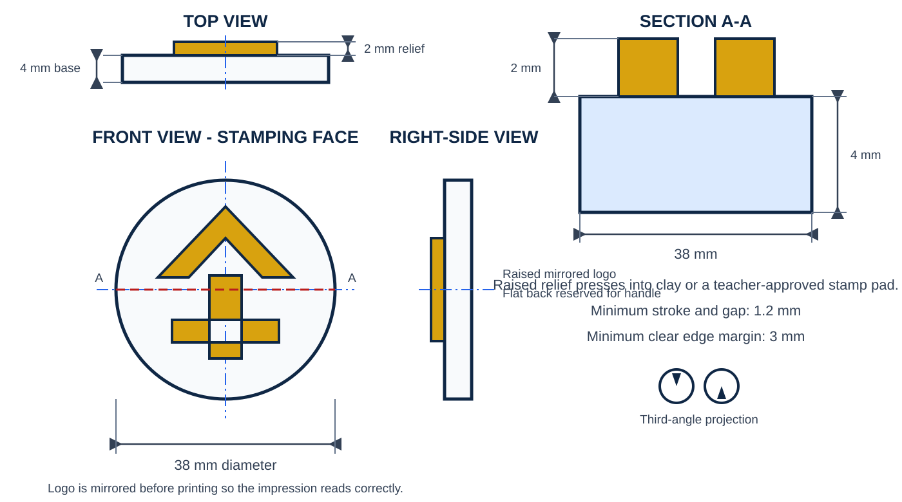

::: {.ter-project-brief}
## The mission

Turn your **original logo** into a working circular stamp. The finished stamp must make a clear, correctly oriented impression. Build the same design idea in either **Tinkercad** or **Onshape**, export it for printing, test it and improve it.
:::

This mission follows the introductory keychain. The keychain taught placement, alignment and grouping. The stamp adds **relief, mirroring, minimum feature size and physical testing**. The later faux-enamel brooch uses the same logo again, but changes raised stamping surfaces into enclosed colour cavities.

## Standard size

Use a **38 mm diameter stamp**. This is approximately **1.5 inches** and gives most student logos enough room to remain printable and readable.

A **25.4 mm (1 inch)** stamp is an optional teacher-approved challenge for a very simple logo. Do not shrink a detailed logo until its lines disappear.

| Feature | Required dimension |
|---|---:|
| Stamp diameter | 38 mm |
| Flat backing thickness | 4 mm |
| Raised logo relief | 2 mm |
| Minimum logo stroke | 1.2 mm |
| Minimum gap between details | 1.2 mm |
| Clear edge margin | at least 3 mm |
| Maximum logo width | about 30-32 mm |

{.ter-concept-diagram}

## The important idea: mirror the stamping face

A raised stamp prints the opposite of what is on its face. **Mirror the logo before printing** so letters, initials and directional symbols appear correctly in the impression.

Before exporting, use the top view and ask: "If I press this face downward, will the result read correctly?"

## Choose your CAD pathway

### Tinkercad pathway

Use the [step-by-step Tinkercad logo stamp guide](tinkercad-logo-stamp.qmd). This pathway reinforces import, resize, mirror, align, workplane height and grouping.

### Onshape pathway

Use the [parametric Onshape logo stamp guide](onshape-logo-stamp.qmd). This pathway adds variables, constrained sketches, feature order and an editable model that can change size reliably.

Both pathways produce the same required object and use the same success criteria.

The mission is **software-neutral**. A student may use board-approved Autodesk Inventor, Fusion, SolidWorks, FreeCAD or another capable CAD system when they can demonstrate the same dimensions, mirror direction, relief, flat back, editable source and exported manufacturing file. The concepts transfer; only the interface and evidence screens change.

Tinkercad is our affectionate **Temu CAD** option: fast, accessible and slightly janky. Onshape is the parametric option. Neither name on the toolbar earns marks—the design evidence does.

::: {.callout-important}
## Web-tool policy check

Before assigning a student account in Tinkercad, Onshape, Photopea or another online service, check the current board-approved-tool process, privacy/security guidance, vendor age restriction and local parent/guardian permission procedure. Confirm that the required Ontario third-party software notice has been issued. Obtain permission when required and provide an approved alternative when access is unavailable. Read [Software access, privacy and permission](01-additive-cad.qmd#software-access-privacy-and-permission).
:::

## Originality rule

Use your own personal, business, club or community logo. Do not copy a company, game, team, social-media or clothing logo. You may simplify your own earlier logo so it stamps cleanly.

## Keep the back flat

Do not add a handle during this mission. The flat back lets the teacher attach a separate **Technology Commons lighthouse handle** after the stamp face has passed its impression test. The handle is an extension, not a way to hide a weak stamp design.

## What this version can stamp

The standard class print is a rigid **relief stamp for modelling clay or plasticine**. A rigid PLA stamp is useful for checking the logo, mirror direction, spacing and handle, but it should not be graded by its ink result on paper.

If the class makes an ink-on-paper version, the stamp face needs an approved **flexible material** and a printer-specific setup. [Prusa's stamp-making guide](https://blog.prusa3d.com/how-to-3d-print-stamps_108285/) recommends flexible material for ink stamps and explains why rigid PLA often leaves blank areas. The CAD dimensions and mirrored logo remain the same.

## Test the impression

1. Follow the teacher's print orientation for the selected material. For the rigid class prototype, place the flat back on the build plate and the raised design upward.
2. Remove loose strings without rounding off the relief.
3. Test first in modelling clay, plasticine or another teacher-approved material.
4. If a teacher-approved washable stamp pad is used, test on scrap paper and clean the stamp as directed.
5. Compare the printed stamp face with the impression.
6. Record one problem and revise the editable source model.

Do not use the printed part on skin, food, property or permanent surfaces.

## Success criteria

- The impression is readable and correctly oriented.
- The logo is centred with at least a 3 mm edge margin.
- All important strokes and gaps are at least 1.2 mm.
- The raised relief is 2 mm above a 4 mm backing.
- The stamp back is flat and available for the later handle.
- The exported STL matches the editable source model.
- The student tests, evaluates and revises the design.

## Digital submission

Submit:

1. a top-view screenshot of the completed model;
2. a side-view screenshot showing the 4 mm backing and 2 mm relief;
3. the exported STL;
4. one photograph of the physical impression beside the stamp; and
5. a short reflection explaining what changed after the test.

File name: `lastname-logo-stamp.stl`

## Next mission

After the stamp, reuse the same original logo for the [Tinkercad Faux-Enamel Logo Earring or Brooch](tinkercad-faux-enamel-logo.qmd). Instead of one raised stamping face, that project creates enclosed recessed areas that can be filled with teacher-approved nail polish.
