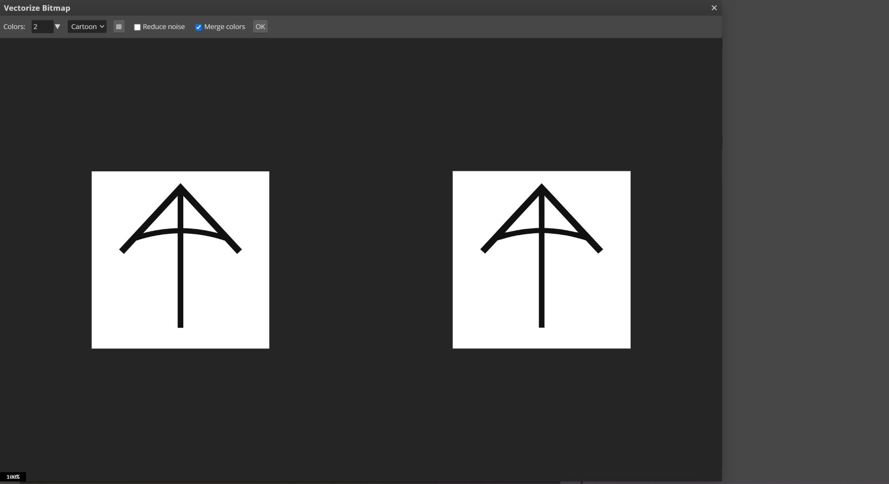
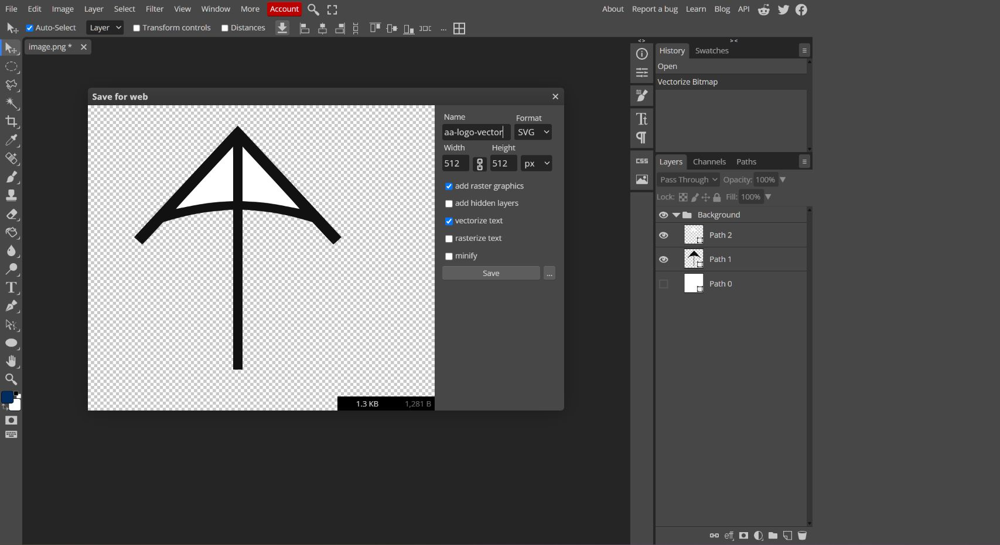
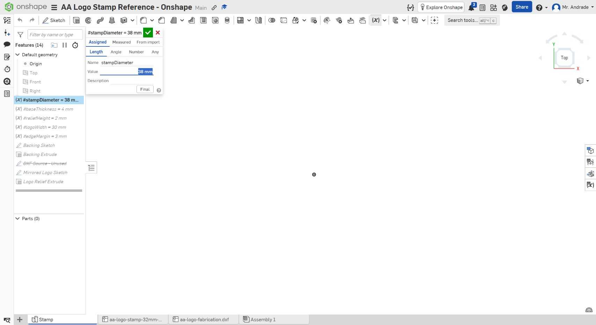
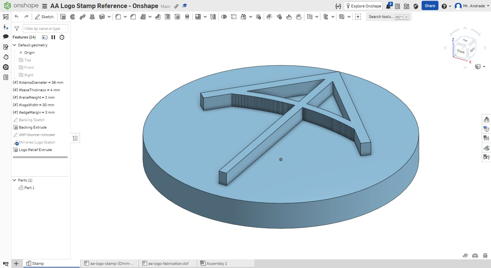
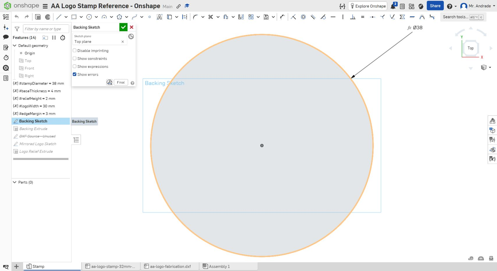
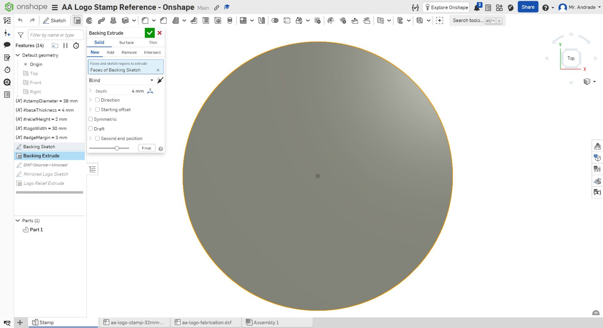
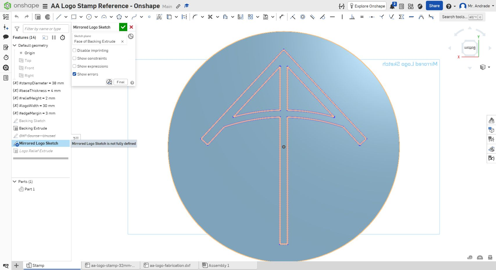
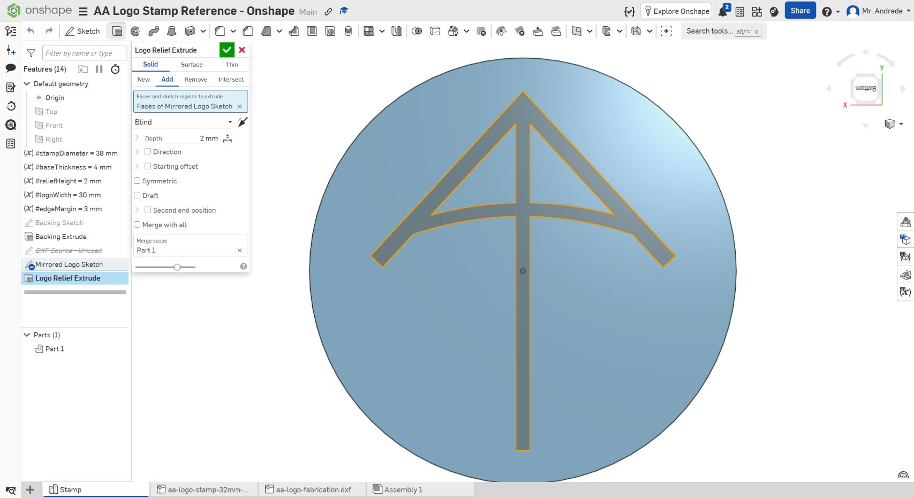
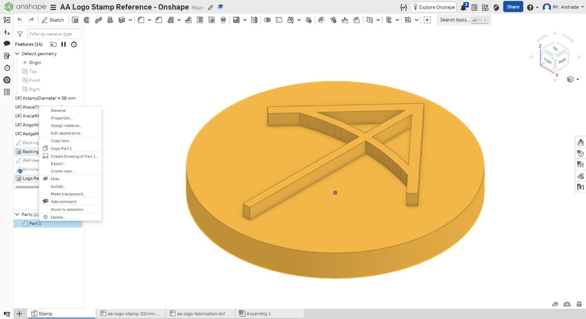
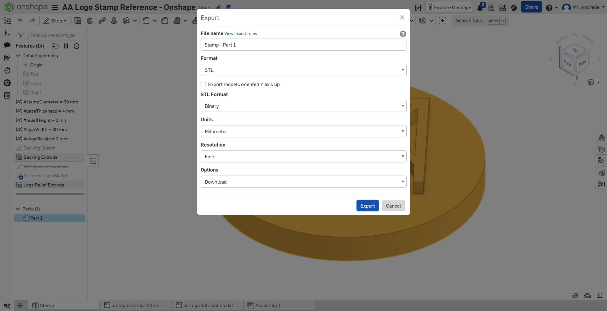

Return to the [Logo Stamp mission brief](logo-stamp-mission.qmd) for the common dimensions, success criteria and submission list.

::: {.callout-important}
## Account and permission check

Before students create or use an Onshape account, confirm that Onshape is approved under the current board's digital-tool process, that students meet the vendor's age/account requirements, that the required Ontario third-party software notice has been provided, and that parent/guardian permission has been obtained whenever local or vendor rules require it. See [Software access, privacy and permission](01-additive-cad.qmd#software-access-privacy-and-permission). Provide an approved alternative when a student cannot use the service.
:::

## Workflow overview

This pathway uses three connected tools:

1. **Photopea** turns a photograph, scan or raster logo into editable vector Shape layers.
2. The **SVG-to-DXF preparation step** centres, scales and mirrors the artwork for fabrication.
3. **Onshape** imports the DXF into a sketch and creates the editable 3D stamp.

Photopea exports the artwork as **SVG**, not DXF. The conversion step between Photopea and Onshape is required. Do not import a finished STL as the editable source.

::: {.callout-tip}
## Graduating from Temu CAD

The Tinkercad pathway—affectionately, **Temu CAD**—is quicker for a first prototype. This Onshape pathway takes longer because it records dimensions, constraints, variables and feature order. That extra structure is the point: the model should remain understandable and editable after the first print.
:::

{.ter-concept-diagram}

::: {.callout-important}
## Design for an impression

The stamp face must look backwards so the impression reads correctly. Keep every important stroke and gap at least **1.2 mm**, and leave at least **3 mm** between the artwork and the outside edge of the stamp.
:::

## Part A - Prepare the artwork in Photopea

### Step 1 - Open the raster artwork

1. Open [Photopea](https://www.photopea.com/).
2. Select **Open From Computer** and choose the photograph, scan, PNG or JPG containing your original logo.
3. Use a high-contrast image with a plain background whenever possible.
4. Keep the original image as a reference. Do not erase the only copy of your source artwork.

{.ter-concept-diagram}

### Step 2 - Convert the bitmap into vector layers

1. Select the raster layer in the **Layers** panel.
2. Choose **Image - Vectorize Bitmap**.
3. For a simple black-and-white logo, set **Colors** to **2**.
4. Compare the source preview on the left with the vector preview on the right.
5. Increase the colour count only when a required part of the design disappears. Extra colours create extra paths that must be cleaned later.
6. Select **OK** when the important edges and openings are clear.

{.ter-concept-diagram}

Photopea replaces the raster layer with a group of vector Shape layers. The generated names may be `Path 0`, `Path 1` and `Path 2`; your number of paths may be different.

### Step 3 - Clean the vector layers

1. Expand the new vector group in the **Layers** panel.
2. Hide the white rectangular background layer. The checkerboard must appear around the logo.
3. Keep any white vector paths that create intentional holes or cutouts inside the black artwork. In the worked example, hiding the white cutout path incorrectly fills the inside of the logo.
4. Hide one layer at a time to learn what it contributes, then restore every required path.
5. Double-click the group name and rename it `STAMP ARTWORK - vector`.
6. Inspect the result at a useful zoom. Remove specks, accidental islands and details that cannot meet the 1.2 mm rule.

{.ter-concept-diagram}

::: {.callout-tip}
## Use layers as a diagnostic tool

Do not delete every white layer automatically. A white page-sized layer is usually the background; a smaller white path may be the cutout that keeps an opening clear. Toggle the eye icon and check the artwork before deleting or hiding anything permanently.
:::

### Step 4 - Export the clean artwork as SVG

1. Confirm that the page background is transparent and every required artwork layer is visible.
2. Choose **File - Export as - SVG**.

{.ter-concept-diagram}

3. Enter a useful name such as `lastname-logo-stamp-source`.
4. Keep the original proportions linked.
5. Leave **add hidden layers** turned off so the hidden page background is not exported.
6. Select **Save**.

{.ter-concept-diagram}

The SVG is the editable two-dimensional artwork submitted to the stamp-preparation step. Saving a PSD copy as well is recommended because it preserves the Photopea layers.

### Worked-example files

Use these files to compare your own workflow with the demonstrated result:

- [Photopea SVG export from the AA example](../../assets/onshape-logo-stamp/photopea-workflow/aa-logo-vector.svg)
- [Centred and mirrored AA DXF prepared for Onshape](../../assets/branding/logo/aa-logo-stamp-32mm-mirrored.dxf)

## Part B - Prepare the SVG for Onshape

Use the class SVG-to-DXF preparation process supplied by your teacher.

1. Upload the Photopea SVG.
2. Set the stamp diameter to **38 mm**.
3. Set the minimum edge margin to **3 mm**.
4. Enable **Mirror for stamping**.
5. Check both previews:
   - the **stamp face** should look backwards;
   - the **impression** should read correctly.
6. Repair any reported open paths, detached islands or details below **1.2 mm**.
7. Download the centred, uniformly scaled, millimetre-based DXF.

The conversion process must preserve holes and cutouts. If the preview fills an opening that should be empty, return to Photopea and repair the vector layers instead of covering the problem in Onshape.

::: {.callout-note}
## Imported geometry is not fully parametric

An imported DXF does not automatically resize when an Onshape variable changes. If the stamp diameter or logo size changes, prepare and import a new DXF using the new settings.
:::

## Part C - Build the stamp in Onshape

Open the [teacher reference model in Onshape](https://cad.onshape.com/documents/0e36bf05b0d1e4ec76afe941/w/a33ad2c0945ed61fa1d612aa/e/ca1279488c8e4ae515f05a36) in another tab. Use it to compare feature names and dimensions, but build the model in your own document. Every screenshot below was captured from that working model.

### Step 5 - Create and name the document

1. Create a new Onshape document named `lastname-logo-stamp`.
2. Rename the first Part Studio `Stamp`.
3. Confirm the workspace uses millimetres.

### Step 6 - Add the controlling variables

1. Select the **Variable** tool (the `x` icon) in the feature toolbar.
2. Enter the name without the number sign: `stampDiameter`.
3. Set the type to **Length**, enter `38 mm`, and select the green check.
4. Repeat the process for the remaining four variables.

{.ter-concept-diagram}

Create these variables at the top of the feature list:

| Variable | Value |
|---|---:|
| `#stampDiameter` | 38 mm |
| `#baseThickness` | 4 mm |
| `#reliefHeight` | 2 mm |
| `#logoWidth` | 30 mm |
| `#edgeMargin` | 3 mm |

The variables document the required design intent. Remember that `#logoWidth` describes the target logo size but does not directly control imported DXF entities.

{.ter-concept-diagram}

### Step 7 - Model the backing coin

1. In the feature tree, select the **Top plane**, then select **Sketch**.
2. Choose **Centre point circle**. Click the origin for the centre, then click again to place the circle.
3. Choose **Dimension**, click the circle, and enter `#stampDiameter` for its diameter.
4. The displayed dimension should read **38 mm**. Select the green check to finish the sketch.
5. Rename it `Backing Sketch`.

{.ter-concept-diagram}

6. Select the circular sketch region, then select **Extrude**.
7. Set the operation to **Solid - New**, the end type to **Blind**, and the depth to `#baseThickness`.
8. Confirm the preview is a 4 mm solid disk and select the green check.
9. Rename the feature `Backing Extrude`. Keep the rear face flat for a later handle.

{.ter-concept-diagram}

### Step 8 - Import the prepared DXF

1. Select the top face of the 4 mm backing and start a new sketch.
2. While editing the sketch, choose **Insert DXF or DWG** in the sketch toolbar.
3. Choose the prepared DXF from its Onshape tab, or upload `aa-logo-stamp-32mm-mirrored.dxf` when following the worked example.
4. Set **Units** to **Millimetre**.
5. Enable **Use file origin position**. The preparation step placed the file origin at the stamp centre, so do not drag the imported geometry by eye.
6. Confirm the stamp face looks backwards. This is correct: the clay impression will read forwards.
7. Confirm that the artwork is inside the backing circle and leaves at least `#edgeMargin` (3 mm) at the edge.
8. Select the green check to finish the sketch, then rename it `Mirrored Logo Sketch`.

{.ter-concept-diagram}

Do not scale one direction independently. The logo must keep its original proportions.

### Step 9 - Create the raised relief

1. Select every closed logo region that should touch the clay. Hold **Ctrl** while selecting additional regions when needed.
2. Select **Extrude**.
3. Set the operation to **Solid - Add**, the end type to **Blind**, and the depth to `#reliefHeight`.
4. Under **Merge scope**, confirm `Part 1` is selected. The preview must show the logo joining the backing, not becoming separate parts.
5. Select the green check and rename the feature `Logo Relief Extrude`.

{.ter-concept-diagram}

The Parts list at the lower left must still say **Parts (1)**. More than one part means the relief did not merge with the backing.

{.ter-concept-diagram}

### Step 10 - Inspect and export

1. Use the top view to check centring, mirroring, holes and the 3 mm margin.
2. Use a front or side view to confirm a **4 mm backing**, **2 mm relief** and **6 mm overall height**.
3. Use the isometric view to check that all raised regions are joined to one part.
4. Confirm there are no detached islands or details below 1.2 mm.
5. Expand **Parts (1)**, right-click `Part 1`, and choose **Export**.

{.ter-concept-diagram}

6. In the Export dialog, use these settings:
   - **File name:** `lastname-logo-stamp`
   - **Format:** STL
   - **STL Format:** Binary
   - **Units:** Millimeter
   - **Resolution:** Fine
   - **Options:** Download
7. Select **Export**. Do not leave the units at Onshape's default **Inch** setting.

{.ter-concept-diagram}

For the rigid class prototype, print flat-back down with the relief upward. A flexible ink-stamp version uses a teacher-selected material and printer-specific orientation.

## If yours does not match

| Symptom | Most likely cause | Fix |
|---|---|---|
| The circle will not extrude | The backing sketch is open or the wrong region is selected | Edit `Backing Sketch`, repair the circle and select its closed region |
| The final impression will read backwards | The artwork was not mirrored before DXF export | Return to the preparation step and generate a new mirrored DXF |
| The artwork is off-centre | The DXF was dragged manually or imported without its file origin | Reinsert it with **Use file origin position** |
| Holes or cutouts are filled | The Photopea vector paths are open or a required cutout layer was hidden | Repair the vector layers in Photopea and export a new SVG and DXF |
| The model contains two or more parts | The relief extrude used **New** instead of **Add**, or the merge scope is empty | Edit `Logo Relief Extrude`, choose **Add**, and select `Part 1` as the merge scope |
| The printed stamp is far too large or small | The DXF or STL was exported with the wrong units | Use **Millimetre** for DXF import and **Millimeter** for STL export |
| A thin detail disappears when sliced | The path or gap is below the 1.2 mm minimum | Simplify or thicken it in Photopea, then repeat the SVG-to-DXF step |

## Final checklist

- The Photopea source has editable vector Shape layers.
- The page-sized background is hidden before SVG export.
- Required holes and cutouts remain open.
- The stamp face is mirrored and the impression preview reads correctly.
- The DXF is centred and uses millimetres.
- The Onshape backing is 38 mm by 4 mm.
- The relief is 2 mm high and joined to the backing.
- The edge margin is at least 3 mm.
- The rear face remains flat.
- The finished model contains one part and exports as `lastname-logo-stamp.stl`.

## Test the design intent

After the first physical impression, revise the Photopea vector layers, DXF preparation settings or Onshape model based on evidence. Capture the feature list and the changed model. The project is successful when another person can understand the layer structure, repeat the conversion and edit the CAD model without rebuilding everything from the beginning.

## Optional configuration

After the 38 mm stamp works, create a teacher-approved **25.4 mm** version for a very simple logo. Generate a new DXF for the smaller stamp and do not claim it works until it has been printed and tested.
