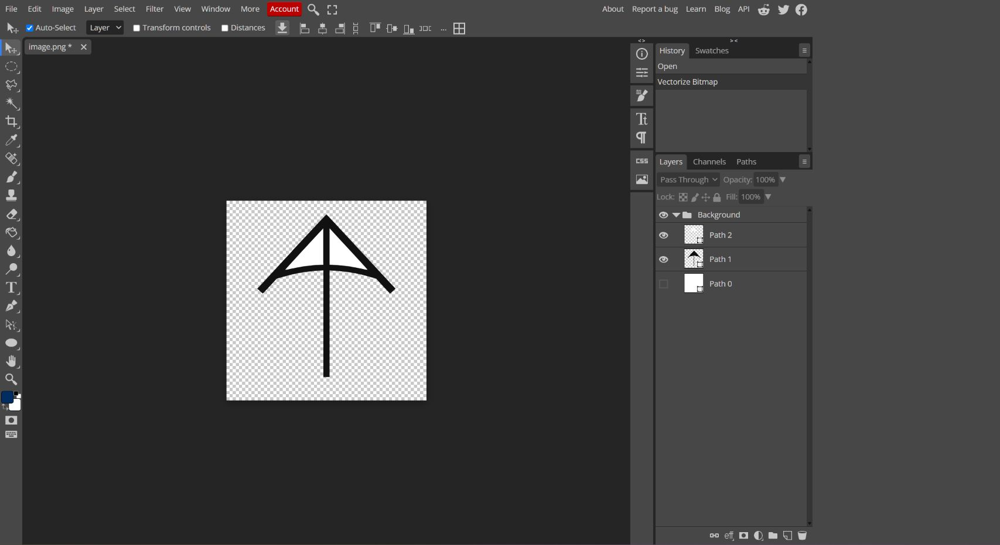
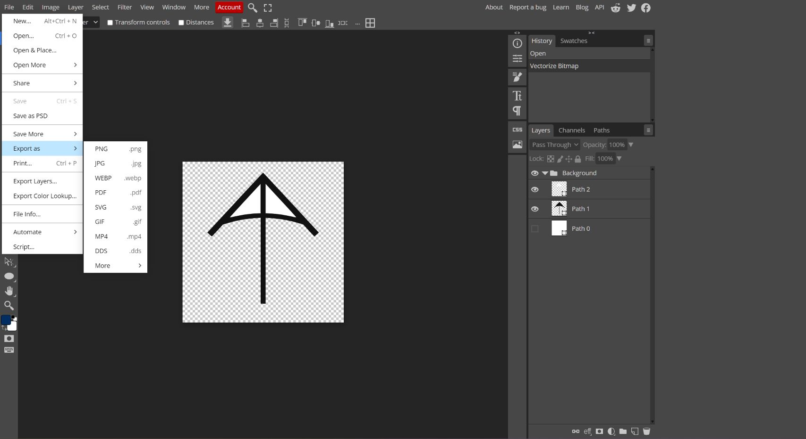
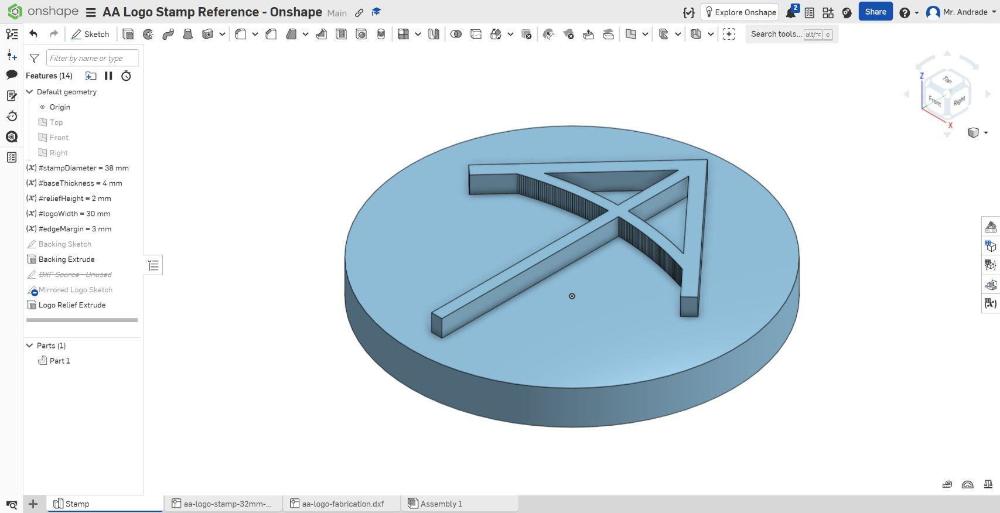

Return to the [Logo Stamp mission brief](logo-stamp-mission.qmd) for the common dimensions, success criteria and submission list.

## Workflow overview

This pathway uses three connected tools:

1. **Photopea** turns a photograph, scan or raster logo into editable vector Shape layers.
2. The **SVG-to-DXF preparation step** centres, scales and mirrors the artwork for fabrication.
3. **Onshape** imports the DXF into a sketch and creates the editable 3D stamp.

Photopea exports the artwork as **SVG**, not DXF. The conversion step between Photopea and Onshape is required. Do not import a finished STL as the editable source.

::: {.callout-important}
## Design for an impression

The stamp face must look backwards so the impression reads correctly. Keep every important stroke and gap at least **1.2 mm**, and leave at least **3 mm** between the artwork and the outside edge of the stamp.
:::

## Part A - Prepare the artwork in Photopea

### Step 1 - Open the raster artwork

1. Open [Photopea](https://www.photopea.com/).
2. Select **Open From Computer** and choose the photograph, scan, PNG or JPG containing your original logo.
3. Use a high-contrast image with a plain background whenever possible.
4. Keep the original image as a reference. Do not erase the only copy of your source artwork.

{.ter-concept-diagram}

### Step 2 - Convert the bitmap into vector layers

1. Select the raster layer in the **Layers** panel.
2. Choose **Image - Vectorize Bitmap**.
3. For a simple black-and-white logo, set **Colors** to **2**.
4. Compare the source preview on the left with the vector preview on the right.
5. Increase the colour count only when a required part of the design disappears. Extra colours create extra paths that must be cleaned later.
6. Select **OK** when the important edges and openings are clear.

{.ter-concept-diagram}

Photopea replaces the raster layer with a group of vector Shape layers. The generated names may be `Path 0`, `Path 1` and `Path 2`; your number of paths may be different.

### Step 3 - Clean the vector layers

1. Expand the new vector group in the **Layers** panel.
2. Hide the white rectangular background layer. The checkerboard must appear around the logo.
3. Keep any white vector paths that create intentional holes or cutouts inside the black artwork. In the worked example, hiding the white cutout path incorrectly fills the inside of the logo.
4. Hide one layer at a time to learn what it contributes, then restore every required path.
5. Double-click the group name and rename it `STAMP ARTWORK - vector`.
6. Inspect the result at a useful zoom. Remove specks, accidental islands and details that cannot meet the 1.2 mm rule.

{.ter-concept-diagram}

::: {.callout-tip}
## Use layers as a diagnostic tool

Do not delete every white layer automatically. A white page-sized layer is usually the background; a smaller white path may be the cutout that keeps an opening clear. Toggle the eye icon and check the artwork before deleting or hiding anything permanently.
:::

### Step 4 - Export the clean artwork as SVG

1. Confirm that the page background is transparent and every required artwork layer is visible.
2. Choose **File - Export as - SVG**.

{.ter-concept-diagram}

3. Enter a useful name such as `lastname-logo-stamp-source`.
4. Keep the original proportions linked.
5. Leave **add hidden layers** turned off so the hidden page background is not exported.
6. Select **Save**.

{.ter-concept-diagram}

The SVG is the editable two-dimensional artwork submitted to the stamp-preparation step. Saving a PSD copy as well is recommended because it preserves the Photopea layers.

### Worked-example files

Use these files to compare your own workflow with the demonstrated result:

- [Photopea SVG export from the AA example](../../assets/onshape-logo-stamp/photopea-workflow/aa-logo-vector.svg)
- [Centred and mirrored AA DXF prepared for Onshape](../../assets/branding/logo/aa-logo-stamp-32mm-mirrored.dxf)

## Part B - Prepare the SVG for Onshape

Use the class SVG-to-DXF preparation process supplied by your teacher.

1. Upload the Photopea SVG.
2. Set the stamp diameter to **38 mm**.
3. Set the minimum edge margin to **3 mm**.
4. Enable **Mirror for stamping**.
5. Check both previews:
   - the **stamp face** should look backwards;
   - the **impression** should read correctly.
6. Repair any reported open paths, detached islands or details below **1.2 mm**.
7. Download the centred, uniformly scaled, millimetre-based DXF.

The conversion process must preserve holes and cutouts. If the preview fills an opening that should be empty, return to Photopea and repair the vector layers instead of covering the problem in Onshape.

::: {.callout-note}
## Imported geometry is not fully parametric

An imported DXF does not automatically resize when an Onshape variable changes. If the stamp diameter or logo size changes, prepare and import a new DXF using the new settings.
:::

## Part C - Build the stamp in Onshape

### Step 5 - Create and name the document

1. Create a new Onshape document named `lastname-logo-stamp`.
2. Rename the first Part Studio `Stamp`.
3. Confirm the workspace uses millimetres.

### Step 6 - Add the controlling variables

Create these variables at the top of the feature list:

| Variable | Value |
|---|---:|
| `#stampDiameter` | 38 mm |
| `#baseThickness` | 4 mm |
| `#reliefHeight` | 2 mm |
| `#logoWidth` | 30 mm |
| `#edgeMargin` | 3 mm |

The variables document the required design intent. Remember that `#logoWidth` describes the target logo size but does not directly control imported DXF entities.

### Step 7 - Model the backing coin

1. Start a sketch on the **Top plane**.
2. Draw a centre-point circle from the origin.
3. Dimension its diameter as `#stampDiameter`.
4. Confirm the sketch is fully constrained.
5. Finish the sketch and **Extrude - Add** by `#baseThickness`.
6. Keep the rear face flat for the later handle.

### Step 8 - Import the prepared DXF

1. Select the top face of the 4 mm backing and start a new sketch.
2. Choose the sketch **Insert DXF or DWG** command.
3. Select the prepared DXF.
4. Set the import units to **Millimetre**.
5. Enable **Use file origin position** so the prepared artwork lands at the stamp centre.
6. Confirm the stamp face looks backwards.
7. Measure or inspect the clear edge. It must remain at least `#edgeMargin`.
8. Rename the sketch `Mirrored Logo Sketch`.

Do not scale one direction independently. The logo must keep its original proportions.

### Step 9 - Create the raised relief

1. Finish the logo sketch.
2. Select every closed logo region that should touch the clay.
3. **Extrude - Add** by `#reliefHeight`.
4. Confirm the merge scope joins the relief to the backing as one part.
5. Rename the feature `Logo Relief Extrude`.

{.ter-concept-diagram}

### Step 10 - Inspect and export

1. Use the top view to check centring, mirroring, holes and the 3 mm margin.
2. Use a front or side view to confirm a **4 mm backing**, **2 mm relief** and **6 mm overall height**.
3. Use the isometric view to check that all raised regions are joined to one part.
4. Confirm there are no detached islands or details below 1.2 mm.
5. Right-click the finished part and choose **Export**.
6. Export an STL in millimetres using the class resolution setting.
7. Name it `lastname-logo-stamp.stl`.

For the rigid class prototype, print flat-back down with the relief upward. A flexible ink-stamp version uses a teacher-selected material and printer-specific orientation.

## Final checklist

- The Photopea source has editable vector Shape layers.
- The page-sized background is hidden before SVG export.
- Required holes and cutouts remain open.
- The stamp face is mirrored and the impression preview reads correctly.
- The DXF is centred and uses millimetres.
- The Onshape backing is 38 mm by 4 mm.
- The relief is 2 mm high and joined to the backing.
- The edge margin is at least 3 mm.
- The rear face remains flat.
- The finished model contains one part and exports as `lastname-logo-stamp.stl`.

## Test the design intent

After the first physical impression, revise the Photopea vector layers, DXF preparation settings or Onshape model based on evidence. Capture the feature list and the changed model. The project is successful when another person can understand the layer structure, repeat the conversion and edit the CAD model without rebuilding everything from the beginning.

## Optional configuration

After the 38 mm stamp works, create a teacher-approved **25.4 mm** version for a very simple logo. Generate a new DXF for the smaller stamp and do not claim it works until it has been printed and tested.
