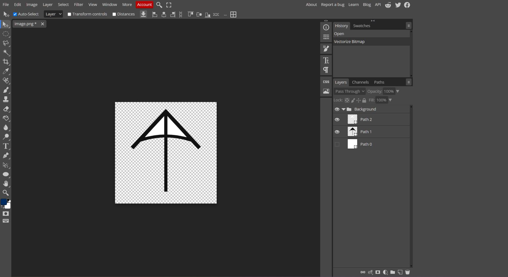
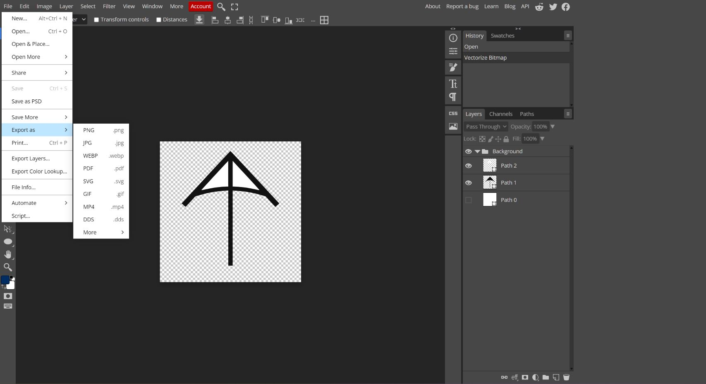

::: {.callout-important}
## One print. One filament colour.

Print the complete badge **once in white PLA**. There is no filament change and no multicolour print.

- The raised ring and logo stay white.
- Navy, gold and any other approved colours are added **after printing** in the recessed areas.
- The colours in the preview are a finishing plan, not separate Tinkercad solids.
:::

::: {.callout-important}
## Account and permission check

Before students create or use a Tinkercad or Photopea account, confirm each service through the current board's digital-tool process, vendor age requirements and privacy/security guidance. Confirm that the required Ontario third-party software notice has been issued and obtain parent/guardian permission whenever local or vendor rules require it. See [Software access, privacy and permission](01-additive-cad.qmd#software-access-privacy-and-permission). Provide an approved account-free, offline or teacher-operated alternative when needed.
:::

## This is not the main assignment

Complete the required [AA Arrow Stamp → Your Own Stamp mission](logo-stamp-mission.qmd) first. This page is an **optional bonus extension** that reuses the student’s already-tested original logo. The PCSS crest is not the starting badge and there is no required faux-enamel V1/V2 sequence.

::: {.callout-tip}
## Temu CAD, used on purpose

Tinkercad is our affectionate **Temu CAD** pathway: quick, web-based and surprisingly capable when the geometry is simple. It is perfect for this guided build. When you need exact constraints, variables and feature history, move to [Onshape](faux-enamel-pin-jewellery.qmd) or another teacher-approved parametric CAD package.
:::

## What you are making - inches only

Before modelling, select **Edit Grid** in Tinkercad and change the units to **inches**.

| Feature | Bonus badge |
|---|---:|
| Finished diameter | 2.00 in |
| Solid white base | 0.12 in |
| Raised white walls | 0.04 in |
| Total thickness | about 0.16 in |
| Minimum wall or gap | 0.05 in |
| Filament | white PLA only |
| Colour | applied after printing |

{.ter-concept-diagram}

## Optional practice files and downloads

Use the AA files below only as a technical practice or recovery example. For the bonus submission, use the same original logo that passed the required stamp mission.

- [AA arrow raster reference](../../assets/branding/logo/aa-logo-transparent.png){download="aa-arrow-reference.png"}
- [Editable AA arrow SVG](../../assets/onshape-logo-stamp/photopea-workflow/aa-logo-vector.svg){download="aa-arrow-vector.svg"}
- [Fabrication-ready AA arrow and circular rim SVG](../../assets/tinkercad-logo-jewellery/source/aa-faux-enamel-detail.svg){download="aa-arrow-faux-enamel-detail.svg"}
- [Editable circular base SVG](../../assets/tinkercad-logo-jewellery/source/circle-base.svg){download="circle-base.svg"}

### Completed reference STL

- [Download the AA arrow STL as a ZIP - recommended](../../assets/tinkercad-logo-jewellery/downloads/aa-arrow-faux-enamel-brooch-stl.zip){download="aa-arrow-faux-enamel-brooch-stl.zip"}
- [Download the AA arrow STL directly](../../assets/tinkercad-logo-jewellery/downloads/aa-arrow-faux-enamel-brooch.stl){download="aa-arrow-faux-enamel-brooch.stl"}

::: {.callout-tip}
## If the STL link will not download

Use the **ZIP - recommended** link. Extract `aa-arrow-faux-enamel-brooch.stl`, then import the STL into the class slicer. Some browsers try to preview a direct `.stl` link instead of saving it; the ZIP avoids that problem.
:::

# Optional AA practice example {#optional-aa-practice-example}

## Part A - learn the Photopea trace

The raster PNG is made from pixels. Tinkercad needs clean vector paths. These screenshots show the actual AA arrow workflow in [Photopea](https://www.photopea.com/).

### Step 1 - open the simple AA arrow

1. Download `aa-arrow-reference.png` from the source kit.
2. Open Photopea.
3. Select **File → Open** and choose the PNG.
4. Confirm that the complete arrow is visible and not cropped.

{fig-alt="AA arrow raster open in the Photopea workspace"}

### Step 2 - vectorize the bitmap

1. Select **Image → Vectorize Bitmap**.
2. Set **Colors** to **2**.
3. Turn on **Reduce noise** and **Merge colors**.
4. Preview the result. The outside edges should be smooth and the centre openings should remain open.
5. Accept the vectorization.

{fig-alt="Photopea Vectorize Bitmap window set to two colours"}

### Step 3 - inspect the vector layer

1. In the Layers panel, confirm that Photopea created a **Vector** layer.
2. Zoom in on the point, curved crossbar and long centre stem.
3. Remove stray dots or disconnected fragments.
4. Keep the arrow bold. Do not add tiny text.

{fig-alt="Clean AA arrow vector layer in Photopea"}

### Step 4 - export the SVG

1. Select **File → Export as → SVG**.
2. Check the preview and make sure the whole arrow is inside the canvas.
3. Select **Save**.
4. Name the file `lastname-aa-arrow.svg`.

{fig-alt="Photopea Export as menu with SVG selected"}

{fig-alt="Photopea SVG export preview and settings"}

::: {.callout-note}
The supplied `aa-arrow-faux-enamel-detail.svg` adds a circular outer rim to the arrow. The rim is important because it contains the post-print colour. Compare your trace with the supplied fabrication-ready SVG before entering Tinkercad.
:::

## Part B - build the one-colour model in Tinkercad

Open [Tinkercad](https://www.tinkercad.com/), create a new **3D Design**, rename it `lastname-faux-enamel-bonus`, and change **Edit Grid → Units** to **inches**.

This is the Temu CAD shift: two SVG imports, two controlled heights, one alignment and one printable group.

### Step 5 - import and size the base

1. Select **Import**.
2. Upload `circle-base.svg`.
3. Set the width and length to **2.00 in × 2.00 in**.
4. Set **Height** to **0.12 in**.
5. Set the shape colour to white. This is a visual reminder that the print uses white PLA.

Checkpoint: the base must be a flat, solid circle with no hole in the centre.

### Step 6 - import the AA arrow and rim

1. Select **Import** again.
2. Upload `aa-arrow-faux-enamel-detail.svg`.
3. Set the width and length to **2.00 in × 2.00 in**.
4. Set **Height** to **0.04 in**.
5. Raise the detail **0.12 in** above the workplane so it sits on top of the base.
6. Set the detail to white too.

{fig-alt="Black vector preview of the circular rim and AA arrow" width="520"}

### Step 7 - align, inspect and group

1. Select both objects.
2. Select **Align**.
3. Click the horizontal centre dot and the vertical centre dot.
4. Orbit to a low side view.
5. Confirm the base is **0.12 in** and the detail rises another **0.04 in**.
6. Confirm the back is flat and the raised ring and arrow touch the base.
7. Press **Ctrl+G** to group the shapes into one printable model.

::: {.callout-note}
## Temu CAD inspection rule

`Ctrl+G` can merge a good model or hide a bad one. The low view, flat back, slicer preview and physical print-not the Group button-prove that the geometry works.
:::

::: {.callout-warning}
Do not make navy and gold objects in Tinkercad. Do not plan a filament swap. The model is one white part; colour is a finishing operation.
:::

### Step 8 - export the STL

1. Keep the grouped model selected.
2. Select **Export**.
3. Choose **The selected shape**.
4. Under **For 3D Print**, select **.STL**.
5. Name it `lastname-aa-faux-enamel-v1.stl`.

## Part C - slice, print and finish

### Step 9 - slicer check

1. Import the STL into the class slicer.
2. Place it flat, plain side down and decorated side up.
3. Use the approved white-PLA profile.
4. Preview every layer. The print should begin with a solid circular base and finish with the raised ring and arrow.
5. Ask for the teacher checkpoint before printing.

### Step 10 - apply the faux-enamel colour

1. Let the white print cool and remove strings or loose material.
2. Test the approved finish on a failed print or scrap piece.
3. Add small amounts of navy, gold and other approved colours only to the recessed areas.
4. Guide the finish with a fine brush or toothpick.
5. Keep the outside ring and AA arrow white.
6. Apply several thin coats instead of one thick coat.
7. Let the finish cure completely before attaching a brooch finding.

Use only teacher-approved finishing products, ventilation, PPE and adhesive procedures.

# Use your successful original stamp logo

Reuse the original artwork that passed the required stamp mission. Do not copy a company, sports team, game, social-media or clothing logo.

## Part D - adapt the successful stamp SVG in Photopea

1. Begin with a high-contrast logo containing no more than three large colour regions.
2. Open it in Photopea and select **Image → Vectorize Bitmap**.
3. Begin with **2–4 colours**, then reduce the number until the edges are clean.
4. Remove tiny text, detached dots and narrow features.
5. Keep every important wall and gap at least **0.05 in** at the final badge size.
6. Add a closed outside rim so every planned colour area is contained.
7. Select **File → Export as → SVG** and save `lastname-original-logo.svg`.

## Part E - repeat the Tinkercad build

1. Duplicate the optional AA practice design or begin a new Tinkercad file.
2. Keep the proven **2.00 in × 0.12 in** circular base.
3. Import your original SVG as **0.04 in** raised white structure.
4. Raise the artwork **0.12 in** and centre-align it with the base.
5. Inspect the top, side and bottom.
6. Group the model and export one STL.
7. Print once in white PLA.
8. Add two or three contrasting colours after printing.

The extension is optional: the software stays simple, but the design decisions must remain original, measurable and defensible.

# Assignment SOP

| SOP stage | Required action | Evidence |
|---|---|---|
| 1. Plan | Identify white structure, colour cavities, final size and finding | annotated logo or colour plan |
| 2. Prepare | Vectorize and simplify in Photopea; export SVG | Photopea screenshot and SVG |
| 3. Produce | Build 0.12 in base + 0.04 in raised detail | top and low-view screenshots |
| 4. Verify | Check alignment, flat back, 0.05 in walls and slicer preview | teacher checkpoint screenshot |
| 5. Manufacture | Print once in white PLA using the approved profile | unpainted print photo |
| 6. Finish | Apply thin, teacher-approved faux-enamel coats and cure | finished photo |
| 7. Evaluate | Explain how the stamp logo was adapted into enclosed colour regions | 100–150 word reflection |

## Bonus submission

1. `lastname-original-logo.svg`;
2. top and side or low-view Tinkercad screenshots;
3. `lastname-faux-enamel-bonus.stl`;
4. unpainted and finished photographs; and
5. a short reflection explaining how the successful stamp logo was adapted into enclosed colour regions.

## Success criteria

- The badge is printed once in **white PLA**.
- The raised outside ring and logo remain visible as white structure.
- The base is **0.12 in** and the raised artwork is **0.04 in**.
- Important walls and gaps are at least **0.05 in**.
- Colour stays inside the intended recessed areas.
- The badge uses the same original, simplified logo that passed the stamp mission.
- Each submitted STL matches its editable Tinkercad design.
- The reflection identifies a specific improvement supported by evidence.

## Teacher note - Google Classroom draft

Keep one unassigned optional draft titled **Bonus - Faux-Enamel Badge Extension**. Do not post it until the required AA and original-logo stamps are complete and the printer, white PLA, finishing products, ventilation and findings are ready.
