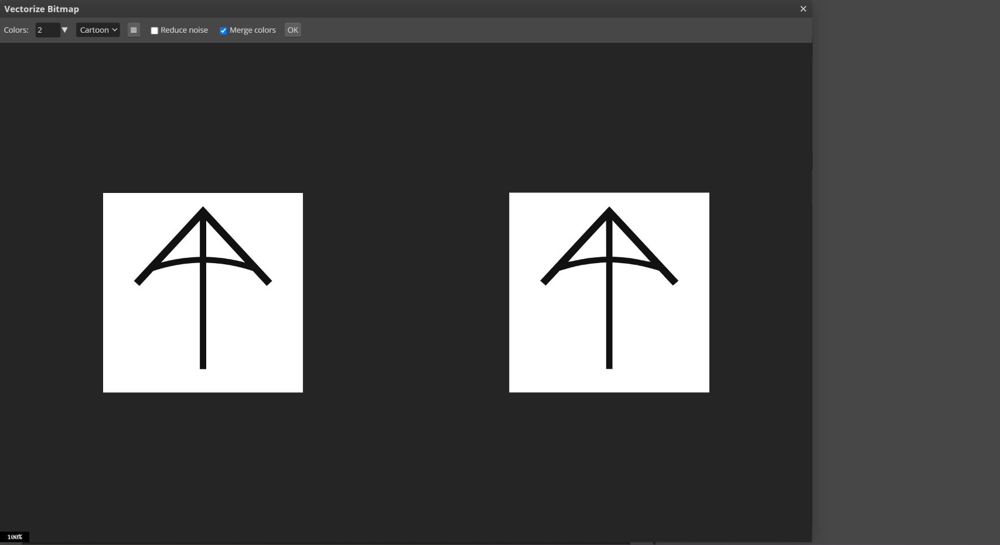
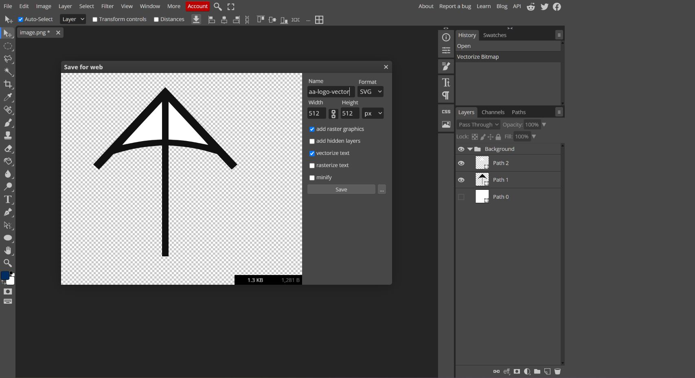

::: {.callout-important}
## One print. One filament colour.

Print the complete badge **once in white PLA**. There is no filament change and no multicolour print.

- The outside ring and AA arrow stay white.
- Navy, gold and any other approved colours are added **after printing** in the recessed areas.
- The colours in the preview are a finishing plan, not separate Tinkercad solids.
:::

::: {.callout-important}
## Account and permission check

Before students create or use a Tinkercad or Photopea account, confirm each service through the current board's digital-tool process, vendor age requirements and privacy/security guidance. Confirm that the required Ontario third-party software notice has been issued and obtain parent/guardian permission whenever local or vendor rules require it. See [Software access, privacy and permission](01-additive-cad.qmd#software-access-privacy-and-permission). Provide an approved account-free, offline or teacher-operated alternative when needed.
:::

## The two-version assignment

1. **V1 — guided AA arrow badge:** follow every step below and build the supplied AA arrow inside a circular rim.
2. **V2 — original badge:** repeat the same workflow using a simple logo you designed yourself.

The AA arrow is intentionally simple. V1 teaches the production method without burying the class in a complicated school crest. V2 proves that you can transfer the method to original work.

::: {.callout-tip}
## Temu CAD, used on purpose

Tinkercad is our affectionate **Temu CAD** pathway: quick, web-based and surprisingly capable when the geometry is simple. It is perfect for this guided build. When you need exact constraints, variables and feature history, move to [Onshape](faux-enamel-pin-jewellery.qmd) or another teacher-approved parametric CAD package.
:::

{.ter-concept-diagram fig-alt="Circular navy and gold badge with a white outer ring and white AA arrow"}

## What you are making — inches only

Before modelling, select **Edit Grid** in Tinkercad and change the units to **inches**.

| Feature | V1: AA arrow badge | V2: original badge |
|---|---:|---:|
| Finished diameter | 2.00 in | 2.00 in |
| Solid white base | 0.12 in | 0.12 in |
| Raised white walls | 0.04 in | 0.04 in |
| Total thickness | about 0.16 in | about 0.16 in |
| Minimum wall or gap | 0.05 in | 0.05 in |
| Filament | white PLA only | white PLA only |
| Colour | applied after printing | applied after printing |

{.ter-concept-diagram}

## Instructions, editable source and downloads

Use the source kit below. The SVG files are editable design geometry. The STL is only a teacher reference and recovery file.

- [AA arrow raster reference](../../assets/branding/logo/aa-logo-transparent.png){download="aa-arrow-reference.png"}
- [Editable AA arrow SVG](../../assets/onshape-logo-stamp/photopea-workflow/aa-logo-vector.svg){download="aa-arrow-vector.svg"}
- [Fabrication-ready AA arrow and circular rim SVG](../../assets/tinkercad-logo-jewellery/source/aa-faux-enamel-detail.svg){download="aa-arrow-faux-enamel-detail.svg"}
- [Editable circular base SVG](../../assets/tinkercad-logo-jewellery/source/circle-base.svg){download="circle-base.svg"}

### Completed reference STL

- [Download the AA arrow STL as a ZIP — recommended](../../assets/tinkercad-logo-jewellery/downloads/aa-arrow-faux-enamel-brooch-stl.zip){download="aa-arrow-faux-enamel-brooch-stl.zip"}
- [Download the AA arrow STL directly](../../assets/tinkercad-logo-jewellery/downloads/aa-arrow-faux-enamel-brooch.stl){download="aa-arrow-faux-enamel-brooch.stl"}

::: {.callout-tip}
## If the STL link will not download

Use the **ZIP — recommended** link. Extract `aa-arrow-faux-enamel-brooch.stl`, then import the STL into the class slicer. Some browsers try to preview a direct `.stl` link instead of saving it; the ZIP avoids that problem.
:::

# V1 — guided AA arrow build {#v1-aa-arrow-guided-build}

## Part A — learn the Photopea trace

The raster PNG is made from pixels. Tinkercad needs clean vector paths. These screenshots show the actual AA arrow workflow in [Photopea](https://www.photopea.com/).

### Step 1 — open the simple AA arrow

1. Download `aa-arrow-reference.png` from the source kit.
2. Open Photopea.
3. Select **File → Open** and choose the PNG.
4. Confirm that the complete arrow is visible and not cropped.

{fig-alt="AA arrow raster open in the Photopea workspace"}

### Step 2 — vectorize the bitmap

1. Select **Image → Vectorize Bitmap**.
2. Set **Colors** to **2**.
3. Turn on **Reduce noise** and **Merge colors**.
4. Preview the result. The outside edges should be smooth and the centre openings should remain open.
5. Accept the vectorization.

{fig-alt="Photopea Vectorize Bitmap window set to two colours"}

### Step 3 — inspect the vector layer

1. In the Layers panel, confirm that Photopea created a **Vector** layer.
2. Zoom in on the point, curved crossbar and long centre stem.
3. Remove stray dots or disconnected fragments.
4. Keep the arrow bold. Do not add tiny text.

{fig-alt="Clean AA arrow vector layer in Photopea"}

### Step 4 — export the SVG

1. Select **File → Export as → SVG**.
2. Check the preview and make sure the whole arrow is inside the canvas.
3. Select **Save**.
4. Name the file `lastname-aa-arrow.svg`.

{fig-alt="Photopea Export as menu with SVG selected"}

{fig-alt="Photopea SVG export preview and settings"}

::: {.callout-note}
The supplied `aa-arrow-faux-enamel-detail.svg` adds a circular outer rim to the arrow. The rim is important because it contains the post-print colour. Compare your trace with the supplied fabrication-ready SVG before entering Tinkercad.
:::

## Part B — build the one-colour model in Tinkercad

Open [Tinkercad](https://www.tinkercad.com/), create a new **3D Design**, rename it `lastname-aa-faux-enamel-v1`, and change **Edit Grid → Units** to **inches**.

This is the Temu CAD shift: two SVG imports, two controlled heights, one alignment and one printable group.

### Step 5 — import and size the base

1. Select **Import**.
2. Upload `circle-base.svg`.
3. Set the width and length to **2.00 in × 2.00 in**.
4. Set **Height** to **0.12 in**.
5. Set the shape colour to white. This is a visual reminder that the print uses white PLA.

Checkpoint: the base must be a flat, solid circle with no hole in the centre.

### Step 6 — import the AA arrow and rim

1. Select **Import** again.
2. Upload `aa-arrow-faux-enamel-detail.svg`.
3. Set the width and length to **2.00 in × 2.00 in**.
4. Set **Height** to **0.04 in**.
5. Raise the detail **0.12 in** above the workplane so it sits on top of the base.
6. Set the detail to white too.

{fig-alt="Black vector preview of the circular rim and AA arrow" width="520"}

### Step 7 — align, inspect and group

1. Select both objects.
2. Select **Align**.
3. Click the horizontal centre dot and the vertical centre dot.
4. Orbit to a low side view.
5. Confirm the base is **0.12 in** and the detail rises another **0.04 in**.
6. Confirm the back is flat and the raised ring and arrow touch the base.
7. Press **Ctrl+G** to group the shapes into one printable model.

::: {.callout-note}
## Temu CAD inspection rule

`Ctrl+G` can merge a good model or hide a bad one. The low view, flat back, slicer preview and physical print—not the Group button—prove that the geometry works.
:::

::: {.callout-warning}
Do not make navy and gold objects in Tinkercad. Do not plan a filament swap. The model is one white part; colour is a finishing operation.
:::

### Step 8 — export the STL

1. Keep the grouped model selected.
2. Select **Export**.
3. Choose **The selected shape**.
4. Under **For 3D Print**, select **.STL**.
5. Name it `lastname-aa-faux-enamel-v1.stl`.

## Part C — slice, print and finish

### Step 9 — slicer check

1. Import the STL into the class slicer.
2. Place it flat, plain side down and decorated side up.
3. Use the approved white-PLA profile.
4. Preview every layer. The print should begin with a solid circular base and finish with the raised ring and arrow.
5. Ask for the teacher checkpoint before printing.

### Step 10 — apply the faux-enamel colour

1. Let the white print cool and remove strings or loose material.
2. Test the approved finish on a failed print or scrap piece.
3. Add small amounts of navy, gold and other approved colours only to the recessed areas.
4. Guide the finish with a fine brush or toothpick.
5. Keep the outside ring and AA arrow white.
6. Apply several thin coats instead of one thick coat.
7. Let the finish cure completely before attaching a brooch finding.

Use only teacher-approved finishing products, ventilation, PPE and adhesive procedures.

# V2 — your original logo

V2 uses the same process with artwork you created. Do not copy a company, sports team, game, social-media or clothing logo.

## Part D — make a simple V2 SVG in Photopea

1. Begin with a high-contrast logo containing no more than three large colour regions.
2. Open it in Photopea and select **Image → Vectorize Bitmap**.
3. Begin with **2–4 colours**, then reduce the number until the edges are clean.
4. Remove tiny text, detached dots and narrow features.
5. Keep every important wall and gap at least **0.05 in** at the final badge size.
6. Add a closed outside rim so every planned colour area is contained.
7. Select **File → Export as → SVG** and save `lastname-original-logo.svg`.

## Part E — repeat the Tinkercad build

1. Duplicate your successful V1 design or begin a new Tinkercad file.
2. Keep the proven **2.00 in × 0.12 in** circular base.
3. Import your original SVG as **0.04 in** raised white structure.
4. Raise the artwork **0.12 in** and centre-align it with the base.
5. Inspect the top, side and bottom.
6. Group the model and export one STL.
7. Print once in white PLA.
8. Add two or three contrasting colours after printing.

V2 is the Temu CAD graduation test: the software stays simple, but the design decisions must become original, measurable and defensible.

# Assignment SOP

| SOP stage | Required action | Evidence |
|---|---|---|
| 1. Plan | Identify white structure, colour cavities, final size and finding | annotated logo or colour plan |
| 2. Prepare | Vectorize and simplify in Photopea; export SVG | Photopea screenshot and SVG |
| 3. Produce | Build 0.12 in base + 0.04 in raised detail | top and low-view screenshots |
| 4. Verify | Check alignment, flat back, 0.05 in walls and slicer preview | teacher checkpoint screenshot |
| 5. Manufacture | Print once in white PLA using the approved profile | unpainted print photo |
| 6. Finish | Apply thin, teacher-approved faux-enamel coats and cure | finished photo |
| 7. Evaluate | Compare V1 with V2 and identify one evidence-based improvement | 100–150 word reflection |

## Submit V1 — guided checkpoint

1. one Photopea vector screenshot;
2. one Tinkercad top-view screenshot;
3. one Tinkercad side or low-view screenshot;
4. `lastname-aa-faux-enamel-v1.stl`;
5. a photo of the unpainted white print; and
6. a photo of the cured multicolour badge with the ring and arrow still white.

## Submit V2 — original final

1. `lastname-original-logo.svg`;
2. top and side or low-view Tinkercad screenshots;
3. `lastname-original-faux-enamel-v2.stl`;
4. unpainted and finished photographs; and
5. the short V1-to-V2 improvement reflection.

## Success criteria

- Both badges are printed once in **white PLA**.
- V1 clearly matches the supplied AA arrow and circular rim.
- The outside ring and AA arrow remain visible as white raised structure.
- The base is **0.12 in** and the raised artwork is **0.04 in**.
- Important walls and gaps are at least **0.05 in**.
- Colour stays inside the intended recessed areas.
- V2 uses an original, simplified logo.
- Each submitted STL matches its editable Tinkercad design.
- The reflection identifies a specific improvement supported by evidence.

## Teacher note — Google Classroom drafts

Create two unassigned Classroom drafts:

- **Faux-Enamel Badge V1 — AA Arrow Guided Checkpoint**
- **Faux-Enamel Badge V2 — Original Logo Final**

Attach this lesson to both drafts. Keep V1 as a formative checkpoint and grade V2 with the success criteria. Do not assign either post until the printer, white PLA, finishing products, ventilation and findings are ready.
