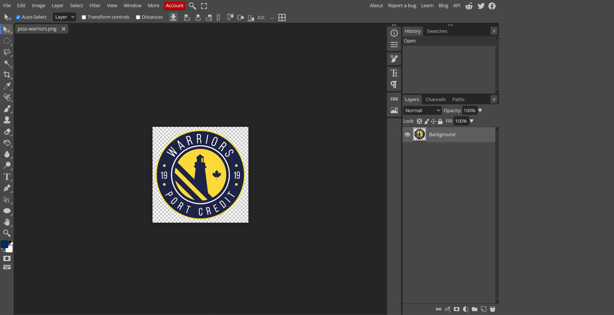
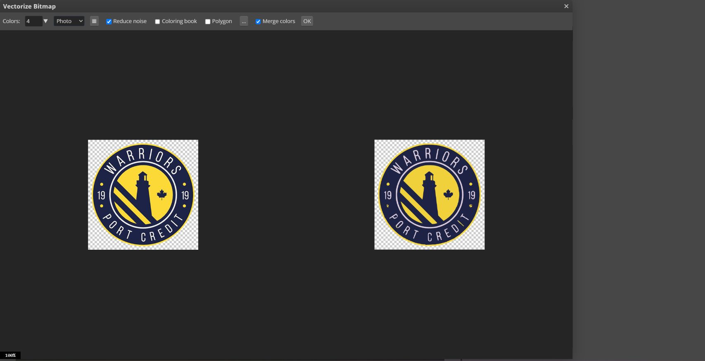
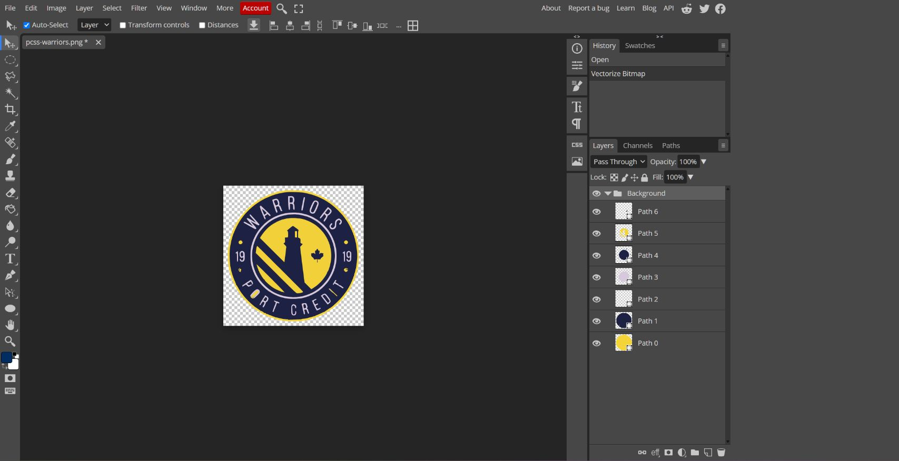
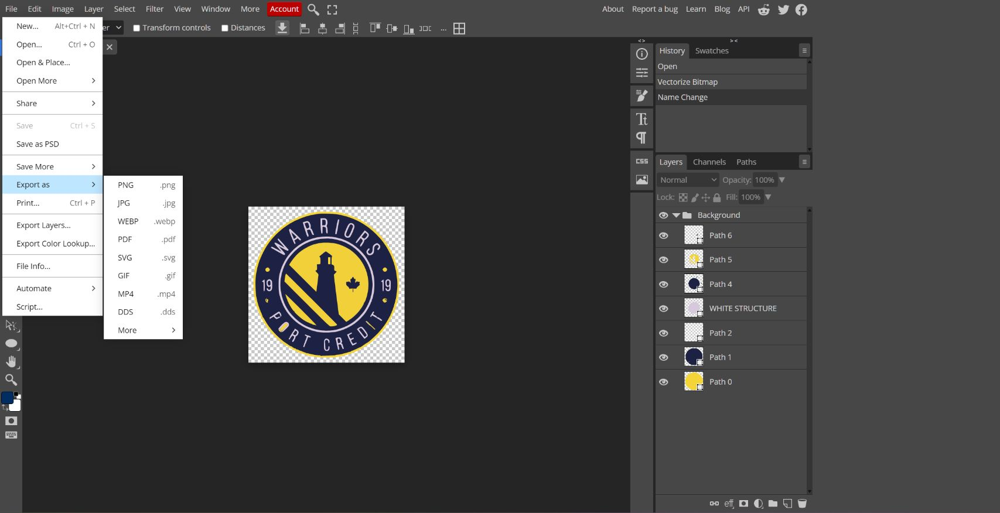
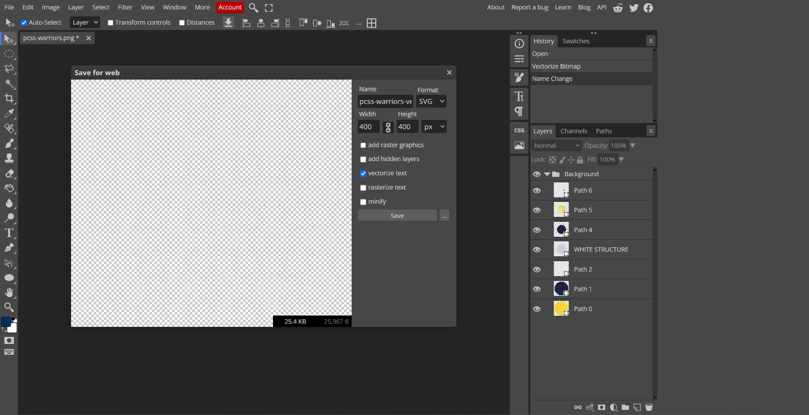
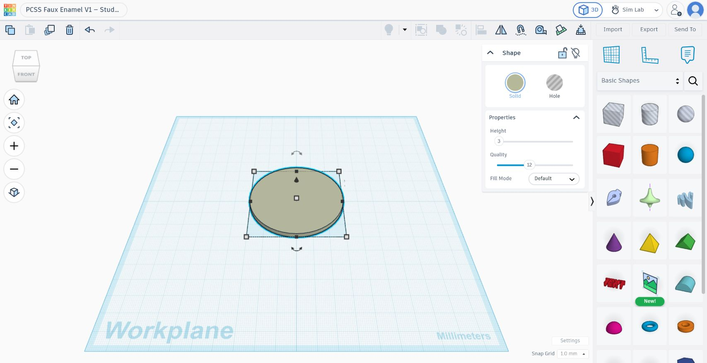
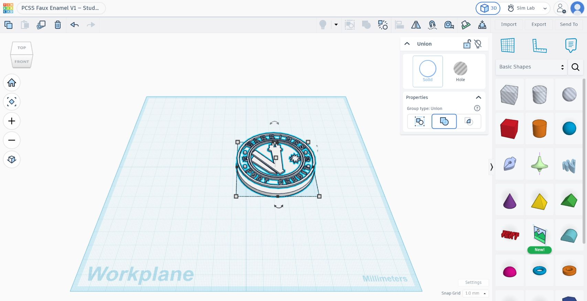
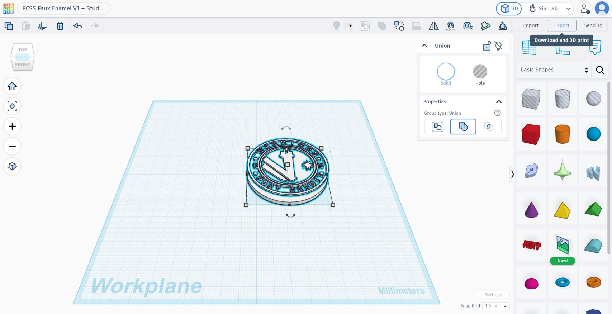
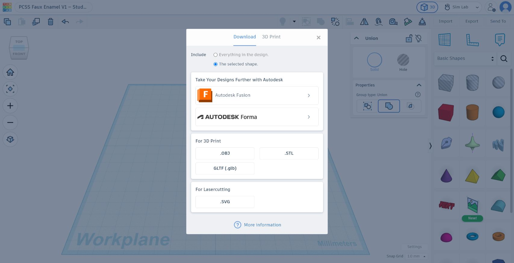

::: {.callout-important}
## One print. One filament colour.

Print the complete badge **once in white PLA**. There is no filament change and no multicolour print.

- The curved text, circular outlines and raised details stay white.
- Port Credit navy and Warriors gold are added **after printing** as teacher-approved faux-enamel finishes.
- The colours shown in the original logo are a finishing guide, not separate Tinkercad solids.
:::

## The two-version assignment

1. **V1 — guided PCSS badge:** follow the photographed workflow and build the supplied school logo as a 60 mm badge.
2. **V2 — original badge:** repeat the same process using a simple logo you designed yourself.

V1 teaches the production method. V2 proves that you can transfer it to original work.

## What you are making

| Feature | V1: PCSS badge | V2: original badge |
|---|---:|---:|
| Finished diameter | 60 mm | 50 mm brooch, or 30 mm for a very simple design |
| Solid white base | 3 mm | 3 mm |
| Raised white artwork | 1 mm | 1 mm |
| Total thickness | about 4 mm | about 4 mm |
| Minimum printable stroke | 1.2 mm | 1.2 mm |
| Filament | white PLA only | white PLA only |
| Colour | applied after printing | applied after printing |

{fig-alt="Port Credit Warriors round school logo" width="400"}

## Download the V1 files

- [PCSS reference PNG](../../assets/branding/pcss/pcss-warriors.png){download="pcss-warriors.png"}
- [Clean PCSS raised-detail SVG](../../assets/tinkercad-logo-jewellery/source/pcss-white-structure.svg){download="pcss-white-structure.svg"}
- [60 mm circular base SVG](../../assets/tinkercad-logo-jewellery/source/circle-base.svg){download="circle-base.svg"}
- [Completed one-colour PCSS STL](../../assets/tinkercad-logo-jewellery/downloads/pcss-faux-enamel-one-colour.stl){download="pcss-faux-enamel-one-colour.stl"}

The completed STL is a teacher reference and recovery file. Build the editable Tinkercad version yourself before using it.

# V1 — PCSS guided build

## Part A — inspect and vectorize the logo in Photopea

The original PNG is made from pixels. Tinkercad needs an SVG made from vector paths. The following screenshots were made while completing the actual PCSS workflow in [Photopea](https://www.photopea.com/).

### Step 1 — open the PCSS PNG

1. Open Photopea.
2. Select **File → Open**.
3. Open `pcss-warriors.png`.
4. Confirm that the full circular logo is visible and not cropped.

{fig-alt="PCSS Warriors logo open in the Photopea workspace"}

### Step 2 — vectorize the bitmap

1. Select **Image → Vectorize Bitmap**.
2. Set **Colors** to **4**.
3. Choose the **Photo** preset.
4. Turn on **Reduce noise** and **Merge colors**.
5. Preview the result before accepting it.

{fig-alt="Photopea Vectorize Bitmap dialogue with four colours selected"}

### Step 3 — inspect the vector layer

1. Accept the vectorization.
2. In the Layers panel, confirm that Photopea created a **Vector** layer.
3. Zoom in on `WARRIORS`, `PORT CREDIT`, the rings, lighthouse and maple leaf.
4. Look for broken letters, small islands and rough edges.

{fig-alt="Photopea Layers panel showing the PCSS vector artwork"}

::: {.callout-note}
Automatic tracing is useful for learning and for simple V2 logos, but the PCSS mark contains curved lettering and many small shapes. For V1, use the supplied **clean PCSS raised-detail SVG** in Tinkercad. It keeps the school mark recognizable and the strokes printable.
:::

### Step 4 — export an SVG

1. Select **File → Export as → SVG**.
2. Keep the full artwork selected.

{fig-alt="Photopea Export as menu with SVG selected"}

3. In the SVG export window, check the preview and dimensions.
4. Select **Save**.
5. Name the file clearly, such as `lastname-pcss-trace.svg`.

{fig-alt="Photopea SVG export preview and settings"}

## Part B — build the one-colour model in Tinkercad

Open [Tinkercad](https://www.tinkercad.com/), create a new **3D Design**, and rename it `lastname-pcss-faux-enamel-v1`.

### Step 5 — import and size the base

1. Select **Import**.
2. Upload `circle-base.svg`. If file upload is unavailable, use **Import from URL** with the file link supplied by your teacher.
3. Set width and length to **60 mm × 60 mm**.
4. Set **Height** to **3 mm**.
5. Set the shape colour to white. This is a visual reminder that the print uses white PLA.

{fig-alt="Tinkercad workplane with the circular base selected and height set to 3 millimetres"}

### Step 6 — import the raised PCSS detail

1. Select **Import** again.
2. Import `pcss-white-structure.svg`.
3. Set it to **60 mm × 60 mm**.
4. Set **Height** to **1 mm**.
5. Raise it **3 mm** above the workplane. The detail must sit on top of the 3 mm base, not inside it.
6. Set this shape to white too.

{fig-alt="White PCSS raised detail aligned above the circular base with its height set to 1 millimetre"}

### Step 7 — align, inspect and group

1. Select both objects.
2. Select **Align** and click the horizontal and vertical centre dots.
3. Orbit to a low side view. Confirm that the base is 3 mm and the detail is 1 mm on top.
4. Confirm that the back is flat and that the text and rings are not floating.
5. Press **Ctrl+G** to group the two shapes into one printable model.

{fig-alt="Finished one-colour white PCSS model grouped in Tinkercad"}

{fig-alt="Low perspective view of the three millimetre base and one millimetre raised detail"}

::: {.callout-warning}
Do not make navy and gold objects in Tinkercad. Do not plan a filament swap. The grouped model is one white part; colour is a finishing operation.
:::

### Step 8 — export the STL

1. Keep the grouped model selected.
2. Select **Export**.
3. Choose **The selected shape**.
4. Under **For 3D Print**, select **.STL**.
5. Name it `lastname-pcss-faux-enamel-v1.stl`.

{fig-alt="Tinkercad Export window with STL selected for 3D printing"}

## Part C — slice, print and finish

### Step 9 — slicer check

1. Import the STL into the class slicer.
2. Place it flat, plain side down and decorated side up.
3. Use the approved white-PLA profile.
4. Preview every layer. The print should begin with a solid circular base and finish with the raised logo structure.
5. Ask for the teacher checkpoint before printing.

### Step 10 — faux-enamel finish

1. Let the white print cool and remove strings or loose material.
2. Test the approved navy and gold finishes on a failed print or scrap piece.
3. Add small amounts of navy and gold only to the recessed areas.
4. Guide the finish with a fine brush or toothpick.
5. Keep the raised text, rings and divider details white.
6. Apply several thin coats instead of one thick coat.
7. Let the finish cure completely before attaching a brooch finding.

Use only teacher-approved finishing products, ventilation, PPE and adhesive procedures.

# V2 — your original logo

V2 uses the same process with artwork you created. Do not copy a company, sports team, game, social-media or clothing logo.

## Part D — make a simple V2 SVG in Photopea

1. Start with a high-contrast black-and-white logo or a logo with no more than three large colours.
2. Open it in Photopea.
3. Select **Image → Vectorize Bitmap**.
4. Begin with **2–4 colours**, then reduce the number until the edges are clean.
5. Remove tiny text, detached dots and narrow features.
6. Keep every important stroke at least **1.2 mm** at the final badge size.
7. Select **File → Export as → SVG** and save `lastname-original-logo.svg`.

These screenshots show the same steps on a simple original `AA` example:

{fig-alt="Original AA logo open in Photopea"}

{fig-alt="Photopea Vectorize Bitmap window set to two colours for a simple original logo"}

{fig-alt="Clean vector layer for the original AA logo"}

## Part E — repeat the Tinkercad build

1. Duplicate your successful V1 design or begin a new Tinkercad file.
2. Keep the proven **3 mm white base**.
3. Import your V2 SVG as the **1 mm raised white detail**.
4. Raise the artwork **3 mm** and centre-align it with the base.
5. Inspect the top, side and bottom.
6. Group the model and export one STL.
7. Print once in white PLA.
8. Choose two or three post-print colours that contrast with the white structure.

Use a 50 mm badge for most V2 designs. Use 30 mm only when the design has very few, very wide shapes.

# Assignment SOP

Use this standard operating procedure for both versions.

| SOP stage | Required action | Evidence |
|---|---|---|
| 1. Plan | Identify white structure, navy/gold or student-choice finish areas, final size and finding | annotated logo or colour plan |
| 2. Prepare | Vectorize and simplify in Photopea; export SVG | Photopea screenshot and SVG |
| 3. Produce | Build 3 mm base + 1 mm raised detail in Tinkercad | top/low-view screenshot |
| 4. Verify | Check alignment, flat back, 1.2 mm strokes and slicer preview | teacher checkpoint screenshot |
| 5. Manufacture | Print once in white PLA using the approved profile | unpainted print photo |
| 6. Finish | Apply thin, teacher-approved faux-enamel coats and cure | finished photo |
| 7. Evaluate | Compare V1 with V2 and identify one evidence-based improvement | 100–150 word reflection |

## Submit V1 — guided checkpoint

Submit:

1. one Photopea vector screenshot;
2. one Tinkercad side/low-view screenshot;
3. `lastname-pcss-faux-enamel-v1.stl`;
4. a photo of the unpainted white print; and
5. a photo of the cured navy, gold and white badge.

## Submit V2 — original final

Submit:

1. `lastname-original-logo.svg`;
2. top and side/low-view Tinkercad screenshots;
3. `lastname-original-faux-enamel-v2.stl`;
4. unpainted and finished photographs; and
5. the short V1-to-V2 improvement reflection.

## Success criteria

- Both badges are printed once in **white PLA**.
- V1 is recognizably based on the supplied PCSS Warriors mark.
- Curved text and circular outlines stay visible as white raised structure.
- The base is 3 mm and the raised artwork is 1 mm.
- Important strokes are at least 1.2 mm wide.
- Colour stays in the intended recessed areas without covering the white structure.
- V2 uses an original, simplified logo.
- Each submitted STL matches its editable Tinkercad design.
- The reflection identifies a specific improvement supported by evidence.

## Teacher note — Google Classroom draft

Create two unassigned Classroom drafts from the submission lists above:

- **Faux-Enamel Badge V1 — PCSS Guided Checkpoint**
- **Faux-Enamel Badge V2 — Original Logo Final**

Attach this lesson to both drafts. Keep V1 as a formative checkpoint and grade V2 with the success criteria. Do not assign either post until the printer, white PLA, finishing products, ventilation and findings are ready.
