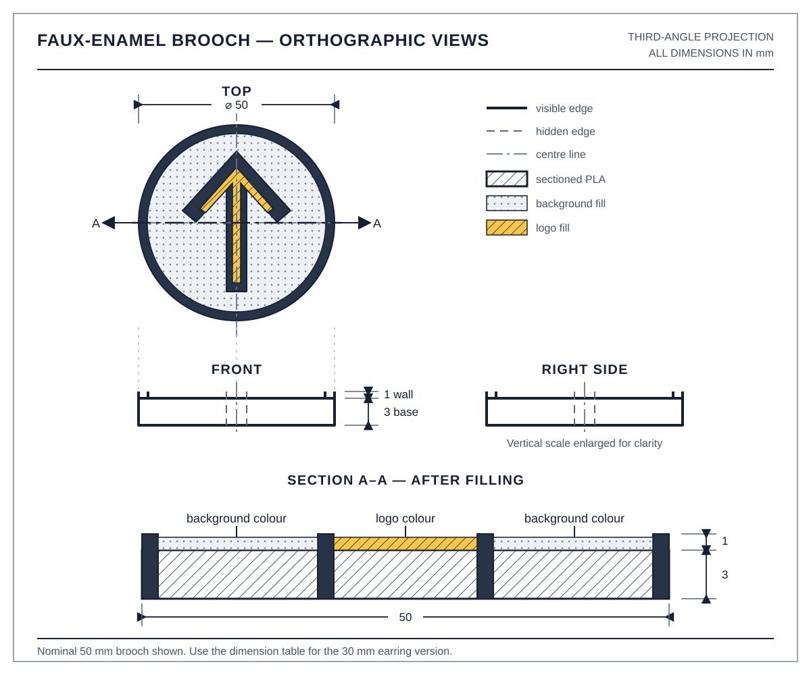

::: {.ter-project-brief}
## The project

Turn an **original personal, business, club or community logo** into one circular faux-enamel product:

- a **30 mm earring**; or
- a **50 mm brooch**.

The back stays flat for a glue-on finding. The front has raised walls and enclosed recessed areas that can be filled with teacher-approved nail polish.
:::

Do not copy a company, team, game, social-media or clothing logo. Use the logo you created in Photopea, or create another original, teacher-approved design.

Read this as a **third-angle orthographic drawing**: the top view is above the front view, and the right-side view is placed to the right. The exterior views establish the shape and dimensions; **section A–A** shows how the two colour fills sit above the 3 mm base and between the 1 mm raised walls.

{.ter-concept-diagram}

## See the finished idea

These photographs show the process and the range of products possible. Your artwork must still be original.

<figure class="ter-process-example ter-process-example--photo">
  
  <figcaption><strong>Finished possibilities:</strong> the same method can produce earrings, brooches, collar pins and other small jewellery. Photograph: <a href="https://www.instructables.com/Turn-3D-Printed-Faux-Enamel-Pins-Into-Unique-Jewel/" target="_blank" rel="noopener noreferrer">kura_kura / Instructables</a>.</figcaption>
</figure>
<figure class="ter-process-example ter-process-example--photo">
  
  <figcaption><strong>Fill the pockets:</strong> place colour inside the recessed areas and guide it to the raised walls. Photograph: <a href="https://www.instructables.com/Turn-3D-Printed-Faux-Enamel-Pins-Into-Unique-Jewel/#step2" target="_blank" rel="noopener noreferrer">kura_kura / Instructables</a>.</figcaption>
</figure>
<figure class="ter-process-example ter-process-example--photo">
  
  <figcaption><strong>Add the hardware:</strong> a flat back accepts an earring post, brooch bar or another teacher-approved finding. Photograph: <a href="https://www.instructables.com/Turn-3D-Printed-Faux-Enamel-Pins-Into-Unique-Jewel/#step4" target="_blank" rel="noopener noreferrer">kura_kura / Instructables</a>.</figcaption>
</figure>

The reference photographs remain copyright of their creator and are not included in this site's CC BY-SA licence. Select any photograph to open the original project and full context.

## Choose the construction

### Full faux-enamel (preferred)

The outer rim and the **outline of the logo** are raised. The logo and background are both recessed pockets. Fill each pocket with a different colour.

Example: fill the AA arrow pocket black and the background pocket white.

### One-colour fill (easier)

The outer rim and the complete logo are raised solid plastic. Only the background is recessed and filled. This is useful when a logo outline would create pockets that are too small.

## Dimensions

| Feature | Earring | Brooch |
|---|---:|---:|
| Circle diameter | 30 mm | 50 mm |
| Logo width | 22–24 mm | 38–40 mm |
| Solid base | 3 mm | 3 mm |
| Recess depth | 0.8–1 mm | 0.8–1 mm |
| Raised wall width | at least 1.2 mm | at least 1.2 mm |
| Finished thickness | about 4 mm | about 4 mm |

Use the earring size only for a very simple logo. Detailed logos belong on the larger brooch.

## Download the starter shapes

- [Circular base SVG](../../assets/tinkercad-logo-jewellery/source/circle-base.svg)
- [Circular rim SVG](../../assets/tinkercad-logo-jewellery/source/circle-rim.svg)
- [AA raised-detail example SVG](../../assets/tinkercad-logo-jewellery/source/aa-faux-enamel-detail.svg)
- [AA brooch teacher-example STL](../../assets/tinkercad-logo-jewellery/downloads/aa-arrow-faux-enamel-brooch.stl)
- [Technology Commons fabrication SVG](../../assets/branding/emblem/commons-emblem-fabrication.svg)
- [Technology Commons colour-reference SVG](../../assets/branding/emblem/commons-emblem.svg)

You also need your own transparent **SVG logo** from the Photopea logo assignment.

### Technology Commons example

<h2>Use the lighthouse as a larger brooch</h2>
This is the missing Technology Commons example. Use the simplified fabrication file, remove details that disappear in the slicer, and make it a <strong>50–60 mm brooch</strong>. It is too detailed for a 30 mm earring.

<a class="btn btn-primary" href="../../assets/branding/emblem/commons-emblem-fabrication.svg">Download fabrication SVG</a> <a class="btn btn-outline-secondary" href="../../assets/branding/emblem/commons-emblem.svg">View colour reference</a>

## Step 1: Start the Tinkercad design

1. Sign in to [Tinkercad](https://www.tinkercad.com/).
2. Select **Create → 3D Design**.
3. Rename the design `lastname-logo-earring` or `lastname-logo-brooch`.
4. Keep **Snap Grid** at **1.0 mm** while setting the main heights.

## Step 2: Import the circular base

1. Select **Import**.
2. Choose `circle-base.svg`.
3. Set both dimensions to **30 mm** for an earring or **50 mm** for a brooch.
4. Select **Import**.
5. Select the circle and set **Height** to **3 mm**.

This creates the flat surface that will later receive the glue-on finding.

## Step 3: Add the outer rim

1. Import `circle-rim.svg` at the **same diameter** as the base.
2. Set its **Height** to **1 mm**.
3. Raise it **3 mm** above the workplane. Press **Ctrl + Up Arrow** three times.
4. Confirm that the rim sits on the base and creates an enclosed pocket. It must not hang past the edge.

## Step 4: Import and size the logo

1. Select **Import** and choose your original SVG logo.
2. Use the target logo width from the dimension table.
3. Keep the logo centred inside the rim.
4. Remove tiny details that create narrow, fragile walls or pockets that a nail-polish brush cannot reach.

For the **AA arrow**, use the simpler arrow/lettermark without small text. For the **Technology Commons** example, use the circular lighthouse emblem without the words around it. Make that version a **50–60 mm brooch**, not an earring.

## Step 5: Make the logo fillable

For the preferred full faux-enamel version:

1. Select the imported logo.
2. Open **Fill Mode**.
3. Choose **Inner Line** so the boundary becomes a wall and the logo becomes a recessed pocket.
4. Adjust the line width until every wall is at least **1.2 mm** wide.
5. Set **Height** to **1 mm**.
6. Raise the logo **3 mm** above the workplane with **Ctrl + Up Arrow** three times.

For the easier one-colour-fill version, leave **Fill Mode** at **Default**, set **Height** to **1 mm**, and raise the logo 3 mm.

<figure class="ter-process-example ter-process-example--wide">
  
  <figcaption><strong>Reference sequence:</strong> import the SVG, create the solid base and raised wall version, then align the parts. Screenshot sequence: <a href="https://www.instructables.com/Turn-3D-Printed-Faux-Enamel-Pins-Into-Unique-Jewel/#step1" target="_blank" rel="noopener noreferrer">kura_kura / Instructables</a>.</figcaption>
</figure>

## Step 6: Align and inspect

1. Select the base, rim and logo.
2. Select **Align**.
3. Use the two centre alignment dots so all three parts share the same centre.
4. Orbit the view and inspect the model from the top, side and bottom.
5. Confirm that every polish area is completely enclosed.
6. Confirm that the back is flat and uninterrupted.
7. Select all parts and press **Ctrl + G** to group them.

Do not continue if a cavity leaks through the rim, a wall is extremely thin, or a pocket is too small to fill cleanly.

## Step 7: Export for printing

1. Select the grouped model.
2. Select **Export**.
3. Choose **The selected shape**.
4. Choose **.STL**.
5. Name the file `lastname-logo-earring.stl` or `lastname-logo-brooch.stl`.
6. Open the STL in the class slicer and inspect every layer before printing.

Print the badge flat with the decorated face upward unless the teacher approves a different orientation.

## Finish the faux enamel

1. Let the printed part cool completely and remove any loose strings.
2. Test the polish on a failed print or sample first.
3. Place a small drop of polish into a cavity.
4. Guide it to the edges with the brush or a toothpick. Do not cover the raised walls.
5. Apply **two or three thin coats**, allowing each coat to dry.
6. Let the finished piece cure fully before gluing hardware or wearing it.

Use only teacher-approved polish and finishing products, with the ventilation and protective procedures required by the school.

## Glue on the finding

### Earring

Use an **8–10 mm stainless-steel flat-pad earring post** with a matching back. The post pad must fit completely on the flat rear surface.

### Brooch

Use a **20–25 mm glue-on bar pin** with a flat base.

Lightly roughen only the glue area and remove dust. A teacher may apply a small amount of [Loctite Super Glue Gel Control](https://www.loctiteproducts.com/products/central-pdp.html/loctite-super-glue-gel-control/SAP_0201DGL029X7/variation/234790.html) or another school-approved adhesive after testing it on the printed material. Five-minute epoxy is a stronger, more gap-filling option but requires more mixing, curing time and handling controls. Hot glue is not a durable jewellery attachment.

Do not wear the product until the polish and adhesive are completely cured. Do not claim that an earring finding is hypoallergenic unless the supplier documents the exact material.

## What to buy for one class

Search Amazon or a jewellery supplier for:

- `stainless steel flat pad earring posts 8mm or 10mm with backs`;
- `glue on brooch pin backs 20mm or 25mm`;
- one or two class sets of inexpensive nail-polish colours;
- toothpicks or fine disposable applicators; and
- a teacher-controlled gel cyanoacrylate or approved two-part epoxy.

Buy findings in bulk only after printing one earring and one brooch test piece and confirming that the pad sizes fit the backs.

## Submit

Submit:

1. one screenshot showing the top of the completed Tinkercad model;
2. one screenshot showing the side and the 3 mm base plus 1 mm walls;
3. the exported STL;
4. one photograph of the filled and fully cured product; and
5. a short reflection naming one design change you would make after inspecting the print and polish.

## Reference

The finishing idea is adapted from [Turn 3D Printed Faux Enamel Pins Into Unique Jewellery](https://www.instructables.com/Turn-3D-Printed-Faux-Enamel-Pins-Into-Unique-Jewel/). Use it as process inspiration, not as an answer file. Students must create original artwork.
