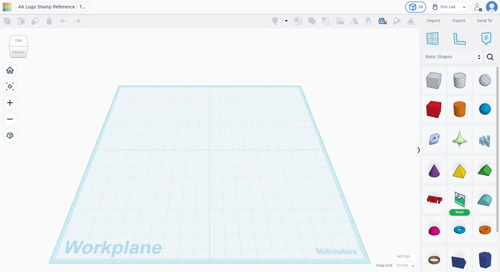
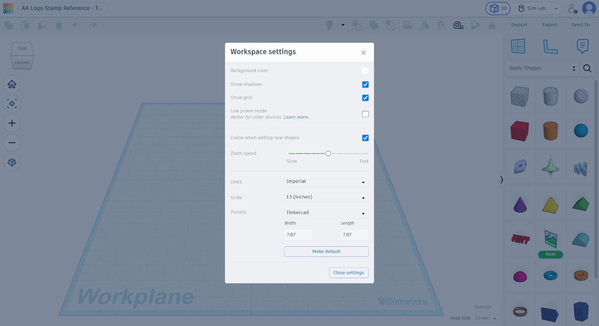
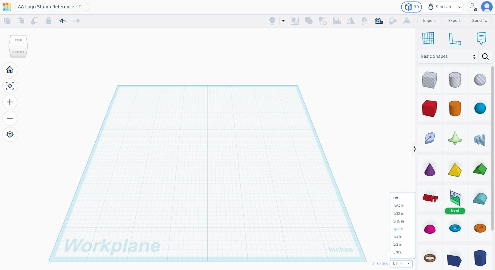
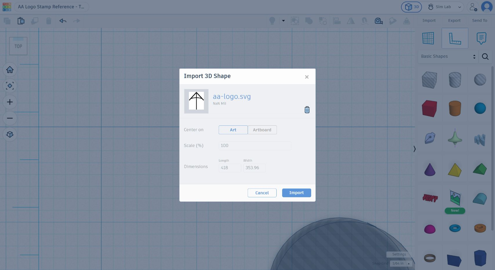
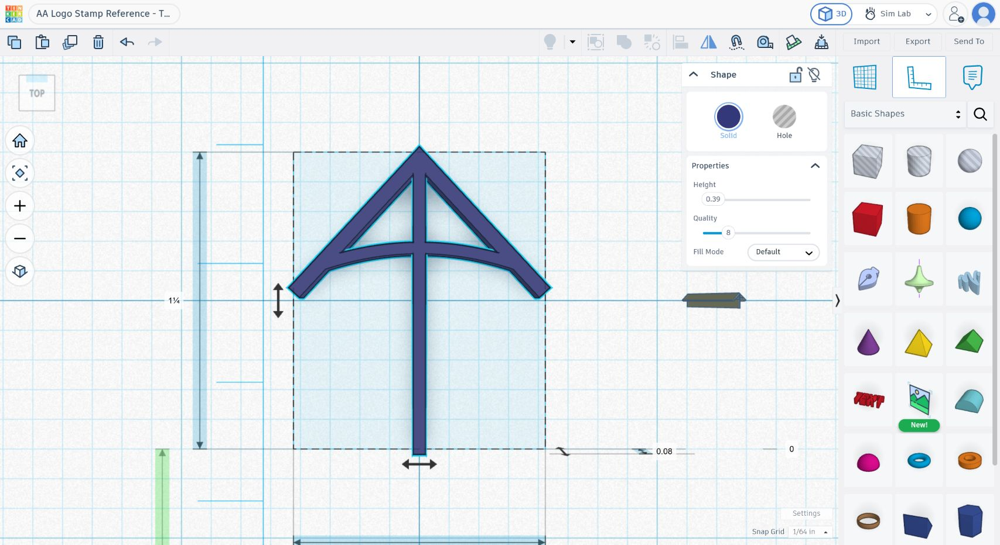
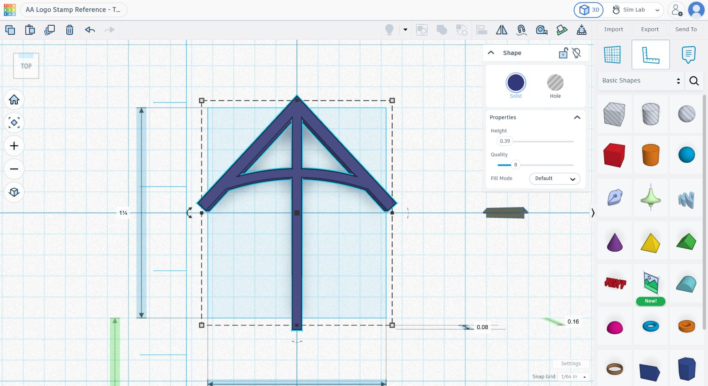
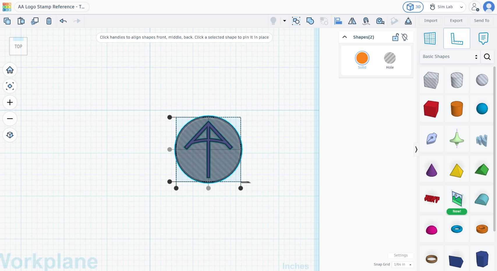
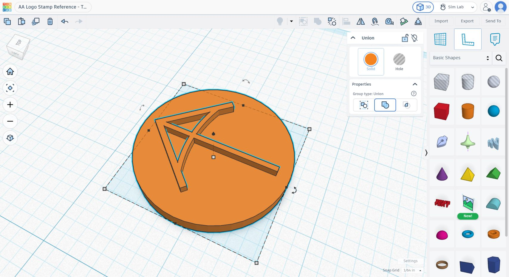
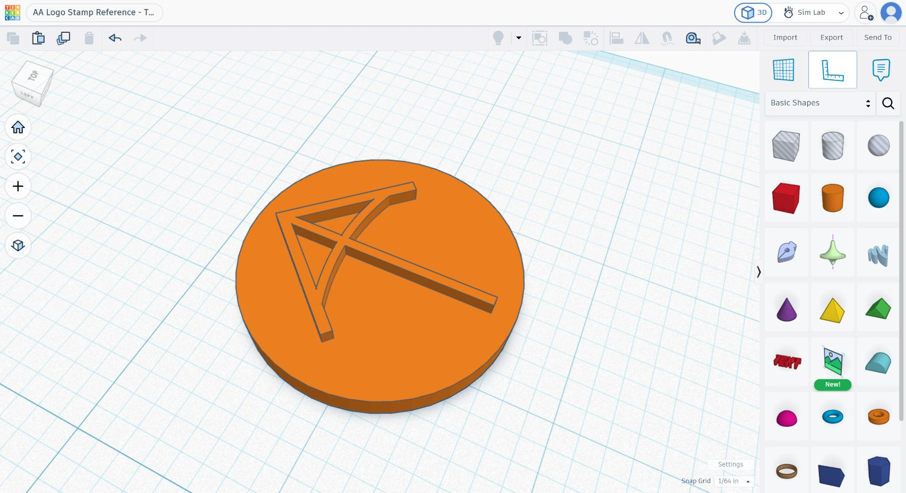

Build this **guided AA arrow stamp first**. After it works, repeat the same process with your own original logo. Return to the [Logo Stamp mission brief](logo-stamp-mission.qmd) for the submission list, success criteria and due dates.

::: {.callout-tip}
## Welcome to Temu CAD

Tinkercad is **Temu CAD**, said with affection. It is quick, browser-based and friendly enough to teach the core ideas: primitives, exact dimensions, mirroring, alignment and grouping. The same concepts transfer to Onshape, Autodesk Inventor, Fusion, SolidWorks, FreeCAD and other CAD software.
:::

::: {.callout-important}
## Account and permission check

Before students create or use a Tinkercad account, confirm that Tinkercad is approved under the current board's digital-tool process, that students meet the vendor's age/account requirements, that the required Ontario third-party software notice has been provided, and that parent/guardian permission has been obtained whenever local or vendor rules require it. See [Software access, privacy and permission](01-additive-cad.qmd#software-access-privacy-and-permission). A student who cannot use the web service needs an approved alternative, not a lower mark.
:::

::: {.callout-important}
## Download the AA logo before Step 1

[Download the AA arrow SVG](../../assets/branding/logo/aa-logo.svg){.btn .btn-primary download="aa-arrow.svg"}

Save the file as `aa-arrow.svg`. You will import this editable vector in Step 4. Do not use a screenshot or the PNG reference in Tinkercad.
:::

## Other V1 files

- [Verified AA stamp STL](../../assets/tinkercad-logo-stamp/downloads/aa-arrow-stamp-tinkercad.stl){download="aa-arrow-stamp-tinkercad.stl"}
- [Logo Stamp mission brief](logo-stamp-mission.qmd)

The STL is a troubleshooting and printing reference. **Submitting the downloaded STL does not prove that you completed the CAD work.**

## Target dimensions

| Part | Exact size |
|---|---:|
| Circular backing | 1.50 × 1.50 × 0.16 in |
| AA arrow | about 1.06 × 1.25 in |
| Raised arrow height | 0.08 in |
| Total stamp height | 0.24 in |
| Snap Grid | 1/64 in |

## Step 1: Create and name the design

1. Sign in to [Tinkercad](https://www.tinkercad.com/).
2. Select **Create → 3D Design**.
3. Click the automatic name in the upper-left corner.
4. Rename V1 `lastname-aa-stamp-v1`.

{.ter-concept-diagram}

## Step 2: Change the workspace to inches

1. Select **Settings** in the lower-right corner.
2. Change **Units** to **Inches**.
3. Keep the default workplane size and select **Update Grid**.

{.ter-concept-diagram}

Open **Snap Grid** and choose **1/64 in**. The previous `0.01 in` instruction was wrong; Tinkercad presents fractional-inch choices.

{.ter-concept-diagram}

## Step 3: Build the solid backing

1. Drag a **Cylinder** from **Basic Shapes** onto the workplane.
2. In the shape panel, select **Solid**, not **Hole**. A solid is coloured; a hole looks grey and striped.
3. Drag a **Ruler** onto an empty part of the workplane.
4. Select the cylinder and type **1.50 in** for width and **1.50 in** for length.
5. Type **0.16 in** for height.
6. Set **Sides** to **48** so the edge prints smoothly.

::: {.callout-warning}
## Stop if the cylinder looks transparent

A grey striped cylinder is a **Hole**. Change it back to **Solid** before grouping, or Temu CAD will cheerfully subtract your entire backing and export only the arrow.
:::

## Step 4: Import the supplied AA arrow

1. Download the [AA arrow SVG](../../assets/branding/logo/aa-logo.svg){download="aa-arrow.svg"}.
2. Select **Import → Choose a file** and choose `aa-arrow.svg`.
3. Select **Art**, not **Artboard**. The preview should show the AA arrow on a transparent background.
4. Select **Import**. Do not depend on the size fields in this import window.

{.ter-concept-diagram}

::: {.callout-note}
## Why resize after importing?

Tinkercad's SVG import window can behave as though its size fields are still metric even after the workplane is changed to inches. Import first, then use the on-workplane **Ruler**. The Ruler is the reliable source of truth.
:::

## Step 5: Resize the arrow and set its relief

1. Select the imported arrow.
2. With the Ruler active, set its long dimension to **1.25 in**.
3. Set the other dimension to about **1.06 in**. Keep its proportions; do not stretch the logo.
4. Set the arrow height to **0.08 in**.
5. Remove or simplify details thinner than **0.05 in** on your later V2 artwork.

{.ter-concept-diagram}

## Step 6: Mirror the stamp face

1. Select only the arrow.
2. Select **Mirror** in the top toolbar.
3. Select the left-right mirror control.

{.ter-concept-diagram}

The AA arrow is almost left-right symmetrical, so the change is subtle. **Still complete the mirror step.** On V2, letters and directional artwork must look backwards on the stamp so the impression reads correctly.

## Step 7: Raise the arrow onto the backing

1. Keep only the arrow selected.
2. Use the Ruler's green vertical-position value.
3. Type **0.16 in**. This places the bottom of the arrow exactly on top of the 0.16 in backing.
4. Confirm that the arrow itself is still **0.08 in** high.

{.ter-concept-diagram}

## Step 8: Align both centres

1. Delete the Ruler by selecting its small **×**.
2. Select the arrow and cylinder together. **Ctrl + A** works when those are the only two shapes.
3. Select **Align**.
4. Select the middle dot on the horizontal axis.
5. Select the middle dot on the vertical axis.

{.ter-concept-diagram}

Click on an empty part of the workplane. The top view should show an even border around the arrow.

{.ter-concept-diagram}

## Step 9: Inspect, then group

Rotate the ViewCube to inspect the model in 3D. Check all of these before grouping:

- the backing is solid, circular and **0.16 in** thick;
- the arrow rises **0.08 in** above the backing;
- no part of the arrow hangs beyond the circle;
- the openings in the AA symbol remain clear; and
- the back of the stamp remains flat.

{.ter-concept-diagram}

Select both shapes and press **Ctrl + G**. The grouped result should remain a full circular stamp, not an arrow by itself.

{.ter-concept-diagram}

::: {.callout-tip}
## Temu CAD quality control

Grouping is not proof that the design is correct; it only proves that Tinkercad agreed to glue the shapes together. The top, 3D and slicer checks are the evidence.
:::

::: {.callout-important}
## Save your evidence before exporting

Capture one clear top view and one side view now. Follow the [Windows Snipping Tool screenshot instructions](logo-stamp-mission.qmd#snipping-tool), then save the files as `lastname-aa-stamp-top.png` and `lastname-aa-stamp-side.png`.
:::

## Step 10: Export and verify the STL

1. Select the grouped stamp.
2. Select **Export**.
3. Choose **The selected shape**.
4. Choose **STL**.
5. Rename the download `lastname-aa-stamp-v1.stl`.
6. Open it in the class slicer.
7. Confirm that the slicer reports a **1.50 × 1.50 × 0.24 in** model before printing.

Print the rigid class prototype with its flat back on the build plate and the raised logo facing upward. A flexible ink-stamp version uses teacher-selected material and printer settings.

## Step 11: Test and revise

Make one impression in teacher-approved modelling material. If the result is backwards, incomplete, crowded or too faint, return to the Tinkercad source and revise it before printing again.

Record:

- one photo of the first impression;
- one problem you observed; and
- one change you made.

V1 is complete only when the AA impression reads correctly. Then duplicate the proven process and replace the artwork with your original V2 logo.

## Prepare original V2 artwork in Photopea

For V2, use the same artwork process as the Onshape pathway:

1. Open the original photograph, scan, PNG or JPG in [Photopea](https://www.photopea.com/).
2. Choose **Image → Vectorize Bitmap**.
3. For a simple black-and-white logo, set **Colors** to **2**.
4. Hide the page-sized white background Shape layer.
5. Keep smaller white Shape layers that create required holes.
6. Confirm that the checkerboard appears around the logo.
7. Choose **File → Export as → SVG** with hidden layers turned off.

For screenshots and a full explanation of raster layers, Shape layers and background removal, use [Part A of the Photopea-to-Onshape guide](onshape-logo-stamp.qmd#photopea-workflow). Tinkercad imports the clean SVG directly; it does not need the DXF conversion used by Onshape.

## Optional bonuses: only after V2

The [PCSS stamp challenge](logo-stamp-mission.qmd#bonus-pcss-stamp-challenge) and [faux-enamel extension](tinkercad-faux-enamel-logo.qmd) come after the guided AA stamp and original-logo stamp. They do not replace either required build.

If Temu CAD made the first prototype, the physical test gets the final vote. Move to the [Onshape pathway](onshape-logo-stamp.qmd) when you want the same design controlled by dimensions, variables and an editable feature history.
