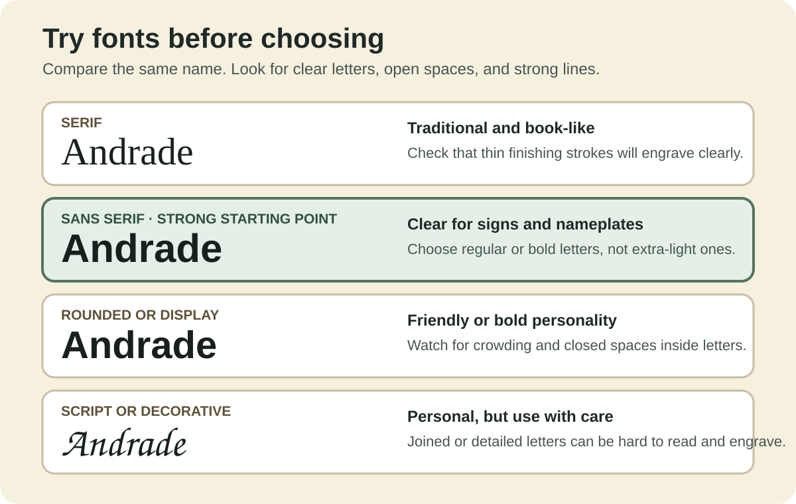

## Learning goals

- I can compare fonts at the size people will actually see.
- I can judge whether a background, outline, shadow, or 3D effect improves readability.

{fig-alt="Four versions of Andrade compare serif, sans serif, rounded display, and script fonts."}

::: {.callout-note}
The complete source text and links from the Graphics Accommodation Guide are retained below.
:::



## Try it

Set the same word in three fonts. Zoom out, stand back, and compare the thinnest lines, open spaces inside letters, and the speed of recognition.

