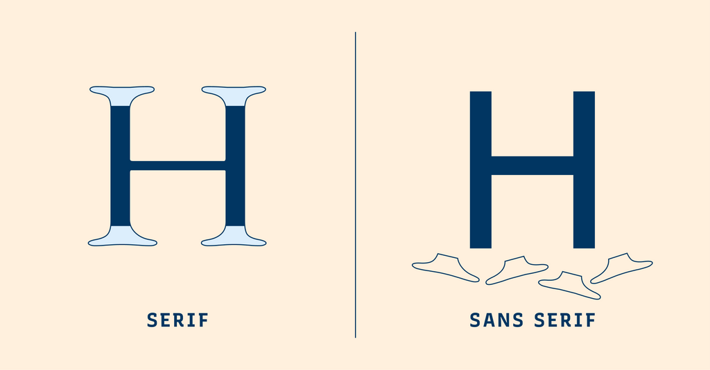
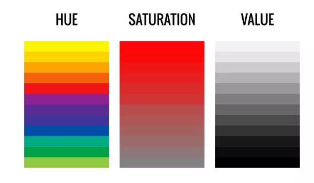
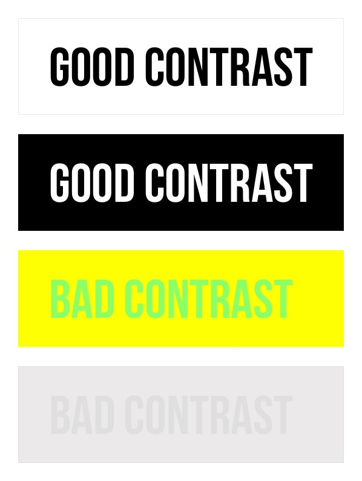
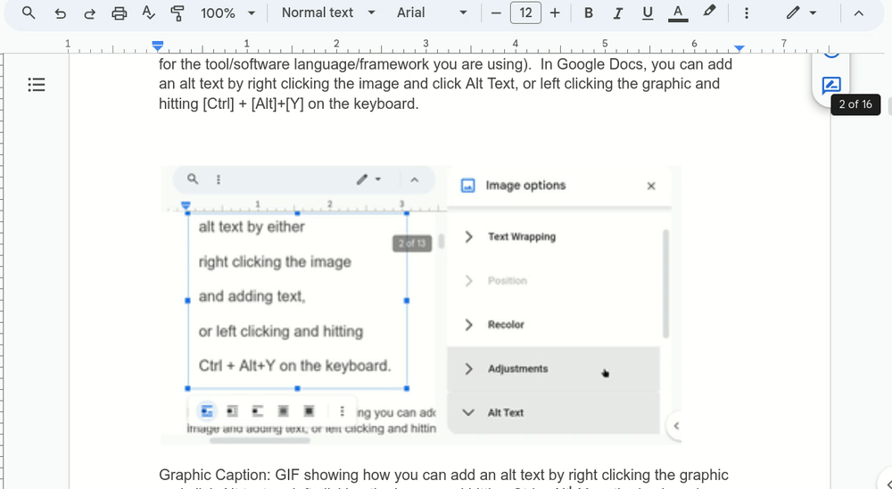
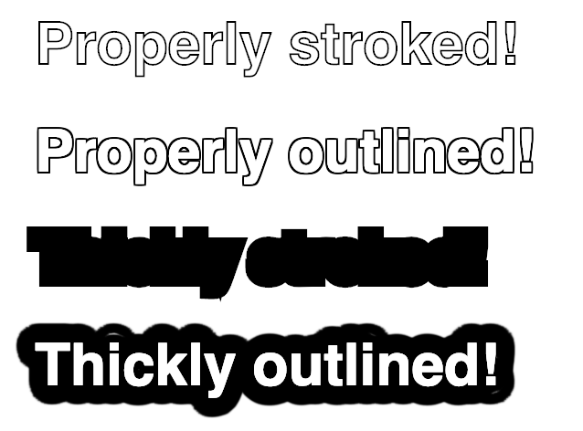
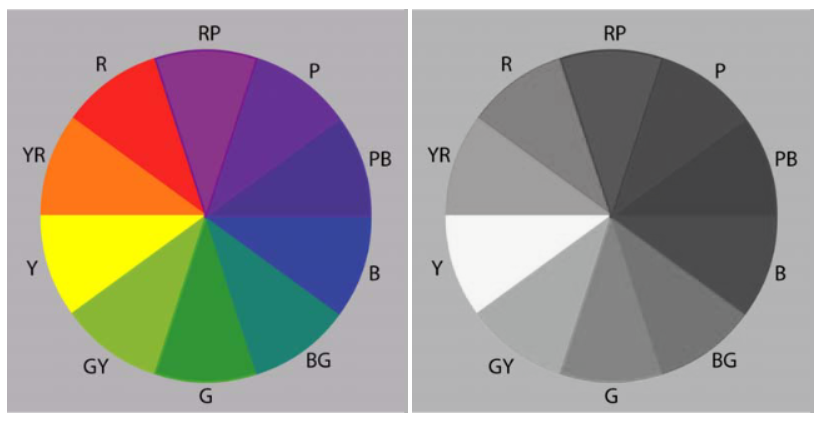
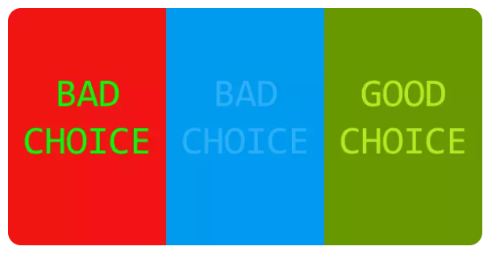

::: {.ad-guide-hero}
::: {}

Graphics Accommodation Guide

## Keep the idea clear from screen to final object

Accessible design is not a separate style. It is the work of making sure the idea survives small type, colour changes, busy backgrounds, printing, projection, and fabrication.

These four lessons use the explanations and examples from the original guide, reorganized into a shorter path for students.
:::

::: {.ad-hero-visuals}

:::
:::

## Zoom out before choosing {#zoom-out-before-choosing}

Check the design at its real output size and from the expected viewing distance before choosing a font, colour, line thickness, or level of detail.

::: {.ad-check-strip}
::: {}
**See it**

Can the important parts be found quickly?
:::
::: {}
**Read it**

Do size, spacing, and letter shapes hold up?
:::
::: {}
**Understand it**

Does the message work without colour alone?
:::
::: {}
**Make it**

Will the design survive print, projection, or fabrication?
:::
:::

## Follow the guide

::: {.ad-path-grid}
::: {.ad-path-card}

::: {}
Lesson 1

### [Access & Alt Text](access-and-alt-text.qmd)

Decide what an image contributes, then describe that purpose for someone who cannot see it.
:::
:::

::: {.ad-path-card}

::: {}
Lesson 2

### [Fonts & Text Effects](fonts-and-text-effects.qmd)

Choose readable type and use backgrounds, outlines, and shadows only when they help the letters stay clear.
:::
:::

::: {.ad-path-card}

::: {}
Lesson 3

### [Understanding Colour](understanding-colour.qmd)

Separate hue, saturation, and value, then connect them to RGB, CMYK, opacity, and output.
:::
:::

::: {.ad-path-card}

::: {}
Lesson 4

### [Contrast, Emphasis & Output](contrast-and-output.qmd)

Measure contrast, add a second cue beside colour, and test the actual screen, print, or fabricated result.
:::
:::
:::

::: {.ad-source-note}
**Source and approach.** The sequence applies the [BBC guidance for visually and hearing impaired audiences](https://www.bbc.com/editorialguidelines/guidance/visually-and-hearing-impaired-audiences), including clear contrast, useful labels, alt text, and explaining essential visual information in the page text. New graphics are used only when the website needs a clearer or more flexible explanation.
:::
