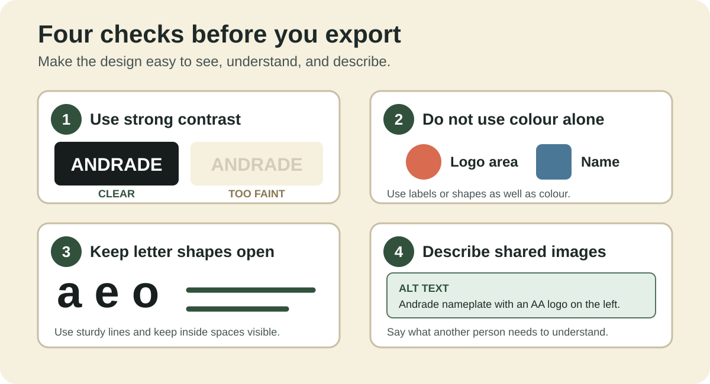
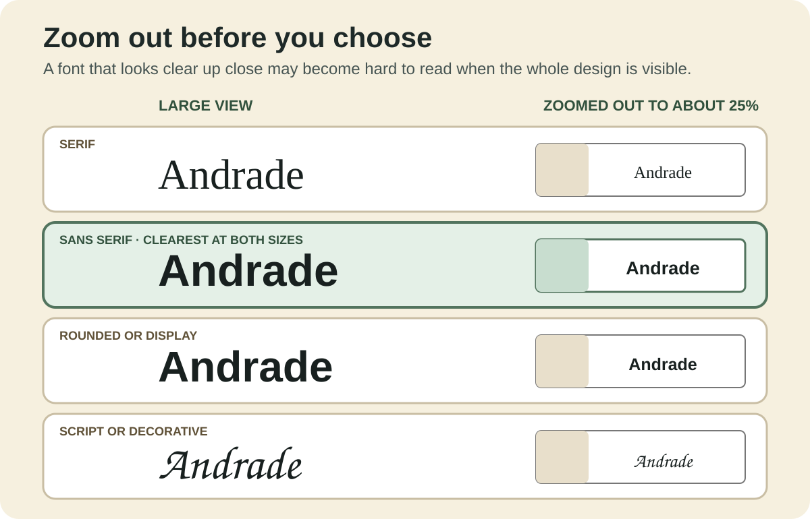
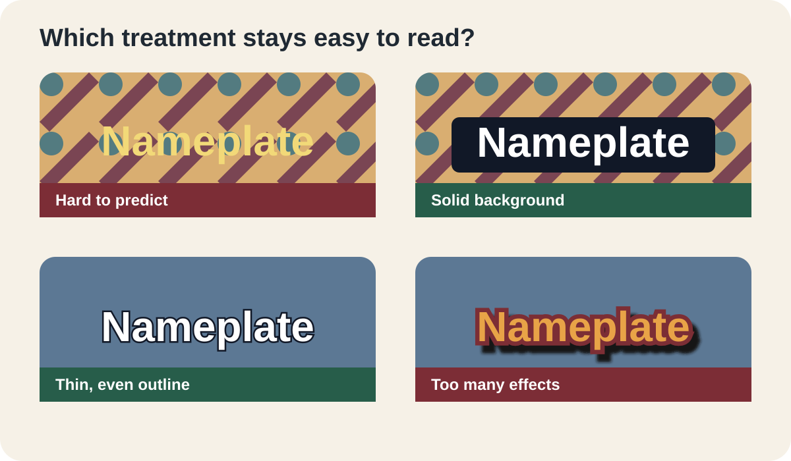

## Learning goals

By the end of this guide:

- I can compare fonts instead of choosing the first one I like.
- I can zoom out to test whether a design stays clear.
- I can use contrast, labels, and open letter shapes.
- I can explain hue, saturation, value, opacity, RGB, and CMYK.
- I can write useful alt text for a shared image.

## Why this is useful

Accessible design helps more people see, read, and understand your work. It also makes signs, labels, slides, graphics, and fabricated objects work better for everyone.

This page has three parts:

1. a quick design checklist;
2. a complete Photopea nameplate practice project; and
3. the full text of the Graphics Accommodation Guide, followed by Technology Commons extensions and examples.

## Quick design checklist

Use these checks with a nameplate, logo, slide, poster, label, diagram, or web graphic.

<picture>
  <source media="(max-width: 600px)" srcset="../../assets/name-tag-photopea/lesson-1-nameplate/accessible-design-checks-mobile.svg">
  
</picture>

1. **Use strong contrast.** Dark text on a light background, or light text on a dark background, is usually easier to read.
2. **Do not use colour alone.** Add a label, shape, pattern, or icon when colour carries meaning.
3. **Keep letters open.** Use lines that are thick enough to print, cut, or engrave. Keep the spaces inside <code>a</code>, <code>e</code>, and <code>o</code> visible.
4. **Describe digital images.** Add short alt text that explains what another person needs to understand.
5. **Test the real size.** Zoom out, print a sample, or stand back before deciding that a design works.

## Font choices: useful starting points

Try the same word in at least three fonts. Change only the font at first.

<picture>
  <source media="(max-width: 600px)" srcset="../../assets/name-tag-photopea/lesson-1-nameplate/font-choice-comparison-mobile.svg">
  
</picture>

- **Serif:** Georgia and Times New Roman have small finishing strokes. Serif fonts are common in printed books. Thin strokes may disappear when a design is made.
- **Sans serif:** DejaVu Sans, Arial, Verdana, and Open Sans use simpler letter shapes. They are a strong starting point for signs, screens, and nameplates.
- **Rounded or display:** Nunito, Montserrat, and Impact add personality. Check for crowded letters and closed inside spaces.
- **Script or decorative:** Brush Script and similar fonts can feel personal. Joined or detailed letters can be hard to read.

No font is always good or bad. Choose one that fits the job and stays easy to read.

## Zoom out before choosing

A font may look clear while it fills the screen. Zoom out until you can see the whole design.

<picture>
  <source media="(max-width: 600px)" srcset="../../assets/accessible-design/font-zoom-test-mobile.svg">
  
</picture>

In Photopea:

1. Press **Ctrl + -** on Windows or **Command + -** on a Mac.
2. Stop near <code>25%</code> or when the whole canvas fits on the screen.
3. Read the design without leaning closer.
4. Ask which font you can recognize first.
5. Zoom back in to check line quality before exporting.

Also step back from the screen or read the design from an arm's length away. If you need extra time to recognize the word, try a simpler font, larger type, or more spacing.

## Practice project: accessible nameplate in Photopea

This complete practice project is also available as [Lesson 1: Build the Nameplate Text in Photopea](../logo-design/01-nameplate-text-photopea.qmd). It is included here so the font, zoom, spacing, fabrication, and export decisions can be studied in one accessibility guide.

### What you will make

You will make a transparent 11 × 4 inch nameplate. The left 4 × 4 inches stay empty. The name **Andrade** sits in the right part of the design.

<video controls preload="metadata" style="width:100%;height:auto" aria-label="Screen recording of the Photopea nameplate text lesson">
  <source src="../../assets/name-tag-photopea/lesson-1-nameplate/lesson-1-nameplate-text.mp4" type="video/mp4">
  Your browser cannot play this video. Use the screenshots and steps below.
</video>

### Before you start

Open [Photopea](https://www.photopea.com/) in a browser.

You will use:

- the **Type Tool (T)**;
- a vertical guide;
- the **Move Tool (V)**; and
- the **Layers** panel.

### 1. Make the canvas

1. Choose **File > New**.
2. Set **Width** to <code>11</code> inches.
3. Set **Height** to <code>4</code> inches.
4. Set **DPI** to <code>300</code>.
5. Set **Background** to **Transparent**.
6. Choose **Create**.

Photopea will make a 3300 × 1200 pixel canvas. That is correct for 11 × 4 inches at 300 pixels per inch.

{fig-alt="Photopea New Project window with an 11 inch width, 4 inch height, and 300 pixels per inch."}

### 2. Mark the logo space

The logo space is a 4 × 4 inch square on the left.

1. Choose **View > New Guide**.
2. Choose a **Vertical** guide.
3. Enter <code>4 in</code>. If Photopea asks for pixels, enter <code>1200 px</code>.
4. Choose **OK**.

Everything left of the guide is for the logo. Keep the name to the right of it.

{fig-alt="A transparent nameplate with a vertical guide at the four-inch mark."}

### 3. Type the name

1. Select the **Type Tool (T)**.
2. Click to the right of the guide.
3. Type <code>Andrade</code>.
4. Select the whole word before changing the font.

{fig-alt="The word Andrade typed in the right part of the transparent nameplate."}

### 4. Try several fonts

Select the whole name. Try at least three fonts before choosing one. Change only the font at first. This makes the choices easier to compare.

Try:

1. a serif font;
2. a decorative or rounded font; and
3. a plain sans serif font.

A **serif** font has small finishing strokes on the letters. Serif fonts are common in printed books. A **sans serif** font does not have those strokes. Sans serif fonts are often a clearer starting point for signs and nameplates.

No font is always good or bad. The best font fits the job and stays easy to read.

- **Serif:** try Georgia or Times New Roman for a printed-book look. Check the thin strokes.
- **Sans serif:** try DejaVu Sans, Arial, Verdana, or Open Sans for clear letters.
- **Rounded or display:** try Nunito, Montserrat, or Impact for personality. Check for crowding.
- **Script or decorative:** use joined or detailed letters with care. They can be hard to read and engrave.

Font names may vary. Choose a similar font if one is unavailable.

{fig-alt="The word Andrade shown in a serif font during the font comparison step."}

Ask these questions:

- Can I read the name quickly?
- Can I tell similar characters apart, such as <code>I</code>, <code>l</code>, and <code>1</code>?
- Are the lines thick enough to engrave?
- Do the spaces inside <code>a</code>, <code>e</code>, and <code>o</code> stay open?

Read the name from an arm's length away. If you need extra time to recognize it, try a simpler font.

Zoom out until the whole nameplate fits on the screen. Compare the fonts again at the smaller view.

The example ends with **DejaVu Sans Book** at about <code>300 px</code>. Another clear sans serif font is also fine.

### 5. Place the name

1. Select the **Move Tool (V)**.
2. Keep the name inside the right 7 inches.
3. Centre it from top to bottom.
4. Leave a clear margin on the right.
5. Check that the name does not cross the 4 inch guide.

Use your eyes as well as the numbers. The empty space above and below the name should look even.

{fig-alt="Andrade in a simple sans serif font, vertically centred with a clear right margin and an empty logo area on the left."}

Continue when:

- the canvas is 11 × 4 inches;
- the background is transparent;
- the left 4 × 4 inch area is empty;
- the name is easy to read;
- the letters have strong contrast and open shapes;
- the name is centred from top to bottom; and
- there is a good margin on the right.

### 6. Save and export

Save three files.

1. Choose **File > Save as PSD**. Name it <code>Andrade-nameplate-text.psd</code>.
2. Choose **File > Export as > PNG**. Name it <code>Andrade-nameplate-text.png</code>.
3. Choose **File > Export as > SVG**. Name it <code>Andrade-nameplate-text.svg</code>.

Keep **add raster graphics** off when you export the SVG. The checkerboard means the background is transparent. It will not appear in the saved image.

{fig-alt="Photopea File menu opened to Export as, with PNG and SVG visible."}

#### Download the example files

- [Editable PSD](../../assets/name-tag-photopea/downloads/tutorial-andrade/Andrade-nameplate-text.psd)
- [Transparent PNG](../../assets/name-tag-photopea/downloads/tutorial-andrade/Andrade-nameplate-text.png)
- [Vector SVG](../../assets/name-tag-photopea/downloads/tutorial-andrade/Andrade-nameplate-text.svg)

### Nameplate troubleshooting

- **The canvas has a white box:** make a new file with **Background: Transparent**.
- **The name is in the logo space:** move it to the right of the 4 inch guide.
- **The name looks too small:** make the type larger, but keep a clear right margin.
- **The name is hard to read:** choose a simple sans serif font with open letter shapes.
- **The name moved when the font changed:** use the Move Tool to centre it again.

## Graphics Accommodation Guide

::: {.callout-note}
The text in this section is reproduced verbatim from the [Graphics Accommodation Guide](https://docs.google.com/document/d/1AfDpLSJQtKy7YUMdwL8-BBR81NTv9Ck_cyzQ4pA2Hk4/edit?usp=drivesdk). The original image captions and source links are retained. The third-party images are not republished on this page; Technology Commons examples appear in separate **Extension** sections.
:::



## Technology Commons extensions

These additions extend the source guide with repeatable tests for classroom, screen, and fabrication work.

### Example: text effects

A background, outline, or shadow is useful only when it makes the letters easier to recognize. Compare the design at full size and at its final viewing size. A solid background is often more reliable than several decorative effects.

<picture>
  <source media="(max-width: 600px)" srcset="../../assets/accessible-design/text-legibility-examples-mobile.svg">
  
</picture>

### Example: hue, saturation, and value

Keep one hue and compare a vivid version, a muted version, a light version, and a dark version. Then view the set in greyscale. If two important colours become the same grey, add a label, pattern, or larger difference in value.

<picture>
  <source media="(max-width: 600px)" srcset="../../assets/accessible-design/colour-components-mobile.svg">
  
</picture>

### Use measurable contrast

For text shared online, aim for at least <code>4.5:1</code> contrast for normal text and <code>3:1</code> for large text. A contrast checker can calculate the ratio, but also test the design at its real size and on the actual display or material.

Use colour and another cue together:

- red **Stop** and green **Go**, not red and green circles alone;
- a warning triangle plus colour;
- labels or patterns on chart segments; and
- icons with text in navigation.

### Write alt text for the purpose

Good alt text explains what the image contributes in this context.

- **Decorative image:** use empty alt text so a screen reader can skip it.
- **Simple image:** identify the important subject and action.
- **Instructional screenshot:** describe the control, value, or location the learner needs.
- **Chart or diagram:** state the important relationship, then provide the underlying data or a longer description nearby.

Example for the font comparison above:

> Four versions of Andrade compare serif, sans serif, rounded display, and script fonts. Sans serif is shown as a strong starting point, while notes identify engraving and readability risks in the other styles.

### Screen, print, and transparency

- Use **RGB** for screens and digital files.
- Expect some bright RGB colours to become duller when printed with **CMYK** inks.
- A six-digit hex value describes red, green, and blue. An eight-digit value adds the alpha channel.
- A transparent colour changes when the layer behind it changes. Test it on every expected background.

### Test the fabrication process

A readable screen design can still fail when it is printed, cut, or engraved.

1. Export a small sample.
2. Make it in the final material.
3. Check the thinnest lines, smallest gaps, inside spaces, and contrast.
4. Increase stroke width or spacing if the material closes or breaks.
5. Repeat the test before making the final piece.

### Ask another person

Show the design without explaining it first.

Ask:

- What did you read first?
- Which part was hard to see?
- What did the colours, shapes, or icons mean?
- What would make the design easier to understand?

Use the answer as evidence. Change one thing, then test again.

## Final check

Your design is ready when:

- the main words are easy to read when zoomed out;
- similar characters such as <code>I</code>, <code>l</code>, and <code>1</code> are easy to tell apart;
- lines are thick enough for the final material or screen;
- text and background have strong contrast;
- colour is not the only way information is shown;
- important digital images have useful alt text; and
- another person can understand the design without a spoken explanation.

::: {.ter-curriculum-relevance}
**Design curriculum:** Use this guide while creating logos, nameplates, slides, posters, labels, diagrams, fabricated objects, and digital interfaces. Accessibility is part of testing and improving a design.
:::

## Sources and further reading

- [Graphics Accommodation Guide](https://docs.google.com/document/d/1AfDpLSJQtKy7YUMdwL8-BBR81NTv9Ck_cyzQ4pA2Hk4/edit?usp=drivesdk)
- [W3C: Understanding text contrast](https://www.w3.org/WAI/WCAG22/Understanding/contrast-minimum.html)
- [W3C: Do not use colour alone](https://www.w3.org/WAI/WCAG22/Understanding/use-of-color.html)
- [Harvard: Write helpful alt text](https://accessibility.huit.harvard.edu/describe-content-images)

## Summary

You compared font choices, tested them while zoomed out, completed a Photopea nameplate example, studied the full Graphics Accommodation Guide, and applied added checks for contrast, alt text, colour, and fabrication.

Return to [Logo Design](../logo-design/index.qmd) or the [Design & Fabrication home page](../index.qmd).
