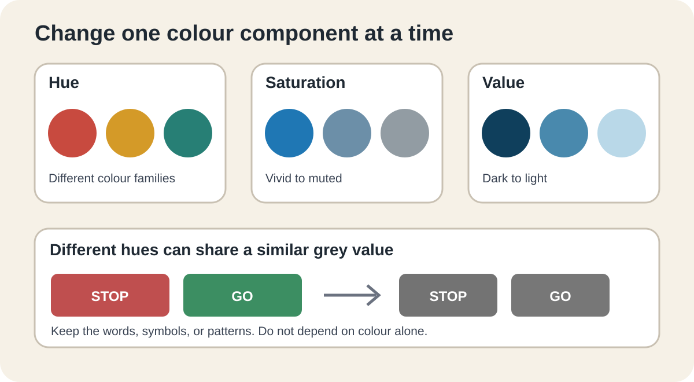

## Learning goals

- I can describe colour using hue, saturation, and value.
- I can explain the difference between RGB screens and CMYK printing.
- I can explain how opacity changes the result.

{fig-alt="Examples separate hue, saturation, and value. A second row shows that different hues can have similar grey values."}

::: {.callout-note}
The complete source text and links from the Graphics Accommodation Guide are retained below.
:::



## Try it

Choose one hue. Make a vivid, muted, light, and dark version. Convert the set to greyscale and record which differences remain visible.

