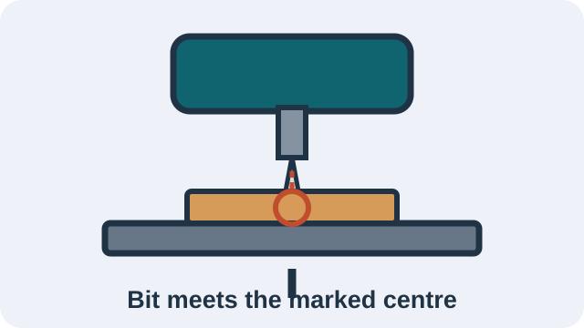

Make one project from start to finish.

::: {.phone-project-path}
::: {.phone-path-card}
## 1. Choose

{fig-alt="Two flat wooden parts that slide together to make the simple phone holder."}

[Choose Level 3 or Level 4](phone-holder-design.qmd)
:::

::: {.phone-path-card}
## 2. Make the CAD

{fig-alt="A Level 4 phone holder shown as a digital 3D model."}

[Learn the CAD you need](introduction-to-cad.qmd)
:::

::: {.phone-path-card}
## 3. Learn the tools

{fig-alt="A drill press makes a round opening in one phone-holder part."}

[See the tools and machines](../hand-tools/tools-machines.qmd)
:::

::: {.phone-path-card}
## 4. Build it

{fig-alt="A finished simple phone holder supports a phone at an angle."}

[Follow the build steps](../hand-tools/phone-holder.qmd)
:::
:::


