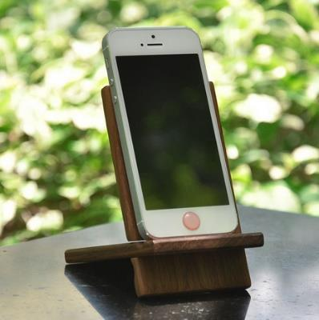
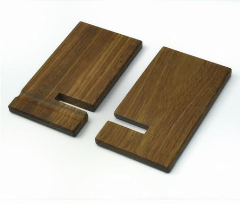
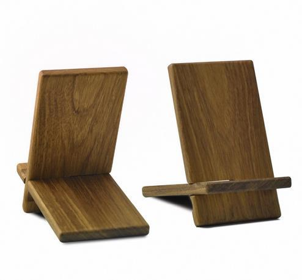
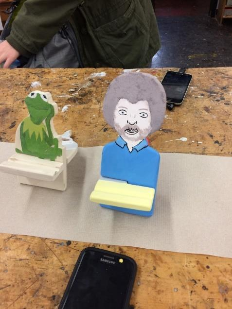
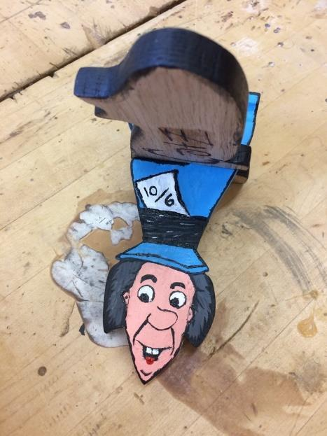
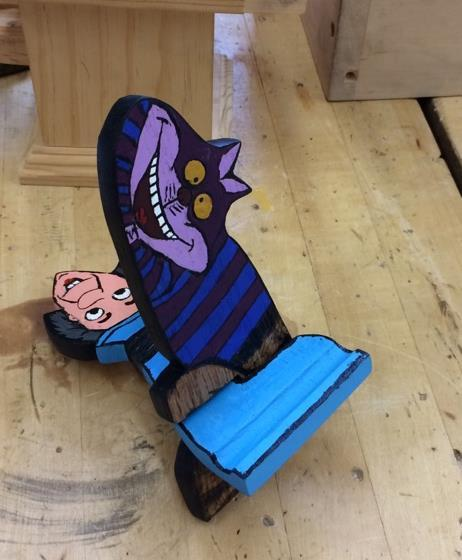
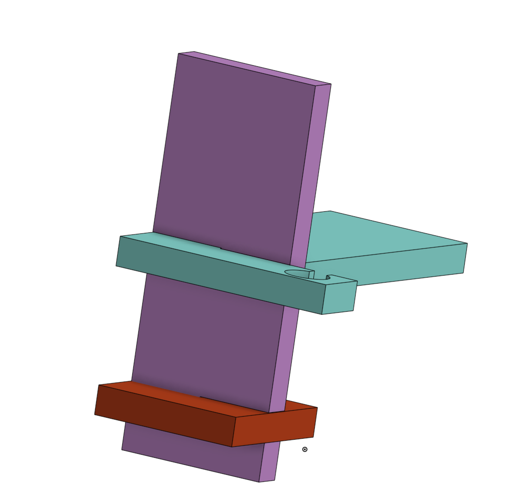
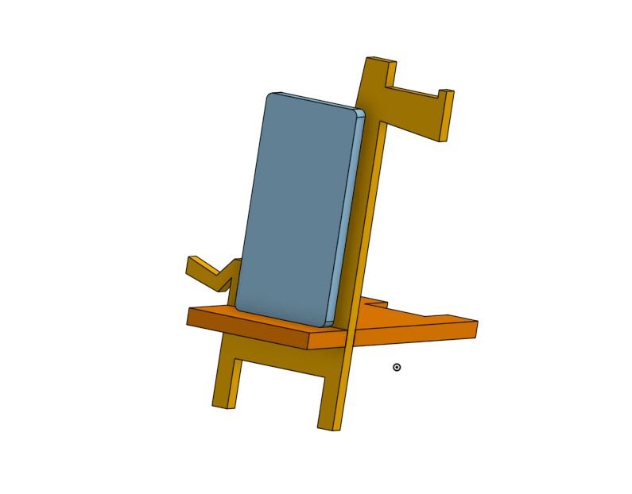

## Level 3: simple holder

Use the Westdale two-part design. The parts slide together.

::: {.phone-image-grid}

:::

It can be plain, painted, or shaped like a character.

::: {.phone-image-grid}

:::

[Open the Westdale project PDF](https://drive.google.com/file/d/1s9BFBX40vxdu2WpLCki3DKvmHzcZiEBl/view?usp=sharing) or [use the current premade plan](https://docs.google.com/spreadsheets/d/1rdGC6nsCR6Z5DtoN071NhLQZxIc3XbFz0cQT_RCSFDs/edit?gid=452419533#gid=452419533).

## Level 3 videos

Watch these before making the simple holder.

::: {.phone-video-stack}
::: {.phone-video}
<iframe src="https://www.youtube-nocookie.com/embed/bWrPhTa8s-w" title="Basic phone holder CAD video 1" allow="accelerometer; autoplay; clipboard-write; encrypted-media; gyroscope; picture-in-picture" allowfullscreen loading="lazy"></iframe>
:::

::: {.phone-video}
<iframe src="https://www.youtube-nocookie.com/embed/yl0L4jj4adk" title="Basic phone holder CAD video 2" allow="accelerometer; autoplay; clipboard-write; encrypted-media; gyroscope; picture-in-picture" allowfullscreen loading="lazy"></iframe>
:::

::: {.phone-video}
<iframe src="https://www.youtube-nocookie.com/embed/1-SRLHCQ9tA" title="Basic phone holder CAD video 3" allow="accelerometer; autoplay; clipboard-write; encrypted-media; gyroscope; picture-in-picture" allowfullscreen loading="lazy"></iframe>
:::
:::

## Level 4: original or complex holder

Add a harder shape or a useful feature. You might add a cable path, watch charger, or jewellery holder.

::: {.columns}
::: {.column width="50%"}
### Three-part holder

This is **Level 4**. It is not a simple Level 3 design.

[Open the Onshape model](https://cad.onshape.com/documents/b7521dff4faa9f0528bec91d/w/fcb08766ede91c026afcbaa9/e/92a90b128cc62be4e050d0de)
:::

::: {.column width="50%"}
### Giraffe holder

[Open the giraffe Onshape model](https://cad.onshape.com/documents/af72919fe7e13f1460a563b9/w/b881f1eb0ede9513d859a9b6/e/1cd40a9ed11789007404a41c?renderMode=0&uiState=6ad28b5dba3347aa0b66da53)
:::
:::

## Level 4 video

::: {.phone-video}
<iframe src="https://www.youtube-nocookie.com/embed/sn3I_HFqoQI" title="Level 4 giraffe phone holder in-depth video" allow="accelerometer; autoplay; clipboard-write; encrypted-media; gyroscope; picture-in-picture" allowfullscreen loading="lazy"></iframe>
:::

## Your next step

- Construction students: use the premade plan.
- Design students: use the [S.O. N.I.C.E. process](../design-process/index.qmd) and the [project brief](https://docs.google.com/document/d/1erSte0Jdg1-iuhU82DN7iFaqwf75sq5QH6TIkUDDbwg/edit?tab=t.0#heading=h.ldwuulz1hza).

Next: [make the CAD](introduction-to-cad.qmd).
