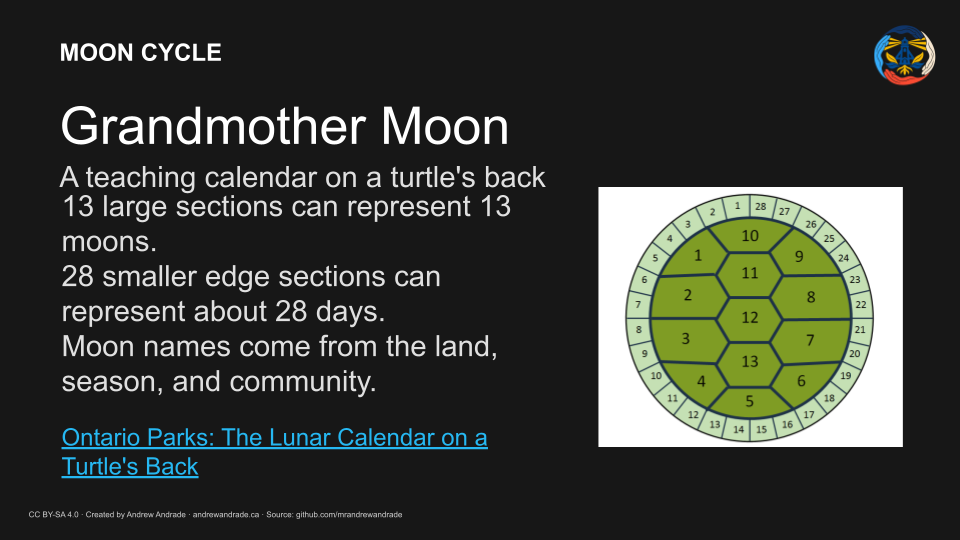
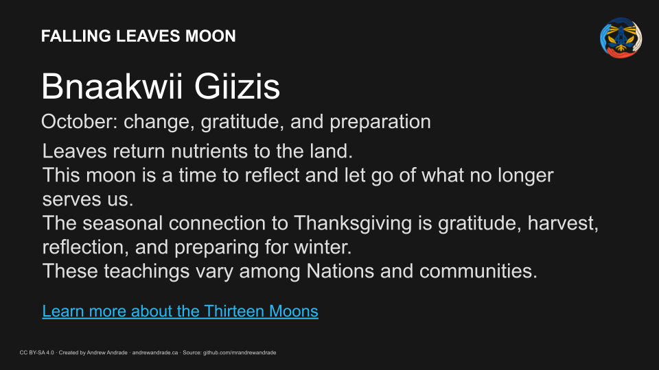

These are the two classroom slides together in one place.

::: {.source-slide-stack}
<figure class="source-slide">

<figcaption>Grandmother Moon and the teaching calendar on a turtle's back.</figcaption>
</figure>

<figure class="source-slide">

<figcaption>Falling Leaves Moon: Bnaakwii Giizis.</figcaption>
</figure>
:::

::: {.source-lesson-links}
[Read the detailed article and sources](../../lore/grandmother-moon-seasons-turtles-back.qmd)

[Open the classroom slides](https://docs.google.com/presentation/d/1PhUf2YbHTbatMiVQfJlJH3X9u5YnD7tRN4fKTZyX58Y/edit)
:::

Next: [Land Lettermark](land-lettermark.qmd).
