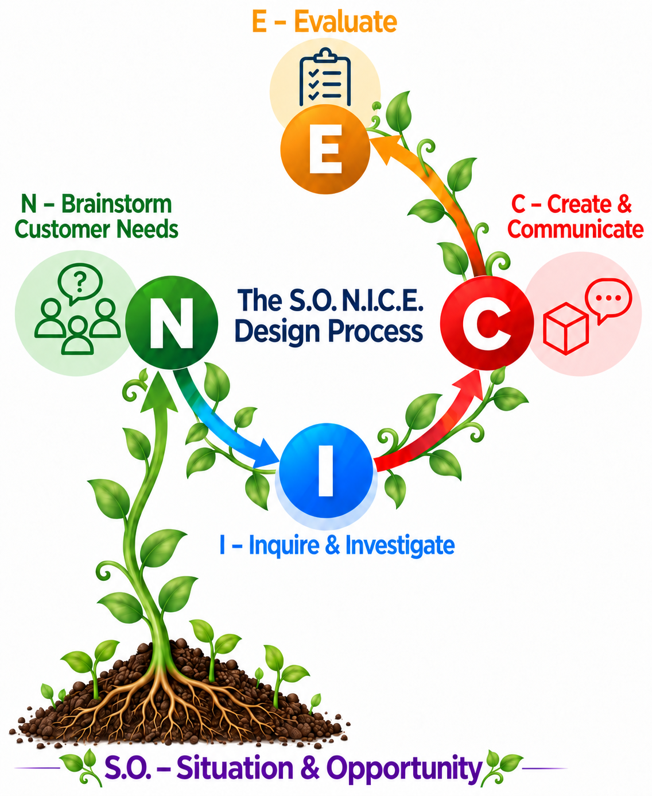

S.O. N.I.C.E. begins by understanding the situation and spotting an opportunity to improve it. Then it keeps the user and the evidence in view from needs through the next version.

{#fig-nice-process fig-alt="A plant grows from Situation and Opportunity at its roots into a repeating N.I.C.E. cycle: Needs, Inquiry and Investigation, Create and Communicate, and Evaluate."}



## Class materials

- [S.O. N.I.C.E. Design Process slides](https://docs.google.com/presentation/d/1bQBt0WHBp6ca0RWtQHBHKbfqhzXMc4q4uUOJ8hHxvIQ/edit)
- [N.I.C.E. Needs Worksheet](https://docs.google.com/document/d/19ObkJz3sYVXwB9VkNUiybXZGZ-ihuGw1FarRj81LtAo/copy)
- [N.I.C.E. Inquiry Worksheet](https://docs.google.com/document/d/1c-7TbI3IMOicnHsTUSLkGNJ4s1i2OA6d458S2bTZ2ho/copy)
- [Communicate Worksheet](https://docs.google.com/document/d/1T6f3beZhKXiOxS1ecXt3FHbam2yOqeP1yXrmaLFSbAs/copy) and [print version](https://docs.google.com/document/d/1F_7NWcW4Bzd-PE7BdLssdBxeT-49clS92381QXjW8gw/copy)
- [Feedback Package](https://docs.google.com/document/d/173eivGi-7of6WWqpPsK81p4Z2Q6_3fIiW5ffjRI6jRQ/copy) and [Plan Feedback](https://docs.google.com/document/d/1QWY7ss3aY5wHh4ETOcSDGZxgpkrrIXcCYnWlXNv1lxo/copy)
- [N.I.C.E. Evaluate Worksheet](https://docs.google.com/document/d/1O_j4gcsUT0ELFpgJk3GiyG6B1l5brKPko-6lO8HQPfk/copy) and [N.I.C.E. Design Log](https://docs.google.com/document/d/1Sai4_cQGkNudnAsLRYuwec6D-B-U4BqA8CCk0Nyo0CA/copy)
- Videos: [Kid Engineer: Bike Trailer](https://www.youtube.com/watch?v=Vcma79mVAYw) and [Pitch the Idea](https://www.youtube.com/watch?v=3wRWN3_u17k)
- [All worksheets, examples, and classroom materials](../../teaching-materials/nice-design-process/index.qmd)
