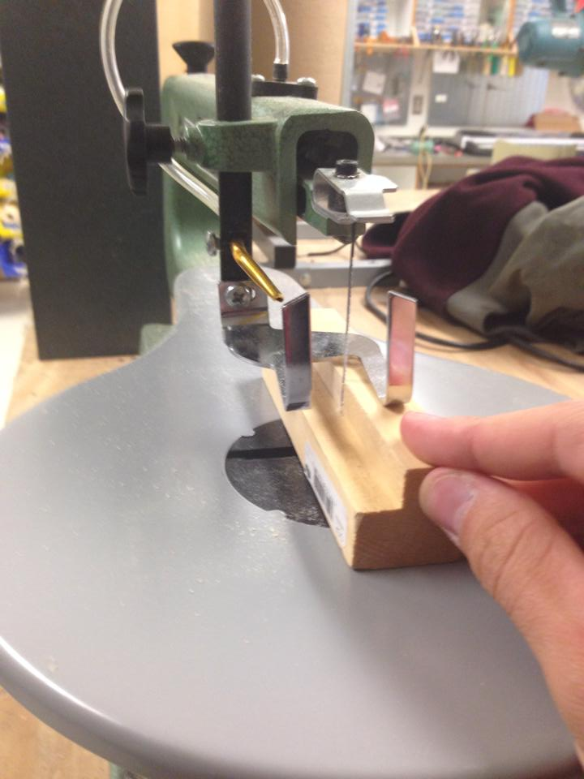
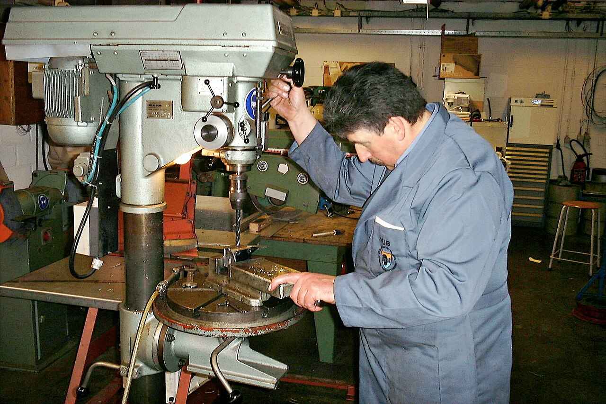

::: {.callout-important title="This is not a safety section"}
This website does not contain safety information. Use your board rules, training, supervision, and your professional experience and judgement.
:::

Your teacher will choose the tools for your shop.

## Measure and mark

::: {.phone-machine-section}
::: {.phone-machine-visual}
<figure><figcaption>Ruler and square</figcaption></figure>
<figure><figcaption>Mark these shapes</figcaption></figure>
:::

A ruler and square copy the sizes from the plan to the wood.
:::

## Cut the outside

::: {.phone-machine-section}
::: {.phone-machine-visual}
<figure><figcaption>Band saw</figcaption></figure>
<figure><figcaption>Scroll saw</figcaption></figure>
<figure><figcaption>Cut parts</figcaption></figure>
:::

A hand saw, scroll saw, or band saw cuts the parts and outside shape.
:::

## Drill an opening

::: {.phone-machine-section}
::: {.phone-machine-visual}
<figure><figcaption>Drill press</figcaption></figure>
<figure><figcaption>Start at the marked point</figcaption></figure>
:::

The drill press starts a round opening at the marked point.
:::

## Cut the slots

::: {.phone-machine-section}
::: {.phone-machine-visual}
<figure><figcaption>Coping saw</figcaption></figure>
<figure><figcaption>Scroll saw</figcaption></figure>
<figure><figcaption>Slots join the parts</figcaption></figure>
:::

The narrow blade cuts the slots that join the two parts.
:::

## Shape and finish

::: {.phone-machine-section}
::: {.phone-machine-visual .is-four}
<figure><figcaption>Edge sander or belt sander: outside edges</figcaption></figure>
<figure><figcaption>Oscillating sander or drum sander: inside curves</figcaption></figure>
<figure><figcaption>Orbital sander: flat faces</figcaption></figure>
<figure><figcaption>By hand: small details</figcaption></figure>
:::

Sand the faces, outside edges, and inside curves until they are smooth.

{.phone-result-photo}
:::

Photo credits

- Combination square: [Limarie Cabrera, CC BY 2.0](https://commons.wikimedia.org/wiki/File:Combination_square_in_use.jpg)
- Band saw: [U.S. Navy, public domain](https://commons.wikimedia.org/wiki/File:US_Navy_100104-N-1688B-018_Hull_Technician_3rd_Class_Elijah_Coe_uses_a_band_saw_to_cut_out_wooden_plaques.jpg)
- Scroll saw: [Agashi5859, CC BY-SA 3.0](https://commons.wikimedia.org/wiki/File:Scroll_saw.jpg)
- Coping saw: [Dale Simonson, CC BY-SA 2.0](https://commons.wikimedia.org/wiki/File:Coping_Saw.jpg)
- Drill press: [LHOON, CC BY-SA 2.5](https://commons.wikimedia.org/wiki/File:Drillpress.jpg)
- Belt and disc sander: [Chris.sherlock, CC BY-SA 4.0](https://commons.wikimedia.org/wiki/File:Belt_and_circular_sander.jpg)
- Orbital sander: [Dave Pape, public domain](https://commons.wikimedia.org/wiki/File:Random_orbit_sander.jpg)
- Spindle sander: [Lewis Hine / U.S. National Archives, public domain](https://commons.wikimedia.org/wiki/File:High_Point,_North_Carolina_-_Upholstering._Tomlinson_Chair_Manufacturing_Co._Spindle_sander_-_chair_leg_-_showing_man..._-_NARA_-_518496.jpg)
- Hand sanding: [Nenad Stojković, CC BY 2.0](https://commons.wikimedia.org/wiki/File:Close-up_of_a_carpenters_hand_sandpapering_the_wood.jpg)

Next: [build the phone holder](phone-holder.qmd).
