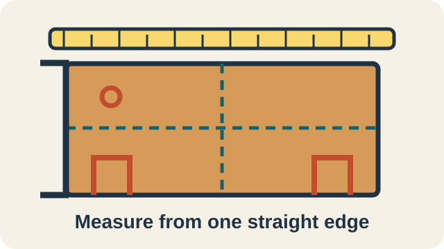
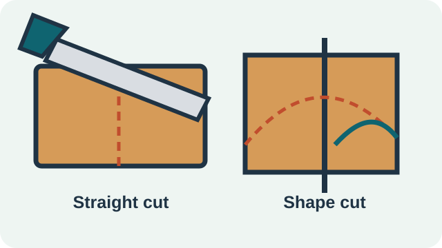
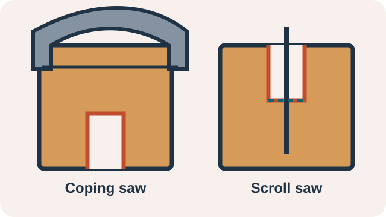
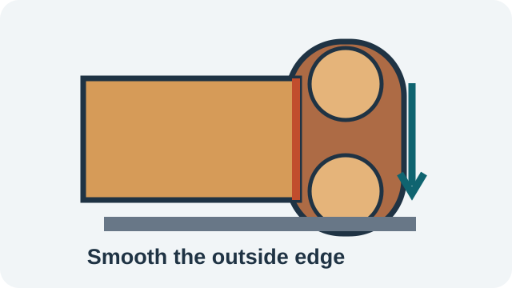
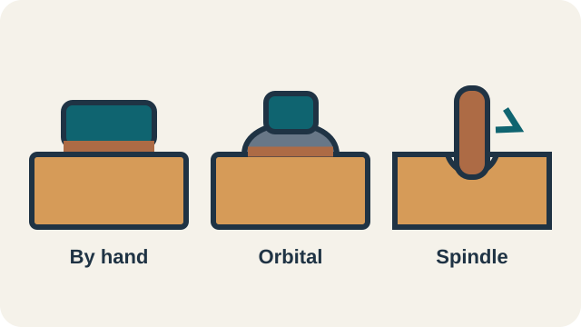

::: {.callout-important title="This is not a safety section"}
This website does not contain safety information. Use your board rules, training, supervision, and your professional experience and judgement.
:::

Your teacher will choose the tools for your shop.

::: {.phone-tool-grid}
::: {.phone-tool-card}
{fig-alt="A ruler and square mark the size and cut lines on the wood."}

### Ruler and square

Measure and mark the parts.
:::

::: {.phone-tool-card}
{fig-alt="A hand saw, scroll saw, and band saw can cut the outside shape."}

### Hand saw, scroll saw, or band saw

Cut the stock and outside shape.
:::

::: {.phone-tool-card}
{fig-alt="A drill press makes the large round start of an opening."}

### Drill press

Make a round opening at a marked point.
:::

::: {.phone-tool-card}
{fig-alt="A coping saw or scroll saw cuts the slots that join the parts."}

### Coping saw or scroll saw

Cut the slots that join the parts.
:::

::: {.phone-tool-card}
{fig-alt="An edge or belt sander smooths an outside edge."}

### Edge sander or belt sander

Shape and smooth outside edges.
:::

::: {.phone-tool-card}
{fig-alt="Hand sanding, an orbital sander, and an oscillating spindle sander finish surfaces and curves."}

### Finish sanding

Use hand sanding, a drum sander, an orbital sander, or an oscillating sander as directed.
:::
:::

Next: [build the phone holder](phone-holder.qmd).

