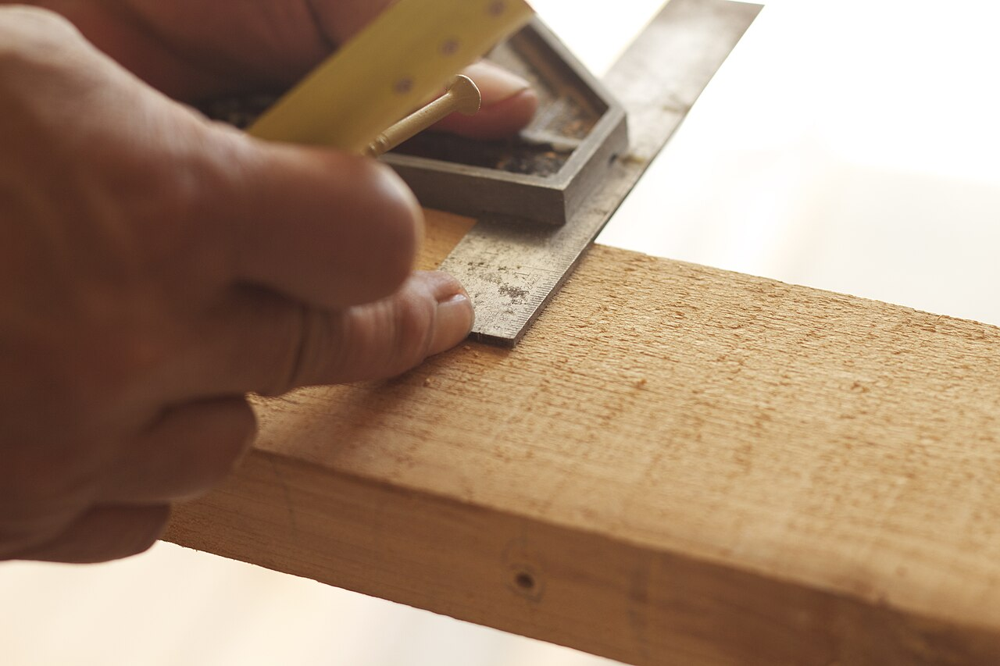
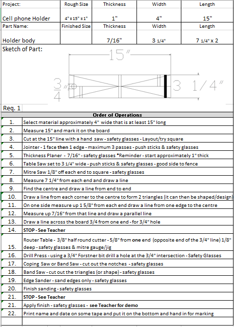
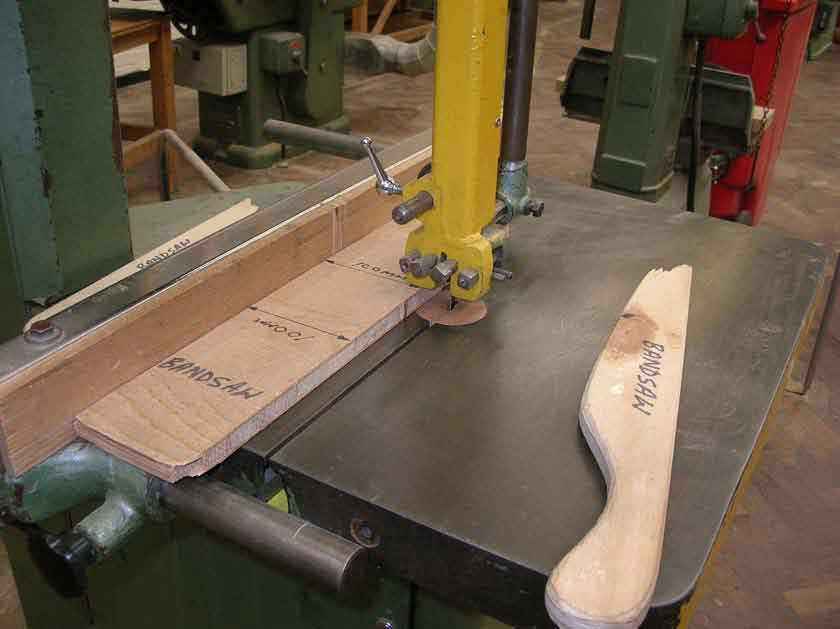
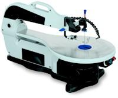
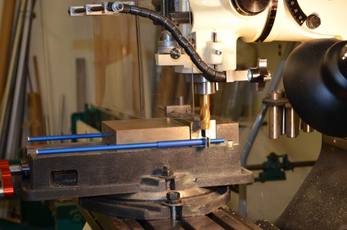
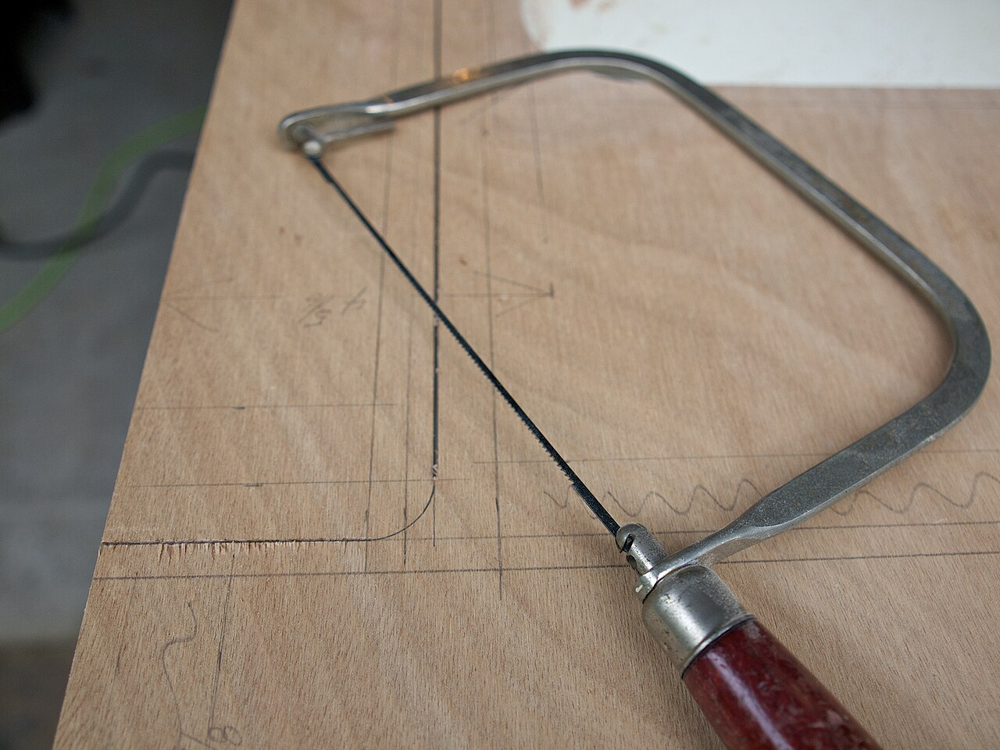
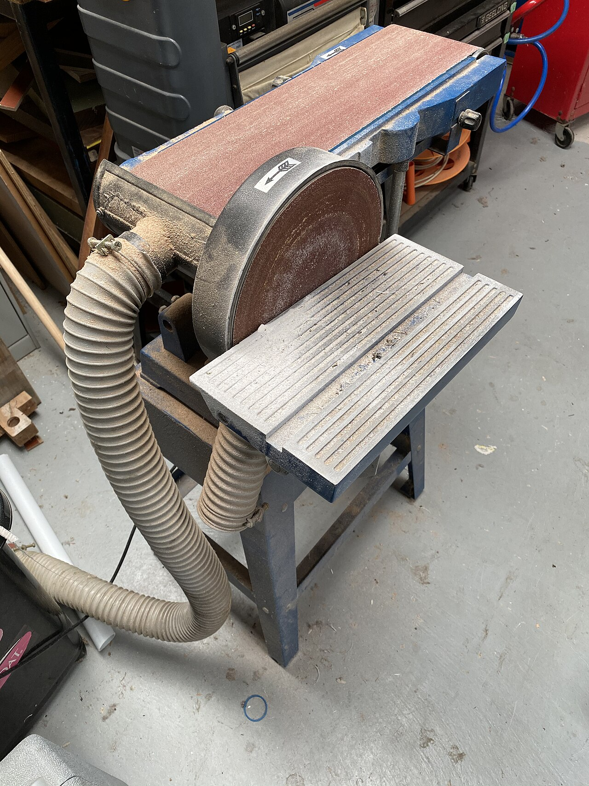
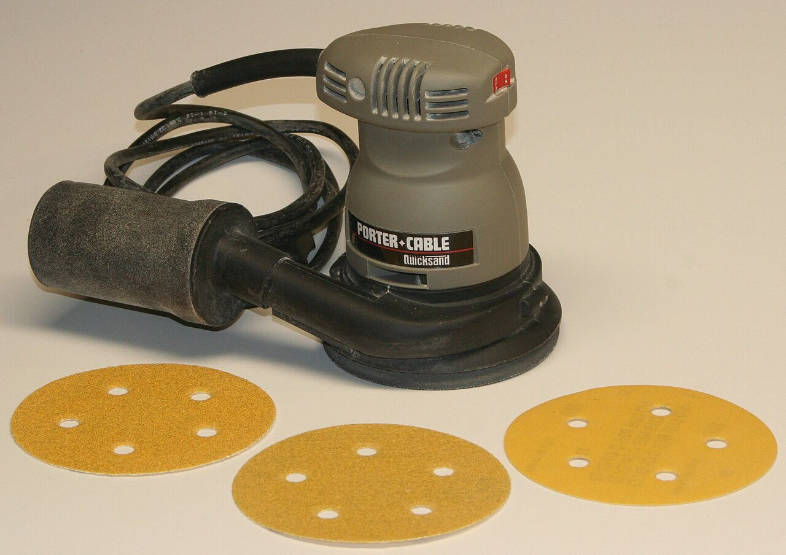
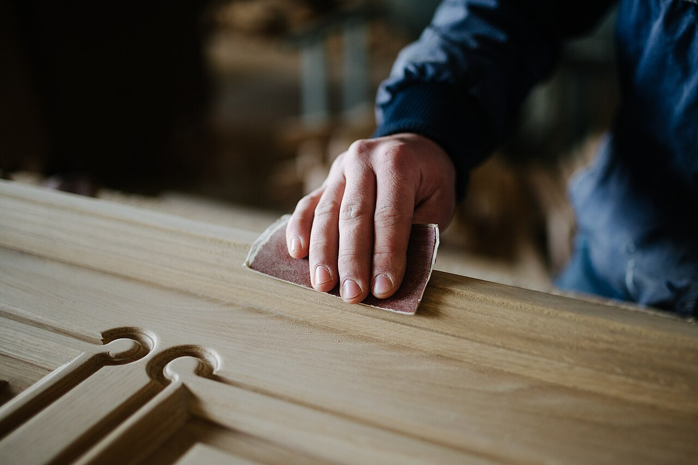

::: {.callout-important title="This is not a safety section"}
This website does not contain safety information. Use your board rules, training, supervision, and your professional experience and judgement.

These photos show the machine or setup. They do not show every safe action.
:::

Your teacher will choose the tools for your shop.

## Measure and mark

::: {.phone-machine-section}
::: {.phone-machine-visual}
<figure><figcaption>Ruler and square</figcaption></figure>
<figure><figcaption>Mark these shapes</figcaption></figure>
:::

A ruler and square copy the sizes from the plan to the wood.
:::

## Cut the outside

::: {.phone-machine-section}
::: {.phone-machine-visual}
<figure><figcaption>Band saw: guide, fence, and push stick</figcaption></figure>
<figure><figcaption>Scroll saw: guarded machine</figcaption></figure>
<figure><figcaption>Cut parts</figcaption></figure>
:::

A hand saw, scroll saw, or band saw cuts the parts and outside shape.

Safety sources: [CCOHS band saws](https://www.ccohs.ca/oshanswers/safety_haz/woodwork/band_saw.html) and [OSHA scroll saws](https://www.osha.gov/etools/machine-guarding/saws/scroll)
:::

## Drill an opening

::: {.phone-machine-section}
::: {.phone-machine-visual}
<figure><figcaption>Drill press: work held in a vise</figcaption></figure>
<figure><figcaption>Start at the marked point</figcaption></figure>
:::

The drill press starts a round opening at the marked point.

Safety source: [WorkSafeBC drill presses](https://www.worksafebc.com/en/resources/health-safety/hazard-alerts/using-drill-presses-safely)
:::

## Cut the slots

::: {.phone-machine-section}
::: {.phone-machine-visual}
<figure><figcaption>Coping saw</figcaption></figure>
<figure><figcaption>Scroll saw</figcaption></figure>
<figure><figcaption>Slots join the parts</figcaption></figure>
:::

The narrow blade cuts the slots that join the two parts.
:::

## Shape and finish

::: {.phone-machine-section}
::: {.phone-machine-visual}
<figure><figcaption>Edge sander or belt sander: outside edges</figcaption></figure>
<figure><figcaption>Orbital sander: flat faces</figcaption></figure>
<figure><figcaption>By hand: small details</figcaption></figure>
:::

Sand the faces, outside edges, and inside curves until they are smooth. An oscillating sander or drum sander can smooth inside curves.

Safety sources: [CCOHS sanders](https://www.ccohs.ca/oshanswers/safety_haz/woodwork/sander_b.html) and [NIOSH wood-dust control](https://www.cdc.gov/niosh/docs/hazardcontrol/hc8.html)

{.phone-result-photo}
:::

Photo credits

- Combination square: [Limarie Cabrera, CC BY 2.0](https://commons.wikimedia.org/wiki/File:Combination_square_in_use.jpg)
- Band saw: [Health and Safety Executive](https://www.hse.gov.uk/woodworking/bandsaw.htm). Contains public sector information published by the Health and Safety Executive and licensed under the Open Government Licence.
- Scroll saw: [OSHA Machine Guarding eTool](https://www.osha.gov/etools/machine-guarding/saws/scroll)
- Coping saw: [Dale Simonson, CC BY-SA 2.0](https://commons.wikimedia.org/wiki/File:Coping_Saw.jpg)
- Drill press: [CDC Public Health Image Library, Brenda J. Jones, public domain](https://wwwn.cdc.gov/PHIL/Details.aspx?pid=14861)
- Belt and disc sander: [Chris.sherlock, CC BY-SA 4.0](https://commons.wikimedia.org/wiki/File:Belt_and_circular_sander.jpg)
- Orbital sander: [Dave Pape, public domain](https://commons.wikimedia.org/wiki/File:Random_orbit_sander.jpg)
- Hand sanding: [Nenad Stojković, CC BY 2.0](https://commons.wikimedia.org/wiki/File:Close-up_of_a_carpenters_hand_sandpapering_the_wood.jpg)

Next: [build the phone holder](phone-holder.qmd).
