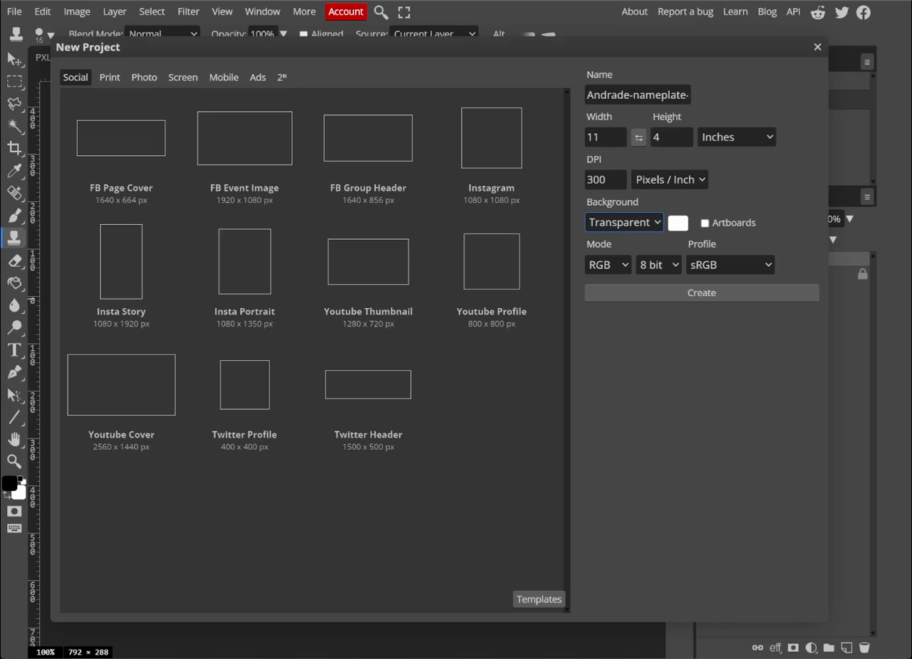
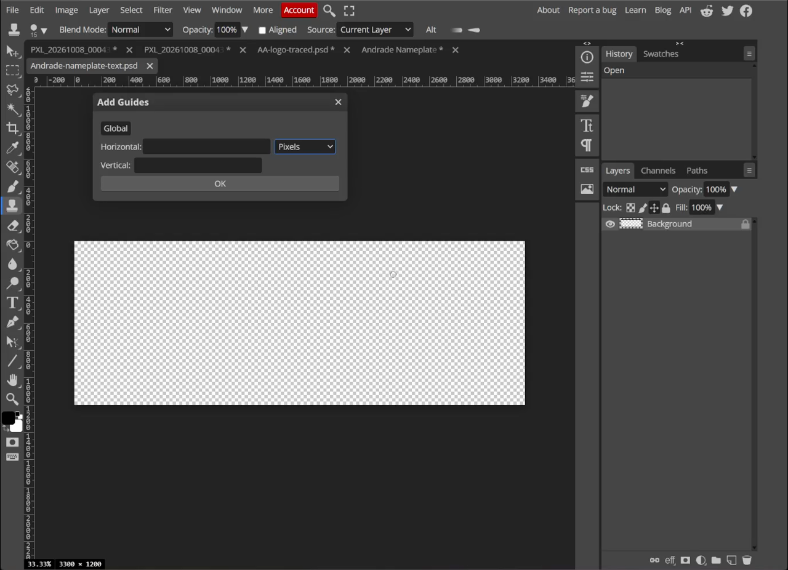
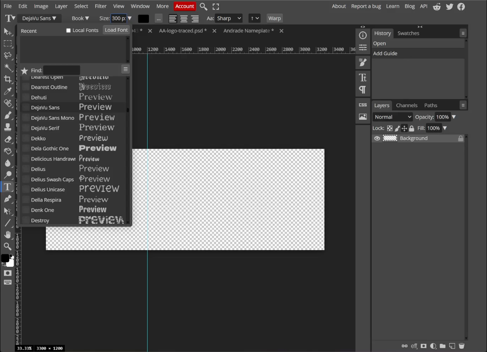
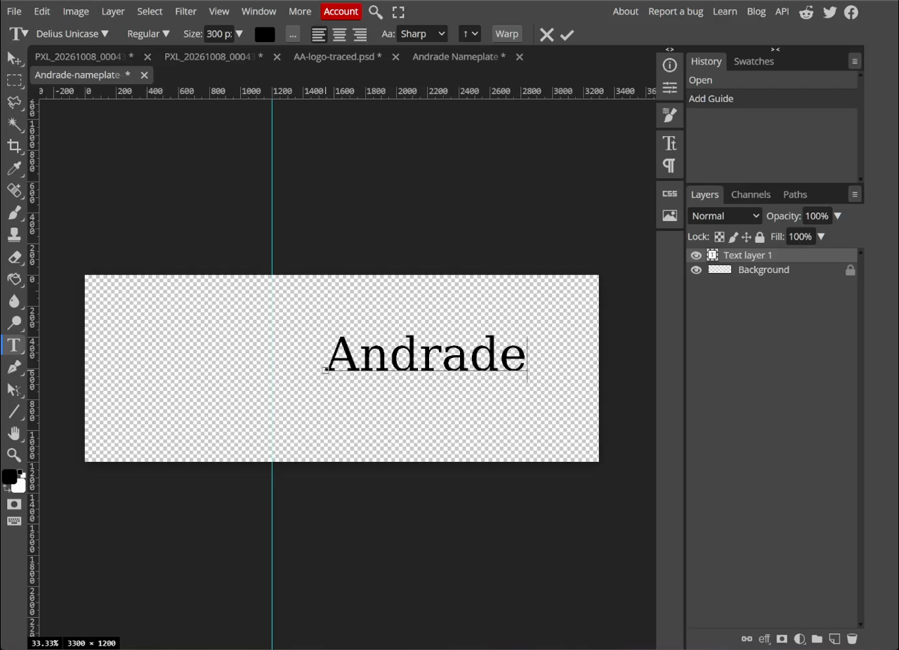
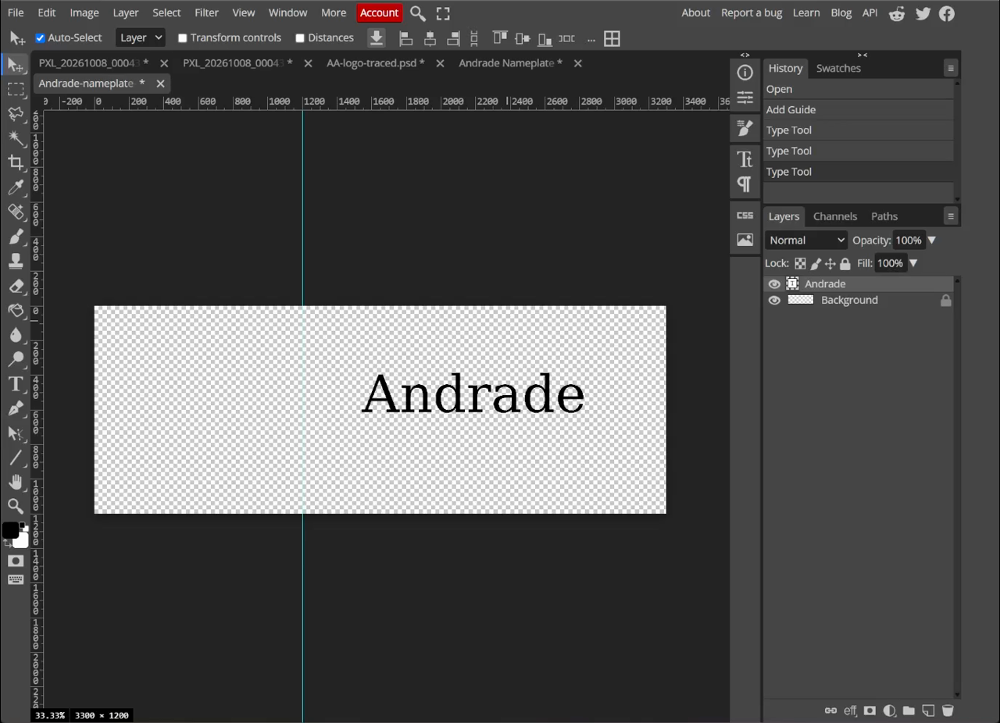
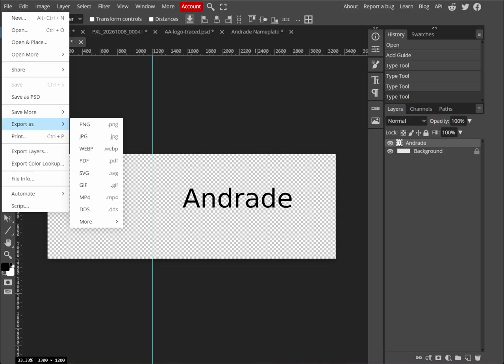

## Learning goals

By the end of this lesson:

- I can make an 11 × 4 inch canvas.
- I can leave a 4 × 4 inch space for a logo.
- I can try fonts and choose one that is easy to read.
- I can save a PSD and export a transparent PNG and SVG.

## Why this is useful

A clear nameplate is easier to read and easier to change. The empty space on the left gives the logo a planned place instead of squeezing it in later.

You will use this file again in Lesson 3.

## What you will make

You will make a transparent 11 × 4 inch nameplate. The left 4 × 4 inches stay empty. The name **Andrade** sits in the right part of the design.

<video controls preload="metadata" style="width:100%;height:auto" aria-label="Screen recording of the Photopea nameplate text lesson">
  <source src="../../assets/name-tag-photopea/lesson-1-nameplate/lesson-1-nameplate-text.mp4" type="video/mp4">
  Your browser cannot play this video. Use the screenshots and steps below.
</video>

## Before you start

Open [Photopea](https://www.photopea.com/) in a browser.

You will use:

- the **Type Tool (T)**;
- a vertical guide;
- the **Move Tool (V)**; and
- the **Layers** panel.

## 1. Make the canvas

1. Choose **File > New**.
2. Set **Width** to `11` inches.
3. Set **Height** to `4` inches.
4. Set **DPI** to `300`.
5. Set **Background** to **Transparent**.
6. Choose **Create**.

Photopea will make a 3300 × 1200 pixel canvas. That is correct for 11 × 4 inches at 300 pixels per inch.

{fig-alt="Photopea New Project window with an 11 inch width, 4 inch height, and 300 pixels per inch."}

## 2. Mark the logo space

The logo space is a 4 × 4 inch square on the left.

1. Choose **View > New Guide**.
2. Choose a **Vertical** guide.
3. Enter `4 in`. If Photopea asks for pixels, enter `1200 px`.
4. Choose **OK**.

Everything left of the guide is for the logo. Keep the name to the right of it.

{fig-alt="A transparent nameplate with a vertical guide at the four-inch mark."}

## 3. Type the name

1. Select the **Type Tool (T)**.
2. Click to the right of the guide.
3. Type `Andrade`.
4. Select the whole word before changing the font.

{fig-alt="The word Andrade typed in the right part of the transparent nameplate."}

## 4. Try several fonts

Select the whole name. Try at least three fonts before choosing one. Change only the font at first. This makes the choices easier to compare.

Try:

1. a serif font;
2. a decorative or rounded font; and
3. a plain sans serif font.

A **serif** font has small finishing strokes on the letters. Serif fonts are common in printed books. A **sans serif** font does not have those strokes. Sans serif fonts are often a clearer starting point for signs and nameplates.

<picture>
  <source media="(max-width: 600px)" srcset="../../assets/name-tag-photopea/lesson-1-nameplate/font-choice-comparison-mobile.svg">
  
</picture>

No font is always good or bad. The best font fits the job and stays easy to read.

- **Serif:** try Georgia or Times New Roman for a printed-book look. Check the thin strokes.
- **Sans serif:** try DejaVu Sans, Arial, Verdana, or Open Sans for clear letters.
- **Rounded or display:** try Nunito, Montserrat, or Impact for personality. Check for crowding.
- **Script or decorative:** use joined or detailed letters with care. They can be hard to read and engrave.

Font names may vary. Choose a similar font if one is unavailable.

{fig-alt="The word Andrade shown in a serif font during the font comparison step."}

Ask these questions:

- Can I read the name quickly?
- Can I tell similar characters apart, such as `I`, `l`, and `1`?
- Are the lines thick enough to engrave?
- Do the spaces inside `a`, `e`, and `o` stay open?

Read the name from an arm's length away. If you need extra time to recognize it, try a simpler font.

Zoom out until the whole nameplate fits on the screen. Compare the fonts again at the smaller view. The [Accessible Design guide](../accessible-design/index.qmd#zoom-out-before-choosing) shows why this test matters.

The example ends with **DejaVu Sans Book** at about `300 px`. Another clear sans serif font is also fine.

## 5. Place the name

1. Select the **Move Tool (V)**.
2. Keep the name inside the right 7 inches.
3. Centre it from top to bottom.
4. Leave a clear margin on the right.
5. Check that the name does not cross the 4 inch guide.

Use your eyes as well as the numbers. The empty space above and below the name should look even.

{fig-alt="Andrade in a simple sans serif font, vertically centred with a clear right margin and an empty logo area on the left."}

## Accessible design

Accessible design helps more people see and understand your work. Before exporting, use the complete [Accessible Design guide](../accessible-design/index.qmd) to check the font at different zoom levels, contrast, open letter shapes, colour choices, and alt text.

### Check your work

Continue when:

- the canvas is 11 × 4 inches;
- the background is transparent;
- the left 4 × 4 inch area is empty;
- the name is easy to read;
- the letters have strong contrast and open shapes;
- the name is centred from top to bottom; and
- there is a good margin on the right.

## 6. Save and export

Save three files.

1. Choose **File > Save as PSD**. Name it `Andrade-nameplate-text.psd`.
2. Choose **File > Export as > PNG**. Name it `Andrade-nameplate-text.png`.
3. Choose **File > Export as > SVG**. Name it `Andrade-nameplate-text.svg`.

Keep **add raster graphics** off when you export the SVG. The checkerboard means the background is transparent. It will not appear in the saved image.

{fig-alt="Photopea File menu opened to Export as, with PNG and SVG visible."}

### Download the example files

- [Editable PSD](../../assets/name-tag-photopea/downloads/tutorial-andrade/Andrade-nameplate-text.psd)
- [Transparent PNG](../../assets/name-tag-photopea/downloads/tutorial-andrade/Andrade-nameplate-text.png)
- [Vector SVG](../../assets/name-tag-photopea/downloads/tutorial-andrade/Andrade-nameplate-text.svg)

## Common issues

- **The canvas has a white box:** make a new file with **Background: Transparent**.
- **The name is in the logo space:** move it to the right of the 4 inch guide.
- **The name looks too small:** make the type larger, but keep a clear right margin.
- **The name is hard to read:** choose a simple sans serif font with open letter shapes.
- **The name moved when the font changed:** use the Move Tool to centre it again.

::: {.ter-curriculum-relevance}
**Design curriculum:** Complete this lesson after the [N.I.C.E. Design Process](../design-process/index.qmd). Next, use a rough sketch to make a clean logo in [Lesson 2](rough-sketch-to-svg-photopea.qmd). You will combine both files in [Lesson 3](03-combine-logo-nameplate.qmd).
:::

## Summary

You made an 11 × 4 inch transparent nameplate. You left a 4 × 4 inch space for a logo, tried several fonts, chose a balanced sans serif font, and saved PSD, PNG, and SVG files.

Next: [Lesson 2: Trace a Rough Logo in Photopea](rough-sketch-to-svg-photopea.qmd).
