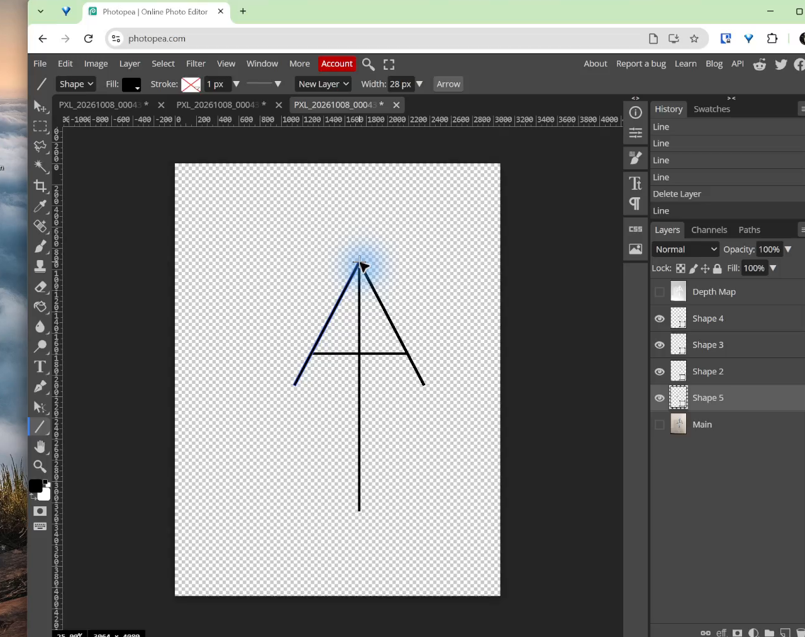

## Learning goals

By the end of this assignment:

- I can follow a digital step-by-step guide.
- I can build a nameplate at the correct size.
- I can trace a simple sketch with editable vector shapes.
- I can save a PSD and export PNG and SVG files.

## Why this is useful

This assignment gives you practice before you make your own design. You will learn where the tools are, how layers work, and how to check exported files.

These are directed practice tasks. Make the examples shown in the guides. You will make your own name and logo in the next project.

## What you will make

Complete all three tasks across two classes.

| Class | Task | Finished work |
|---|---|---|
| **Class 1** | 1. Nameplate | An 11 × 4 inch transparent nameplate with **Andrade** on the right |
| **Class 1** | 2. Simple trace | A clean AA mark made from four editable vector lines |
| **Class 2** | 3. Multi-layer trace | A coloured sun, two-peak mountain, and river made from separate named shapes |

Use **Andrade** in Task 1 so your screen matches the worked example. Do not redesign the examples during this assignment.

## Before you start

1. Open [Photopea](https://www.photopea.com/).
2. Make a folder named `Photopea-Practice`.
3. Keep this assignment open in another tab.
4. Open each linked guide when you reach that task.

Save often. Keep every PSD because the PSD is the editable working file.

## Class 1

### Task 1: Build the Andrade nameplate

Open [Guide 1: Build the Nameplate Text](01-nameplate-text-photopea.qmd). Follow every numbered step in order.

Your finished nameplate must have:

- an `11 × 4 in` canvas at `300 DPI`;
- a transparent background;
- an empty `4 × 4 in` space on the left;
- the name **Andrade** on the right;
- at least three font choices tested before choosing one;
- a clear sans serif font;
- the name centred from top to bottom; and
- a clear margin on the right.

{fig-alt="The finished practice nameplate has an empty square on the left and the word Andrade centred in the right side."}

Save these files in `Photopea-Practice`:

- `Andrade-nameplate-text.psd`
- `Andrade-nameplate-text.png`
- `Andrade-nameplate-text.svg`

Before moving on, reopen the PNG and SVG. Check that the name appears and the background is transparent.

### Task 2: Trace the simple AA mark

Open [Guide 2: Trace the AA Logo](rough-sketch-to-svg-photopea.qmd). Follow every numbered step in order.

Your finished trace must have:

- four separate editable shape layers;
- two outside lines that meet at the top;
- lower ends at the same height;
- one centre line and one crossbar;
- matching line thickness; and
- the reference photograph hidden.

{fig-alt="The finished AA practice trace has two balanced outside lines, one centre line, and one crossbar."}

Save these files in `Photopea-Practice`:

- `Andrade-AA-trace.psd`
- `Andrade-AA-trace.svg`

Open the SVG before you finish Class 1. It should show only the clean black AA mark.

## Class 2

### Task 3: Trace the multi-layer landscape logo

Open [Guide 3: Trace a Multi-Layer Logo](02b-advanced-multilayer-tracing-photopea.qmd). Download the sketch from the guide and follow every numbered step in order.

Your finished file must have these five layers:

1. `SUN`
2. `LEFT-A`
3. `RIGHT-A`
4. `RIVER`
5. `REFERENCE`, hidden and locked

The four finished parts must be vector shape layers. Use a fill for each part and no unwanted stroke. Check the black shapes first. Add colour only after the shapes look clean.

{fig-alt="The finished multi-layer practice logo has four coloured parts and separate named layers."}

Save these files in `Photopea-Practice`:

- `Andrade-layered-logo.psd`
- `Andrade-layered-logo.svg`

Open the SVG before you submit it. The reference sketch must not appear. The sun, both peaks, and the river must all be visible.

::: {.callout-note title="This is a practice example"}
This simple example shows Level 3 tool use. Your later personal design should have stronger styling, more original choices, and careful revision.
:::

## Check your work

Before you submit, make sure:

- [ ] I completed all three tasks.
- [ ] My nameplate is 11 × 4 inches at 300 DPI.
- [ ] My nameplate has a transparent background and an empty 4 × 4 inch logo area.
- [ ] My AA mark uses four separate vector lines.
- [ ] My landscape logo uses four separate named vector shapes.
- [ ] Both reference images are hidden in the finished work.
- [ ] I reopened and checked every exported PNG and SVG.
- [ ] All filenames match the list below.

## Submit

Submit one folder containing these seven files:

1. `Andrade-nameplate-text.psd`
2. `Andrade-nameplate-text.png`
3. `Andrade-nameplate-text.svg`
4. `Andrade-AA-trace.psd`
5. `Andrade-AA-trace.svg`
6. `Andrade-layered-logo.psd`
7. `Andrade-layered-logo.svg`

Do not submit screenshots instead of the working and exported files.

## Common issues

- **The background is white:** return to the guide and make sure the document background is transparent.
- **A shape is made of pixels:** undo it, choose **Shape** mode, and draw it again.
- **The reference appears in the SVG:** hide the reference and export again with raster graphics and hidden layers turned off.
- **The SVG is empty or missing a part:** return to Photopea, make the part visible, export again, and reopen the new SVG.
- **A filename is unclear:** rename it to match the submission list before uploading.

::: {.ter-curriculum-relevance}
**Design curriculum:** This two-class practice assignment builds beginner Photopea skills in typography, layers, vector tracing, file organization, and export. The next worked example combines a finished logo and nameplate before students begin their own original name-tag project.
:::

## Summary

You followed three worked guides. You made a correctly sized nameplate, traced a simple mark, and built a coloured logo from separate vector shapes. You also checked the editable and exported files.

Next: [Combine the Logo and Nameplate](03-combine-logo-nameplate.qmd).
