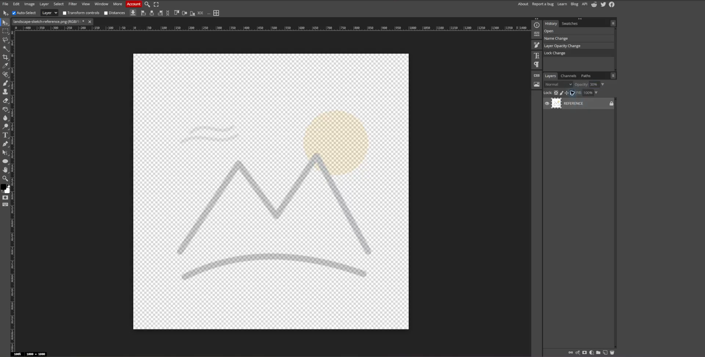
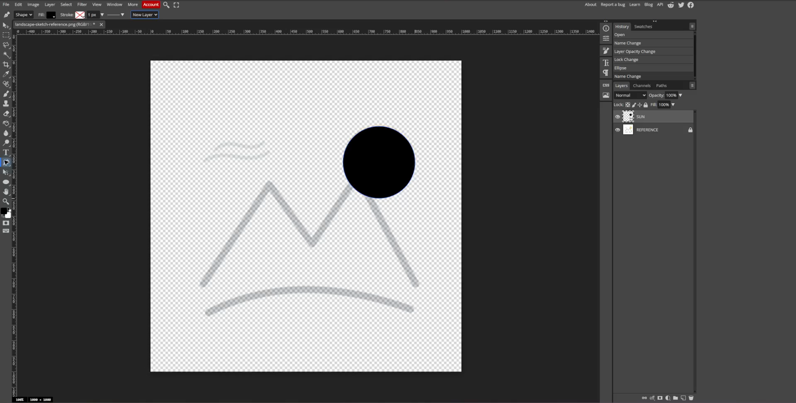
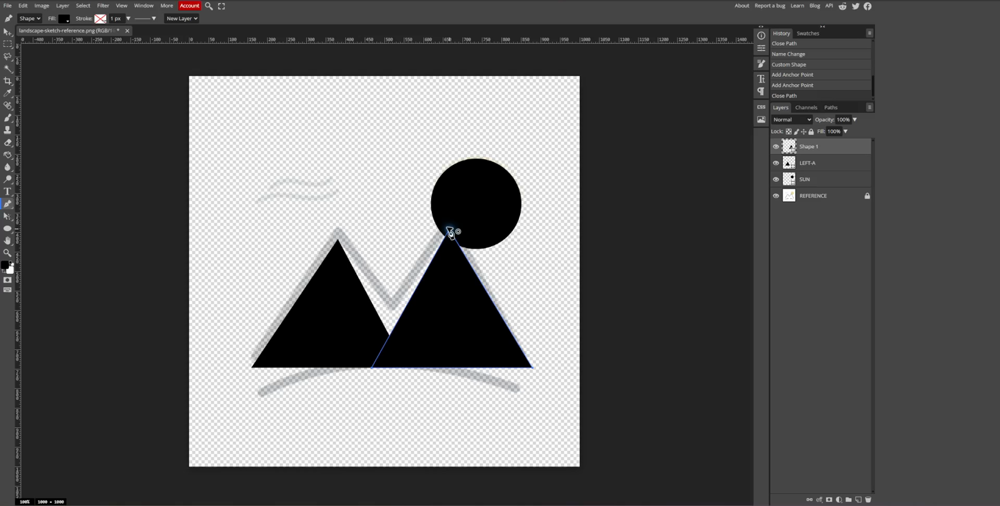
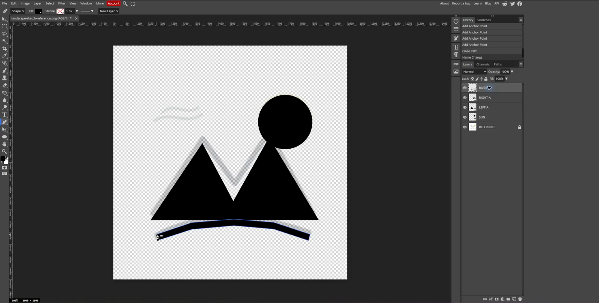
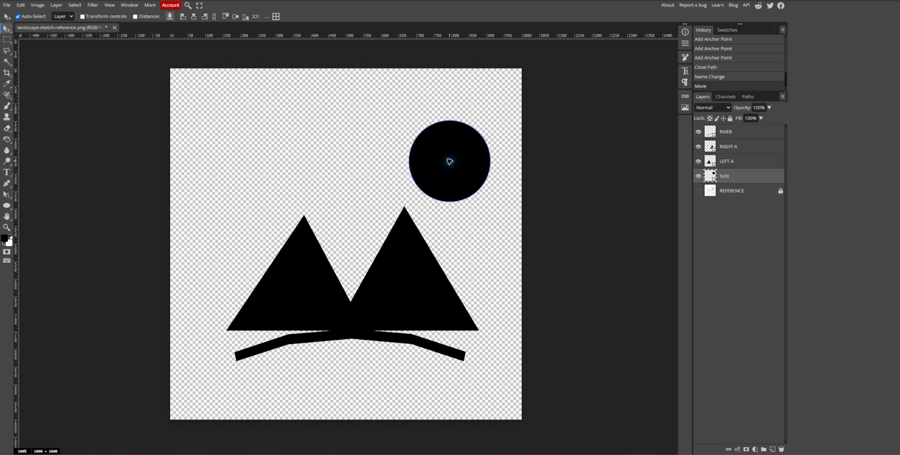
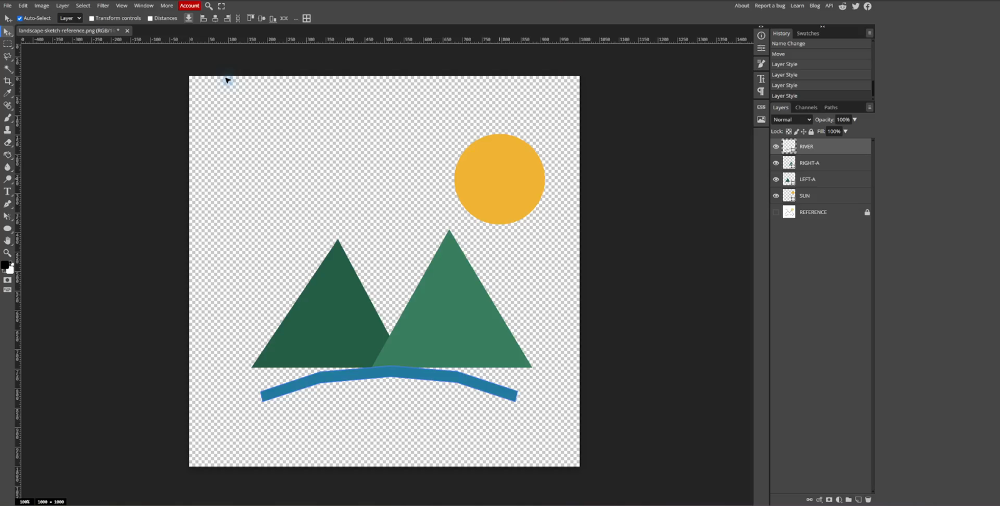
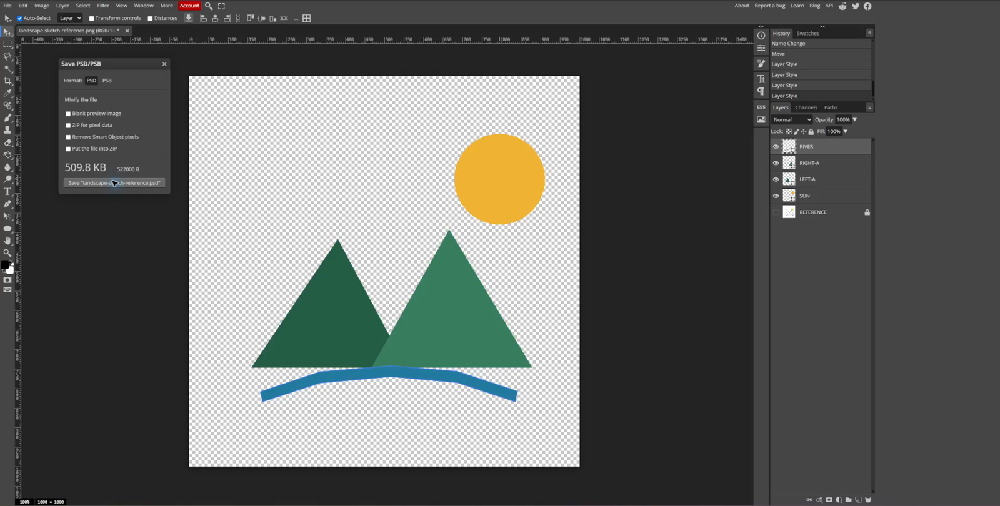
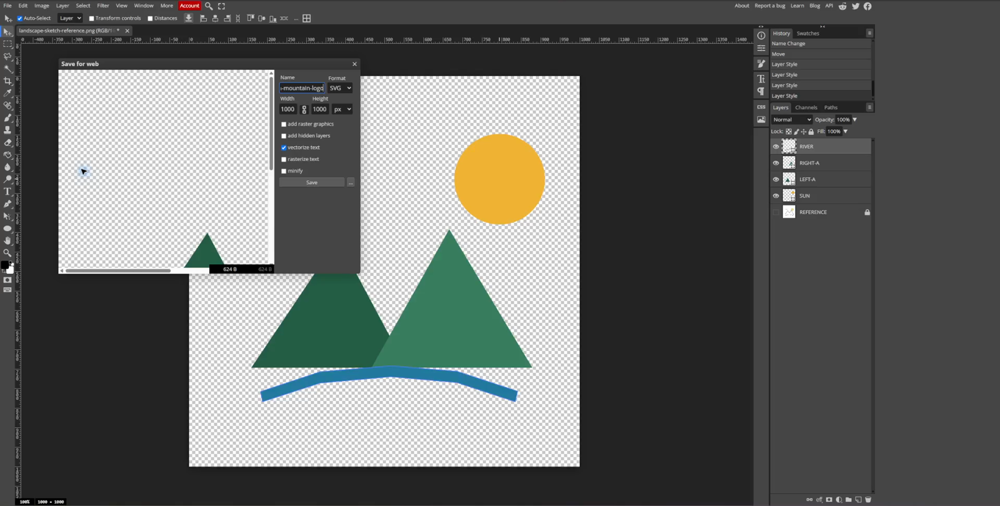

## Learning goals

By the end of this lesson:

- I can trace a sketch with separate vector shapes.
- I can name each layer so I know what it contains.
- I can colour each part without changing the other parts.
- I can save a PSD and export an SVG with separate parts.

## Why this is useful

Most hand-drawn logos have more than one part. A separate graphics layer for each part makes the logo easier to fix, colour, move, and animate.

An SVG can also guide a laser cutter, embroidery machine, vinyl cutter, or other machine. Clean paths and clear names make the file easier to use later.

## What you will make

You will rebuild a small landscape logo. The two mountain peaks also look like the letters **AA**. The finished SVG has four separate parts:

1. `SUN`
2. `LEFT-A`
3. `RIGHT-A`
4. `RIVER`

<video controls preload="metadata" style="width:100%;height:auto" aria-label="Screen recording of the Photopea multi-layer logo tracing lesson">
  <source src="../../assets/personal-logo-photopea/advanced-multilayer-tracing/advanced-multilayer-tracing.mp4" type="video/mp4">
  Your browser cannot play this video. Use the screenshots and steps below.
</video>

[Open the lesson video in a new tab](../../assets/personal-logo-photopea/advanced-multilayer-tracing/advanced-multilayer-tracing.mp4){target="_blank"}.

::: {.callout-note title="Level 3 example"}
This is a simple Level 3 example, below 75%. It shows the required tracing and layer skills, but it is not a highly styled final design.

After the trace works, improve the shapes, spacing, colours, and style. Make your own logo look more polished and original.
:::

## Before you start

Finish [Lesson 2A: Warm-Up: Trace the AA Logo](rough-sketch-to-svg-photopea.qmd) first.

Open [Photopea](https://www.photopea.com/) in a browser. Download the [rough landscape sketch](../../assets/personal-logo-photopea/landscape-sketch-reference.png), or use a clear photo of your own sketch.

You will use:

- the **Layers** panel;
- the **Ellipse Tool**;
- the **Pen Tool** in **Shape** mode;
- the **Move Tool**; and
- the colour picker.

## 1. Fade and lock the sketch

1. Open the sketch in Photopea.
2. Rename the image layer `REFERENCE`.
3. Lower its **Opacity** to about `30%`.
4. Lock the layer.

The sketch should be light enough that new black shapes are easy to see.

{fig-alt="The rough mountain, sun, and river sketch faded to light grey so new vector shapes will stand out."}

## 2. Make the sun

1. Choose the **Ellipse Tool**.
2. Set the tool to **Shape** mode.
3. Use a solid black fill and set the stroke to **None**.
4. Drag a circle over the sun.
5. Rename the new layer `SUN`.

Hold **Shift** while dragging if you want a perfect circle.

{fig-alt="A black circle tracing the sun while the faded mountain sketch remains visible underneath."}

## 3. Make two mountain shapes

The two peaks are separate pieces. Do not trace the whole mountain as one shape.

1. Choose the **Pen Tool**.
2. Choose **Shape** in the top bar.
3. Click anchor points at the bottom-left corner, the top of the first peak, and the centre valley.
4. Click the first anchor point again to make a closed path.
5. Rename the layer `LEFT-A`.
6. Start a new shape layer.
7. Trace the second peak and rename it `RIGHT-A`.

Use only a few points. Fewer points make a cleaner shape.

{fig-alt="Two filled mountain triangles traced separately so each peak can be edited or animated on its own."}

## 4. Make the river

The river is a thin closed shape, not a brush line.

1. Start another new shape layer.
2. Click several points along the top edge of the river.
3. Click back along the bottom edge.
4. Close the path by clicking the first point.
5. Rename the layer `RIVER`.

For a smoother river, drag while placing an anchor point to make a Bézier curve. A few well-placed anchor points usually look smoother than many small ones.

Keep the shape simple. The curve does not need many points.

{fig-alt="A closed river shape below the mountains, with its own RIVER layer selected in the Layers panel."}

## 5. Hide the sketch and check the shapes

Click the eye beside `REFERENCE` to hide the sketch.

Check the logo in black before adding colour. Black makes uneven shapes, gaps, and unwanted overlaps easier to see.

{fig-alt="The clean black logo with the reference hidden and SUN, LEFT-A, RIGHT-A, RIVER, and REFERENCE named in the Layers panel."}

### Check your layers

The Layers panel should show:

- `RIVER`
- `RIGHT-A`
- `LEFT-A`
- `SUN`
- `REFERENCE`, hidden and locked

These names become useful labels inside the SVG. In the next assignment, you can animate the sun, each peak, and the river separately.

## 6. Fix the size and spacing

Use the **Move Tool** to move a whole shape. Use the **Direct Select Tool** to move one point.

Check that:

- the two peaks look balanced;
- the centre valley is clear;
- the sun does not cover a peak;
- the river follows the mountain base; and
- no part is too close to the edge.

Make small changes. Look at the whole logo after each change.

## 7. Add colour at the end

1. Double-click the shape thumbnail beside `SUN`.
2. Choose a colour and select **OK**.
3. Repeat for `LEFT-A`, `RIGHT-A`, and `RIVER`.
4. Use a small set of colours that are easy to tell apart.

Colour comes last because the black version makes shape problems easier to find.

{fig-alt="The finished four-colour logo with separate named layers visible in Photopea."}

## 8. Save the editable PSD

Choose **File > Save More > Save PSD/PSB**. Keep **PSD** selected, then choose **Save**.

The Photoshop Document (PSD) keeps the reference and all four editable shape layers.

{fig-alt="The Save PSD or PSB window ready to download the layered working file."}

## 9. Export the SVG

1. Keep `REFERENCE` hidden.
2. Choose **File > Export as > SVG**.
3. Give the file a clear name.
4. Leave **add raster graphics** off.
5. Leave **add hidden layers** off.
6. Choose **Save**.

The empty background keeps its transparency, so the SVG does not gain a white rectangle.

{fig-alt="The SVG Save for Web window showing the vector-only export settings."}

Open the [finished four-part SVG](../../assets/personal-logo-photopea/aa-mountain-animation-ready.svg) to compare it with your file.

## Check your work

Before you submit, check that:

- the PSD has four separate shape layers;
- every layer has a clear name;
- the reference is hidden and locked;
- the logo still works when the reference is hidden;
- the SVG contains only the finished artwork; and
- each part can be selected separately.

## Submit

Submit:

- the layered `.psd` working file; and
- the finished `.svg` file.

## Common issues

- **Everything is on one layer:** undo the last shape, make a new layer, and draw that part again.
- **The Pen Tool makes a line instead of a filled shape:** choose **Shape** mode before you click points.
- **The shape has too many bumps:** remove points. Use only the points needed to show the main form.
- **The sketch appears in the SVG:** hide `REFERENCE` and export again with **add raster graphics** and **add hidden layers** off.
- **The parts cannot move separately:** check that every part is on its own shape layer.
- **The colours look busy:** use fewer colours and keep enough contrast between nearby parts.

::: {.ter-curriculum-relevance}
**Design curriculum:** Builds vector drawing, layer organization, revision, SVG export, and animation preparation.
:::

## Summary

You traced one simple sketch as four named vector shapes. You checked the black shapes first, added colour at the end, saved an editable PSD, and exported an SVG whose parts can be animated separately.

This Level 3 example is a starting point. Improve the styling and make the final design your own.

Previous: [Lesson 2A: Warm-Up: Trace the AA Logo](rough-sketch-to-svg-photopea.qmd). Next: [Lesson 3: Combine the Logo and Nameplate](03-combine-logo-nameplate.qmd).
