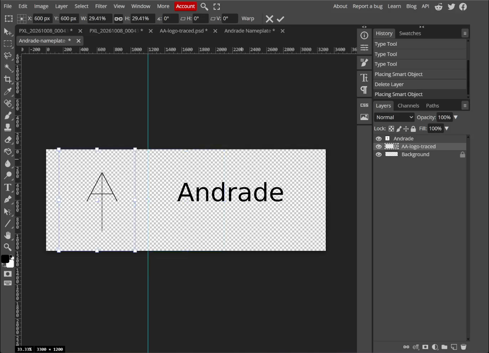
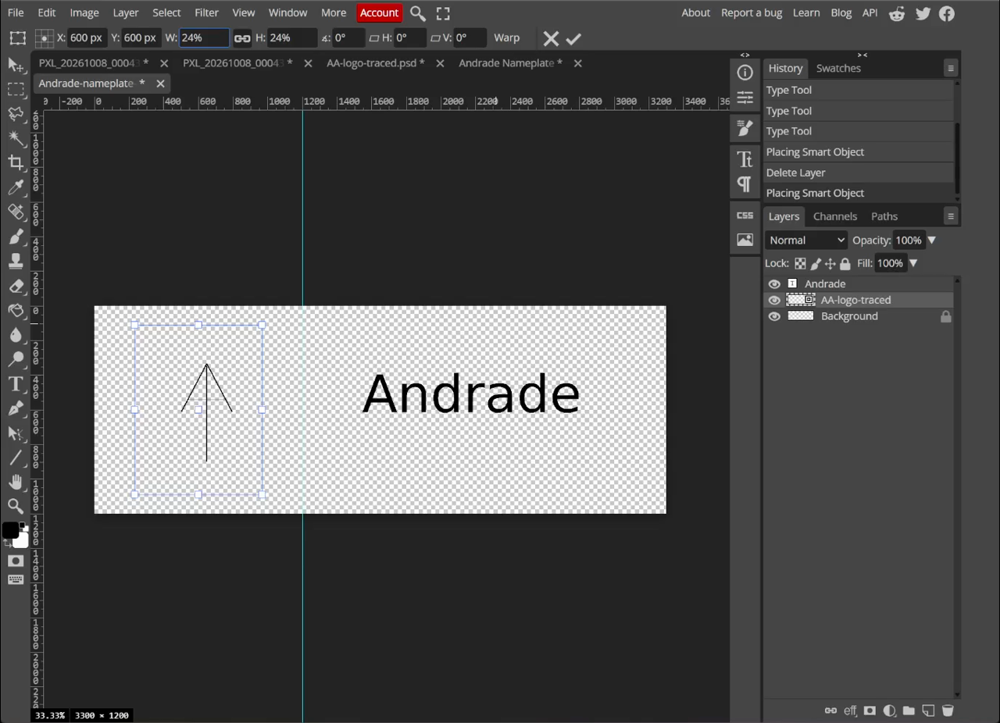
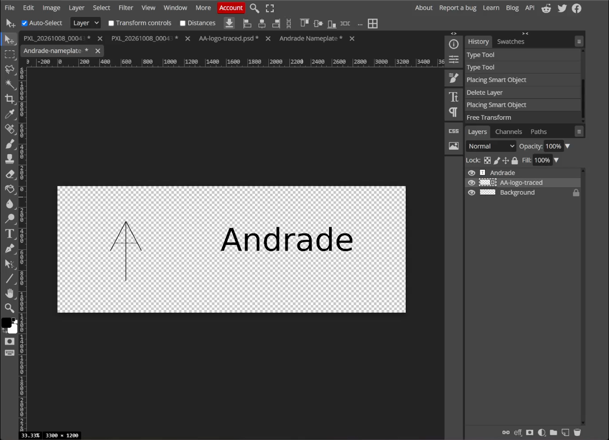
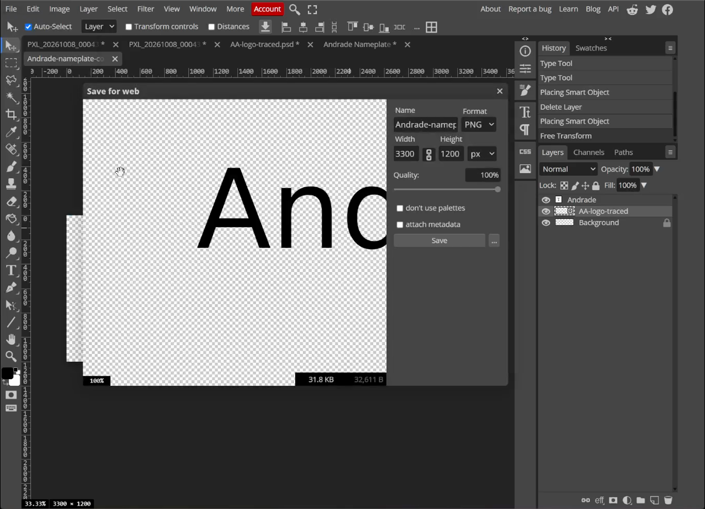
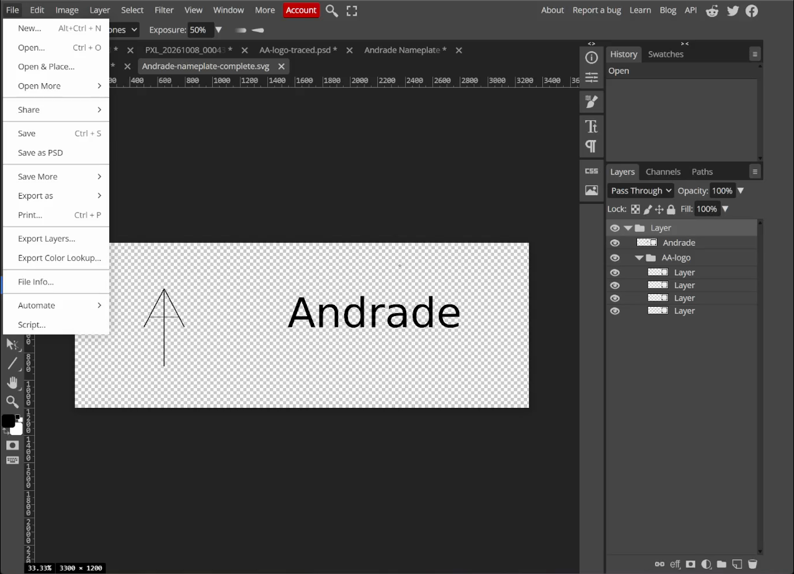

## Learning goals

By the end of this lesson:

- I can place a logo in another Photopea file.
- I can resize a logo without stretching it.
- I can align a logo and name so the design looks balanced.
- I can save PSD, PNG, and SVG files.

## Why this is useful

A logo and a name should look like one design. Good size, spacing, and alignment make the nameplate easier to read and ready for the next project.

## What you will make

You will add the logo from Lesson 2 to the empty 4 × 4 inch space from Lesson 1. The final design has no background.

<video controls preload="metadata" style="width:100%;height:auto" aria-label="Screen recording of the Photopea logo and nameplate lesson">
  <source src="../../assets/name-tag-photopea/lesson-3-complete/lesson-3-combine-logo-nameplate.mp4" type="video/mp4">
  Your browser cannot play this video. Use the screenshots and steps below.
</video>

## Before you start

Finish the [Two-Class Photopea Practice Assignment](01-photopea-practice-assignment.qmd) first. It uses these three guides:

1. [Build the Nameplate Text](01-nameplate-text-photopea.qmd)
2. [Trace the AA Logo](rough-sketch-to-svg-photopea.qmd)
3. [Trace a Multi-Layer Logo](02b-advanced-multilayer-tracing-photopea.qmd)

You need the nameplate PSD and the finished logo SVG.

## 1. Open the nameplate

1. Open Photopea.
2. Choose **File > Open**.
3. Open `Andrade-nameplate-text.psd`.
4. Check that the 4 inch guide is still visible.

{fig-alt="The transparent nameplate open in Photopea with the name on the right and the left logo area empty."}

## 2. Place the logo

1. Choose **File > Open & Place**.
2. Choose your finished logo SVG.
3. Keep the link between **W** and **H** turned on. This keeps the logo's shape.
4. Drag a corner to resize the logo.

The logo may cover the name at first. That is normal. Resize it before judging the spacing.

{fig-alt="The AA logo being resized with transform handles on the transparent nameplate."}

## 3. Fit the logo in the left square

Move the logo into the left 4 × 4 inch space.

For the example:

- the logo centre is near `X: 600 px` and `Y: 600 px`;
- the width and height are about `24%`; and
- the logo stays inside the guide with clear space around it.

Your logo may need different numbers. Keep its shape locked and judge the empty space around it.

{fig-alt="The AA logo centred in the left four-inch area with the name Andrade on the right."}

## 4. Check the full design

1. Press **Enter** or choose the checkmark to finish the transform.
2. Hide guides with **View > Extras** or `Ctrl+H`.
3. Look at the logo and name together.

Check these points:

- The logo has room on every side.
- The logo and name feel centred from top to bottom.
- The space between them is clear.
- The name is still the easiest part to read.
- Nothing touches an edge.

{fig-alt="The finished transparent nameplate with a balanced AA logo and Andrade layout."}

## 5. Save the PSD and PNG

1. Choose **File > Save as PSD**. Name it `Andrade-nameplate-complete.psd`.
2. Choose **File > Export as > PNG**.
3. Check that the size is `3300 × 1200 px`.
4. Name it `Andrade-nameplate-complete.png`.
5. Choose **Save**.

The PNG should show the logo and name on a transparent background.

{fig-alt="Photopea Save for web window set to PNG for the completed nameplate."}

## 6. Export a true vector SVG

A placed SVG can stay as a smart object in the PSD. Photopea may leave that smart object out of a normal SVG export.

Use this checked method:

1. Choose **File > Open** and open the logo SVG in its own Photopea tab.
2. Select the logo's vector layers in the Layers panel.
3. Copy them with `Ctrl+C`.
4. Return to the nameplate tab and paste with `Ctrl+V`.
5. Resize and place the pasted vector layers in the same position as the smart-object logo.
6. Hide the smart-object logo so there is only one visible copy.
7. Check that the name and the pasted logo paths are both visible in the Layers panel.
8. Choose **File > Export as > SVG**.
9. Leave **add raster graphics** off.
10. Choose **Save**.

{fig-alt="Photopea File menu opened to Export as with SVG visible while the complete vector nameplate is open."}

::: {.callout-warning title="Check the SVG before you submit it"}
Open the exported SVG. Make sure both the logo and the name appear. If the logo is missing, do not submit that export. Use the checked all-vector SVG below.
:::

### Download the finished example files

- [Editable PSD](../../assets/name-tag-photopea/downloads/tutorial-andrade/Andrade-nameplate-complete.psd)
- [Transparent PNG](../../assets/name-tag-photopea/downloads/tutorial-andrade/Andrade-nameplate-complete.png)
- [Checked all-vector SVG](../../assets/name-tag-photopea/downloads/tutorial-andrade/Andrade-nameplate-complete.svg)

## Submit

Submit all three files:

- `Andrade-nameplate-complete.psd`
- `Andrade-nameplate-complete.png`
- `Andrade-nameplate-complete.svg`

## Common issues

- **The logo looks stretched:** undo, turn on the W/H link, and resize from a corner.
- **The logo is too close to an edge:** make it smaller and centre it again.
- **The design has a white background:** hide or remove the background layer before export.
- **The SVG is missing the logo:** the placed logo stayed as a smart object. Use the all-vector file and export again.
- **The name and logo do not feel connected:** adjust the gap. Keep enough space so they do not touch.

::: {.ter-curriculum-relevance}
**Design curriculum:** This lesson combines the files from [Lesson 1](01-nameplate-text-photopea.qmd) and the [multi-layer tracing example](02b-advanced-multilayer-tracing-photopea.qmd). Next, use the worked ANDRADE example to [design a name tag with your own name and logo](../03-laser-cutting/01-name-logo.qmd).
:::

## Summary

You placed the logo in the 4 × 4 inch space, kept its shape, checked the full layout, and made PSD, transparent PNG, and vector SVG files.

Previous: [Two-Class Photopea Practice Assignment](01-photopea-practice-assignment.qmd). Next: [Your Turn: Design Your Own Name + Logo Name Tag](../03-laser-cutting/01-name-logo.qmd).
