## Learning goals

By the end of this lesson:

- I can use a photograph as a tracing guide.
- I can rebuild a drawing with editable vector shapes.
- I can make clean corners, curves, and closed paths.
- I can save a PSD and export a working SVG.

## Why this is useful

A paper sketch can be rough. Vector shapes let you fix the lines without losing the idea.

Clean SVG files can be resized without becoming blurry. They can also become paths for cutting, scoring, plotting, or embroidery software.

## What you will make

First, trace the simple AA mark as a short warm-up. Then follow a worked example that turns two mountain peaks into a clean AA landscape logo. Finally, use the same steps with your own drawing.

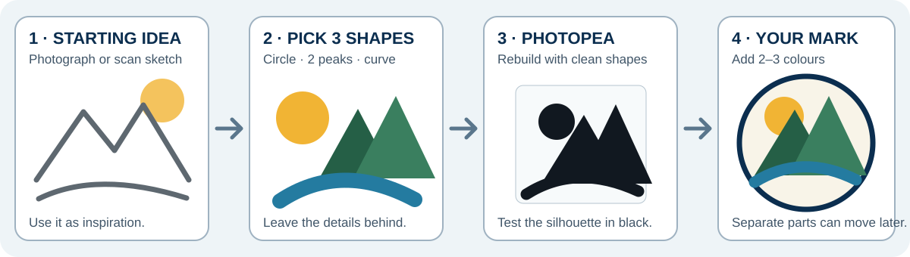{fig-alt="A paper landscape sketch is reduced to a sun, mountain, and river, rebuilt with clean shapes in Photopea, and finished as a simple logo."}

The goal is not to copy every pencil mark. The goal is to rebuild the important shapes.

## Before you start

Open [Photopea](https://www.photopea.com/) in a modern browser.

You need:

- a clear photograph or scan of your drawing;
- a dark drawing on light paper;
- the **Shape tool** for circles and simple shapes;
- the **Pen tool** for custom shapes and curves; and
- the **Layers panel** for keeping each part separate.

[Download the landscape practice sketch](../../assets/personal-logo-photopea/landscape-sketch-reference.png){.btn .btn-primary}

[Download the finished four-element SVG](../../assets/personal-logo-photopea/aa-mountain-animation-ready.svg){.btn .btn-outline-primary}

[Download the printable Photopea guide](../../assets/name-tag-photopea/personal-logo-photopea-guide.pdf){.btn .btn-outline-primary}

## 1. Warm up with four straight lines

Open the AA reference photograph. It is only a tracing guide.

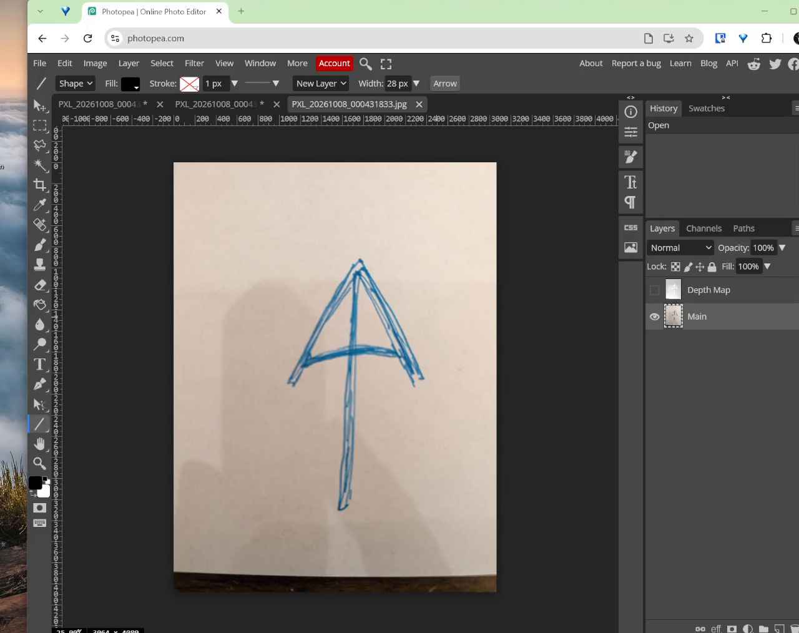{fig-alt="A blue hand-drawn AA mark is open in Photopea as a tracing guide."}

1. Choose the **Line tool**.
2. Choose **Shape** in the top bar.
3. Set the colour to black.
4. Start with a line thickness near `14 px`.
5. Drag over the left diagonal.

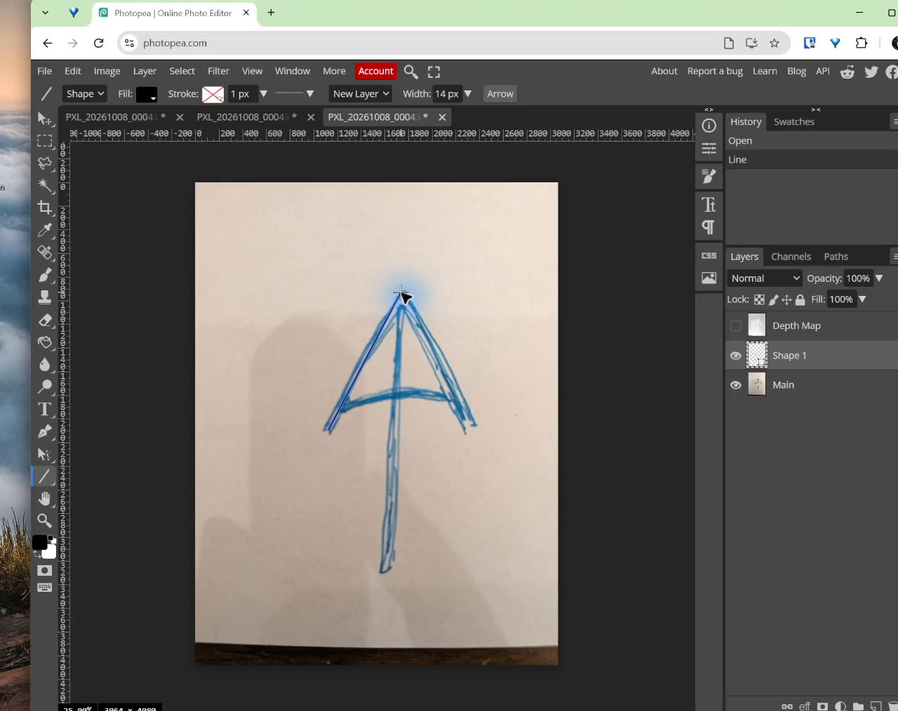{fig-alt="One clean black vector line is drawn over the left side of the blue sketch."}

Draw the other diagonal, the centre line, and the crossbar. Keep each line on its own shape layer.

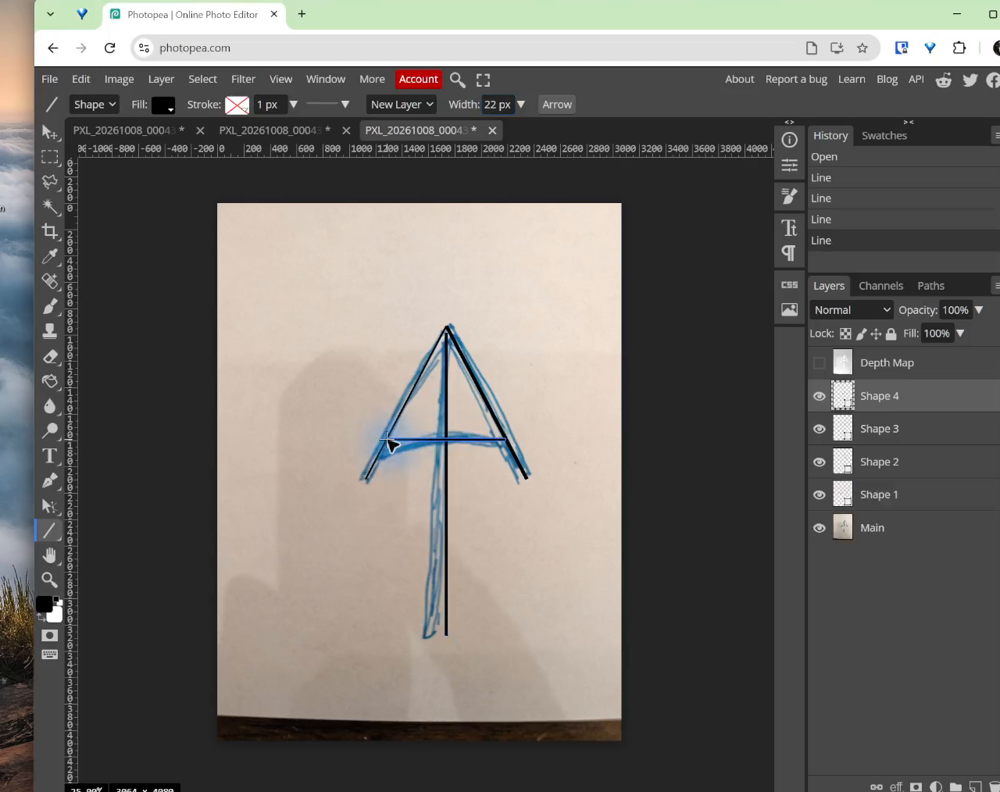{fig-alt="Four black vector lines rebuild the AA mark above the reference photograph."}

Hide the photograph. Move the lines until both sides look even.

This is the warm-up. Straight lines are useful, but most student logos need more than four lines.

## 2. Study the worked example

The landscape drawing has many pencil marks. The logo keeps only four main parts:

1. a circle for the sun;
2. a left peak for the first A;
3. a right peak for the second A; and
4. a curved shape for the river.

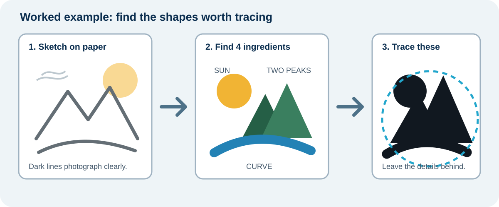{fig-alt="A landscape sketch is examined and its three useful logo parts are identified as a circle, triangle, and curve."}

Do the same with your drawing. Circle the parts that carry the idea. Leave small details behind.

Your drawing may need more than four parts. Rebuild one important part at a time.

::: {.callout-tip title="Keep the idea, not every wobble"}
Use a few clean shapes. A logo should still make sense when it is small.
:::

## 3. Create the logo file

1. Choose **File > New**.
2. Set **Width** to `1000 px`.
3. Set **Height** to `1000 px`.
4. Choose **Transparent** for the background.
5. Select **Create**.

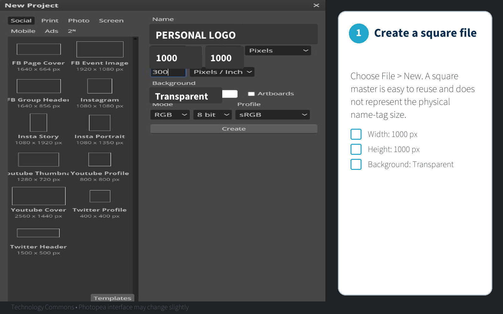{fig-alt="The Photopea New Project screen is set to a 1000 by 1000 pixel transparent document."}

This square is a working area. The SVG can be resized later.

## 4. Place, fade, and lock the drawing

1. Choose **File > Open & Place**.
2. Select the photograph or scan.
3. Resize it to fill most of the square.
4. Rename its layer `REFERENCE`.

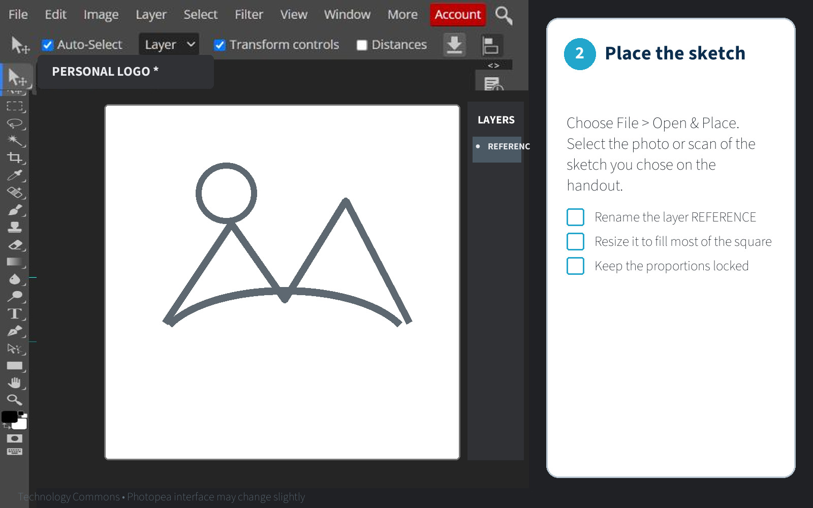{fig-alt="A landscape drawing is placed in Photopea on a layer named REFERENCE."}

1. Select the `REFERENCE` layer.
2. Set its **Opacity** to about `30%`.
3. Select the lock icon.

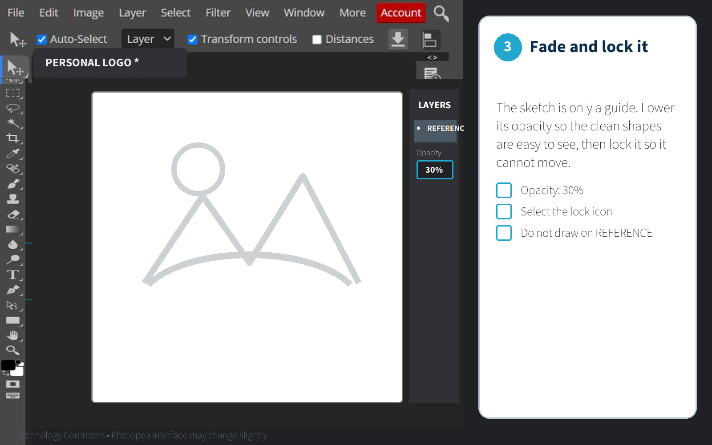{fig-alt="The landscape reference is faded to 30 percent opacity and locked in the Layers panel."}

You should see a pale drawing that cannot move by accident.

## 5. Rebuild the simple shapes

Start with the easiest part. In the worked example, that is the sun.

1. Choose the **Ellipse tool**.
2. Choose **Shape** in the top bar.
3. Set **Fill** to black.
4. Set **Stroke** to none.
5. Hold **Shift** and drag a circle over the sun.
6. Rename the new shape layer `SUN`.

Use a shape tool when a part is a circle, rectangle, line, or simple polygon.

## 6. Use the Pen tool for custom shapes

Use the Pen tool for the two peaks and the river.

1. Choose the **Pen tool** or press **P**.
2. Choose **Shape** in the top bar.
3. Set **Fill** to black.
4. Set **Stroke** to none.
5. Click once to make a sharp corner.
6. Click and drag to make a curve.
7. Click the first point again to close the path.
8. Rename the layers `LEFT-A`, `RIGHT-A`, and `RIVER`.

Use as few points as possible. Two or three smooth points make a better curve than many small points.

Keep the sun, both peaks, and river on separate shape layers. Do not merge them. Use the unique layer names `SUN`, `LEFT-A`, `RIGHT-A`, and `RIVER`. Photopea uses these names as element IDs in the exported SVG. In the next animation assignment, each part can move, fade, scale, or enter at a different time.

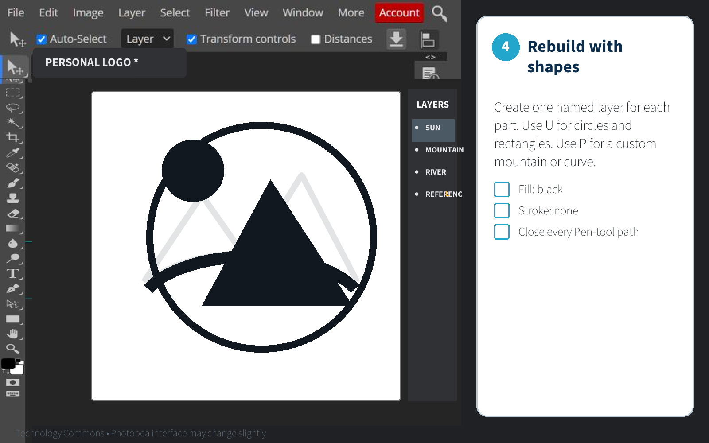{fig-alt="The landscape is rebuilt with separate black vector layers for the sun, peaks, and river above the pale reference drawing."}

### Make both sides even

For a symmetrical part:

1. Trace one half.
2. Duplicate the shape layer.
3. Choose **Edit > Transform > Flip Horizontally**.
4. Move the copy until the centre edges meet.

### Make a hole inside a shape

Some logos have an opening inside a larger shape. Draw the outside path first. Draw the inside path next. Select both paths and choose **Subtract** in the path-operation menu.

The opening should show the transparent checkerboard when the reference is hidden.

## 7. Hide the drawing and run the black test

1. Select the eye beside `REFERENCE` to hide it.
2. Look at the logo as one black design.
3. Zoom out until it looks about `25 mm` wide.

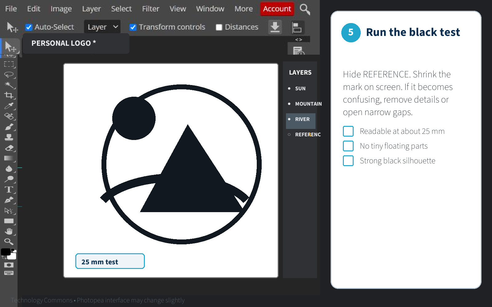{fig-alt="The reference layer is hidden so the black logo can be checked as a small, clear silhouette."}

Fix the logo if:

- a thin line disappears;
- a small gap closes;
- a curve looks bumpy;
- one side looks heavier; or
- a small part looks like a loose dot.

Use the **Direct Select tool** to move a point or its curve handles. Make one small change, then look at the whole logo again.

## 8. Add colour after the black version works

Colour is optional for the name tag. Keep a black version for engraving.

If you add colour, use two or three flat colours. Do not use colour to fix an unclear shape.

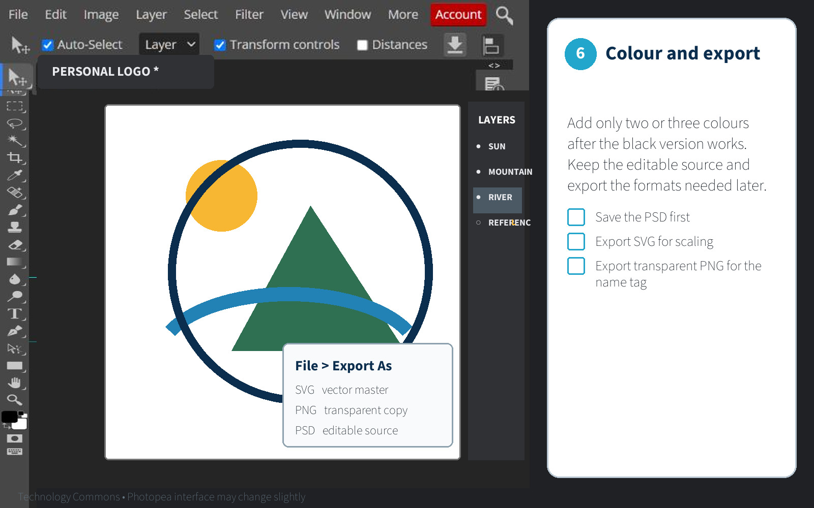{fig-alt="The finished landscape logo uses three flat colours while the sun, mountain, and river remain on separate layers."}

## 9. Check your work

Continue when:

- the photograph is hidden;
- each part is an editable shape layer;
- the sun, left peak, right peak, and river are still separate;
- every filled shape is closed;
- the logo is clear in black;
- narrow gaps stay open;
- curves use only the points they need; and
- nothing important disappears at a small size.

## 10. Save the PSD and export the SVG

1. Choose **File > Save as PSD**.
2. Save the file as `lastname-logo-working.psd`.
3. Hide `REFERENCE` and any practice layers.
4. Choose **File > Export as > SVG**.
5. Leave **add hidden layers** off.
6. Leave **add raster graphics** off.
7. Choose **Save**.

Because the layers have unique names, the SVG contains four separate elements. Do not combine the paths before exporting.

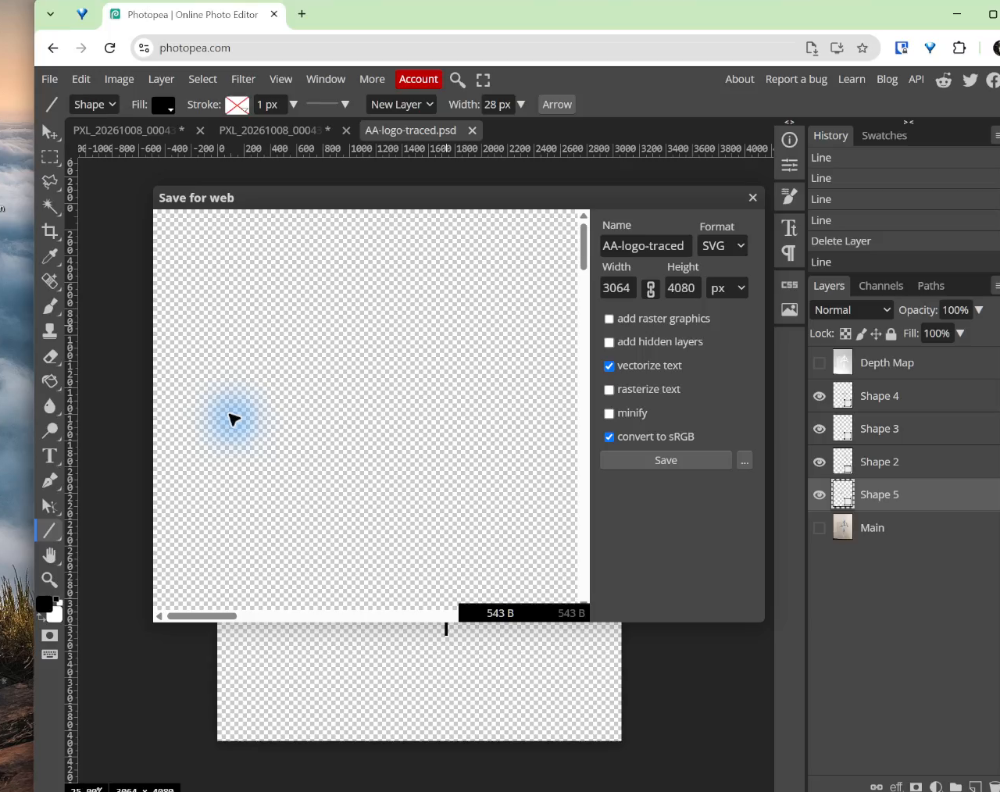{fig-alt="Photopea's SVG export window is ready to save only the visible vector shapes."}

Open the downloaded SVG in Photopea. Check that the photograph is gone and every logo part is visible.

## Submit

Submit:

- `lastname-logo-working.psd` with editable layers; and
- `lastname-logo.svg` with only the finished vector artwork.

## Common issues

- **The logo is made of pixels:** undo and choose **Shape** mode before drawing.
- **The Pen tool makes a corner instead of a curve:** click and drag instead of clicking once.
- **The curve is bumpy:** remove extra points and adjust the remaining handles.
- **A filled part is open:** use the Pen tool to click the first point and close the path.
- **The logo has too much detail:** keep the largest shapes and remove small marks.
- **The two sides do not match:** trace one half, duplicate it, and flip the copy.
- **The photograph appears in the SVG:** hide `REFERENCE` and export again with raster graphics turned off.
- **Automatic tracing creates hundreds of points:** use **Image > Vectorize Bitmap** only as a starting point. Delete tiny pieces and rebuild important curves with the Pen tool.

::: {.ter-curriculum-relevance}
**Design curriculum:** This is Lesson 2 in the Photopea sequence. Complete [Lesson 1](01-nameplate-text-photopea.qmd) first. Next, add the finished logo to the nameplate in [Lesson 3](03-combine-logo-nameplate.qmd).
:::

## Summary

The AA warm-up showed how vector lines work. The landscape example turned two peaks into an AA mark and showed how to rebuild a real drawing with simple shapes, custom curves, and closed paths.

Do not trace every pencil mark. Keep the idea, rebuild the important shapes, test the logo in black, and check the exported SVG. Keep each part separate so the next animation assignment can move the elements one at a time.

Previous: [Lesson 1: Build the Nameplate Text](01-nameplate-text-photopea.qmd). Next: [Lesson 3: Combine the Logo and Nameplate](03-combine-logo-nameplate.qmd).
