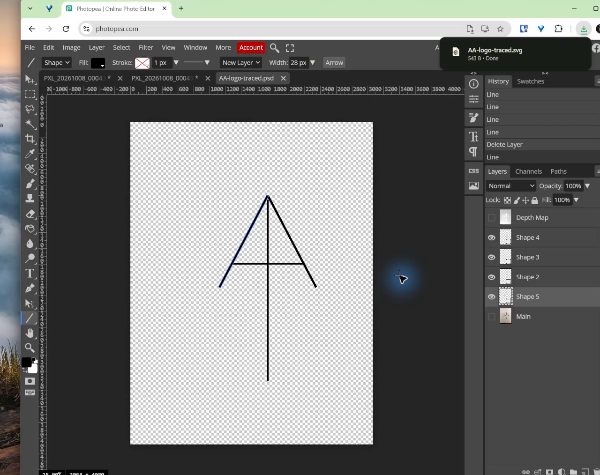

## Learning goals

By the end of this activity:

- I can use a rough sketch as a reference instead of copying every wobble.
- I can build a logo from editable vector shape layers.
- I can improve symmetry, alignment, spacing, and visual weight.
- I can save an editable PSD and export a scalable SVG.

## What you are making

You will begin with a photograph of a hand-drawn mark and rebuild it with clean lines. The sketch supplies the idea. You decide the finished proportions.

The example uses four vector strokes:

1. a left diagonal;
2. a right diagonal;
3. a vertical centre line; and
4. a horizontal crossbar.

::: {.callout-tip title="Work from large shapes to small corrections"}
Build the complete symbol first. Hide the photograph only after all four strokes exist, then judge the clean silhouette and make corrections.
:::

## Before you begin

Open [Photopea](https://www.photopea.com/) in a modern browser. You can choose **File > Open** or drag the photograph from its folder onto Photopea.

You will use these parts of the editor:

- **Toolbar:** the vertical row of tools on the left.
- **Canvas:** the document in the centre.
- **Layers panel:** the list of editable pieces on the right.
- **Shape layer:** a vector object that can be resized or adjusted without becoming blurry.
- **Stroke width:** the thickness of a line.

## 1. Open the sketch

Open the photograph and fit it on screen. Do not erase or paint on it. It is only a reference for the vector shapes you will place above it.

{fig-alt="A blue hand-drawn AA logo opened as a reference image in Photopea."}

Look for the simplest structure inside the rough drawing. In this example, the main decisions are the position of the top point, the angle of the two legs, the centre line, and the crossbar.

## 2. Draw the first editable stroke

1. Select the **Line tool**. If it is hidden, press and hold the shape-tool icon in the toolbar and choose **Line**.
2. In the top options bar, choose **Shape** mode.
3. Choose black for the line and begin with a stroke width near `14 px`.
4. Drag from one endpoint to the other to trace the left diagonal.

{fig-alt="The first black vector line drawn over one side of the blue sketch."}

Photopea creates a new shape layer. This is different from drawing with a brush: the line stays editable and can be scaled cleanly.

::: {.callout-note title="The sketch is a guide, not a rule"}
Aim for a cleaner angle than the hand-drawn line. Ignore small bumps and changes in pen pressure.
:::

## 3. Build the complete symbol

Draw the remaining diagonal, the vertical centre stroke, and the crossbar. Keep each stroke as an editable shape layer.

{fig-alt="Four black vector strokes forming the AA logo over the original sketch, with separate shape layers visible."}

Work slowly and check these relationships:

- The two diagonal legs meet at one centred top point.
- The lower endpoints of the legs are at the same height.
- The vertical stroke is straight and centred.
- The crossbar is level.
- All four strokes have a similar visual weight.

It is fine if the first version is uneven. The next step is where the design work happens.

## 4. Hide the photograph and inspect the silhouette

In the Layers panel, click the eye beside the photograph layer. The grey-and-white checkerboard means the background is transparent.

{fig-alt="The traced AA logo by itself on Photopea's transparent checkerboard."}

Without the sketch underneath, proportion problems become easier to see. Ask:

- Does the logo lean to one side?
- Are the two legs equally far from the centre?
- Is the centre stroke truly vertical?
- Is the crossbar centred and level?
- Does one stroke look heavier than the others?

## 5. Correct proportions and thickness

Select one shape layer at a time. Use the **Move tool** to reposition a whole stroke or the **Direct Select tool** to adjust its vector points. Change the stroke width in the top options bar when a line looks too heavy or too light.

Make small changes, then look at the complete mark again. Perfect numerical symmetry is useful, but the final test is whether the logo *looks* balanced.

{fig-alt="A corrected, balanced black AA logo on a transparent background in Photopea."}

### Design checkpoint

Continue only when:

- the top point is centred;
- the two outside legs feel balanced;
- the centre stroke is straight;
- the crossbar is level and centred; and
- the line thickness feels consistent.

## 6. Save the editable working file

Choose **File > Save as PSD** and use a clear filename such as `initials-logo-working.psd`.

The PSD is the working file. It preserves the photograph and the editable shape layers, so you can revise the logo later.

## 7. Export the SVG

1. Hide the photograph and any abandoned practice layers.
2. Choose **File > Export as > SVG**.
3. Leave **add hidden layers** off.
4. Leave **add raster graphics** off so the photograph is not embedded.
5. Keep the original width and height, then choose **Save**.

{fig-alt="Photopea's Save for Web window with SVG selected as the export format."}

The downloaded `.svg` is the final scalable artwork. It can be enlarged for a sign or reduced for a small label without becoming blurry.

{fig-alt="The completed AA logo in Photopea with a notification confirming the SVG download."}

## Submit

Submit both files:

- the `.psd` working file with editable shape layers; and
- the final `.svg` with only the finished vector artwork visible.

## Common recovery

- **A line is on the photograph layer:** undo, choose the Line tool in Shape mode, and draw it again.
- **A line is too thick or thin:** select its shape layer and change the stroke width in the top options bar.
- **The symbol looks correct over the sketch but wrong alone:** keep the photograph hidden while correcting the proportions.
- **The photo appears in the SVG:** hide the photo and export again with **add hidden layers** and **add raster graphics** turned off.
