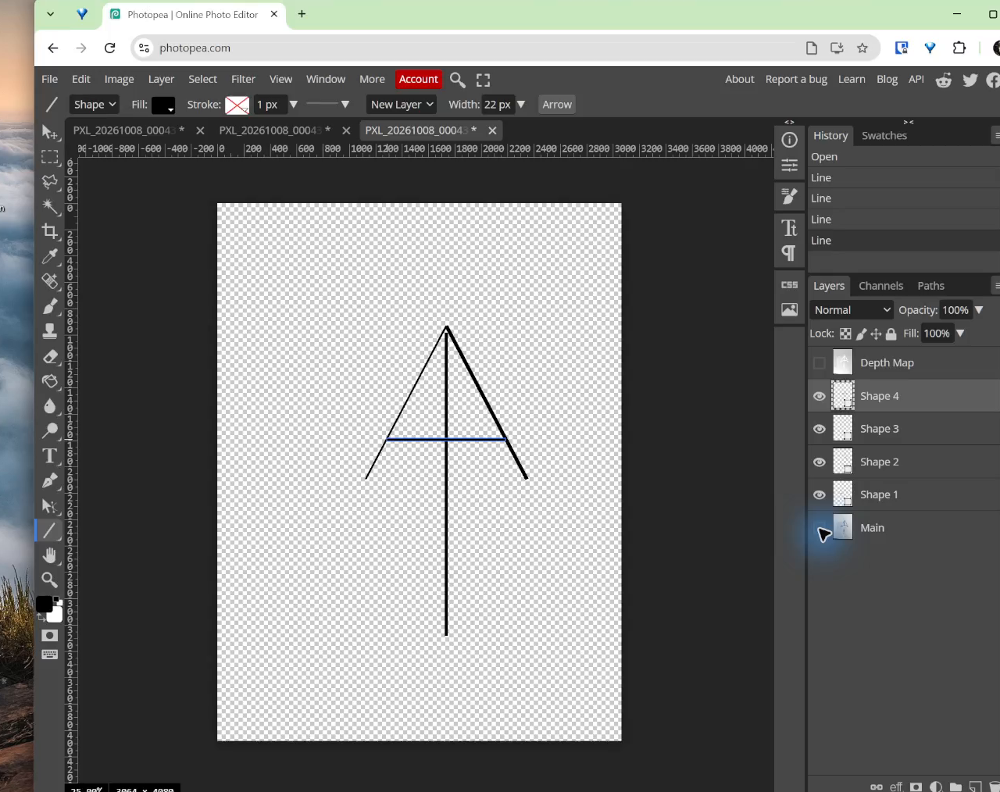

## Learning goals

By the end of this warm-up:

- I can use a photo as a tracing guide.
- I can draw an editable vector line.
- I can make both sides of a mark look even.
- I can save a PSD and export an SVG.

## Why this is useful

Your first sketch does not need to be perfect. Editable lines let you fix the shape while keeping the original idea.

This warm-up teaches the basic tools before you trace a logo with more parts.

## What you will make

You will rebuild the hand-drawn AA mark with four clean vector lines:

1. a left diagonal;
2. a right diagonal;
3. a vertical centre line; and
4. a horizontal crossbar.

## Before you start

Open [Photopea](https://www.photopea.com/) in a browser. Open the AA reference photograph, or use another simple mark made from a few straight lines.

You will use:

- the **Line Tool**;
- **Shape** mode;
- the **Move Tool**; and
- the **Layers** panel.

## 1. Open the sketch

Choose **File > Open**, then select the photograph. You can also drag the photograph onto Photopea.

Do not erase or paint on the photograph. It is only a guide.

{fig-alt="A blue hand-drawn AA mark is open in Photopea as a tracing guide."}

## 2. Draw the first line

1. Choose the **Line Tool**.
2. Choose **Shape** in the top bar.
3. Set the colour to black.
4. Start with a line thickness near `14 px`.
5. Drag over the left diagonal.

Photopea makes a new shape layer. A shape line stays sharp when it is resized.

{fig-alt="One clean black vector line is drawn over the left side of the blue sketch."}

## 3. Draw the other three lines

Draw the other diagonal, the centre line, and the crossbar. Keep each line on its own shape layer.

{fig-alt="Four black vector lines rebuild the AA mark above the reference photograph."}

Check that:

- the two outside lines meet at one top point;
- the lower ends are at the same height;
- the centre line is straight;
- the crossbar is level; and
- the four lines have the same thickness.

## 4. Hide the photo and fix the mark

Click the eye beside the photograph layer. The grey-and-white checkerboard means the background is transparent.

{fig-alt="The traced AA mark is visible on a transparent background after the photograph is hidden."}

Use the **Move Tool** to move a whole line. Make small changes until both sides look even.

{fig-alt="A balanced black AA mark made from four even vector lines."}

## 5. Save and export

1. Choose **File > Save as PSD**.
2. Save the working file with a clear name.
3. Keep the photograph hidden.
4. Choose **File > Export as > SVG**.
5. Leave **add hidden layers** off.
6. Leave **add raster graphics** off.
7. Choose **Save**.

{fig-alt="Photopea's SVG export window is ready to save only the visible vector lines."}

## Check your work

Continue when:

- the four lines are editable shape layers;
- both sides look even;
- the line thickness matches;
- the photograph is hidden; and
- the SVG contains only the finished mark.

## Common issues

- **A line is made of pixels:** undo and choose **Shape** mode before drawing.
- **A line is too thick or thin:** select its shape layer and change the line thickness.
- **The mark looks wrong without the photo:** keep the photo hidden while you fix the spacing.
- **The photo appears in the SVG:** hide the photo and export again with raster graphics turned off.

::: {.ter-curriculum-relevance}
**Design curriculum:** This warm-up builds basic vector drawing, visual checking, and file-export skills. Next, students use separate named shapes in the multi-layer worked example.
:::

## Summary

You used a rough sketch as a guide. You rebuilt it with four editable lines, made both sides look even, saved a PSD, and exported an SVG.

This was the warm-up. The next lesson uses different tools and named layers to trace a logo with several parts.

Return to the [Two-Class Photopea Practice Assignment](01-photopea-practice-assignment.qmd). Continue to Task 3 when Task 2 is complete.
