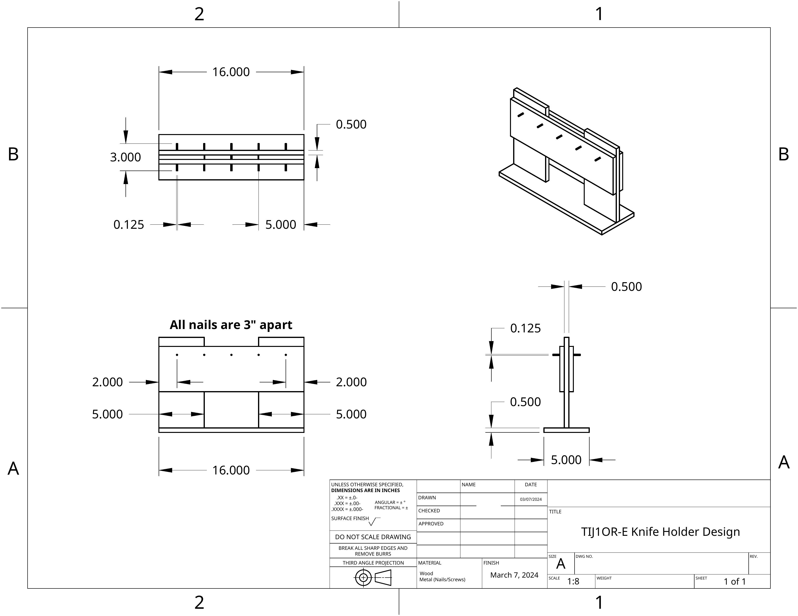

[← All finished organizers](index.qmd)

::: {.ter-case-status}
**TIJ1OR-E Knife Holder Design · Grade 9 project · March 2024**

**Finished prototype photographed · Assembly 1 drawing published · later drawing visible in the project photo**

This is a real student build, not a perfect final answer. The photograph and drawings show how the design changed after the tools, spacing and structure were considered.
:::

## Read the finished organizer

```{=html}
<figure class="ter-annotated-build">
  <div class="ter-annotated-build-stage">
    
    <span class="ter-build-pin ter-build-pin--one" aria-hidden="true">1</span>
    <span class="ter-build-pin ter-build-pin--two" aria-hidden="true">2</span>
    <span class="ter-build-pin ter-build-pin--three" aria-hidden="true">3</span>
  </div>
  <figcaption>Finished prototype. The numbered markers connect the physical features to the design decisions below. <a href="https://photos.app.goo.gl/UX3Vb3wBr8UQ5ZHf8">Open the shared project photo</a>.</figcaption>
</figure>

<div class="ter-build-callouts" aria-label="Design strengths visible in the finished organizer">
  <section><span>1</span><div><h3>Visible and easy to use</h3><p>All five handles face the user. Each can be seen, counted and gripped without moving a neighbouring knife. An empty position would be obvious.</p></div></section>
  <section><span>2</span><div><h3>Portable as one object</h3><p>The tool face, side supports and base form one self-contained organizer. It can be moved to another bench without installing a permanent wall system. A carry test should still confirm that the tools remain secure while it is moved.</p></div></section>
  <section><span>3</span><div><h3>Stands on its own</h3><p>The wide base and triangular side braces create a larger footprint than the upright tool face. That support geometry helps the organizer resist tipping when a knife is removed.</p></div></section>
</div>
```

## Why the spacing works

Ergonomic spacing is based on the real tool and the way a person reaches for it, not only on equal distances. Each handle remains visible, the grip areas do not overlap and the outside knives have clearance from the supports. The photograph is evidence that the layout was checked with the actual utility knives.

A future test should record whether different users can remove the centre and outside knives comfortably with one hand and whether the organizer remains stable when an outside knife is removed first.

## A one-sided wall version

::: {.ter-cleat-option}
### Keep one tool face; replace the freestanding base with a French-cleat interface

If the organizer only needed tools on one side, a later version could remove the second working face and the bench base. A solid backer on the remaining tool face could engage a continuous French cleat fixed to the wall. A lower spacer would keep the organizer parallel to the wall, and an anti-lift feature would prevent it from being knocked upward during use.

This is a **design direction, not a tested claim**. The cleat, backer, wall, fasteners, tool load and removal forces must be built and load-tested together. Mounting hardware must suit the actual wall and load.

[Browse French-cleat starting points in the Laser-Cut Gallery](../../../teaching-materials/laser-cutting/gallery.qmd)
:::

## Drawing and revision evidence

```{=html}
<figure class="ter-full-width-evidence">
  
  <figcaption>Assembly 1 drawing, March 7, 2024. <a href="../../../assets/tool-organizer-gallery/grade-9-knife-holder-assembly-drawing.pdf">Open the privacy-safe Assembly 1 PDF</a>.</figcaption>
</figure>
```

| Evidence | Dimensions and decisions visible in the record |
|---|---|
| **Assembly 1 drawing, March 7** | 16 in overall width, 5 in base depth, five knife positions and nails at 3 in centres. Materials are identified as wood and metal fasteners. |
| **Later drawing visible in the photo, March 22** | A more compact 12 in-wide layout, 10 in overall height and five nails at 2 in centres. The note calls for 2 in nails inserted 1 in at approximately 35 degrees. |
| **Finished prototype** | Five real utility knives fit with visible hand clearance. Side braces and a broad base make the holder freestanding. |

The drawing and photograph should not be treated as one unchanged set of dimensions. Together they document iteration: the designer reduced the width and adjusted the support geometry after considering the real tools.

## What a later revision could improve

- add labels or silhouettes so every tool has an obvious home;
- test and document the one-sided French-cleat option;
- add a positive carry-retention feature if the organizer will be moved while loaded;
- test one-handed removal with several users;
- record a tip test while removing an outside knife;
- measure and document the minimum neighbouring-handle clearance.

The useful strengths of this build should remain visible in the next concept. A later design does not need to change everything.

## Validation record

| Evidence | Status |
|---|---|
| Assembly 1 drawing metadata and dimensions | Recorded from the supplied March 7 PDF |
| Publishable orthographic image and privacy-safe PDF | Published; the student name field is removed |
| Finished-project front photo | Photo documented and linked to the shared album |
| Ergonomic handle spacing | Visually documented with all five real knives; multi-user reach test not yet recorded |
| Actual built dimensions | Pending comparison with the physical project |
| Visibility and access | Clearly demonstrated in the photo; formal test record pending |
| Stability | Freestanding base is visible; outside-tool tip test pending |
| Portability | Self-contained structure is visible; loaded carry test pending |
| Wall mounting | One-sided French-cleat direction proposed; not built or tested |
