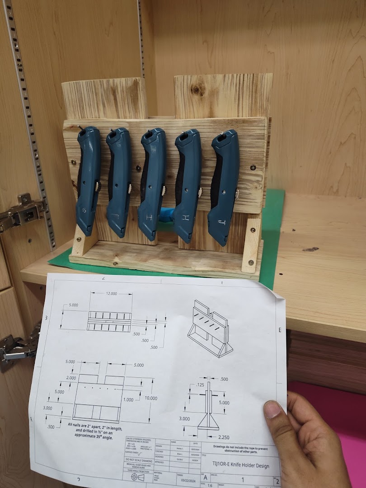

Each organizer in this gallery gets its own page. A build is added only when there is real evidence to show: a finished object, a drawing, dimensions, feedback or a documented revision.

<div class="ter-process-flow ter-process-flow--strong" aria-label="Organizer design cycle"><span>DESIGN</span><span>BUILD</span><span>FEEDBACK</span><span>REVISION</span></div>

## Finished organizers

```{=html}
<article class="ter-build-index-card">
  <a href="grade-9-knife-holder.qmd"></a>
  <div>
    <p class="ter-build-eyebrow">Grade 9 · Built and photographed</p>
    <h2><a href="grade-9-knife-holder.qmd">Portable utility-knife organizer</a></h2>
    <p>A full-size annotated photo shows why the organizer is easy to carry, easy to use and able to stand on a bench. The page also shows the drawing, two documented iterations and a possible one-sided French-cleat version.</p>
    <p><a class="btn btn-primary" href="grade-9-knife-holder.qmd">Study this organizer</a></p>
  </div>
</article>
```

## What makes a good tool holder?

| Design criterion | What a student should be able to show |
|---|---|
| **Visible inventory** | Every tool or part has a visible position. A missing item can be noticed quickly. |
| **Clear labels** | Names, sizes, outlines or colour-independent symbols show where each item belongs. |
| **Easy access** | A user can see the handle, grip it and remove or return the tool without moving neighbouring tools. |
| **Secure fit** | The holder supports the tool without being so tight that normal removal becomes difficult. Sharp or fragile parts are protected. |
| **Freestanding stability** | The holder stands on its own and does not tip when a tool is removed from an outside position. |
| **Wall option** | The design can include a tested wall interface, such as a French cleat, while still allowing safe removal or service. Mounting hardware must suit the actual wall and load. |
| **Stacking or modularity** | Modules can align, connect or stack without hiding labels, blocking tools or becoming unstable. |
| **Simple construction** | Parts, joints and fasteners are understandable, buildable and replaceable. |

Not every holder needs every feature. Choose the criteria that matter for the tools, user and location, then test those claims.

## A practical test

1. **Glance test:** Can another student identify every tool and notice what is missing?
2. **Reach test:** Can the user remove and return each tool with a natural grip?
3. **Tip test:** Does the organizer remain stable when the heaviest outside tool is removed?
4. **Carry test:** Can it be moved without loose tools falling out or the structure flexing?
5. **Mount test:** If it hangs, can it be attached, removed and loaded without pulling away, rotating or lifting off accidentally?

Record the result of each test. A claim such as “wall-mountable,” “portable” or “stable” is not complete until the actual interface has been built and tested.

## From measurements to a prototype

1. Compare the finished examples and decide which features fit the real tools and user.
2. Measure the real tools, including handles, collars, tapers and the hand clearance needed for removal.
3. Draw the concept using orthographic views and an isometric or assembly view.
4. Use the [Fabrication Plate Builder](../plate-builder/index.qmd) for plates, rings and repeated holder holes.
5. Use the [Laser-Cut Leg & Support Builder](../leg-builder/index.qmd) when the organizer needs a freestanding base, legs or a rear support.
6. Browse the [Laser-Cut Gallery](../../../teaching-materials/laser-cutting/gallery.qmd) for reusable geometry and design directions.
7. Make a small fit test before building the complete prototype.
8. Photograph the build, collect feedback and record the next revision.

## Add a future build

Each new organizer page should include a full finished photo, the original drawing, the problem, key dimensions, materials, fabrication method, what worked, feedback, the next revision, downloads where appropriate and a clear validation status.

Do not mark a design “validated” merely because a file renders or a digital assembly looks plausible. Distinguish **drawing available**, **dimension-tested**, **fit-tested**, **shop-tested** and **photo documented**. If evidence is missing, say so instead of filling the gap with a stock or generated image.
