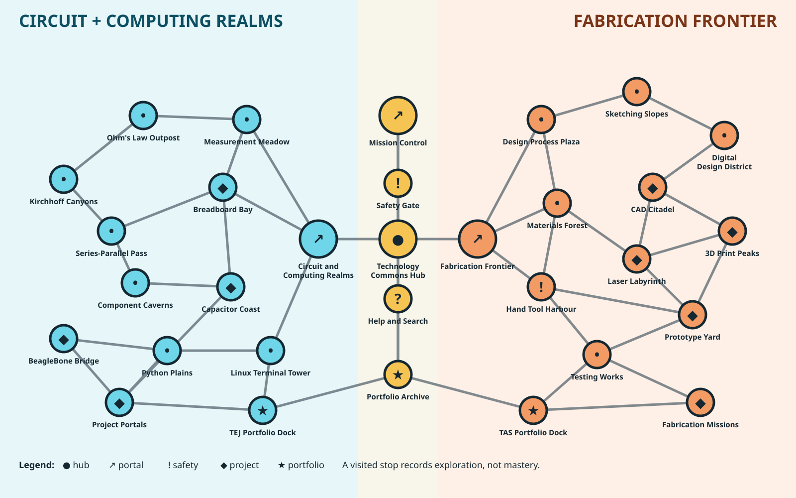

[Return to the interactive Learning Worlds map](index.qmd)

{fig-alt="Technology Commons Learning Worlds map. The central hub connects to TEJ circuit and computing regions on the left and TAS fabrication regions on the right."}

## Legend

- **● Hub:** start and shared supports
- **↗ Portal:** entrance to a course world
- **• Lesson:** notes, tutorial, or practice
- **◆ Project:** build, investigation, or longer mission
- **! Safety:** stop and check before acting
- **★ Portfolio:** document evidence and reflect

Visited stops show exploration, not mastery or a grade. All required content remains available through normal site navigation and search.

