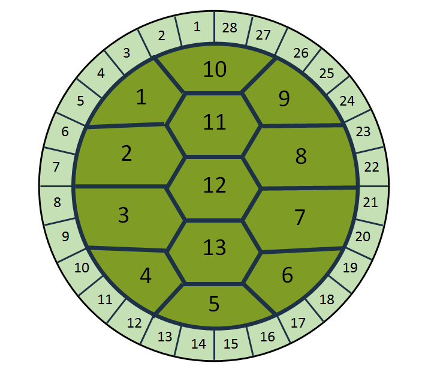
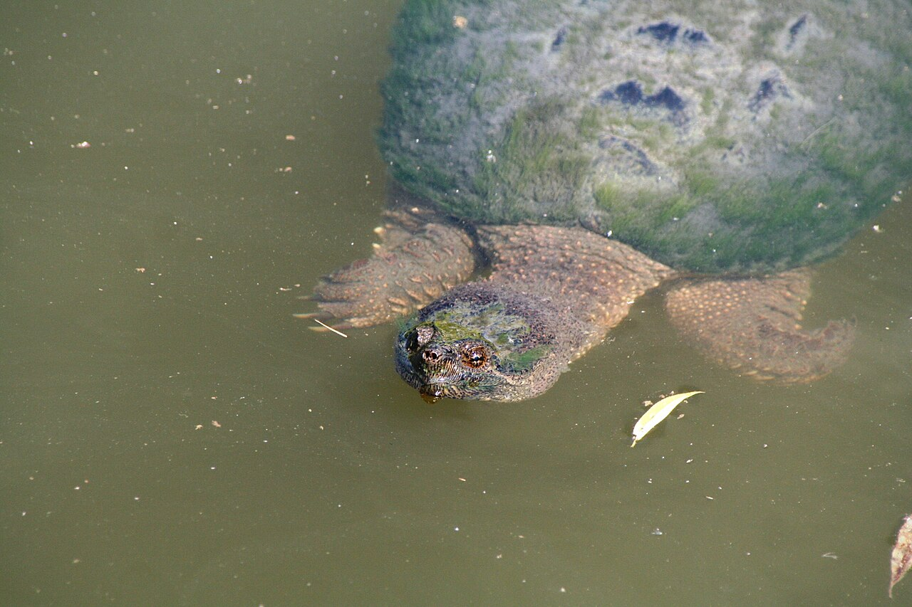
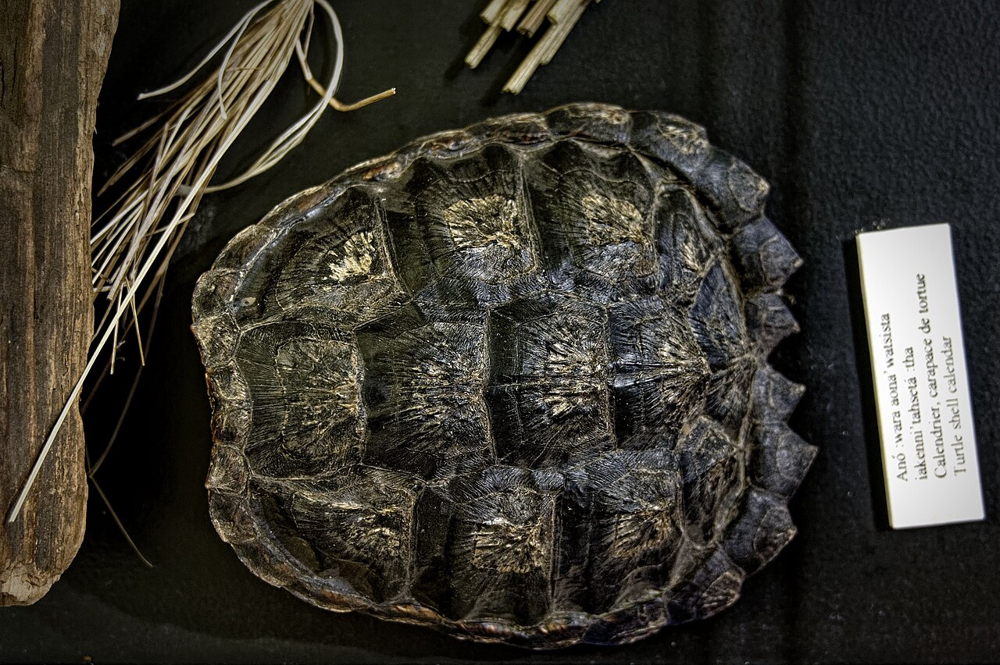

::: {.bs-editorial-lead}
In the Anishinaabe teaching resources used here, **Grandmother Moon** helps mark time through changes in the land, water, plants, animals, weather, and community life.
:::

{.moon-lead-diagram fig-alt="A turtle shell diagram numbered with 13 large central sections and 28 smaller sections around the edge."}

**The lunar calendar on a turtle's back.** Image and explanation from [Ontario Parks](https://blog.ontarioparks.ca/the-lunar-calendar-on-a-turtles-back/). © King's Printer for Ontario, 2018. Reproduced unchanged for non-commercial educational use.

## Start with community

Moon teachings are not identical across First Nations. Names, spellings, timing, and meanings change with language, territory, family, and community.

The sequence below comes from a [Matawa Education and Care Centre resource](https://matawalearning.ca/application/files/7517/1598/1948/Matawa_Science-Cycles-of-the-Moon.pdf), which identifies these as the 13 Moons of the **Mississaugas of the Credit**. Port Credit Secondary School stands within the traditional territory of the Mississaugas of the Credit First Nation.

The local sources use **Grandmother Moon**, rather than Mother Moon. A Mississaugas of the Credit First Nation notice names her **Tibik Giizis Nookmissmaan** and connects Grandmother Moon with water, cleansing, gratitude, and intention. See page 11 of the [November 2019 *Eaglepress*](https://mncfn.ca/wp-content/uploads/2026/01/November2019FINAL-compressed.pdf).

::: {.callout-note}
This page is a starting point, not a replacement for an Elder, Knowledge Keeper, language speaker, or community teacher.
:::

## Read the turtle's back

:::: {.moon-figure-grid}
::: {.moon-figure-card}
{fig-alt="A real common snapping turtle seen from the front and above while swimming in a pond."}

**A living turtle.** Photograph by [Maxquijano](https://commons.wikimedia.org/wiki/File:Common_snapping_turtle.jpg) at Toronto's Evergreen Brick Works, 2011, [CC BY-SA 3.0](https://creativecommons.org/licenses/by-sa/3.0/).
:::

::: {.moon-figure-card}
{fig-alt="A museum display shaped like a turtle shell. Thirteen large sections fill the centre and smaller sections form an outer edge."}

**A material example.** Iroquoian turtle-shell calendar display at the Droulers-Tsiionhiakwatha archaeological site. Photograph by [Pierre5018](https://commons.wikimedia.org/wiki/File:Turtle_shell_calendar.jpg), 2020, [CC BY-SA 4.0](https://creativecommons.org/licenses/by-sa/4.0/). The photographed edge has 25 visible small sections, which is why this page treats the numbers as a teaching pattern rather than a universal anatomy test.
:::
::::

### What to notice

  
<strong>13</strong>large centre sections<small>the Grandmother Moons</small>

  
<strong>28</strong>small edge marks<small>days in the teaching cycle</small>

The [Oneida Language and Cultural Centre](https://oneidalanguage.ca/oneida-culture/oneidalanguage-symbols/13-moons-turtle-island/) explains the same 13-and-28 relationship. A Mississaugas of the Credit classroom story describes children counting 13 spots and connecting them to the 13 Moons. See page 14 of the [May 2026 *Eaglepress*](https://mncfn.ca/wp-content/uploads/2026/05/MayEaglepress_2026-Websize.pdf).

## The 13 Grandmother Moons

These compact meanings summarize the Mississaugas of the Credit sequence in the [Matawa resource](https://matawalearning.ca/application/files/7517/1598/1948/Matawa_Science-Cycles-of-the-Moon.pdf). Gregorian months are approximate guides, not fixed start and end dates.

  <article>1 · January<h3>Mnido Giizis</h3>
Spirit Moon
<small>quiet reflection</small></article>
  <article>2 · February<h3>Makwa Giizis</h3>
Bear Moon
<small>birth and reflection</small></article>
  <article>3 · March<h3>Ziissbaakdoke Giizis</h3>
Sugar Moon
<small>maple sap runs</small></article>
  <article>4 · April<h3>Namebine Giizis</h3>
Sucker Moon
<small>fish return and sustain</small></article>
  <article>5 · May<h3>Waawaaskone Giizis</h3>
Flower Moon
<small>flowers and medicines grow</small></article>
  <article>6 · June<h3>Odemin Giizis</h3>
Strawberry Moon
<small>healing and reconciliation</small></article>
  <article>7 · July<h3>Mskomini Giizis</h3>
Raspberry Moon
<small>gentleness and kindness</small></article>
  <article>8 · July to August<h3>Datkaamin Giizis</h3>
Blackberry or Thimbleberry Moon
<small>a less frequent harvest</small></article>
  <article>9 · August<h3>Mdaamiin Giizis</h3>
Corn Moon
<small>future generations</small></article>
  <article>10 · September<h3>Biinaakwe Giizis</h3>
Falling Leaves Moon
<small>Creation gives back</small></article>
  <article>11 · October<h3>Mshkawji Giizis</h3>
Freezing Moon
<small>prepare for winter</small></article>
  <article>12 · November<h3>Mnidoons Giizis Oonhg</h3>
Little Spirit Moon
<small>healing and a good path</small></article>
  <article>13 · December<h3>Mnidoons Giizis</h3>
Blue or Big Spirit Moon
<small>purification and healing</small></article>

Other Anishinaabe communities may use different names, spellings, orders, or teachings because the land and community are different.

## Learn through Indigenous art

The diagrams above are plain teaching graphics. They do not imitate a living artist's style. For art that carries story, material, and community voice, visit the artists' official presentations.

:::: {.moon-art-grid}
::: {.moon-art-card}
### *Nokomis gizis*

**Heather Shillinglaw**, a member of Cold Lake First Nation, created 13 quilted, beaded, and painted Moon story images. She credits Elders Lynn Lush of Sandy Bay First Nation and Shirley Norris-Shillinglaw of Cold Lake First Nations.

[View the exhibition and all 13 artwork descriptions](https://arts.givetouhf.ca/exhibitions-list/2024/1/11/nokomis-gizis)
:::

::: {.moon-art-card}
### *Mother Earth's Guiding Light*

**Leilani Shaw**, a Kanien'kehá:ka and Northern Paiute artist and Turtle Clan member, brings the turtle, Moon cycle, Skywoman, plants, and other teachings into one digital artwork.

[View the artwork and the artist's explanation](https://www.musee-mccord-stewart.ca/en/connecting-indigenous-nations/)
:::
::::

Their images remain on the official gallery and museum pages because no open-reuse licence was stated.

## New Moon and Old Moon

  
🌘<h3>Old Moon</h3>
The thin waning crescent shortly before New Moon. This is an informal sky-watching name, not one of the 13 Grandmother Moon names.

  
🌑<h3>New Moon</h3>
An astronomical phase when the lit side faces mostly away from Earth. The visible crescent grows afterward.

See [NASA's Moon phases guide](https://science.nasa.gov/moon/moon-phases/) for the complete astronomical sequence.

## Keep the two measures clear

  
<strong>13</strong>Grandmother Moons<small>a seasonal teaching round</small>

  
<strong>28</strong>teaching days<small>shown around the shell</small>

  
<strong>29.5</strong>astronomical days<small>about one New Moon to the next</small>

The turtle-shell teaching carries relationship, memory, and seasonal meaning. Astronomical measurement describes orbital timing. NASA gives about **27.3 days** for one orbit around Earth and **29.5 days** from one New Moon to the next.

## Sources and further learning

- Ontario Parks, [“The lunar calendar on a turtle's back”](https://blog.ontarioparks.ca/the-lunar-calendar-on-a-turtles-back/), 2018.
- Matawa Education and Care Centre and The Critical Thinking Consortium, [*Science 9: Cycles of the Moon*](https://matawalearning.ca/application/files/7517/1598/1948/Matawa_Science-Cycles-of-the-Moon.pdf). The resource identifies the sequence as the Moons of the Mississaugas of the Credit.
- Centennial College, [“Thirteen Grandmother Moons,” *Our Stories: First Peoples in Canada*](https://ecampusontario.pressbooks.pub/indigstudies/chapter/13-grandmother-moons/).
- Mississaugas of the Credit First Nation, [November 2019 *Eaglepress*](https://mncfn.ca/wp-content/uploads/2026/01/November2019FINAL-compressed.pdf), p. 11, Grandmother Moon community notice.
- Mississaugas of the Credit First Nation, [May 2026 *Eaglepress*](https://mncfn.ca/wp-content/uploads/2026/05/MayEaglepress_2026-Websize.pdf), p. 14, “Turtle Discoveries and the Teachings of the Land.”
- Oneida Language and Cultural Centre, [“13 Moons Turtle Island”](https://oneidalanguage.ca/oneida-culture/oneidalanguage-symbols/13-moons-turtle-island/).
- University Hospital Foundation Arts in Health, [Heather Shillinglaw's *Nokomis gizis* exhibition](https://arts.givetouhf.ca/exhibitions-list/2024/1/11/nokomis-gizis).
- McCord Stewart Museum, [Leilani Shaw's *Mother Earth's Guiding Light*](https://www.musee-mccord-stewart.ca/en/connecting-indigenous-nations/).
- Ontario Ministry of Education, [*The Ontario Curriculum, Grades 9 to 12: First Nations, Métis, and Inuit Studies*](https://www.edu.gov.on.ca/eng/curriculum/secondary/First-nations-metis-inuit-studies-grades-9-12.pdf), glossary entry for Thirteen Moon Teachings.
- NASA Science, [“Moon Phases”](https://science.nasa.gov/moon/moon-phases/) and [“Top Moon Questions”](https://science.nasa.gov/moon/top-moon-questions/).
- U.S. Naval Observatory, [“Dates of Primary Phases of the Moon”](https://aa.usno.navy.mil/data/MoonPhases), for astronomical phase dates.
