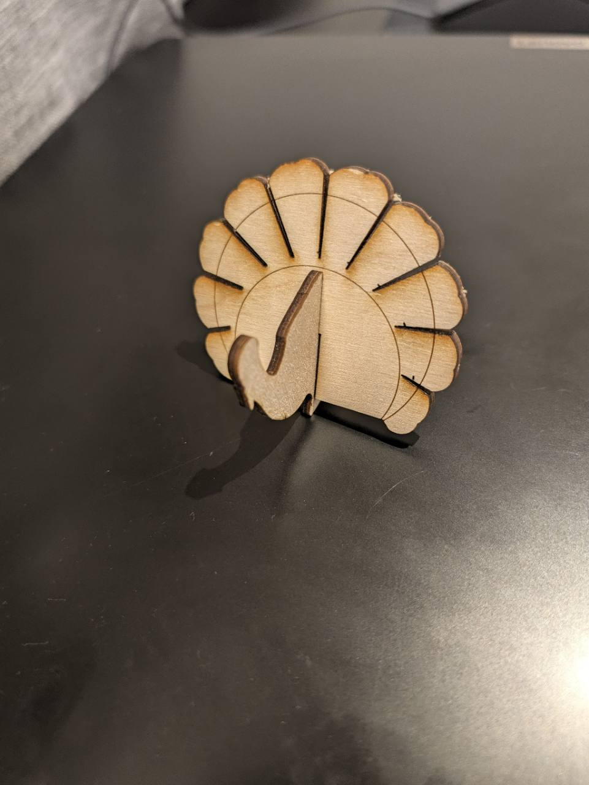

```{=html}
<div class="bs-laser-shell" data-laser-library data-catalog="../../assets/laser-library/catalog.json">
  <p class="bs-laser-back"><a href="../index.qmd">← General materials</a> · <a href="index.qmd">Laser-cutting files and tools</a></p>

  <section class="bs-laser-hero">
    <div>
      <p class="bs-laser-kicker">General materials · Visual gallery</p>
      <p class="bs-laser-lead">Start with the picture. Browse organizer parts, stands, joints, French-cleat modules, calibration tools and themed shapes. Then open the reusable SVG and adapt it to the real material and object.</p>
      <div class="bs-laser-actions">
        <a class="bs-laser-button bs-laser-button-primary" href="#gallery">Browse all designs</a>
        <a class="bs-laser-button" href="../../design-fabrication/tools/tool-organizer-gallery/index.qmd">Finished organizer builds</a>
        <a class="bs-laser-button" href="index.qmd">Files, builders and testing guidance</a>
      </div>
    </div>
  </section>

  <section id="documented-projects" class="bs-laser-library-section" aria-labelledby="documented-projects-title">
    <div class="bs-laser-section-heading">
      <p class="bs-laser-kicker">Documented projects</p>
      <h2 id="documented-projects-title">Photos and source files together</h2>
      <p>These pages keep the finished object, supplied SVG, source attribution and material-fit cautions together. Each project has its own page.</p>
    </div>
    <div class="bs-laser-feature-grid bs-laser-project-grid">
      <article class="bs-laser-feature-card">
        <a href="turkey.qmd"></a>
        <div><p class="bs-laser-kicker">Built and photographed</p><h2>Standing turkey</h2><p>See two finished-build photos, download the supplied SVG and review the slot-fit caution from the original source.</p><a href="turkey.qmd">Open the turkey project →</a></div>
      </article>
      <article class="bs-laser-feature-card">
        <a href="headphone-stand.qmd"></a>
        <div><p class="bs-laser-kicker">Source file available</p><h2>3 mm headphone stand</h2><p>Inspect the supplied glue-free slot-fit layout and open the original design source. A finished-build photo has not yet been supplied.</p><a href="headphone-stand.qmd">Open the headphone stand project →</a></div>
      </article>
    </div>
  </section>

  <nav class="bs-laser-category-links" aria-label="Gallery shortcuts">
    <button type="button" data-laser-preset="type" data-laser-value="tool-holders">Tool organizers</button>
    <button type="button" data-laser-preset="type" data-laser-value="french-cleat">French-cleat parts</button>
    <button type="button" data-laser-preset="type" data-laser-value="project-components">Stands and joints</button>
    <button type="button" data-laser-preset="type" data-laser-value="themed-starters">Themed starters</button>
    <button type="button" data-laser-preset="type" data-laser-value="calibration">Calibration</button>
  </nav>

  <section id="gallery" class="bs-laser-library-section" aria-labelledby="gallery-title">
    <div class="bs-laser-section-heading">
      <p class="bs-laser-kicker">232 reusable visuals</p>
      <h2 id="gallery-title">Choose by shape and purpose</h2>
      <p>These are editable starting points, not verified finished products. Measure the real object and sheet material, then make a small test cut before a complete build.</p>
    </div>

    <div class="bs-laser-controls" data-laser-controls>
      <div class="bs-laser-search-row">
        <label class="bs-laser-search-label" for="laser-gallery-search">
          <span>Search the gallery</span>
          <input id="laser-gallery-search" type="search" placeholder="Try screwdriver, cleat, stand, snowflake…" autocomplete="off" data-laser-search>
        </label>
        <details class="bs-laser-filter-details" data-laser-filter-details>
          <summary>Filters <span class="bs-laser-filter-badge" data-laser-filter-count>0</span></summary>
          <div class="bs-laser-filter-panel">
            <p>Filters narrow the current gallery. Shortcut buttons above start a fresh view.</p>
            <div class="bs-laser-filter-grid">
              <label>Type<select data-laser-filter="type"><option value="">All types</option></select></label>
              <label>Shop<select data-laser-filter="shop"><option value="">All shops</option></select></label>
              <label>Technology Area<select data-laser-filter="technology"><option value="">All technology areas</option></select></label>
              <label>Function<select data-laser-filter="function"><option value="">All functions</option></select></label>
              <label>Geometry<select data-laser-filter="geometry"><option value="">All geometry</option></select></label>
              <label>Material<select data-laser-filter="material"><option value="">All materials</option></select></label>
              <label>Operation<select data-laser-filter="operation"><option value="">All operations</option></select></label>
              <label>Editor<select data-laser-filter="editor"><option value="">All editors</option></select></label>
              <label>Skill level<select data-laser-filter="level"><option value="">All levels</option></select></label>
              <label>Theme<select data-laser-filter="theme"><option value="">All themes</option></select></label>
            </div>
          </div>
        </details>
      </div>
      <div class="bs-laser-filter-footer">
        <p data-laser-count role="status" aria-live="polite">Loading gallery…</p>
        <button type="button" data-laser-clear hidden>Clear search and filters</button>
      </div>
    </div>

    <div class="bs-laser-card-grid" data-laser-grid></div>
    <p class="bs-laser-empty" data-laser-empty hidden>No designs match this combination. Try clearing a filter.</p>
    <button type="button" class="bs-laser-more" data-laser-more hidden>Show 48 more</button>
    <noscript><p class="bs-laser-empty">JavaScript is required for the searchable gallery. Open the files-and-tools page for direct downloads.</p></noscript>
  </section>
</div>

<script src="../../assets/laser-library.js?v=20261004-technology-areas" defer></script>
```
