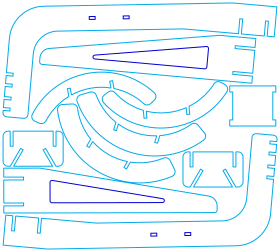

```{=html}
<div class="bs-laser-shell bs-laser-project-shell">
  <p class="bs-laser-back"><a href="gallery.qmd">← Laser-Cut Gallery</a> · <a href="../index.qmd">General materials</a></p>

  <div class="bs-laser-actions bs-laser-project-actions">
    <a class="bs-laser-button bs-laser-button-primary" href="../../assets/laser-gallery/headphone-stand-3mm-baltic-birch.svg" download>Download SVG</a>
    <a class="bs-laser-button" href="https://ragingcomputer.com/2021/06/28/glowforge-cut-headphone-stand-free-download/">Original source</a>
  </div>

  <figure class="bs-laser-project-figure bs-laser-project-figure--drawing">
    
  </figure>
  <p class="bs-laser-project-credit">3 mm Baltic birch design by Raging Computer. <a href="https://ragingcomputer.com/2021/06/28/glowforge-cut-headphone-stand-free-download/">Source</a>. Third-party file: not relicensed under the site’s CC BY-SA licence.</p>
</div>
```
