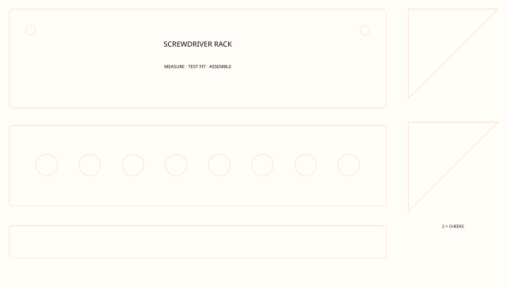
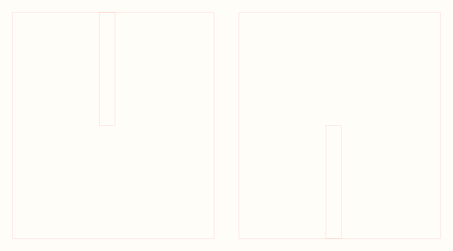
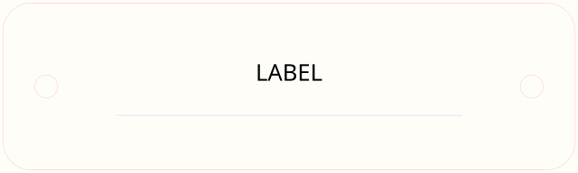

```{=html}
<div class="bs-laser-shell" data-laser-library data-catalog="../../assets/laser-library/catalog.json">
  <p class="bs-laser-back"><a href="../index.qmd">← General materials</a></p>

  <section class="bs-laser-hero">
    <div>
      <p class="bs-laser-kicker">Technology Commons · Tool organizer gallery</p>
      <p class="bs-laser-lead">Browse organizer ideas and reusable parts. The Plate Builder and Leg &amp; Support Builder are the two current interactive tools. The SVG catalogue provides starting points, not finished plans.</p>
      <div class="bs-laser-actions">
        <a class="bs-laser-button bs-laser-button-primary" href="../../design-fabrication/tools/tool-organizer-gallery/index.qmd">Open the organizer guide</a>
        <a class="bs-laser-button" href="../../design-fabrication/tools/plate-builder/index.qmd">Plate Builder</a>
        <a class="bs-laser-button" href="../../design-fabrication/tools/leg-builder/index.qmd">Leg &amp; Support Builder</a>
        <a class="bs-laser-button" href="#library">Browse SVGs</a>
      </div>
    </div>
  </section>

  <section class="bs-laser-feature-grid" aria-label="Featured tool-organizer ideas">
    <article class="bs-laser-feature-card">
      <a href="../../design-fabrication/tools/tool-organizer-gallery/index.qmd#grade-9-knife-holder-example"></a>
      <div><p class="bs-laser-kicker">Finished example</p><h2>Ergonomic knife holder</h2><p>See the photo, orthographic drawing, spacing decisions, and documented revisions.</p><a href="../../design-fabrication/tools/tool-organizer-gallery/index.qmd#grade-9-knife-holder-example">Study the example →</a></div>
    </article>
    <article class="bs-laser-feature-card">
      <a href="#library"></a>
      <div><p class="bs-laser-kicker">Organizer idea</p><h2>Screwdriver rack</h2><p>Use the SVG as a visual starting point, then change the holes and spacing for the real tools.</p><a href="#library">Browse holder SVGs →</a></div>
    </article>
    <article class="bs-laser-feature-card">
      <a href="../../design-fabrication/tools/leg-builder/index.qmd"></a>
      <div><p class="bs-laser-kicker">Interactive tool</p><h2>Legs and supports</h2><p>Create a stand or support after measuring the project and the actual sheet material.</p><a href="../../design-fabrication/tools/leg-builder/index.qmd">Open the builder →</a></div>
    </article>
    <article class="bs-laser-feature-card">
      <a href="../../design-fabrication/tools/plate-builder/index.qmd"></a>
      <div><p class="bs-laser-kicker">Interactive tool</p><h2>Plates and hole patterns</h2><p>Create a measured plate, ring, or repeated holder-hole pattern.</p><a href="../../design-fabrication/tools/plate-builder/index.qmd">Open the builder →</a></div>
    </article>
  </section>

  <nav class="bs-laser-category-links" aria-label="Featured SVG views">
    <button type="button" data-laser-preset="type" data-laser-value="tool-holders">Tool holders</button>
    <button type="button" data-laser-preset="type" data-laser-value="project-components">Project parts</button>
    <button type="button" data-laser-preset="type" data-laser-value="calibration">Calibration first</button>
    <button type="button" data-laser-preset="type" data-laser-value="core-geometry">Core geometry</button>
  </nav>

  <section id="library" class="bs-laser-library-section" aria-labelledby="library-title">
    <div class="bs-laser-section-heading">
      <p class="bs-laser-kicker">SVG starting points</p>
      <h2 id="library-title">Browse the idea gallery</h2>
      <p>Use the pictures to find a useful part or organizer idea. Measure the real tools and material before cutting.</p>
    </div>

    <div class="bs-laser-controls" data-laser-controls>
      <div class="bs-laser-search-row">
        <label class="bs-laser-search-label" for="laser-search">
          <span>Search titles, tags, tools and geometry</span>
          <input id="laser-search" type="search" placeholder="Try animals, kerf, socket, 50 mm…" autocomplete="off" data-laser-search>
        </label>
        <details class="bs-laser-filter-details" data-laser-filter-details>
          <summary>Filters <span class="bs-laser-filter-badge" data-laser-filter-count>0</span></summary>
          <div class="bs-laser-filter-panel">
            <p>Filters narrow the current search. Preset buttons above always start a fresh view.</p>
            <div class="bs-laser-filter-grid">
              <label>Type<select data-laser-filter="type"><option value="">All types</option></select></label>
              <label>Shop<select data-laser-filter="shop"><option value="">All shops</option></select></label>
              <label>Technology Area<select data-laser-filter="technology"><option value="">All technology areas</option></select></label>
              <label>Function<select data-laser-filter="function"><option value="">All functions</option></select></label>
              <label>Geometry<select data-laser-filter="geometry"><option value="">All geometry</option></select></label>
              <label>Material<select data-laser-filter="material"><option value="">All materials</option></select></label>
              <label>Operation<select data-laser-filter="operation"><option value="">All operations</option></select></label>
              <label>Editor<select data-laser-filter="editor"><option value="">All editors</option></select></label>
              <label>Skill level<select data-laser-filter="level"><option value="">All levels</option></select></label>
              <label>Theme<select data-laser-filter="theme"><option value="">All themes</option></select></label>
            </div>
          </div>
        </details>
      </div>
      <div class="bs-laser-filter-footer">
        <p data-laser-count role="status" aria-live="polite">Loading catalogue…</p>
        <button type="button" data-laser-clear hidden>Clear search and filters</button>
      </div>
    </div>

    <div class="bs-laser-card-grid" data-laser-grid></div>
    <p class="bs-laser-empty" data-laser-empty hidden>No assets match this combination. Try clearing a filter.</p>
    <button type="button" class="bs-laser-more" data-laser-more hidden>Show 48 more</button>
    <noscript><p class="bs-laser-empty">JavaScript is required for the searchable catalogue. The complete SVG bundle remains available above.</p></noscript>
  </section>

  <section class="bs-laser-guides" aria-label="Editor and fabrication guidance">
    <article>
      <p class="bs-laser-kicker">Primary editor</p>
      <h2>Inkscape checklist</h2>
      <ol>
        <li>Open the SVG at 100%; do not scale on import.</li>
        <li>Confirm document and display units are millimetres.</li>
        <li>Measure a known feature with the Measure tool.</li>
        <li>Inspect CUT (red), SCORE (blue) and ENGRAVE (black) geometry.</li>
        <li>Remove overlapping lines after combining or duplicating shapes.</li>
        <li>Save an editable copy and run a small physical test.</li>
      </ol>
      <p>Text is not used for structural geometry. If engraved typography must look exact on another computer, convert a copy to paths after editing.</p>
    </article>
    <article id="veccy-guidance">
      <p class="bs-laser-kicker">Parametric browser option</p>
      <h2>Veccy: change variables, not copies</h2>
      <p>Use the curated recipes for circles, rings, slots, fit gauges, module faces, racks, frames, stands and joinery. Define meaningful variables such as <code>material_thickness</code>, <code>clearance</code>, <code>count</code>, <code>diameter</code>, <code>spacing</code>, <code>width</code> and <code>height</code>, then reference them in feature expressions.</p>
      <div class="bs-laser-actions">
        <a class="bs-laser-button bs-laser-button-primary" href="https://veccy.app/">Open Veccy</a>
        <a class="bs-laser-button" href="../../assets/laser-library/veccy-recipes.json">View 20 recipes</a>
      </div>
      <p>Export SVG, open it in Inkscape, confirm millimetres and physical size, then test-cut. Vectorpea is a compatibility target, not the primary workflow.</p>
    </article>
  </section>

  <section class="bs-laser-test-batch" aria-labelledby="test-batch-title">
    <p class="bs-laser-kicker">Physical verification</p>
    <h2 id="test-batch-title">First shop test batch</h2>
    <p>Cut the dimension sheet, circle/hole tests, fit gauge, one French-cleat sample, one removable holder, one stand and one joint. Record stock measurements, machine settings, actual dimensions, selected fit, assembly result and changes. Only then advance an asset from <code>unverified</code> to <code>dimension-tested</code>, <code>fit-tested</code> or <code>shop-tested</code>.</p>
  </section>
</div>

<script src="../../assets/laser-library.js?v=20261004-technology-areas" defer></script>
```
