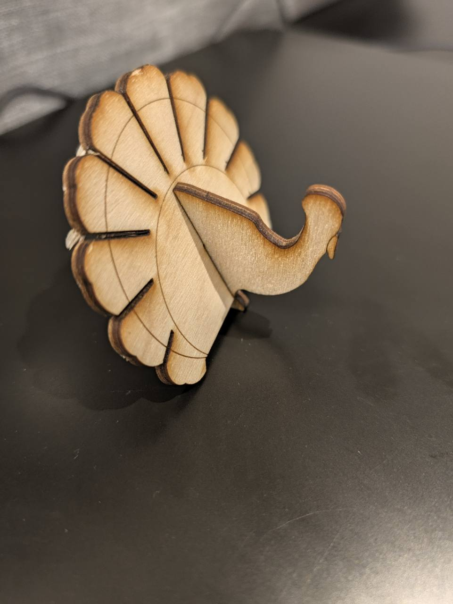

```{=html}
<div class="bs-laser-shell bs-laser-project-shell">
  <p class="bs-laser-back"><a href="gallery.qmd">← Laser-Cut Gallery</a> · <a href="../index.qmd">General materials</a></p>

  <div class="bs-laser-actions bs-laser-project-actions">
    <a class="bs-laser-button bs-laser-button-primary" href="../../assets/laser-gallery/turkey.svg" download>Download SVG</a>
    <a class="bs-laser-button" href="https://community.glowforge.com/t/thanksgiving-turkey-box/119792">Original source</a>
  </div>

  <figure class="bs-laser-project-figure">
    
  </figure>

  <figure class="bs-laser-project-figure">
    
  </figure>
  <p class="bs-laser-project-credit">Design by h.suber. <a href="https://community.glowforge.com/t/thanksgiving-turkey-box/119792">Source</a>. Third-party file: not relicensed under the site’s CC BY-SA licence.</p>
</div>
```
