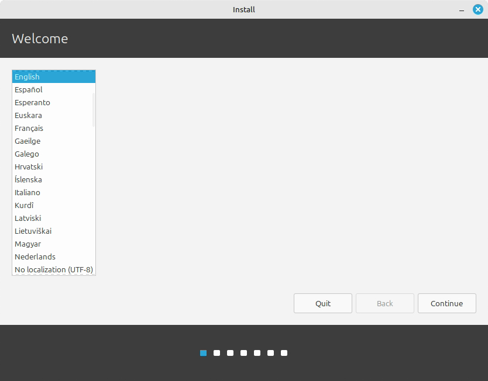
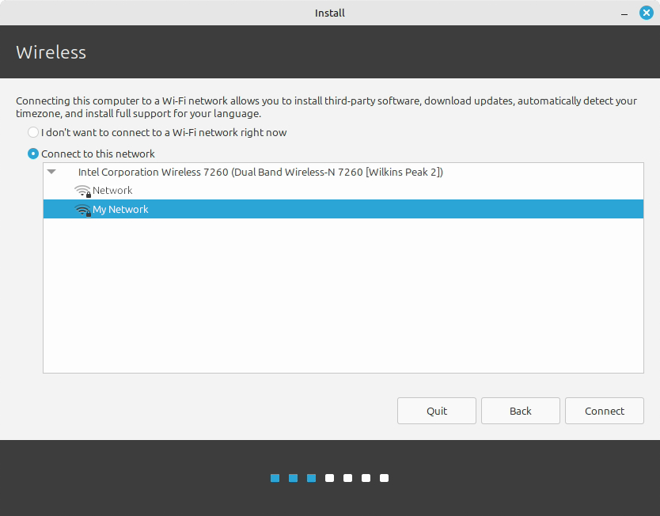
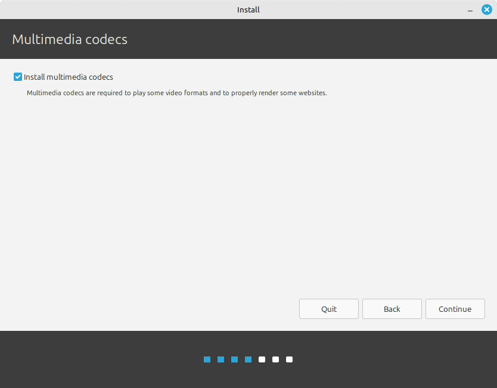
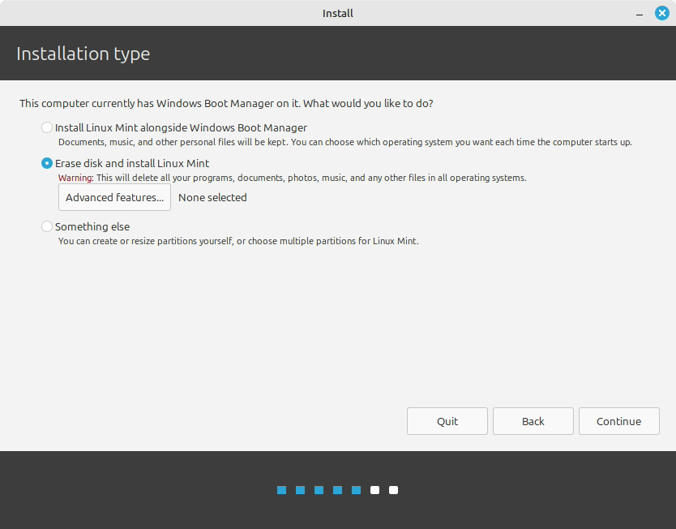
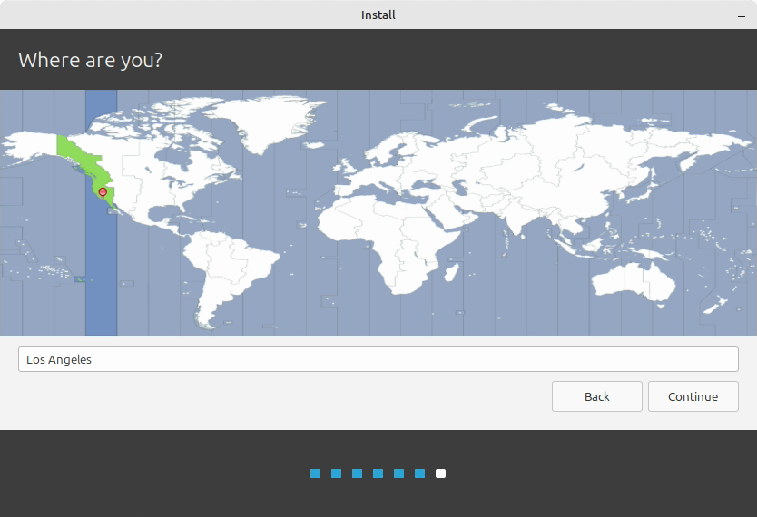
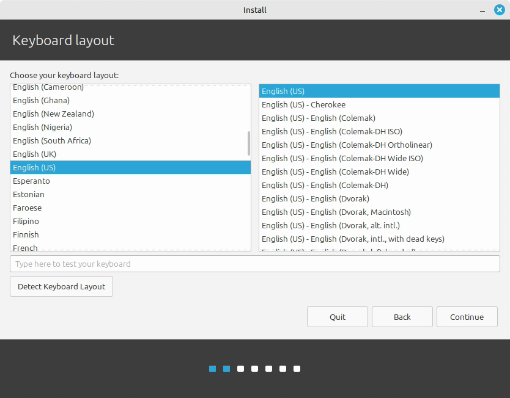
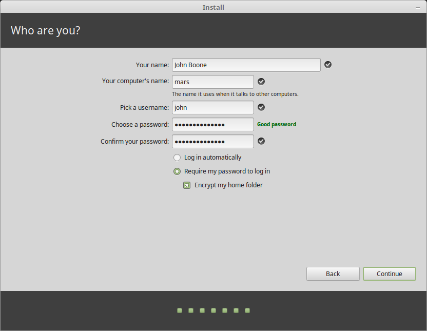
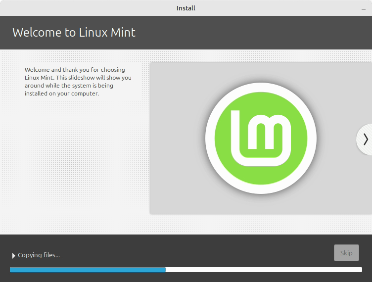
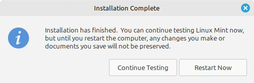

Linux Mint is a Linux operating system that usually **just works** and is easy for new users. We are installing **Linux Mint 22.3 “Zena” Xfce Edition**. Xfce has a familiar, classic Windows-like layout and uses fewer system resources, which makes it a good fit for our older computers with less than 8 GB of RAM.

::: {.callout-danger title="This lab erases the computer"}
Choose **Erase disk and install Linux Mint** only on the classroom computer assigned by your teacher. This deletes Windows, accounts, programs, and every file on the selected drive. Stop and ask your teacher before continuing if you are not certain that the computer and drive are approved.
:::

This classroom guide is adapted from the [official Linux Mint Installation Guide](https://linuxmint-installation-guide.readthedocs.io/en/latest/install.html). The installer screenshots come from that guide. Screens can change slightly between releases, and the example names or checkboxes shown in a screenshot may not match our required classroom settings. **Follow the written choices on this page.**

## Before you begin

You need:

- the assigned classroom computer;
- the Linux Mint 22.3 “Zena” Xfce USB installer supplied in class;
- the classroom Wi-Fi credentials; and
- the editable [Linux Mint Installation Digital Submission Google Doc](https://docs.google.com/document/d/120xWMTjO7YDA8XPMSy9Cy5rLjfBZixSiIRb3AvZQn_w/edit?usp=drivesdk). The [website preview](install-linux-mint-submission.qmd) explains the same deliverables.

Disconnect any personal USB drives or external storage. Have the teacher confirm the target computer before you erase anything.

### How the installer USB was prepared

Your teacher, with help from students, prepared the installer before this lab:

1. Download the Linux Mint 22.3 Xfce `.iso` file from the official Linux Mint website.
2. Verify the downloaded image when possible.
3. Insert an empty USB drive. Creating the installer erases that USB drive.
4. Use [balenaEtcher](https://etcher.balena.io/) to select the image, select the correct USB drive, and flash it.
5. On Windows, [Rufus](https://rufus.ie/) is another good tool for creating a bootable USB from an ISO image.
6. Test the installer on one classroom computer before preparing the remaining computers.

See the official Linux Mint instructions for [creating bootable media](https://linuxmint-installation-guide.readthedocs.io/en/latest/burn.html). Sign out an installer USB from your teacher. Do not create or erase installation media without approval.

::: {.callout-note title="Dual boot uses different instructions"}
This classroom lab erases an approved computer. Do not follow these erase instructions when keeping Windows or macOS. A dual-boot setup needs free space, a backup, careful partition selection, and a recovery plan. Install Windows before Linux when both systems share a drive. Some UEFI computers are easier to maintain when each operating system uses a separate physical drive, but this depends on the computer. Search the exact model and follow model-specific documentation before changing partitions or boot settings.
:::

### Working at home: Windows and Mac options

In class, we are installing Linux Mint directly on approved classroom computers. Do not erase or dual boot a family computer for this course.

If you use Windows 11 or a supported Windows 10 computer at home, the recommended option is **Windows Subsystem for Linux 2 (WSL 2) with Ubuntu**. It gives you a real Linux command line without replacing Windows. Ask the computer owner for permission because installation requires administrator access and may require a restart.

1. Open **PowerShell as Administrator**.
2. Run:

```powershell
wsl --install
```

3. Restart Windows if asked.
4. Open **Ubuntu** from the Start menu.
5. Create a private Linux username and password. The password will not appear while you type it.
6. Return to PowerShell and verify the installation:

```powershell
wsl --list --verbose
wsl --status
```

If WSL is already installed but Ubuntu is missing, run `wsl --list --online`, then `wsl --install -d Ubuntu`. Never use `wsl --unregister` for this course because it permanently deletes that WSL distribution and its files. Follow the official [Microsoft WSL installation guide](https://learn.microsoft.com/windows/wsl/install) if your screen differs.

On a Mac, use the built-in **Terminal** for transferable work such as files, Git, Quarto, Python, and SSH. macOS is Unix-like, but it is not Linux. Complete Linux-specific hardware, package, permission, and administration activities on the classroom Linux computer or an approved remote Linux host. Apple's [Terminal User Guide](https://support.apple.com/guide/terminal/welcome/mac) is a useful reference.

## 1. Start the live system

Insert the Linux Mint USB drive and boot the computer from it.

- On an Intel iMac or Mac mini, restart and hold **Alt** or **Option** after power-on. Select the USB entry. It may appear as **EFI Boot**.
- On a typical Windows computer, use the model-specific boot-menu or BIOS/UEFI key. Common keys include **Delete**, **F12**, **F10**, **Esc**, or **F2**. Every computer differs, so search the exact make and model when the key is unknown.

Choose the normal **Start Linux Mint** option if a startup menu appears. Linux Mint first opens a **live session**: a temporary desktop running from the USB drive.

The live session may feel slower than the finished installation, and changes made there are not permanent. If the live session asks for a password, leave it blank and press **Enter**.

Double-click **Install Linux Mint** on the desktop.

## 2. Choose the language

Select **English**, then select **Continue**.

{fig-alt="Linux Mint installer language screen with English selected"}

## 3. Connect to the classroom Wi-Fi

Select the classroom network and connect using the Wi-Fi credentials given in class.

::: {.callout-warning title="Do not use guest Wi-Fi"}
Do **not** use the guest Wi-Fi. Use only the classroom Wi-Fi credentials provided by your teacher.
:::

{fig-alt="Linux Mint installer wireless network selection screen"}

## 4. Install multimedia codecs

Check **Install multimedia codecs**, then select **Continue**. Codecs help the computer play common audio and video formats.

{fig-alt="Linux Mint installer option to install multimedia codecs"}

## 5. Choose the installation type

Select **Erase disk and install Linux Mint**.

- Leave **Advanced features** at its default setting with **None selected**. We can explore advanced storage settings in a later lab.
- Do **not** select an encryption option for this classroom installation.
- Do **not** select **Something else**.
- Do **not** select an “install alongside” option in this lab.

{fig-alt="Linux Mint installation type screen with Erase disk and install Linux Mint selected"}

Select **Install Now** or **Continue**, depending on the wording shown. Read the drive-change summary, confirm that it refers to the approved classroom drive, and then continue.

In a future lab, we will install another operating system alongside Windows and create a **dual-boot** computer. That is not today’s task.

## 6. Set the time zone

Choose **Toronto**, then select **Continue**.

{fig-alt="Linux Mint installer time zone screen"}

## 7. Set the keyboard layout

Choose **English (US)** for the keyboard layout. Do **not** choose English (Canadian). Use the test box to check a few letters, numbers, and punctuation marks, then select **Continue**.

{fig-alt="Linux Mint installer keyboard layout screen"}

## 8. Create the classroom account

Enter the following settings exactly, except for the computer name:

| Installer field | Classroom setting |
|:--|:--|
| Your name | `min` |
| Your computer's name | Create a unique, school-appropriate name |
| Pick a username | `min` |
| Choose a password | `pcss` |
| Confirm your password | `pcss` |
| Login choice | **Require my password to log in** |
| Encrypt my home folder | **Leave unchecked** |

Use only lowercase letters, numbers, and hyphens in the computer name, with no spaces. A name such as `min-tej-14` is clear and easy to record. Your name must be unique in the classroom.

::: {.callout-important title="Use the table, not the sample data in the screenshot"}
The official screenshot shows example names and shows home-folder encryption selected. For this lab, use `min`, your unique computer name, the classroom password, **Require my password to log in**, and **do not encrypt the home folder**. The password `pcss` is for this classroom image only; never reuse it for a personal account.
:::

{fig-alt="Linux Mint installer user account screen"}

Select **Continue** to begin the installation.

## 9. Explore safely while the installer works

The installation slideshow will run while files are copied.

{fig-alt="Linux Mint installation slideshow while files are copied"}

Without closing the installer:

1. Open the web browser.
2. Visit the [TEJ Notes website](https://andrewandrade.ca/tech-edu-resources/tej3-4/) and record whether it loads.
3. Open the main menu and find the **Software Manager**, Linux Mint's "app store." Search for `games` and record one school-appropriate game or application in your Google Doc.
4. Find the File Manager and Terminal icons. You do not need to run commands yet.

Software installed during the live session may disappear after restart, so wait until the finished system starts before installing your chosen application.

## 10. Restart into the installed system

When the installer reports that it is finished, select **Restart Now**.

{fig-alt="Linux Mint installation complete screen with Restart Now"}

Remove the USB drive when the computer asks, then press **Enter**. Log in as `min` using the classroom password `pcss`.

## 11. Test the new installation

1. Open the browser and confirm that the [TEJ Notes website](https://andrewandrade.ca/tech-edu-resources/tej3-4/) still loads.
2. Open **Software Manager** from the main menu.
3. Search for `games` or search for the application you recorded earlier.
4. With teacher approval, install one school-appropriate game or useful application. Record its exact name in your Google Doc.
5. Open the application once to confirm that it works.

If you finish early, choose one optional challenge:

- change the desktop wallpaper or panel appearance without hiding essential controls;
- find the system-information screen and record the computer’s RAM;
- take a screenshot of your finished desktop;
- find one accessibility setting that could make the computer easier for someone to use; or
- compare the Linux desktop with Windows and list one similarity and one difference.

## Google Classroom submission

Complete the editable [Linux Mint Installation Digital Submission Google Doc](https://docs.google.com/document/d/120xWMTjO7YDA8XPMSy9Cy5rLjfBZixSiIRb3AvZQn_w/edit?usp=drivesdk). You can also read the [website preview of the handout](install-linux-mint-submission.qmd).

Submit **one Google Doc** in Google Classroom. The submission page gives you the exact file name, required headings, screenshot, reflection questions, final checklist, and **Above and beyond** section.

Show the installed system to your teacher before you leave.

## Extend your learning

- Review the [Linux Start Here class slides](https://docs.google.com/presentation/d/1V9VzFkTGhEyKs5TszsuZV96xya5k-zvfEx8qGKjgbzM/edit) for the distribution, installation, WSL, account, and Bashcrawl sequence.
- Visit the [Linux Mint documentation](https://linuxmint.com/documentation.php) to explore official desktop and system guides.
- Explore the school-appropriate [Learn Linux TV YouTube channel](https://www.youtube.com/@LearnLinuxTV) for beginner Linux demonstrations. Choose a beginner video and record one new idea in the **Above and beyond** section of your Google Doc.
- Try the [Ubuntu command-line tutorial](https://documentation.ubuntu.com/desktop/en/latest/tutorial/the-linux-command-line-for-beginners/) when you are ready to move beyond the desktop.

## Sources and image credit

- [Linux Mint Installation Guide: Install Linux Mint](https://linuxmint-installation-guide.readthedocs.io/en/latest/install.html)
- [Linux Mint 22.3 “Zena” editions](https://linuxmint.com/download.php/)
- [Linux Mint FAQ: use of Linux Mint screenshots](https://www.linuxmint.com/faq.php)

Linux Mint project screenshots are reproduced for this educational installation guide. This site is not affiliated with or endorsed by Linux Mint.

