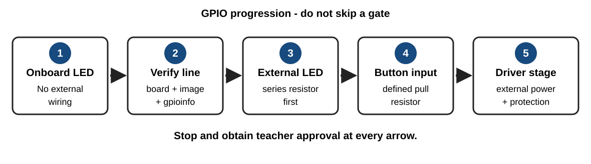
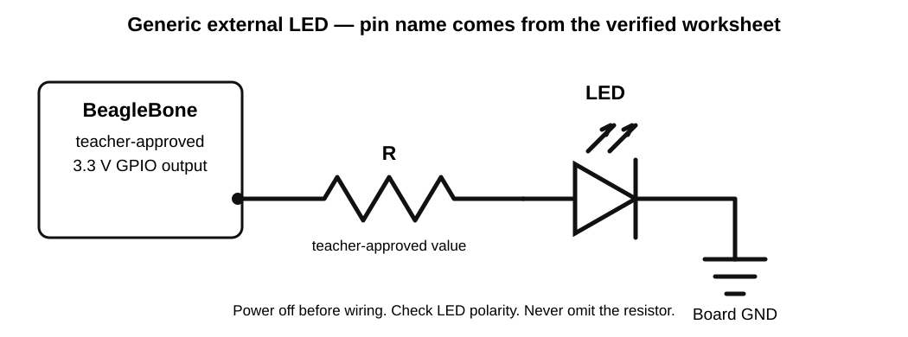
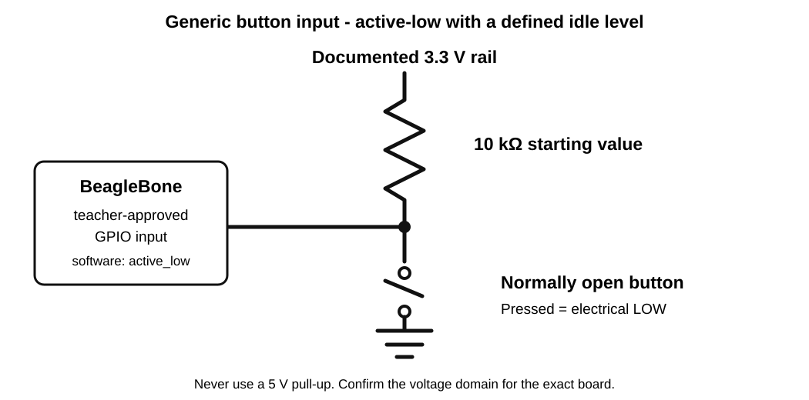
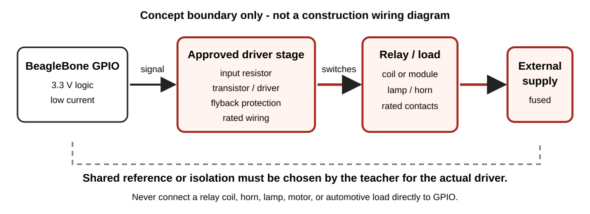

GPIO work is released in small gates. Passing a software test does not approve
wiring, and a physically correct-looking header does not prove its pin mapping.

{fig-alt="Five large numbered boxes joined by straight arrows, with teacher approval required at every arrow." width="100%"}

## Gate 1: inspect an onboard LED

Linux exposes available LED devices through `/sys/class/leds`. List what the
current board actually reports:

```sh
python3 -m tej_platform.onboard_led --list
```

The teacher selects an appropriate device name. Then run:

```sh
python3 -m tej_platform.onboard_led --name TEACHER_APPROVED_NAME
```

The script records the original trigger and brightness, blinks briefly, and
attempts to restore the original state. Stop if permission is denied; do not add
`sudo` by habit.

## Gate 2: verify one proposed header line

With no external circuit connected, the teacher records:

- exact board model and revision;
- current Linux image and kernel;
- header name and physical pin number;
- voltage domain and pinmux function;
- `/dev/gpiochipN` and reported line name or offset;
- whether another driver already uses the line;
- the result after a reboot.

`gpioinfo` reports current kernel line information. BeagleBoard's
[GPIO mapping guide](https://docs.beagleboard.org/books/beaglebone-cookbook/02sensors/sensors.html#mapping-header-numbers-to-gpio-numbers)
shows the inspection method, but its example output is not permission to reuse
that example pin.

## Gate 3: one resistor-limited LED

Use the board's documented logic supply, a teacher-approved GPIO, an LED, and a
series resistor. For a first estimate with a 3.3 V output, 2.0 V red LED model,
and 1.0 kΩ resistor:

$$
I\approx\frac{3.3\,\mathrm{V}-2.0\,\mathrm{V}}{1000\,\Omega}=1.3\,\mathrm{mA}.
$$

That calculation does not prove the selected GPIO's drive limit, the real LED
voltage, or the wiring. Check the exact board documentation and measure the
resistor voltage after teacher approval. The GPIO is for signalling; it is not a
power supply for a load.

{fig-alt="Schematic with a BeagleBone GPIO output, resistor, LED, and ground connected in one uncrossed series path." width="100%"}

This is an original schematic redrawn from the standard series circuit taught
in the official BeagleBoard Cookbook's
[external LED lesson](https://docs.beagleboard.org/books/beaglebone-cookbook/03displays/displays.html#toggling-an-external-led).
Unlike that worked example, it deliberately omits a header-pin number. The
teacher supplies the verified pin and resistor value for the actual board.

## Gate 4: one biased button

A common protected pattern uses an external pull-up from the selected GPIO input
to the board's documented 3.3 V rail and a normally open button from the input
to ground. Pressed is then logically active but electrically low. A typical
starting pull-up may be 10 kΩ, subject to the exact board and circuit check.

The software adapter uses `active_low: true` so project code receives
`trigger=True` when the button is pressed. Do not use an external 5 V pull-up.

{fig-alt="Schematic with a 3.3 volt rail, pull-up resistor, GPIO input node, normally open button, and ground." width="100%"}

This original diagram adapts the passive-switch idea in the official
[BeagleBoard button lesson](https://docs.beagleboard.org/books/beaglebone-cookbook/02sensors/sensors.html#reading-the-status-of-a-pushbutton-or-magnetic-switch-passive-on-off-sensor)
while making the pull resistor and active-low behaviour explicit. It is a
generic pattern, not a verified header mapping.

## Gate 5: configure, do not hard-code

Copy `gpio-config.example.json`. Replace its placeholders only from the approved
header worksheet. The current adapter uses the documented libgpiod 2.x
`request_lines` and `LineSettings` API. It refuses a placeholder or incompatible
older binding.

## Voltage and load limits

::: {.callout-warning title="BeagleBone Black boundaries"}
The BeagleBone Black connector documentation identifies 3.3 V signals and warns
that 5 V logic can damage the board. Its analogue inputs have a 1.8 V maximum.
Do not apply a voltage to I/O while the board is unpowered. Check other models
separately.
:::

Relay coils, horns, lamps, motors, and many buzzers require a driver, protection,
and an external supply. This platform only exposes a logical `relay` output; the
project's approved driver circuit performs the electrical work.

{fig-alt="Four large blocks show BeagleBone GPIO, an approved protected driver, a relay or load, and a fused external supply. It is labelled as a concept, not a wiring diagram." width="100%"}

The driver figure is intentionally a block diagram rather than a construction
schematic. Component ratings, flyback protection, isolation or shared ground,
wire size, fuse, relay contacts, and supply must be selected for the actual
load before a horn, lamp, motor, or automotive relay is connected.

## Clean stop test

1. Run with the high-current load disconnected.
2. Activate each logical output.
3. Press `Ctrl+C`.
4. Verify the GPIO adapter sets every controlled output inactive.
5. Reconnect an approved load only after the driver-side test passes.

The official [BeagleBone Black connector documentation](https://docs.beagleboard.org/boards/beaglebone/black/ch07.html)
is the authority for the board-specific warnings, not this summary.

## Diagram references

The drawings on this page are original and were checked against these official
sources rather than copied from a textbook figure:

- [BeagleBoard Cookbook: displays and external LEDs](https://docs.beagleboard.org/books/beaglebone-cookbook/03displays/displays.html)
- [BeagleBoard Cookbook: passive switch inputs and GPIO mapping](https://docs.beagleboard.org/books/beaglebone-cookbook/02sensors/sensors.html)
- [BeagleBone Black expansion connector warnings](https://docs.beagleboard.org/boards/beaglebone/black/ch07.html)
- [BeagleBone Black voltage domains](https://docs.beagleboard.org/boards/beaglebone/black/ch04.html)
