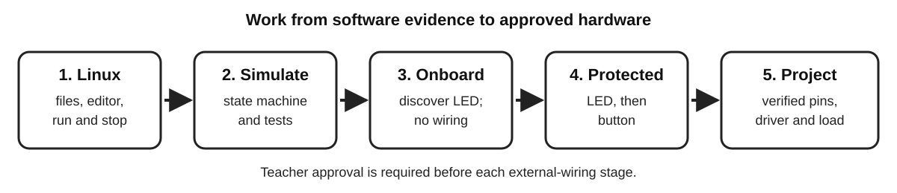

This platform separates the part that decides **what should happen** from the
part that touches physical pins. The same tested Python controllers can run with
terminal commands, automated tests, or a teacher-verified BeagleBone adapter.

{fig-alt="Five left-to-right boxes labelled Linux, Simulate, Onboard, Protected, and Project, with teacher approval required before external wiring." width="100%"}

The diagram is an original course drawing. Its staged hardware progression is
informed by the official BeagleBoard Cookbook lessons on
[onboard and external LEDs](https://docs.beagleboard.org/books/beaglebone-cookbook/03displays/displays.html).

## Required order

1. [Use Linux and run Python](linux-introduction.qmd).
2. Run the alarm and traffic-light software without hardware.
3. [Progress from an onboard LED to approved external GPIO](gpio-progression.qmd).
4. [Use the shared software contract](software-platform.qmd).
5. [Log and graph events](data-extension.qmd).
6. Connect a project only after its schematic, pin worksheet, and power-off
   inspection are approved.

::: {.callout-warning title="No remembered pin numbers"}
Do not copy a header pin from another board, an old image, or an Internet
example. The teacher verifies the exact board, Linux image, pinmux, gpiochip, and
line before a student configuration is released.
:::

## Safety boundary

- BeagleBone Black expansion signals are 3.3 V unless specifically documented
  otherwise. Its analogue inputs have a 1.8 V maximum. Other BeagleBone models
  must be checked separately.
- Never connect 5 V logic to a 3.3 V GPIO.
- Never drive a relay coil, lamp, horn, buzzer, or motor directly from GPIO.
- A resistor-limited LED and biased button come before any load driver.
- Stop code cleanly, make outputs inactive, shut Linux down normally, and only
  then remove power.

These limits follow the official [BeagleBone Black overview](https://docs.beagleboard.org/boards/beaglebone/black/ch04.html)
and [connector warnings](https://docs.beagleboard.org/boards/beaglebone/black/ch07.html).

## Downloads

- [Python platform README](../../../assets/tej-capstone/python/README.md)
- [Terminal simulator](../../../assets/tej-capstone/python/simulate.py)
- [Example GPIO configuration](../../../assets/tej-capstone/python/gpio-config.example.json)
- [Synthetic sample data](../../../assets/tej-capstone/data/README.md)

The example GPIO configuration is intentionally incomplete. It must fail until
its placeholders are replaced with teacher-verified values.
