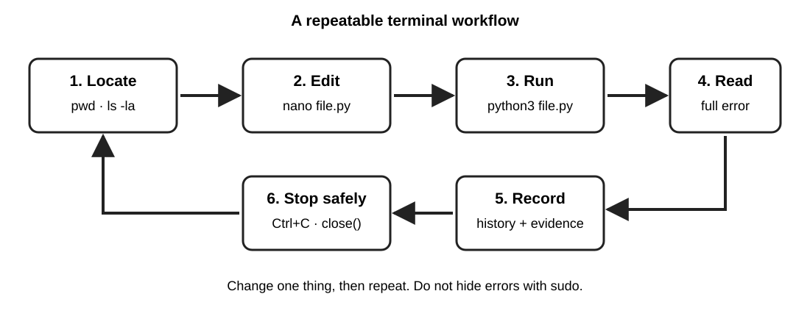

## Learning goals

- I can identify my location and files in a Linux terminal.
- I can create, copy, rename, inspect, and edit project files.
- I can run and stop Python safely.
- I can preserve the command and error evidence needed to get help.

{fig-alt="A six-step rectangular workflow for locating files, editing, running Python, reading errors, recording evidence, and stopping safely." width="100%"}

## Sign in and identify the system

Use only the teacher-provided account. Do not change another account, system
password, network configuration, or installed packages.

```sh
whoami
pwd
uname -a
python3 --version
```

Record what each command reports. `pwd` prints the working directory; it is not
a password command.

## Navigate without guessing

```sh
pwd
ls
ls -la
cd Documents
pwd
cd ..
```

Read the prompt and the output after every command. Use `cd ..` deliberately;
do not type paths copied from another student's screen.

## Create a protected project workspace

```sh
mkdir -p ~/tej-capstone
cd ~/tej-capstone
mkdir code data evidence
cp /teacher-approved/location/starter.py code/
mv code/starter.py code/controller.py
ls -la code
```

The `cp` source above is a placeholder. Use the exact teacher-provided location.
Do not overwrite an existing file until you know what it contains.

## Read and edit a small file

```sh
cat code/controller.py
nano code/controller.py
```

In Nano, `Ctrl+O` writes the file and `Ctrl+X` exits. Another approved editor is
fine, but keep the source as a plain `.py` file in the project folder.

## Run and stop Python

```sh
python3 code/controller.py
```

Use `Ctrl+C` to request a clean stop. A GPIO program must catch that stop,
deactivate outputs, and release the GPIO request. Closing a terminal or removing
power is not a substitute for program cleanup.

## Treat errors as evidence

When a command fails, keep:

1. the command you ran;
2. the complete error text;
3. `pwd` and `ls -la` output;
4. the Python version;
5. the smallest change you tried afterward.

Do not fix an error by adding `sudo`, changing permissions, or installing a
package unless the teacher approves the exact action.

## Save useful command history

```sh
history
history > evidence/terminal-history.txt
```

Review the file before submitting it. Remove commands that reveal private paths,
tokens, passwords, network details, or unrelated work. Never type a password on
the command line where history can record it.

## First software-only run

From the downloaded Python platform folder:

```sh
python3 -m unittest discover -s tests -v
python3 simulate.py alarm --log alarm-events.csv
```

The simulator must work before external wiring begins. Enter `arm`, allow the
configured delay to pass, enter `trigger`, then `silence` and `disarm`. Use
`quit` or `Ctrl+C` to stop.

## End the session

Save source and approved evidence. Stop running programs. Use the normal Linux
shutdown menu or teacher-approved shutdown command. The BeagleBoard guide
recommends an orderly shutdown to protect the microSD card or eMMC; see the
[official power-button guidance](https://docs.beagleboard.org/boards/beaglebone/black/ch05.html#power-button).

## Diagram source note

The workflow figure is an original course diagram. The shutdown step follows
BeagleBoard's official power-button and orderly-shutdown guidance linked above.
